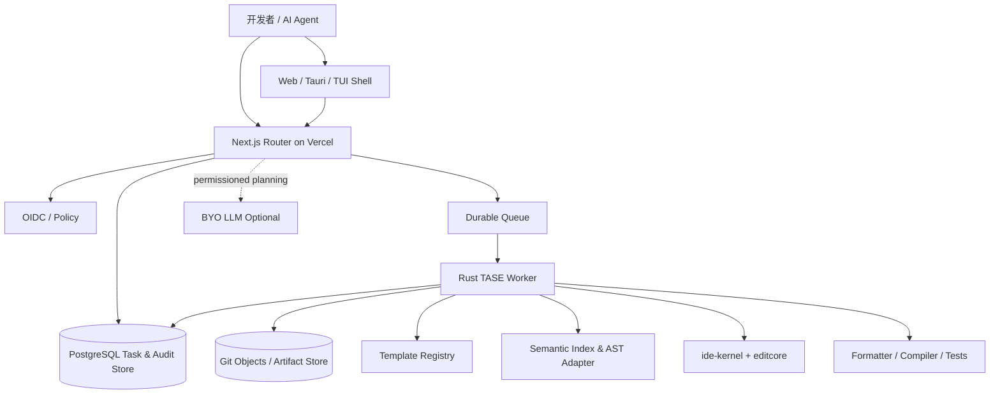
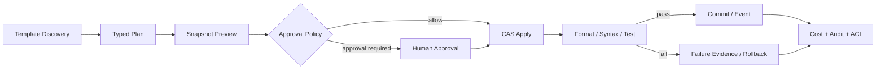
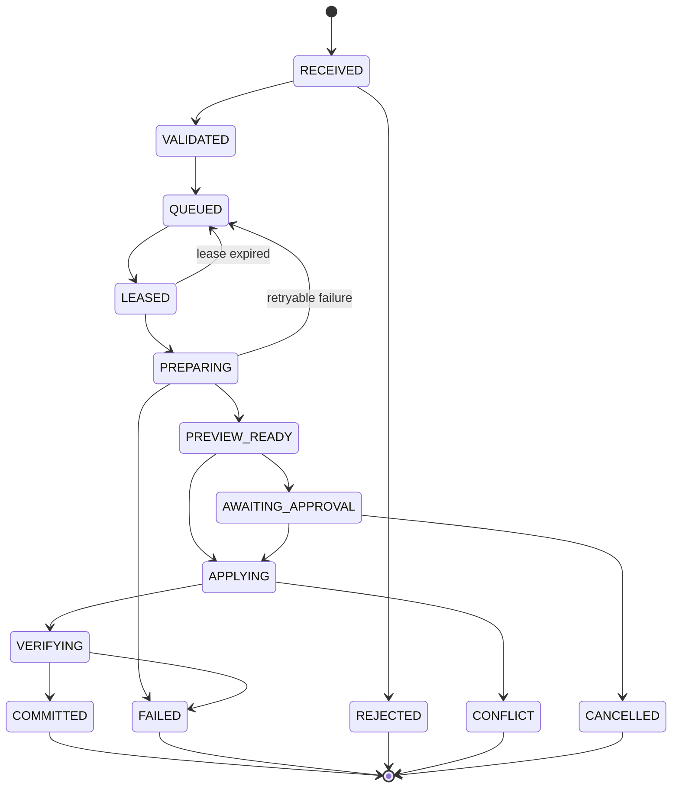
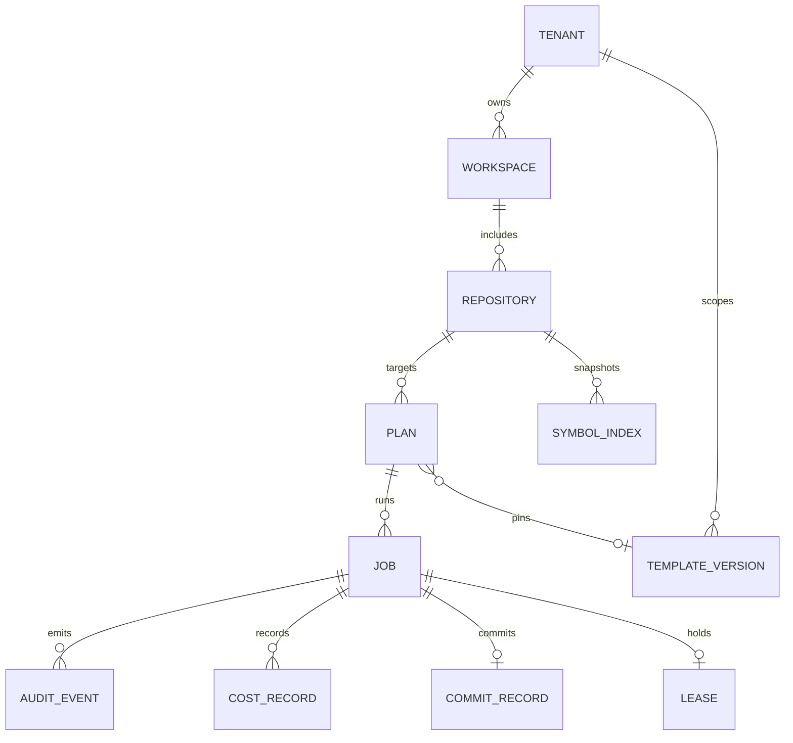
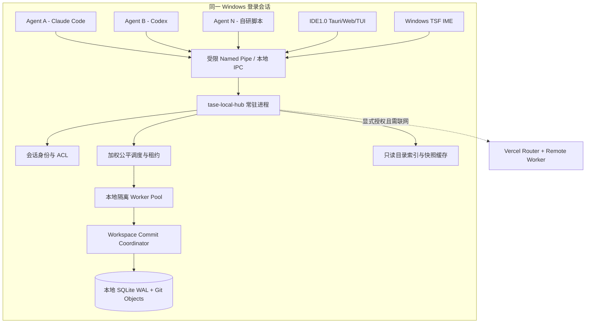
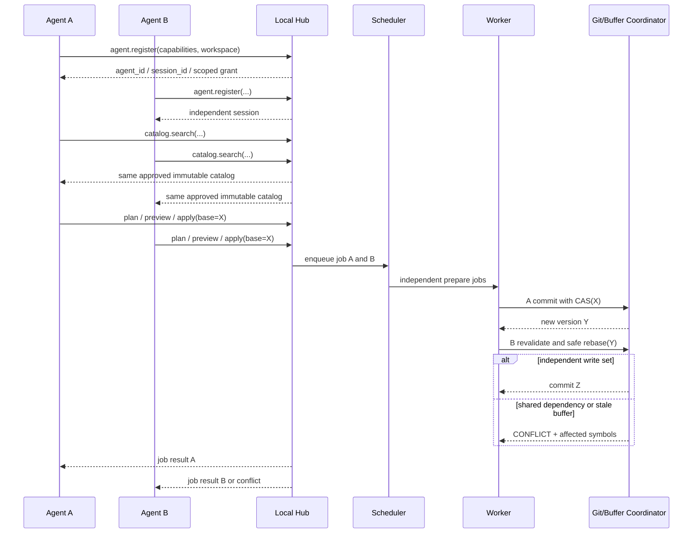
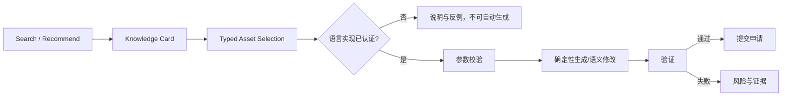
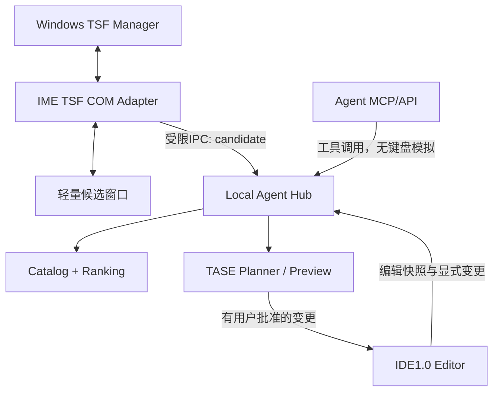

# IDE1.0 — TASE 模板感知语义执行系统：基本设计书

| 属性 | 内容 |
|---|---|
| 文档编号 | IDE-TASE-BD-001 |
| 版次 | 1.1 / 2026-11-05 |
| 状态 | 设计提案 |
| 上位输入 | `01_要件定义.md` |
| 下位输出 | `03_详细设计.md`、接口 Schema、测试设计 |
| 范围 | 云端与同机 Hub 双形态、统一知识资产、IME/Agent 接入、事务、资源与体验 |

## 1. 设计原则和约束（BD-ARCH）

1. **执行优于生成**：模型仅表达意图与最小必要自由代码；固定代码由模板实例化。
2. **计划与提交分离**：Plan 和 Preview 无正式副作用；Apply 通过 CAS 校验后提交。
3. **单一编辑内核**：所有正式文档变更经既有 `ide-kernel::Document::apply` 或其标准事务适配层，确保 undo/redo 与文档版本一致。
4. **保留现有协议**：增加 `tase.*` RPC 方法，适配 HTTP/WS/stdio；不破坏 `ide-shell-protocol` 的 Vim Buffer API。
5. **符号级准备，文件级线性化**：可同时计算多个符号变更；同一文件的落盘需要冲突检查及线性化序列。
6. **不可变工件**：版本化模板、Git 基线、预览差异、执行证据均按内容哈希引用。
7. **安全优先**：未经批准的源码不得传给 LLM；源代码生成与测试操作放入隔离 Worker。
8. **成本归因**：按每任务计算模型与 Worker 的完整费用，不把减少输出 Token 等同于总费用减少。

## 2. 系统边界

### 2.1 外部系统与交互对象

| 系统 | 输入 | 输出 | 信任边界 |
|---|---|---|---|
| 人类 / 多 Agent | 自然语言意图、模板条件、结构化 Plan | Diff、状态、成本、冲突证据 | API 身份认证 |
| IDE1.0 Web / Tauri / TUI | 用户事件、编辑会话 | 预览与最终代码 | 复用 Kernel 服务边界 |
| Vercel Router (Next.js) | REST / JSON-RPC、JWT / OIDC | 任务 ID、状态、事件流 | 公网入口；不直接改仓库 |
| Task Store / Queue | 不可变任务信息、幂等键、租约 | 状态转移与任务投递 | 持久化一致性边界 |
| Rust Worker | 模板工件、仓库快照、Plan | Patch、编译/测试证据、提交对象 | 沙箱与只读挂载边界 |
| Git Repository | Git refs / objects | 新树、提交 ID、审计版本 | CAS 更新 ref 的最终提交点 |
| LLM Provider（可选） | 最小必要上下文、可用模板清单 | 结构化计划 / 自由片段 | 外部网络/数据发送需授权 |

### 2.2 C4 容器关系



**部署决定**：Vercel 的无状态 Router 负责 REST 入口、鉴权、轻量 schema 校验与推送任务；长任务 Worker 运行于隔离的、可持久存取 Git 对象的环境。可选择 Vercel Queue 作为消息层，但由于其交付至少一次，应用自身必须以数据库作业状态和幂等键保证效果至多一次。Vercel 的函数最大执行时间等限制随计划和 runtime 更新，部署时以官方文档核对，不写死为产品逻辑。参考 <https://vercel.com/docs/queues/concepts>。

### 2.3 模块边界与新增 crate

| 组件 | 位置（建议） | 核心职责 | 复用/新增 |
|---|---|---|---|
| `ide-kernel` | 现有 crate | Document、Session、undo/redo、字符位置编辑 | 复用，增加事务适配 |
| `editcore` | 现有 crate | 文本、undo、range、encoding | 复用，不另建文本引擎 |
| `ide-shell-protocol` | 现有 crate | JSON-RPC / HTTP / WS / stdio | 扩展 `tase.*` dispatch |
| `tase-contract` | `crates/tase-contract` | API DTO、JSON Schema、版本、错误码 | 新增 |
| `tase-registry` | `crates/tase-registry` | 模板索引、内容哈希、许可/签名政策 | 新增 |
| `tase-planner` | `crates/tase-planner` | 意图策略、计划校验、上下文裁剪 | 新增 |
| `tase-semantic` | `crates/tase-semantic` | 语法树适配、符号索引、引用/影响面 | 新增 |
| `tase-executor` | `crates/tase-executor` | Preview / Apply / Rebase / Git CAS | 新增 |
| `tase-worker` | `crates/tase-worker` | 队列消费者、租约、沙箱、验证 | 新增 |
| `tase-metrics` | `crates/tase-metrics` | 成本、延迟、ACI、追踪和统计 | 新增 |
| `web-router` | Next.js App Router (部署包) | 身份鉴权、REST 映射、任务查询 | Web 侧新增 |

必须确保 CLI/Tauri 也可直接用本地 `tase-executor`，并不强制通过 Vercel；本机多 Agent 默认统一通过 `tase-local-hub` 仲裁，云部署采用相同核心 crate。

## 3. 业务功能结构



### 3.1 决策路由规则

| 特征 | 模式 | 适用任务 | 约束 |
|---|---|---|---|
| 模板完全匹配 + 参数充分 | Template | CRUD、DTO、Handler、固定测试脚手架 | 必须 pin digest；禁止任意命令插值 |
| 可确定符号定位 + 局部修改 | Semantic | 更新某函数/trait/import/属性 | 必须重新解析并验证作用范围 |
| 以上都不成立 | Freeform Patch | 复杂算法、新业务逻辑 | 只能输出受约束 diff，仍要版本校验与沙箱验证 |

**失败安全策略**：模板参数不合法不自动切换“自由生成”来绕过策略；仅明确有权限且重新形成计划时方可降级。语义锚点有多个同名候选时返回候选列表要求 disambiguate，不猜测第一个。

### 3.2 模板生命周期

`DRAFT → VALIDATED → APPROVED → ACTIVE → DEPRECATED → REVOKED`。模板发布之后内容 immutable；修复通过新版本。`REVOKED` 禁止新实例化，旧作业的恢复动作需按安全策略再次评估。审批后凭 `digest + template_version + engine_version` 重现结果。

### 3.3 作业状态机



作业中的 `PREVIEW_READY` 是提交之前的中间证据，不代表执行成功。已写入临时沙箱而未更新正式 Git ref 的任务，恢复时仍视为 NOT_COMMITTED。

## 4. 外部接口基本设计（BD-API）

### 4.1 协议总则

- 第一版 REST 基础路径：`/api/v1/tase`，所有写请求 `Content-Type: application/json`。
- JSON-RPC 2.0 方法名：`tase.template.search`、`tase.code.plan`、`tase.code.preview`、`tase.code.apply`、`tase.job.get`、`tase.job.cancel`、`tase.metrics.get`。
- Router 可将 REST 映射到同一 Contract DTO；CLI/stdio/WS 直接执行 JSON-RPC。方法体和错误语义一致。
- 请求头包含 `Authorization: Bearer <token>`、`Idempotency-Key`（有副作用的操作必填）、`X-Request-ID`（可选，不可信仅作追踪）。
- 所有对象有 `contract_version`；`v1` 不允许未知必需字段的静默解释，版本不兼容返回 `UNSUPPORTED_VERSION`。

### 4.2 API 一览

| REST | RPC | 副作用 | 响应 |
|---|---|---|---|
| `GET /templates` | `tase.template.search` | 无 | 模板摘要、参数模式 URI、digest |
| `POST /plans` | `tase.code.plan` | 仅计划记录 | `plan_id`、模式、目标与风险 |
| `POST /previews` | `tase.code.preview` | 仅快照/工件 | `preview_id`、diff、checks、影响集 |
| `POST /applications` | `tase.code.apply` | 修改/提交 | `job_id`，202 接受异步处理 |
| `GET /jobs/{id}` | `tase.job.get` | 无 | 状态、证据、commit、错误 |
| `POST /jobs/{id}/cancel` | `tase.job.cancel` | 更改作业状态 | 可取消/不可取消的明确状态 |
| `GET /metrics` | `tase.metrics.get` | 无 | 成本、时间、成功率分组 |

### 4.3 错误码约定

| 业务码 | HTTP | 场景 | 可重试 |
|---|---:|---|---|
| `INVALID_ARGUMENT` | 400 | schema / 参数无效 | 纠正后 |
| `UNAUTHENTICATED` | 401 | 无有效凭证 | 重新认证 |
| `PERMISSION_DENIED` | 403 | 租户/仓库/分支权限不足 | 否 |
| `NOT_FOUND` | 404 | 模板/符号/作业不存在 | 否 |
| `IDEMPOTENCY_MISMATCH` | 409 | 同 Key 请求摘要不同 | 否 |
| `STALE_BASE` | 409 | 基线 Git commit 不匹配 | 重新计划 |
| `SYMBOL_CONFLICT` | 409 | 符号/共享依赖变更冲突 | 重新计划 |
| `POLICY_REJECTED` | 422 | 模板/危险操作被策略拒绝 | 审批后 |
| `VALIDATION_FAILED` | 422 | 格式/编译/测试未通过 | 修复计划 |
| `RATE_LIMITED` | 429 | 配额/并发上限 | 根据 Retry-After |
| `WORKER_UNAVAILABLE` | 503 | 可恢复基础设施错误 | 可 |
| `INTERNAL_ERROR` | 500 | 未分类内部故障 | 视诊断 |

JSON-RPC error 使用标准外层 `code/message/data`，`data.business_code` 保存同名业务码；不能把 HTTP 409 直接当作 JSON-RPC 规范码。

## 5. 数据基本设计（BD-DATA）

### 5.1 关系图



### 5.2 关键实体和存储

| 表/存储 | 主键/唯一性 | 核心字段 | 保留策略 |
|---|---|---|---|
| `templates` + `template_versions` | `template_id`, `(template_id, semver)`, `digest UNIQUE` | schema、provenance、license、status、digest | 版本长期不可变 |
| `plans` | `plan_id` | repo、base_commit、operations_json、digest、risk | 可配置保留 |
| `jobs` | `job_id`, `(tenant_id, idempotency_key) UNIQUE` | state、request_digest、attempt、lease_epoch、result | 可配置保留 |
| `leases` | `job_id UNIQUE` | owner、epoch、expires_at | TTL + 历史事件 |
| `commits` | `job_id UNIQUE` | base_commit、new_commit、tree_digest、branch | 与代码版本关联 |
| `audit_events` | append-only event id | actor、time、action、hash、decision | 组织策略；不可由客户端删除 |
| `cost_records` | provider request id + job id | model、tokens、price_snapshot、elapsed_ms | 汇总 + 按需明细 |
| `symbol_index` | `(commit_id,file_path,adapter_version,symbol_id)` | span、signature hash、dependencies | cache，可重建 |
| Git / Artifact Store | content digest | snapshots、diff、logs、compiled artifacts | 对象生命周期/GC 管理 |

作业、幂等、租约及 branch CAS 是一致性所需的事实源。队列只承担传递，不承担“准确一次执行”承诺。

### 5.3 租户隔离

数据库每次查询均包含 `tenant_id`，可叠加 RLS；对象存储键按 tenant/repo 分区，签名 URL 最短有效期；worker 服务账号按 job 范围领取只读输入和受限写入凭证。

## 6. 事务和并发基本设计（BD-TX）

### 6.1 两个并发层次

- **并行计划层**：不同 Agent 可读取相同不可变快照，查询 Template Registry 和计算 AST 变更，无锁或只读。
- **受控提交层**：同文件按 `repo + branch + file` 取得可续租锁或通过数据库事务/有序队列线性化；最终以 Git ref compare-and-swap 防止跨文件、跨 Worker 的陈旧提交。

锁只是优化冲突；**最终版本 CAS 是防止丢失更新的必要保障**。此外引入受控 `CommitCoordinator`：它在数据库行锁保护下同时验证最新租约 epoch 与分支提交资格，然后才调用 Git ref CAS。租约失效的旧 Worker 即使未改动 HEAD，也不可再提交。Git 与数据库之间的崩溃窗口由 CommitRecord / Reconciler 对账。

### 6.2 冲突定义

触及同一 AST symbol、同一行内容范围、同一 import 组、同一公共签名、同一个跨文件声明/引用集，或自动格式化导致实际写集合重叠的操作均可能冲突。只有在当前 HEAD 重新解析、验证独立且测试通过时，才允许自动重基。

### 6.3 Git 事务边界

Worker 在临时快照生成候选 Git tree；多文件更新**不直接逐个写远端正式分支**。首先在隔离 worktree 验证全部文件，创建 commit object，再用受保护 ref 的 CAS 统一推进至新 commit。若 ref 在 CAS 时改变，作业进入重基或 `CONFLICT`，不可把部分文件宣称已提交。

本地未接 Git 的单文档编辑通过 `Document::apply` 批量事务及内核版本号实现一致性；不能误用 Git 的原子性来承诺未接 Git 的多文件保存。

## 7. 语义单元设计（BD-AST）

### 7.1 SymbolIdentity

`SymbolKey = repo + commit + normalized_path + language + qualified_name + kind + signature_fingerprint + anchor_context_hash`。其中 `commit` 是快照身份；重基时必须**重新解析映射**，不能假定旧 byte offset 永久有效。

### 7.2 字符位置与字节位置

`ide-kernel` 使用 char-based 行列；Tree-sitter 一类解析器偏向 UTF-8 byte offsets。需经唯一的 `PositionMapper` 做 char/UTF-8 byte/LSP UTF-16 三者转换，考虑 emoji、日文、CRLF、BOM，所有范围必须落在有效代码点边界。Tree-sitter 官方说明增量解析在 edit 后需要更新树及相应位置：<https://tree-sitter.github.io/tree-sitter/using-parsers/3-advanced-parsing.html>。

### 7.3 第一阶段解析器

Rust 优先：`syn` 负责合法 Rust 的结构化操作，`quote`（或等价生成器）处理语法 token，`rustfmt` 输出稳定格式；Tree-sitter 可承担增量导航/编辑过程中未闭合代码的符号探索。TypeScript/TSX 在 M3 提供独立解析适配器，不能用 Rust 文本规则误改 TS。

## 8. 模板基本设计（BD-TPL）

模板包建议结构：

```text
templates/rust/handler-create/1.0.0/
├── manifest.yaml            # id/version/license/engine/permissions/digest
├── params.schema.json       # 参数约束
├── fragments/handler.rs.tmpl
├── fixtures/input/          # 可选输入仓库片段
├── fixtures/expected/       # 输出快照
└── tests/template_tests.yaml
```

设计规则：输出目标路径必须来自模板白名单或经规范化的安全变量；支持禁用宏/表达式/任意脚本的受限模板语言；参数插入经过语言层转义/标识符合法性校验；相同模板哈希与参数在相同引擎版本应得到相同输出。复杂生成优先使用 AST 构造器而不是大规模字符串替换。

## 9. 用户界面基本设计（BD-UX）

- **编辑器侧边栏**：新增“TASE / Agent Execution”标签页，显示模板候选、模式（Template/Semantic/Freeform）、预览 diff、冲突提示和成本对比。
- **动作区**：搜索模板、规划、预览、申请执行、批准、查看状态、撤销。`Apply` 不能被仅预览的按钮间接触发。
- **版本显示**：显示 `base_commit`、目标分支、被锁定的模板版本与风险级别；没有参数时不能点击执行。
- **并发提示**：同一文件不同 Agent 的计划以符号定位列表展示；冲突给出“哪个符号、谁在何时修改、当前版本”的可信信息。
- **成本面板**：分别显示输入/输出/缓存 Token、LLM 请求费用、Worker 计算费用、验证耗时、总成功成本；未知费用明确标为未知，不推算为零。
- **无障碍**：键盘可用、长任务进度不依赖颜色、diff 清晰支持屏幕阅读器；移动 Web 仅浏览与审批作为 M3 目标。

## 10. 安全与运营基本设计（BD-OPS）

- 使用 OIDC/组织 SSO 或部署平台认证；策略按 `tenant/repo/ref/action/path/risk` 判断。
- 对模板发布、跨文件修改、修改 CI/安全文件和执行 shell 命令实施更高风险门禁。
- 每个 Worker 使用临时沙箱，默认只读基础镜像、非 root、限制 CPU/内存/进程数、输出大小、运行时间和网络；工具依赖按 digest pin。
- 日志不输出源码、Prompt、API Key；审计事件引用受控对象 URI。模型 Provider 连接仅通过显式启用的 outbound policy。
- 观测采用 trace_id、request_id、job_id、plan_id、commit_id；指标包括等待时间、执行时间、冲突率、重试率、验证通过率、Token 按供应商与任务分组。
- Queue 消费侧 at-least-once：Worker 领租约→CAS 标记为运行→计算→提交→记录结果→ACK。失败可以重试，但不可重复提交。
- 备份覆盖 Postgres/模板对象/Git 对象；恢复后先运行 pending job 对账，再恢复执行。

## 11. 容量与性能设计（BD-CAP）

| 容量项 | 初期设计目标 | 解释 |
|---|---|---|
| 逻辑 Agent 数 | ≥1,000 | 允许注册与排队，不等于 1,000 并发进程 |
| 同时准备的任务 | 32（基准） | Worker 水平扩展及配额决定上限 |
| 单个文件并发 Apply | 线性化为 1 次可见提交 | 同时独立准备可多个 |
| 高风险测试超时 | 按组织/项目限额配置 | 防止构建卡死 |
| 搜索与规划 | 索引、参数模式缓存 | 提供 p95 指标，独立剔除模型推理时间 |
| Token 优化 | 输出 Token/成功任务 | 含失败重试的总指标用于决策 |

## 12. 需求—设计—测试映射（BD-TRACE）

| 需求范围 | 基本设计定位 | 详细设计定位 | 验证入口 |
|---|---|---|---|
| FR-001~004, 027,035 | BD-TPL | DD-REGISTRY | UT/IT 模板工件 |
| FR-005~008,026,031 | BD-API, BD-AST | DD-RPC, DD-EXEC | UT/IT schema / preview |
| FR-009~016,030 | BD-TX | DD-EXEC | IT/ST 并发 / Git CAS |
| FR-017~018,032~033 | BD-API, BD-UX | DD-RPC, DD-ADAPTER | IT/E2E 客户端 parity |
| FR-019~020,028,036 | BD-AST | DD-SEMANTIC, DD-EXEC | UT/IT 解析与编译 |
| FR-021~025,029,034 | BD-OPS | DD-SECURITY, DD-METRIC | ST/E2E 安全与成本 |
| NFR-001~015 | BD-OPS, BD-TX, BD-CAP | DD-ACCEPTANCE | ST/E2E/Bench |

完整逐项追踪见 `04_需求追踪矩阵.xlsx`。

## 13. 与现有产品的集成计划

| 阶段 | 改动 | 防回归约束 |
|---|---|---|
| M0 | 新增 `tase-contract`、schema、只读索引和协议路由；不动既有编辑命令 | 既有 JSON-RPC 原始测试必须保持通过 |
| M1 | `tase-registry`、`tase-semantic`、`tase-executor`，以及适配 `Document::apply` | 单内核 undo/redo 不变 |
| M2 | worker、异步队列、基线 CAS、ACL、审计与 ACI | 单文件/跨文件无静默覆盖 |
| M3 | Next.js Router/UI、多租户、成本基准和 TS 适配 | Web/Tauri/TUI parity |

## 14. 前提与外部接口风险

- Vercel Queues、Workflow、Runtime 具体可用性与价格须以实施日和用户计划核实；系统不应依赖厂商特有投递恰好一次语义。
- `Document::apply` 和 `ide-shell-protocol` 当前版本必须通过 PoC 确认多文件事务适配点；不得私自在旁路新增第二份编辑事实源。
- Rust AST 格式化可能修改语义单元外围行，必须在 Preview 展示**真实最终 diff**，在 Apply 校验实际修改集合。
- 模板更新或失效必须强制重做计划/预览或保留明确安全快照；不得静默升级。
- Git 分支保护规则与 Agent 自主权限要在真实部署环境核对，不能由 Worker 绕开。

## 15. 基本设计自审清单

- [x] 与要件 ID 对应；明确不在范围内的能力。
- [x] 分清 Router、Worker、Git 与数据库最终事实源。
- [x] 分清只读规划、临时预览与正式提交。
- [x] 跨文件 Git ref CAS 与同文件符号重基均有明确责任模块。
- [x] 复用 IDE1.0 现有 `Document` 和 JSON-RPC，而不是另起编辑内核。
- [x] 容量与 Token 目标均为可测量指标，未误写为既有实测。


## 16. 双部署拓扑与本地多 Agent 架构（BD-LOCAL）

### 16.1 本机优先的共享代理服务



**实例粒度**：默认 `user_logon_sid` 一个 Hub 进程；Hub 可承载多个工作区，但所有状态通过 `tenant/user/workspace/agent/session` 显式分区。不同登录用户之间不共享权限；管理员权限启动的 IDE 不应让普通进程借 Hub 越权编辑受保护目录。允许以独立 Windows Service 的高级安装形态支持跨用户，但需另行授权与独立隔离策略，非 v1.1 默认。

### 16.2 IPC 与客户端协议

| 链路 | 传输 | 安全/语义 | 选用理由 |
|---|---|---|---|
| 同机 Agent / IDE / IME | Windows Named Pipe `\\.\pipe\ide1-tase-{logon-sid}`（示意，真实名由安装器生成） | DACL 绑定当前 logon SID；拒绝 remote clients；最大帧大小；每连接 session | 支持多个本机进程，不占用公网 TCP 端口 |
| Unix/Linux 后续 | Unix Domain Socket（权限 0600，所属用户） | SO_PEERCRED/UID 验证与能力 token | 跨平台同抽象 |
| 旧协议适配 | JSON-RPC over stdio / WebSocket / HTTP | 通过相同 Hub 逻辑转发；不在旧协议中引入共享可变 buffer | 向后兼容 |
| 远程 Router | HTTPS/OIDC，作业异步 API | 远程 Worker 双重鉴权与租约；Git snapshot 对齐 | 多机/云端协作 |

**安全注意**：不能依赖命名管道默认 DACL；Windows Named Pipe 存在多实例客户端与权限检查细节，必须显式设置 ACL 和 `PIPE_REJECT_REMOTE_CLIENTS`。参考：<https://learn.microsoft.com/en-us/windows/win32/ipc/named-pipes> 和 <https://learn.microsoft.com/en-us/windows/win32/ipc/named-pipe-security-and-access-rights>。

### 16.3 多 Agent 生命周期



### 16.4 并发级别与数据共享规则

- `AgentSession`：不可变 client identity + scoped grants；每个 Agent 独立持有 plan/history/preview/undo。这些内容不交叉广播。
- `WorkspaceView`：Agent 指向 Git commit 或已冻结编辑器快照；未保存内容须从 GUI 授权的 `BufferSnapshot` 获得，不允许默认使用磁盘过期副本写回覆盖。
- `CatalogCache`：按 `asset_digest` 全局只读缓存，支持并发读；版本变更采用 copy-on-write 和引用固定，不跨 Agent 改写已发布条目。
- `Scheduler`：基于 `workspace / agent` 队列与优先级；默认 Weighted Fair Queuing + 每 Agent in-flight 限额；交互输入候选优先于批量编译，但必须有 CPU 配额、防止输入流饿死提交任务。
- `CommitCoordinator`：本地工作区引入 per-file generation + in-process mutex（跨 Hub 实例由 singleton/文件锁保护）+ Git ref CAS；不在 LLM 等待期间占用提交锁。
- `EventBus`：有界队列、递增序号、`workspace_id` 与 `session_id` 过滤；消费者慢则断流并从 `last_seq` 恢复，避免内存无限增长。

### 16.5 容量与降级

建议容量目标：64 同时连接、16 并行准备、编译验证并发初始 2、1,000 逻辑身份/排队任务。实现值可按机器内存与用户配置调整；目标是可扩缩，不是单机真的同时运行无限模型进程。资源不足时只读 API 仍可服务，写请求返回 `RESOURCE_EXHAUSTED/RATE_LIMITED` 与建议重试时间；Hub 离线不应导致已经运行的 IDE 无法键盘输入。

## 17. 统一标准资产目录（BD-CATALOG）

### 17.1 逻辑分层



`catalog_asset` 保存跨语言知识；`catalog_implementation` 是语言/目标平台/框架特定的可执行实现。一个资产可以具多个实现，每个实现独立版本、许可证与测试工件。所有模板生成过程必须经原有 TASE `Plan → Preview → Apply`，不得因为来源是内置资产而绕开版本校验。

### 17.2 资产组成（适用于 GoF、工程模式、算法）

| 组成 | 内容 | 机器使用方式 |
|---|---|---|
| `asset_id`, `version` | 稳定 ID + semver + hash | pin 特定资产；防误用变更版本 |
| `card` | 意图、适用、不适用、优势/代价、反例、来源 | `catalog.inspect` 返回可读概要与风险 |
| `constraints` | 语言、数据规模、内存、稳定性、线程安全、复杂度 | `catalog.recommend` 先规则校验再排名 |
| `implements` | Rust/Python/TS 等语言模板与依赖 | 认证后用于生成；未认证只提供说明 |
| `tests` | 正确性/性质/极端输入/性能证据 | 发布门禁，编译/测试失败不得 APPROVED |
| `governance` | 作者、许可、来源、审查状态、安全公告 | 供应链与许可证策略 |

**选型原则**：标准库/成熟库满足功能时优先生成调用方式或最薄适配封装；只有使用者明确需要算法教学、低层控制或标准库不可满足时，才生成完整算法实现。不能为减少 Token 而给复杂业务强加模式，也不能以“设计模式”名义引入不必要抽象。

### 17.3 GoF 23、工程模式与算法覆盖

分类与名称的强制完整范围以 RD §14 为准。首版至少 GoF 23 + 工程模式 16 + 算法知识卡 30；推荐默认内置完整知识卡 23 + 20 + 50，代码实现认证按语言分批完成。所有资产通过层级 ID 搜索：`pattern.gof.behavioral.strategy`、`pattern.arch.hexagonal`、`algorithm.graph.dijkstra` 等，别名/翻译只做检索键，不改变 ID。

### 17.4 选择评分与安全优先级

1. 硬门禁：资产审核状态、语言适配、版本、许可证、权限、正确性与约束先决条件，未满足立即排除。
2. 技术评分：类型正确性/平台匹配优先，然后对数据规模、复杂度、内存、可读性和依赖情况评分。
3. 工程规范：组织可制定 `prefer_standard_library`、`no_custom_crypto`、`avoid_recursion_at_depth_gt`、`disallow_unapproved_network` 等政策。
4. 输出：候选附 `recommendation_reason`、`complexity`、`tradeoffs`、`required_tests`、`confidence_source=rule|verified_benchmark`；不能将模型自述的置信度当作验证结果。

### 17.5 Agent API / MCP 切面

| RPC | MCP Tool Name | 只读 | 用途 |
|---|---|---|---|
| `tase.catalog.search` | `tase_catalog_search` | 是 | 语义/约束/标签检索 |
| `tase.catalog.inspect` | `tase_catalog_inspect` | 是 | 资产知识卡、复杂度和实现状态 |
| `tase.catalog.recommend` | `tase_catalog_recommend` | 是 | 规则门禁 + 排名与替代方案 |
| `tase.catalog.instantiate` | `tase_catalog_instantiate` | 是（仅生成计划/预览） | 返回结构化 Plan 和 diff，不写正式仓库 |
| `tase.catalog.verify` | `tase_catalog_verify` | 可能产生隔离任务，不改正式仓库 | 运行受限验证并返回工件 ID |
| `tase.code.apply` | `tase_code_apply` | 否 | 单独的授权正式提交 |

MCP `inputSchema`/`outputSchema` 采用 JSON Schema；工具注解是提示信息，安全决策必须在 Hub/Worker 的权限层验证。参考 <https://modelcontextprotocol.io/specification/2025-11-25/server/tools>。

## 18. 程序员输入法与 IDE / Agent 统一接口（BD-IME）

### 18.1 架构边界



Windows 自定义 IME 必须使用 TSF（不使用旧 IMM32 方案）；TSF 由 OS 负责向应用提交用户选择后的文字。IME DLL 只做 COM 适配/快捷键/候选窗口，不能包含 Worker、LLM、网络凭证或持久仓库写入。参考 Microsoft 官方：<https://learn.microsoft.com/en-us/windows/apps/develop/input/input-method-editor-requirements>。

### 18.2 人机交互

- 默认输入字母提供本地匹配候选：`strategy` → Strategy 模式模板；`dijkstra` → Dijkstra 标准库推荐/受检模板。
- F1 默认“上下文修改方案与插入候选”，但可重映射并遵守宿主 App 的快捷键优先级；首次使用需要显式启用当前应用、工作区与权限。
- 文本候选有 `asset_id@version`、目标语言、复杂度、风险与来源。展示完全不等于写入；用户确认之后只通过 TSF 选择事件提交文本，完整项目级修改必须转交 IDE 服务进行 Preview/审批。
- 密码字段、受保护输入、远程桌面/提权窗口、沙箱拒绝输入上下文时静默回退普通输入；不做键盘记录、剪贴板旁路或跨进程代码扫描。
- 用户代码编写时，实时补全走本地缓存/索引，不把每次按键发送模型；只有用户显式触发 AI 并授权后才调用模型。

### 18.3 语言能力矩阵

| 语言 | 知识卡/候选 | 语法感知插入 | 已验证自动展开（计划目标） | 发布条件 |
|---|---|---|---|---|
| Rust | P0 | P0 | P0 | cargo fmt/check/test |
| Python | P0 | P1 | P1 | ruff/pytest 及解释器版本 |
| TypeScript | P0 | P1 | P1 | typecheck/eslint/test |
| PowerShell | P0 | P1 | P2 | PowerShell 解析与平台级集成测试 |
| C | P0 | P1 | P2 | 编译器/ABI/边界测试 |
| 汇编 | P1 | P2 | 受限 | 指定 ISA、汇编器、目标平台及审查 |
| 机器语言 | P1 | 受限 | 默认禁止写入二进制 | 指定 ISA、目标文件签名及人工确认 |

P0/P1/P2 表示设计阶段目标，而非当前已实现能力。无获批准的语言实现不得返回“可直接应用”的模板。

## 19. 新增可观测性、发布与追踪（BD-OPS-LOCAL）

审计增加 `device_id_hash`（匿名化）、`user_session_sid_hash`、`agent_id`、`session_id`、`workspace_id`、`catalog_asset_id`、`implementation_digest`、`request/trace_id`、`queue_wait_ms`、`lock_wait_ms`、`stale_base_count`、`ipc_connections`、`worker_memory_peak`。为成本优化同时记录模型 Token 与本地 CPU/编译时间。Agent 状态与源码/Prompt 不在全局仪表盘互相暴露。

新增的 FR-037～FR-064 / NFR-016～NFR-028 映射到详细设计 DD-LOCAL / DD-LOCAL-DATA / DD-CATALOG / DD-IME；测试 TC-021～TC-049。所有新增 P0 条目与原有 P0 使用同一个发布门禁，且须证明现有编辑内核、JSON-RPC 和 ACI 兼容不退化。
