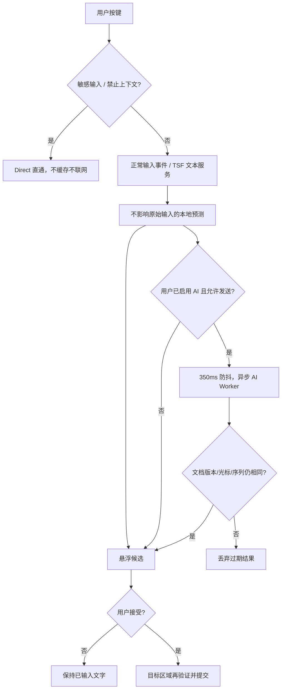
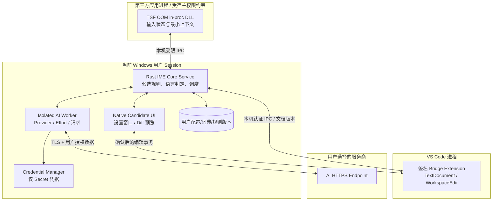
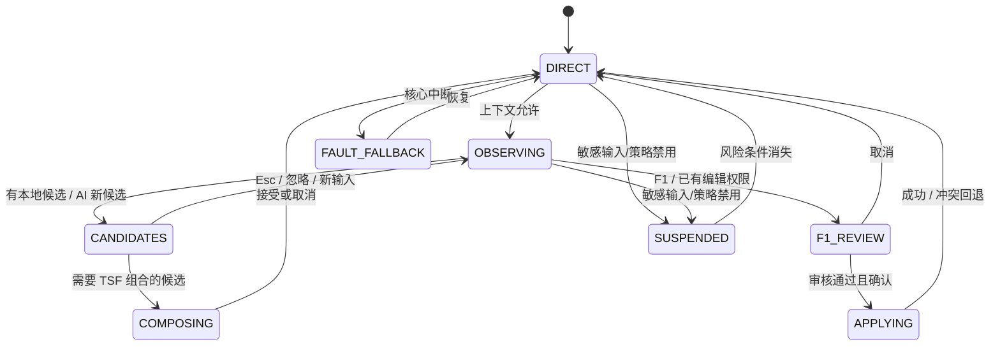
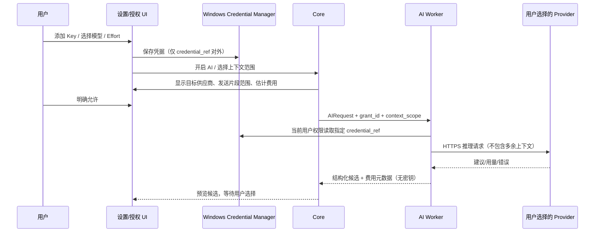
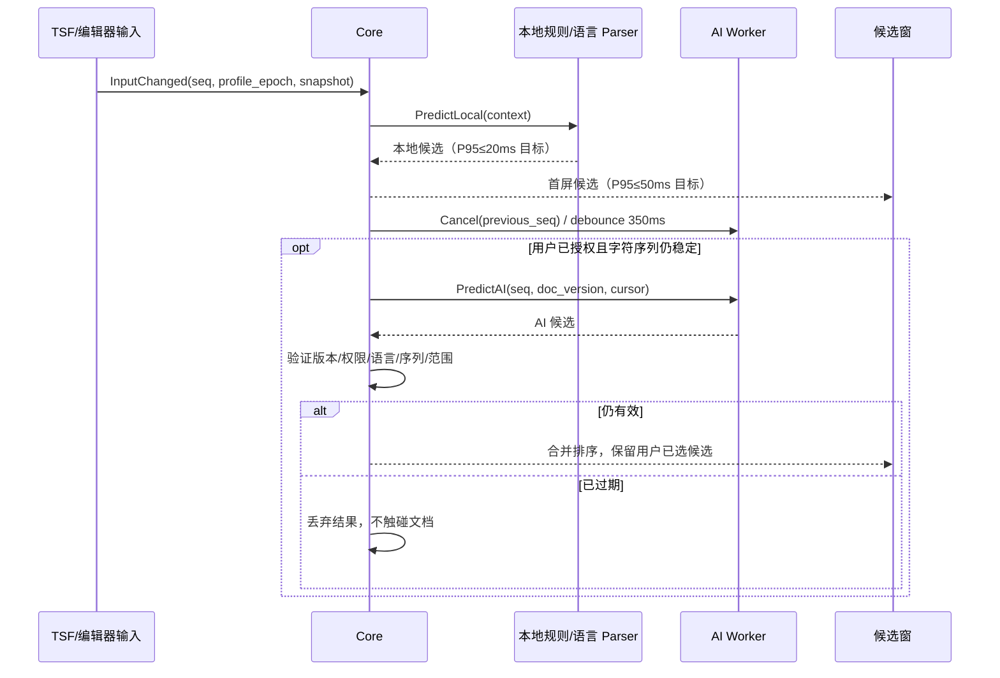
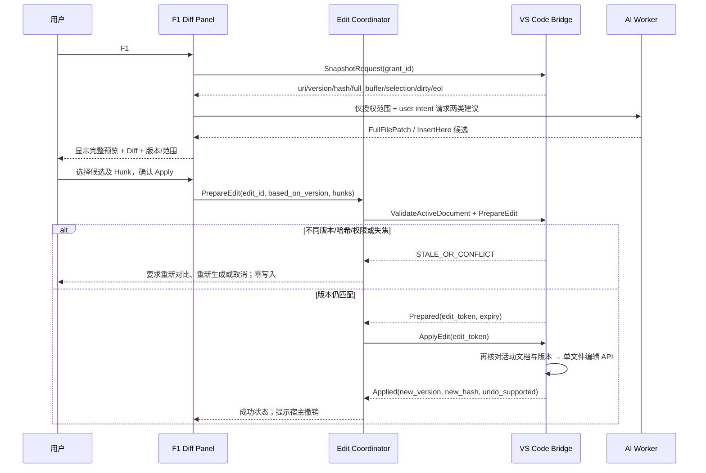
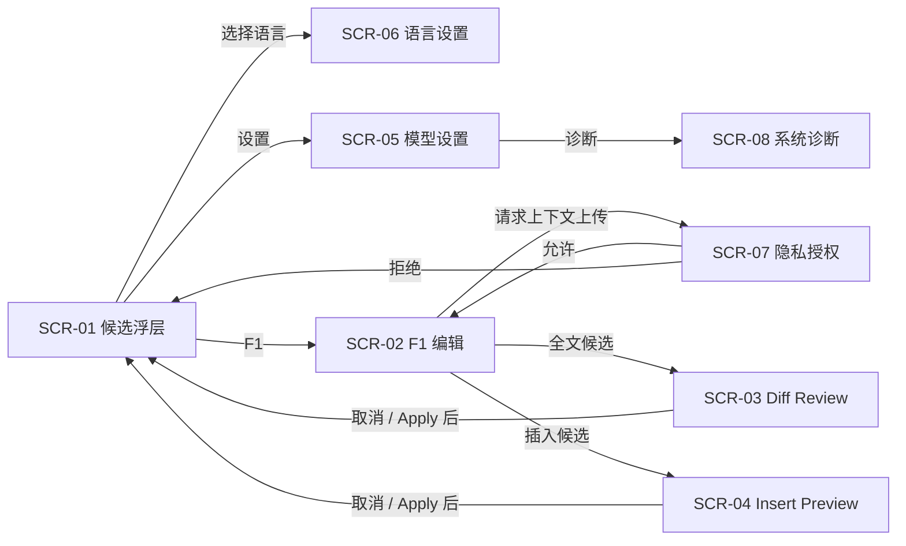
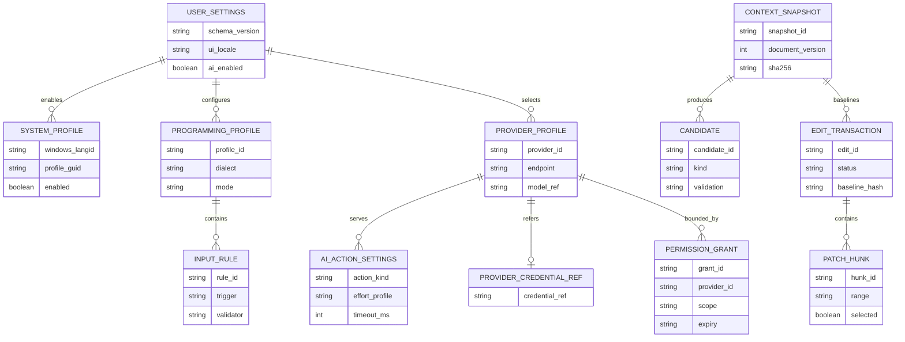

# Programming IME — 软件基本设计书（ソフトウェア基本設計書／外部設計書）

> **文档编号：** BD-PIME-001  
> **版本：** v1.0　**编制日期：** 2026-10-29　**状态：** 设计基线（PoC 验证前）  
> **上游基线：** `SRS-PIME-001` v1.2（2026-10-29）；本设计的所有 `FR-001～FR-052` 与 `NFR-101～NFR-601` 均在随附追踪表中对应。  
> **适用：** Windows 11 x64；系统语言 `zh-CN/en-US/ja-JP`；编程语言 Rust、Python、TypeScript、PowerShell、C、Assembly、Machine Code。  
> **参考方法：** 日本 IPA《共通フレーム2013》开发过程与《非機能要求グレード2018》六大分类；“基本設計（外部設計）”是本项目的交付层级，**并非宣称 IPA 有唯一强制模板或认证**。  
> **文档语言：** 中文正文，日式设计书章节与术语；字段、状态和 API 使用英文规范名。

## 0. 设计模块清单（機能構成一覧）

| 模块 | 基本设计编号 | 设计对象 | 对应要件 |
|---|---|---|---|
| M01 | BD-01 | Windows TSF 输入服务与中英日 Profile | FR-001～004 |
| M02 | BD-02 | 输入状态机与共通候选引擎 | FR-005～008 |
| M03 | BD-03 | 七语言 Profile 与自动检测 | FR-009～012 |
| M04 | BD-04 | 上下文服务与编辑器 Bridge | FR-013～017 |
| M05 | BD-05 | BYOK、模型能力及 Effort 适配 | FR-018～024 |
| M06 | BD-06 | 实时规则预测与异步 AI 预测 | FR-025～030 |
| M07 | BD-07 | F1 全文 Diff 与局部插入事务 | FR-031～040 |
| M08 | BD-08 | 悬浮候选窗、设置、三语本地化 | FR-041～044 |
| M09 | BD-09 | 规则词典、Schema 与插件隔离 | FR-045～047 |
| M10 | BD-10 | 安装、授权、安全、诊断与迁移 | FR-048～052 |

**必须区分的三个层级：** `WindowsInputLanguage`（从何处唤出：zh-CN/en-US/ja-JP）、`InterfaceLocale`（UI 中文/英文/日文）、`ProgrammingProfile`（生成哪种编程语言）。三者相互独立。

## 1. 文档位置及设计原则（文書体系・設計方針）

### 1.1 设计输入／输出

| 输入文档 | 本文件规定 | 交给详细设计的内容 |
|---|---|---|
| SRS v1.2 的 52 项功能要件、12 项非功能要件、七语言规范、验收案例 | 模块边界、画面、状态、消息契约、数据模型、时序、安全和错误行为 | COM 接口实现类、Rust 模块代码、语法规则文件、算法步骤、数据库 DDL、安装脚本、UT/IT 用例 |
| 官方 TSF 注册/IME 安全要求 | 采用 `ITfInputProcessorProfileMgr` 注册三个语言 Profile，COM/TSF in-proc 安全边界 | 具体 GUID、注册脚本、编译与签名流程 |
| VS Code 扩展 API | 由宿主 Bridge 获取未保存 TextDocument、版本和编辑能力 | TypeScript 扩展实现、IPC 授权验证及具体 API 调用 |

### 1.2 功能与非功能决策（ADR）

| 决策 | 采用方案 | 反对方案及理由 |
|---|---|---|
| ADR-01 | 单一 TSF COM 服务 + 3 个语言 Profile GUID，共用引擎 | 开发 3 套输入法：重复、难升级 |
| ADR-02 | Direct/Predict 双路径：不拦截普通输入，预测可独立显示 | 所有按键先经过 AI：延迟与数据安全不可接受 |
| ADR-03 | 本地候选同步；AI 异步独立进程 | 网络调用进入 TSF 回调：会卡住编辑器 |
| ADR-04 | TSF 只负责适当文本范围，整文件依赖可信 Bridge | 用全局按键钩子和 Ctrl+A 模拟替换：不可控且破坏 Undo |
| ADR-05 | F1 双选项先预览后提交；版本/哈希校验 | AI 自动覆盖文件：丢失未保存内容 |
| ADR-06 | API Key 进入 Windows Credential Manager；Provider 拥有独立授权 | 明文 YAML 保存、未许可自动上传代码 |
| ADR-07 | 同一 Candidate/Validation/Commit 契约承载七语言 | 每语言单独写一套候选 UI 和事件系统 |
| ADR-08 | x86-64 为第一版 ASM/MC 完整目标；显式 ISA/模式/方言 | 裸助记符直接断言唯一机器码：可能产生错误字节 |
| ADR-09 | TSF 悬浮窗轻量；重 Diff 与设置页由独立用户进程承载 | 在宿主应用中弹出阻塞式长页面 |
| ADR-10 | 所有外部请求带 capability、版本快照与过期检查 | 用当前焦点与窗口标题作为文件读取授权 |

### 1.3 适用与非适用范围

- **范围内 P0**：Windows 11 x64、三个系统语言 Profile、七种编程语言配置、本地规则、候选窗、BYOK、独立场景模型及 Effort、实时 AI、F1 双选项、VS Code 全文 Bridge、Diff/Undo、默认不联网、无桥接降级。
- **范围内 P1/P2**：更多编辑器 Bridge、更多架构、第三方规则插件、云同步/高级 AI 扩展。
- **范围外**：IDE/编译器/调试器、自动运行 Shell、自动执行机器码、任意应用的全文读取、系统登录画面、未经授权跨文件写入、任意二进制文件的直接修改。
- **兼容边界**：VS Code 是 v1.0 唯一承诺可执行“全文修改”的首批 Bridge；Notepad 等只有 TSF 能力时不保证获取全文、Diff 应用或跨多处插入。

## 2. 业务使用流程（業務フロー・ユースケース）

| UC | 操作者 | 前提 | 主流程 | 后置条件 |
|---|---|---|---|---|
| UC-01 | 用户 | 已安装某语言 Profile | Win+Space → 选择 Programming IME → Direct 输入 | 文字正常提交，原有 IME 不受损 |
| UC-02 | 用户 | 可编辑文本且非敏感框 | 输入字符 → 本地候选 → 可选 AI → 人工接受 | 未选中候选时原文字不被更改 |
| UC-03 | 用户 | 语言下拉可用 | 手动选择 Rust 等 → 锁定或解除 | 后续候选按所选语言生成 |
| UC-04 | 系统 | 可信 Bridge 或文本特征可用 | 读取 languageId → 按优先级识别 → 低置信保持 | 不无故跳转 Profile |
| UC-05 | 用户 | F1、已授权全文 L3/L4 | 采集快照 → AI FullFile → Diff → 确认 → 事务应用 | 完整文件变更可撤销，未确认零写入 |
| UC-06 | 用户 | F1、至少有合法目标区域 | 采集选区/光标 → InsertHere → 预览 → 提交 | 仅目标区域变更 |
| UC-07 | 用户 | 安装应用 | 填 Provider/Key/Model/Effort → 测试 → 授权 | 凭据仅保存到系统 Vault |
| UC-08 | 用户 | AI 断网、超限或关停 | 输入字符 → 本地候选或直通 | 不阻塞、无代码丢失 |



**核心边界说明：** Windows TSF 在不同宿主中允许的文本读取和编辑能力不同。Direct 场景只保证“不破坏输入”；字母触发候选的实现可读取已授权的 TSF 临近范围或者可信编辑器的实时快照。若范围不支持，按 L0 提供不读取宿主内容的本地候选；不能通过全局键盘监听隐蔽收集文字。

## 3. 系统方式设计（システム方式設計）

### 3.1 进程、信任和部署



| 节点 | 角色 | 权限约束 | 生命周期及故障策略 |
|---|---|---|---|
| `pime-tsf.dll` | TSF COM Text Service；键入与 Composition、激活状态 | 宿主进程/沙盒权限，不接网络、不存 Key | 宿主加载/卸载；Core 故障维持 Direct |
| `pime-core.exe` | 单用户可复用 Core，语言包、候选生成、IPC 路由 | 当前用户会话、受限本机 IPC；不直接读任意工作区 | 用户会话按需启动；故障后重连 |
| `pime-ui.exe` | 候选浮层、设置、F1 Diff、权限确认 | 仅展示用户授权的数据 | 非模态；无焦点抢占；不可用时回退 |
| `pime-ai-worker.exe` | Provider 连接、模型能力、费用/速率、响应解析 | 凭据访问隔离；网络仅对用户选择端点 | 独立取消；异常可杀进程不影响键入 |
| `pime-vscode` | 主动提供活动编辑器当前 buffer、版本、受控编辑 | 受 VS Code 扩展宿主与工作区信任约束 | VS Code 未安装/未启动时退化 L0/L1 |
| 用户数据 | 非敏感配置、语言包、缓存、诊断 | `%LOCALAPPDATA%`，明确区分密钥与配置 | Schema 迁移、备份/恢复 |

安全实现注意：Windows 应用容器可能限制 TSF DLL 的外部通信与文件访问，因此 Core/IPC 不能被当作对所有宿主“必定可用”；不支持或无法验证 IPC 时 **原始输入直通**，候选/上下文功能降级。前景窗口只用于显示锚定，不是授权凭证。

### 3.2 设计层依赖

`TSF Adapter → Input Coordinator → [Rule Engine, Language Resolver, AI Scheduler] → Candidate Renderer`；`Context Broker → Bridge` 为只读快照入口，`Edit Coordinator → Bridge` 为唯一全文写入入口，`Provider Adapter` 不得越过 Broker 直接获取文件或调用操作系统命令。

### 3.3 消息种类和界限

| 方向 | 操作类别 | 优先级 | 超时与降级 |
|---|---|---|---|
| TSF → Core | `PredictLocal`、`GetLanguageState`、`Cancel` | 最高；本地短操作 | 不等服务响应；断开走 Direct |
| Core → UI | `ShowCandidates`、`StatusChanged`、`ShowDiff` | 交互 | 显示失败不影响文本 |
| Bridge → Core | `EditorSnapshot`、`FocusChanged`、`DocumentChanged` | 带授权的上下文 | 失联降级，不猜文件内容 |
| Core → Bridge | `PrepareEdit`、`ApplyEdit`、`CancelEdit` | 显式用户操作 | 校验失败返回冲突，不重试盲写 |
| Core → AI Worker | `Complete`、`SuggestFullFile`、`SuggestInsert`、`CancelAI` | 异步可取消 | 超时/403/429 等保持本地输入 |

## 4. M01 Windows 输入服务基本设计（OS・TSF）

### 4.1 Profile 规格

| WindowsInputLanguage | LANGID | Profile ID | 显示名称 | 唯一性 |
|---|---|---|---|---|
| 中文简体（中国） | `0x0804` | `GUID_PIME_ZH_CN` | Programming IME | 与其他二者不同 |
| English (United States) | `0x0409` | `GUID_PIME_EN_US` | Programming IME | 与其他二者不同 |
| 日本語（日本） | `0x0411` | `GUID_PIME_JA_JP` | Programming IME | 与其他二者不同 |

使用**一个稳定 COM CLSID**，三个稳定的 Profile GUID；GUID 真值在详细设计生成且发布后不可任意更改。首选 `ITfInputProcessorProfileMgr::RegisterProfile`；注册服务分类/IME 标识应满足最新系统兼容要求。用户明确选择的输入语言未安装时，安装器提示添加，不擅自调整系统显示语言/默认 IME，不直接修改受保护注册表以强制设默认。

### 4.2 组件生命期与组合

- `Activate`：获取 TSF Text Service 上下文、当前语言 Profile、需要的事件 Sink；窗口/进程是否允许 TSF 处理单独检测。
- `OnInput`：仅执行短耗时输入状态迁移；先将原始输入路径确定，再安排本地候选或 AI 预测。 **普通字母不要求进入长 Composition**。
- `StartComposition/Update/End`：仅对明确使用候选转换且宿主支持的文本区域执行；获得合法 Edit Session 与目标范围，不越权写入宿主文本。
- `Deactivate`：取消在途预测、结束悬浮窗、释放 Sink，不删除当前原始文字。
- `Secure/Excluded`：检测可信敏感输入信号或显式禁用应用；关闭上下文抓取和 AI，无法可靠判定时采取保守策略。
- `Unregister`：卸载按 CLSID/Profile 清理注册，恢复原输入语言设置而不删除其他输入法。

### 4.3 Windows 兼容验收

| 场景 | 期待结果 |
|---|---|
| 三语言分别激活、注销、重启 | 能正常出现并切换到输入法；状态与规则共用 |
| VS Code/Notepad/Windows Terminal/浏览器 | Direct 不丢字符，候选能力按宿主显式分类 |
| 100%、150%、200%、250% DPI、多屏 | 候选靠近文本光标；无法定位时屏幕范围内安全回退 |
| 高完整性进程/沙盒应用/密码框 | 不暗中越权访问；不可用能力明确降级 |
| Win + Space/系统语言栏/切回原 IME | 原有输入法持续工作，当前组合安全撤销或提交 |

## 5. M02 统一输入状态与候选（入力状態・候補設計）

### 5.1 状态定义

| 状态 | 触发 | 原始输入归属 | 可进行的操作 |
|---|---|---|---|
| `DIRECT` | 默认、禁用智能、断网 | 宿主按常规键入 | 本地轻量观察与候选（若允许） |
| `OBSERVING` | 合法文本范围内输入/光标变化 | 宿主已输入的内容保持原状 | 本地分析、显示非阻塞候选 |
| `COMPOSING` | 用户显式触发输入法组合 | TSF Composition 控制 | 键盘选择候选、取消/提交 |
| `CANDIDATES` | 获得本地/AI 候选 | 用户原文不变 | 预览、选择、隐藏、关闭 |
| `F1_REVIEW` | F1 发起带授权 AI 分析 | 原始内容仍属宿主 | Diff / InsertHere 预览、确认 |
| `APPLYING` | 用户确认且有有效 Bridge | Bridge 编辑事务负责 | 版本比对、单文件提交 |
| `SUSPENDED` | 安全框、宿主受限、扩展禁止 | 原始键入直通 | 不采集、不联网 |
| `FAULT_FALLBACK` | Core/IPC/Worker 故障 | 直通 | UI 提示/后台重连，避免丢字符 |



### 5.2 候选统一数据结构（业务字段）

`Candidate { id, kind, language, source, trigger_text, display_text, insert_text?, patch?, target_range?, document_version?, snapshot_hash?, score?, confidence_class, assumptions[], validation, expiry, generation_seq }`。

`kind`：`keyword|symbol|syntax|snippet|ai_inline|full_file_patch|insert_here|byte_hex`；`source`：`rule|parser|history|ai`；`validation`：`unchecked|valid|warn|invalid|context_missing`。不把模型概率数字伪装为已校准的语法正确率。

排序：显式规则和用户固定项 > 当前语法合法性 > 本地语言/历史 > AI 建议；拒绝跨 Profile 结果、陈旧上下文及超出授权编辑范围的候选。

### 5.3 按键规则

| 键 | Direct/观察模式 | 组合/候选模式 | F1 面板 |
|---|---|---|---|
| 字母/符号 | 原样传给宿主；触发本地预测 | 更新组合/相应候选 | 面板聚焦时只输入面板字段 |
| 上/下 | 不截获 | 选择候选（有明确捕获时） | 移动焦点 |
| 数字 | 原样输入 | 可选数字选候选，明确启用时 | 不改文档 |
| Tab/Enter | 默认遵守 IDE 键位 | 用户配置确认；冲突时不截获 | 预览内导航，非自动应用 |
| Esc | 不截获或隐藏窗 | 取消 Composition，保持原文 | 关闭，零写入 |
| F1（默认） | 仅可编辑支持环境且无用户禁用时呼出面板 | 先安全结束组合，再尝试面板 | 关闭或聚焦，按配置 |
| Win+Space | 交给 Windows | 交给 Windows | 交给 Windows |

**不同宿主的接受候选实现**：可信 Bridge 可用时通过已验证的 editor API 精准应用；仅 TSF 时通过可用的合法 Edit Session/Range 写入；无法定位现有已输入字母的替换范围时，只能作为新插入文本或不提供可执行接受选项，禁止盲发退格模拟删除。

## 6. M03 七语言 Profile 与自动判定（言語別設計）

### 6.1 语言包统一外部契约

`LanguagePack` 包含 `profile_id / display_name / version / dialect / engine_version_range / parser_capabilities / triggers / symbol_map / templates / validator_id / accepted_extensions / default_style`。语言包只描述编程语言语义；不得控制 Windows LANGID，不得读取 Key，不得自发联网。版本或方言切换将增大 `profile_epoch`，清理不兼容候选。

| Profile | 字母预测与结构候选（P0） | 标准与校验策略 | 特别交互 |
|---|---|---|---|
| `rust` | `fn/impl/trait/match/if let/Result/Option/async`；声明、表达式和宏候选 | Edition 与稳定版语法配置；Parser 可用时限定上下文 | 避免无条件插分号；生命周期单引号识别 |
| `python` | `def/class/for/with/try/async`、推导式、类型注释 | Python 3 目标版本；根据已有 indent_style/width 生成 | 不把 Tab 硬改 4 空格；保留换行 |
| `typescript` | `interface/type/arrow/function/Promise/async/union` | TS/TSX，匹配目标 TS 语法；在 TSX 中区分 JSX | `<...>` 不确定时列多个候选不强制 |
| `powershell` | `Verb-Noun`、参数、管道、变量、`param{}`、函数、错误处理 | PowerShell 5.1 / 7 版本区分 | Cmdlet 只作为文本，无执行副作用 |
| `c` | `#include`、函数/原型、struct/union、指针、数组、宏 | C11/C17/C23 方言及语法限制 | 指针/数组声明需验证，模板不引入非标准扩展 |
| `assembly` | x86-64 指令、寄存器、标签、寻址、伪指令 | Intel/AT&T，NASM/GAS 等方言独立；架构和位数必填 | 编码不确定时显示候选与假设，不输出伪确定机器码 |
| `machine-code` | Hex 字节、指令编码/解码候选、字节格式、寄存器示例 | x86-64 ISA、模式、地址、重定位状态约束 | 默认提交可见 Hex 文本，原始字节写入须额外可信 Binary Bridge |

> **汇编和机器码的安全/正确性边界**：机器语言输出在普通编辑器是 `48 89 D8` 等十六进制字符表示，不是通过 TSF 注入不可见二进制字节。若宿主本身支持二进制文档编辑，需额外的 Binary Editor Bridge、明确权限及 byte-offset 事务才可支持原始字节写入，v1.0 不承诺所有文件编辑器都具备该能力。验证器对未知指令集扩展、重定位、链接器符号、执行环境返回 `context_missing`，而不是冒充 valid。

### 6.2 自动语言识别优先级及冲突规则

| 来源 | 证据等级 | 优先关系 | 示例 |
|---|---|---|---|
| 用户手动锁定（`manual_locked`） | 决定性 | 1 | 下拉选择 Rust，直到用户解锁/明确作用域结束 |
| Bridge `document.languageId` | 高 | 2 | VS Code TS/TSX、PowerShell、C |
| 已授权且有可靠 filename/URI 扩展名 | 高/中 | 3 | `.rs → rust`, `.py → python`, `.ps1 → powershell` |
| 本地语法/标记特征 | 中/低 | 4 | `fn main()`，`def main()`；多义词降低置信 |
| AI 辅助推断 | 仅参考 | 5 | 提示用户建议，绝不覆盖手动锁定 |

语言状态：`auto|manual_locked|manual_once|unknown`。对不明确扩展名（`.h`, `.asm`, `.bin`, 无后缀）需提供可见的确认提示；`.bin` **不得单凭扩展名自动切到 Machine Code**。语言变更需停止旧 Profile 的请求、递增 `profile_epoch`、候选刷新。文件切换后的锁定策略默认为“当前文件有效”，可选按应用/全局锁定。

### 6.3 可扩展性要求

支持新增语言包（新 schema、词典与验证器）而不改 TSF 入口；本地 `LanguagePackRegistry` 按 `profile_id`/`schema_version` 发现并验证签名或来源可信度。升级前校验版本兼容，不兼容时回滚上版规则，不影响 Direct。

## 7. M04 上下文读取与编辑器 Bridge（コンテキスト・編集連携）

### 7.1 上下文权限等级与可执行能力

| ContextLevel | 获取条件 | 可能返回字段 | 允许预测 | 允许写入 |
|---|---|---|---|---|
| L0 `none` | 未授权或未知编辑器 | 当前编程 Profile、当前键入组合 | 固定规则、本地词典 | 仅被宿主允许的普通输入 |
| L1 `nearby` | TSF 合法文本范围或可信 Bridge | 光标前后短文本、选区锚点（可选） | 局部候选及经授权 AI | 仅可验证的局部 Range/Composition |
| L2 `selection` | Bridge/TSF 提供真实选区 | selection + 范围内容 + 版本（若有） | 选区相关候选 | 仅实际目标选区 |
| L3 `full_buffer` | 已认证 VS Code Bridge + 许可 | 未保存 TextDocument 全文、version、uri、eol、selection | 全文级 AI | 仅经过版本校验的 Bridge Edit API |
| L4 `explicit_file` | 用户显式选文件并同意读取 | 文件 bytes/编码/mtime/hash | 指定文件全文候选 | 必须验证编辑器冲突并获写入授权；v1.0 默认只读，如无 Bridge 禁用直接全文写入 |

L4 不能被当作比 L3 更可靠的编辑器内文本：**磁盘文件可能落后于未保存 buffer**。如果 VS Code 选中文档处于 dirty 状态，优先 L3；显式读取磁盘的 F1 候选不得直接回写活动编辑器以覆盖 dirty buffer。

### 7.2 Bridge 获取流程及身份绑定

1. 可信扩展在编辑器侧发起连接，交换协议版本与随机一次性挑战，绑定当前 Windows 用户 Session、进程标识、扩展来源及 `editor_instance_id`。本地 IPC 使用受限 ACL；不能依靠 localhost 端口号本身实现信任。
2. 对 `SnapshotRequest`，扩展必须确认当前 active editor 可编辑、授权范围与工作区信任、是否为敏感文件；返回 `document_uri` 的不可直接显示内部标识、`document_version`、`document_hash`、`language_id`、`selection`、`eol`、`dirty`、必要正文。
3. Core 生成 `context_grant_id`；任何 AI 调用或编辑请求携带该 ID，并按最小可读范围裁剪内容。
4. 切换文件、编辑器焦点或文档内容变化产生新 `document_epoch`，取消旧预测；全文候选的旧快照仍可用于展示历史预览，**不得直接应用**。
5. 已关闭、非活动或不可编辑文档：不猜测其他活动窗口的身份，不使用 `SendInput` 或按键模拟代替 Bridge。

### 7.3 统一位置和字符边界

- 对外使用 `TextRange = {start:{line,character},end:{line,character}}`，编码约定 `UTF-16 code units`，且文本以编辑器原始 `EOL` 与换行形式为准；支持 Unicode 补充平面、CRLF/LF，不得拆开代理项对。
- 传输同时包括 `document_version`, `document_hash`（建议 SHA-256）, `selection_epoch`, `document_epoch`, `cursor_anchor`；仅靠 URI 不足以定位目标。
- `L1` 可能缺版本；没有可靠版本的变更只能定位 Composition/当前受控 Range，否则禁止破坏现有已提交文本。
- 文本大小/超限、二进制、只读、无权限、安全区域直接返回 `CONTEXT_UNAVAILABLE` 的细分原因，并允许用户选择较小上下文，不能自行扩大读取范围。

## 8. M05 AI Provider、BYOK、Model/Effort（AI連携方式）

### 8.1 用户可见设置对象

| 设置项 | 类型与默认值 | 行为及校验 |
|---|---|---|
| AI enabled | bool；默认 `false` | 未启用不得触发网络调用 |
| Provider profile | `provider_id`,`base_url`,`credential_ref` | 允许多个配置；HTTPS 默认强制；自定义端点显示明显隐私提醒 |
| API Key | 系统凭据对象 | 输入只显示掩码，测试后写入 Credential Manager；不会回显完整 Key |
| Model | string + 能力表 | 支持模型列表及手输 ID；连接测试后记录可用能力/上次探测时间 |
| Reasoning Effort | `Auto/Low/Medium/High/Extended` | UI 档位通过每 Provider 的 `CapabilityMap` 映射，未知/不支持显式禁用或 Auto，不能默默忽略 |
| AI 场景 | `realtime`, `f1_full`, `f1_insert` | 用户可分别选模型、Effort、max_output_tokens、timeout、预算 |
| Realtime debounce | ms，默认 `350`，边界 150～1000 | 任意输入立即更新本地候选，AI 延后触发 |
| Token/budget | 当前用户可设上限，初始不自动无限调用 | 超限暂停 AI，Direct 与本地候选继续 |
| Privacy grant | 每次/当前工作区及供应商范围 | 会话失效/工作区变化后按策略再询问 |

至少设计 `ProviderAdapter` 插口 `probe_capabilities / list_models? / validate_credentials / infer / cancel / usage`；自定义“兼容 API”不代表完全兼容所有能力，必须通过 capability probe/明示静态映射。任何模型名称、定价、Effort 的具体值由适配器的可更新能力表维护，不在本设计硬编码外部服务商承诺。

### 8.2 机密与外送流程



Key 不经 Core IPC 明文传递，不入本地数据文件、诊断日志、剪贴板或崩溃报告。允许用户删除单个 Provider 配置及对应凭据；失效 Key 不触发自动改用另一个供应商。

### 8.3 提示词与外部输入防护

- 系统指令只来自本地可信规则；源文件、注释、候选文本、模型输出都是不可信数据。禁止模型输出中出现的“读取更多文件/运行命令/上传数据”升级成实际权限。
- 请求中携带 `task_type, profile, dialect, user_intent, allowed_context, context_level, cursor, selection, snapshot_fingerprint, permitted_actions`；输出解析为结构化候选，超出可写范围拒绝。
- 对 `.env`、私钥、令牌、密码字段与高风险路径按本地策略识别并阻断或掩码，全文请求需逐次可见授权；默认无匿名遥测采集输入内容。
- 不支持运行代码、Shell、调试工具或读取未授权目录作为 AI tool；即使 Provider 支持 tool calling，本产品默认只解析文本建议。

## 9. M06 实时预测（リアルタイム入力予測）

### 9.1 双通道调度



### 9.2 候选去重与触发矩阵

| 用户行为 | 本地响应 | AI 请求 | 一致性条件 |
|---|---|---|---|
| 单字符输入 | 即时词法/符号候选；无词典则不扰动 | 合法非敏感上下文且 debounce 达到才发 | 输入序列 `seq` 未变 |
| 快速连打 | 立即刷新本地候选 | 取消/废弃旧请求，仅保留最新允许的一个 | `seq`,`epoch`,`cursor`,`hash` 一致 |
| 退格/撤销 | 清理不匹配候选 | 旧请求取消并可重新防抖 | 不允许把旧文本插回 |
| 切换编程语言 | 清空旧候选、切到新规则 | 旧请求失效 | `profile_epoch` 递增 |
| 光标移动/切换文件 | 清空位置相关建议 | 取消并重新授权快照 | 新 `document_epoch` |
| 网络失败/费用封顶 | 保留本地候选 | 暂停错误 Provider；提示原因 | 永不阻塞输入 |
| 敏感框/未授权 | 仅 Direct | **零请求** | 不缓存或泄漏上下文 |

每种编程 Profile 的默认建议来源至少包含：语言内建关键字、常见语法结构、当前位置 token 的前缀匹配（`不是只有固定缩写`）、可用 Parser 的上下文约束；AI 建议仅补充，绝不假设所有字符都必须上云。显示`本地/AI/上下文不足`可区分标签。

### 9.3 候选采纳方式

- TSF Composition 内接受：以当前合法 Range 结束组合；`Esc` 必须回到原输入状态；不能把候选和原字符重复写入。
- 已提交 Direct 文本接受：优先 Bridge 精确 `replace(range, candidate)`；检查 `snapshot_hash` 和触发前缀；否则只允许安全 append 或禁用该候选。
- 提交后 `undo` 必须受宿主编辑器控制；不在后台自动继续改动同一文本。

## 10. M07 F1 智能编辑与写入事务（F1編集・差分反映）

### 10.1 两路径的显示与权限

| 路径 | 读取 | 建议类型 | 目标 | 用户确认 |
|---|---|---|---|---|
| `FullFileChange` | 需要 L3 当前未保存完整 buffer，或明确授权的 L4 只读文件（L4 不直接回写活动 dirty buffer） | 整文件新文本或规范 Patch；展示全文件最终结果和 Diff | **仅当前一文件** | 审阅全部/分块 Hunk，再确认 Apply |
| `InsertHere` | L1/L2 或 L3（准确位置必须验证） | 1～N 个可预览片段/选区替换 | 当前光标或选择区域 | 选中插入候选并确认 |

F1 默认交互：当前已输入文本/选区优先用于推断编辑意图，UI 显示模型推断的 `intent_summary` 与 `assumptions`，允许用户在面板中补充意图、分别请求两路径；不自动把“猜测意图”当作修改命令执行。两路径独立加载、独立错误状态、共享快照版本号；当缺全文时 **FullFileChange disabled + 原因及启用 Bridge 指引**。

### 10.2 F1 编辑状态

`IDLE → SNAPSHOT_REQUESTED → PERMISSION_CHECK → GENERATING → REVIEW_READY → CONFIRMED → PREPARE_EDIT → APPLYING → APPLIED`。任意状态可 `CANCELLED`；版本冲突为 `STALE_REQUIRES_REVIEW`；权限、I/O、Provider 失败为 `FAILED_SAFE`。AI 生成的预览本身绝不属于已应用状态。

### 10.3 版本一致性与回滚协议



设计要点：

1. `baseline` 至少包括 `document_uri, editor_instance_id, document_version, SHA-256, selection, eol, encoding?`。生成前若全文包含疑似 Secret，遵循授权/过滤策略；版本可能变化时只允许**查看预览，不允许直接提交**。
2. `PrepareEdit` 要求目标文件仍为同一编辑器当前活动文档、可写、仍在授权范围、版本号/哈希完全一致；如不一致返回冲突。分块选择要验证非重叠 Range、顺序、UTF-16 边界、最终可组合效果。
3. `ApplyEdit` 由编辑器 Bridge 在单次操作中完成同步检查与编辑 API 调用，成功后获取新版本/哈希。不能声称外部的 `WorkspaceEdit` 自身是通用 compare-and-swap；若宿主不能保证检查到写入间不存在竞态，则应采取拒绝、再次校验与事后校核的保守策略，必要时标记该宿主为“不支持安全全文编辑”。
4. 失败/局部失败时禁止盲目“撤回”可能包含用户新输入的内容。优先使用编辑器原生 Undo 事务；若无法可靠回滚，报告冲突并维持用户原文，恢复操作只能在校验已知版本后进行。
5. 不执行/保存/编译/调试/运行 PowerShell 等生成内容；生成变更默认只影响当前文件。终止程序、窗口失焦、关闭文件、文件权限变化都将取消待应用事务。

### 10.4 文本保真策略

- 对 UTF-8/UTF-16 BOM、LF/CRLF、尾随换行、缩进、格式、注释进行差异预览，默认保留原编辑器 buffer 的 EOL；不对全文件自动格式化导致无关 Diff。
- 生成结果可用语言 Parser 或只读静态检查；不保证语义/安全正确，但能排除明显格式与目标范围错误；检查失败标记警告，阻止默认一键应用高风险变更。
- Partial Hunk 接受可能造成跨 Hunk 依赖；应重新解析组合后文本并展示最终预览，不能仅将多个字符串差异无条件拼接。

### 10.5 F1 键位冲突

- `F1` 只在用户选择启用的、可编辑的目标宿主中注册；不安装全局低层键盘钩子；仅 TSF 合法按键处理/编辑器扩展命令或 Keybinding。
- 若 VS Code 原 F1 与扩展冲突，首次启用须告知可选择“保留 Help F1/改用其他键”。用户未确认占用 F1 时不默认破坏原帮助功能。
- 无 Bridge 场景允许显示“不支持完整文件修改”的信息；不会劫持宿主菜单、系统热键或终端命令。

## 11. M08 画面设计（画面設計・画面遷移）

### 11.1 画面一览（画面一覧）

| Screen ID | 名称 | 出现条件 | 主要元素 | 提交/退出 |
|---|---|---|---|---|
| SCR-01 | Candidate Float / 候选悬浮框 | 有合法输入候选 | 语言 Profile 下拉、当前模式、最多 N 条候选、来源/能力状态 | 选候选/隐藏；不自动提交 |
| SCR-02 | F1 Edit / 智能编辑面板 | F1 且编辑状态允许 | FullFile/InsertHere 标签、意图确认、生成状态、权限提示 | 只预览；Esc 关闭 |
| SCR-03 | Full Diff Review / 全文差异 | 有全文修改候选 | 原文件/新文件/分块 Diff、授权范围、基线版本、风险警告 | 勾选 Hunk → 二次确认 Apply |
| SCR-04 | Insert Preview / 局部插入 | InsertHere 有结果 | 目标 URI/光标范围/候选正文/来源/安全提示 | 接受单项 → 位置验证 → 应用 |
| SCR-05 | AI Settings / Provider 管理 | 用户打开设置 | Provider、新增/测试/删 Key、Model/Effort/预算/取消 | 保存普通配置与凭据分离 |
| SCR-06 | Language Profile Settings | 状态栏/设置 | 七语言、方言/版本、自动识别、锁定范围 | 变更立即刷新 Profile epoch |
| SCR-07 | Privacy Permissions | 首次联网/全文或变更授权 | 供应商、文件范围、片段摘要、风险、期限、撤销 | 同意/拒绝，拒绝不联网 |
| SCR-08 | System & Diagnostics | 设置或错误 | 中/英/日 Profile 状态、Bridge 连接、输入模式、日志、导出诊断 | 仅导出脱敏信息 |

### 11.2 候选浮层布局

```text
┌───────────────────────────────────────────────────┐
│ Programming IME  Rust ▾  AUTO   AI:ON   [⚙]      │
├───────────────────────────────────────────────────┤
│ fnm                                [本地 + AI]   │
│ 1  fn main() { … }                 规则候选       │
│ 2  fn main() -> Result<()> { … }    上下文候选   │
│ 3  async fn main() { … }            AI候选        │
└───────────────────────────────────────────────────┘
```

始终不遮住当前插入光标和主输入行；如果无法获得 caret 坐标，浮层应自动放置到活动显示器可见区域或隐藏。候选窗不得大面积抢占屏幕；长代码在明确展开后预览，而不是默认显示整个文件。受限宿主可完全关闭浮层但维持 Direct。允许 UI 独立选择中文、英文、日文文本，**代码不做本地化翻译**。

### 11.3 F1 面板布局

```text
┌─ Programming IME / F1 智能编辑 ─────────────────────────────────┐
│ 文件：current.rs  未保存 ● 版本：42  语言：Rust ▾  模型：...   │
│ 意图：根据当前位置的解析结果补齐错误处理       [重新描述意图] │
├──────────────┬────────────────────────────────────────────────┤
│ 整文件修改   │ 光标处插入                                    │
├──────────────┴────────────────────────────────────────────────┤
│ [原文]  [变更后全文]  [Diff]        [按 Hunk 选择]             │
│ - let value = parse(text);                                    │
│ + let value = parse(text)?;                                   │
│ + validate(&value)?;                                          │
│ 权限：当前文件 L3 / 发送到所选 Provider / 验证：有警告        │
├───────────────────────────────────────────────────────────────┤
│ [取消] [重新生成]                                [审核并应用]   │
└───────────────────────────────────────────────────────────────┘
```

屏幕宽度不足时改为上下分页或独立面板。`审核并应用` 按钮在用户尚未审核全部更改/缺少权限/快照失效/版本冲突时禁用，给出可恢复指导。不使用色彩单独表达 Diff：增加 `+/-`、读屏语义与可键盘访问控件。

### 11.4 基本画面迁移（画面遷移）



### 11.5 快捷键与可访问性

默认 Esc 关闭候选、方向键移动、数字直选（仅候选接管时）、Enter/Tab 可配置；F1 默认触发仅在应用未占用且用户允许时绑定。要求屏幕阅读器可访问候选说明，Windows 高对比度、100%～250% 缩放、多显示器浮层安全定位。焦点切换与语言变更时必须防止过期候选误插入。

## 12. M09 本地规则、词库与插件（マスタ・拡張設計）

### 12.1 存储范围

| 数据分类 | 位置与格式（逻辑） | 保存内容 | 生命周期 |
|---|---|---|---|
| 用户设置 `UserSettings` | 用户本地 AppData，版本化 JSON/TOML | UI/键位/语言/模型引用、AI 开关、预算 | 长期；支持备份 |
| 语言规则 `LanguagePack` | 应用内置 + 用户扩展目录 | schema、version、trigger、syntax、validator | 签名/来源校验后装载 |
| 候选使用偏好 | 用户本地小型索引/SQLite（可选） | 脱敏的候选 ID 与使用频次 | 用户可关闭、清除 |
| 请求级快照 `ContextSnapshot` | 进程内短期内存 | 已授权的邻近/全文内容与哈希 | TTL、失焦、完成/取消后清除 |
| ProviderCredential | Windows Credential Manager | API Key / 凭据引用 | 用户删除即移除 |
| 授权记录 `PermissionGrant` | 用户受保护配置 | Provider、范围、工作区、时效、撤销时间 | 有效期届满自动失效 |
| 诊断 `DiagnosticEvent` | 本地轮转日志 | 错误码/耗时/组件/数值指标 | 默认禁止代码、按键、Key |
| 编辑候选 `EditTransaction` | 进程内 + 编辑器 Undo 栈 | 变更摘要、版本、选中 Hunk、验证结果 | 完成后释放正文，不另存原文 |

### 12.2 插件和语言包边界

`RulePlugin` 仅可访问经过清洗的 `InputContextView`，默认没有文件系统、网络、Shell、凭据读取权；插件超时或崩溃时跳过而不妨碍键入。第三方插件 P1，第一版 P0 的七语言规则可内置在同一配置框架中。对用户自定义模板也适用语法合法性标记及准确编辑范围保护。

## 13. 外部接口与数据契约（外部インターフェース設計）

### 13.1 接口一览

| Interface ID | 提供方 → 调用方 | 协议/技术 | 核心业务动作 | 鉴权/权限与失败结果 |
|---|---|---|---|---|
| IF-01 | Windows TSF ↔ TSF DLL | COM / TSF | Profile Activate、Composition、EditSession、候选提交 | 宿主进程能力；失败 Direct |
| IF-02 | TSF/UI ↔ Rust Core | 用户级 IPC（Windows Named Pipe 候选） | PredictLocal、Cancel、State、Candidates | 限定同用户 SID/Session，超时 Direct |
| IF-03 | VS Code Bridge ↔ Core/Review UI | 本机认证 IPC | Snapshot、EditorChanged、Prepare、Apply、Undo 由宿主管理 | editor_instance、grant、version/hash 校验 |
| IF-04 | AI Worker ↔ Provider | HTTPS + Provider 专属契约 | Capabilities、Models、Inference、Cancel、Usage | Vault 取 Key、授权 scope、费用/429/超时 |
| IF-05 | Core ↔ LanguagePack/Parser | 本地抽象接口 | ParsePrefix、Suggest、ValidateText、ValidateBytes | 只读规则和限制资源、错误降级 |
| IF-06 | AI Worker ↔ Windows Credential Manager | Windows Credential APIs | Get/Put/Delete Secret by ref | 仅当前授权账户；不输出明文到 Core |
| IF-07 | Installer ↔ Windows 注册/更新机制 | 已签名安装器、COM/TSF Registration | Install/Repair/Unregister/Profile enable/rollback | 检查权限、签名、复原旧设置 |

### 13.2 共通 IPC 消息 Envelope（逻辑协议 v1）

```json
{
  "protocol_version": "1.0",
  "request_id": "uuid",
  "session_id": "opaque-per-user-session-id",
  "type": "PredictLocal | EditorSnapshot | ApplyEdit | ...",
  "sent_at_monotonic_ms": 0,
  "ttl_ms": 500,
  "language_profile": "rust",
  "profile_epoch": 7,
  "document_epoch": 15,
  "context_grant_id": "opaque-or-null",
  "payload": {}
}
```

注意：`sent_at_monotonic_ms` 用于同一进程会话内超时比较；跨进程不能直接比较独立时钟基点，服务端应使用接收时间和 `ttl_ms` 维护期限。`payload` 有大小、速率与字段白名单限制，永远不包含 Provider API Key。

### 13.3 关键请求／返回（画面和 API 的契约）

| 请求 | 必填业务字段 | 正常返回 | 可预期错误 |
|---|---|---|---|
| `PredictLocal` | `input_seq, prefix, profile, context_level, document_epoch` | `Candidate[]`, `generation_seq` | `LANGUAGE_UNSUPPORTED`, `CONTEXT_RESTRICTED` |
| `PredictAI` | `input_seq, snapshot_ref, grant_id, model_ref, effort_profile` | `Candidate[]`, `usage`, `source=ai` | `AI_DISABLED`, `CONSENT_REQUIRED`, `RATE_LIMITED`, `MODEL_UNSUPPORTED`, `STALE_RESULT` |
| `LanguageDetect` | `manual_lock?, language_id?, file_meta?, syntax_hint?` | `profile, source, confidence_class, locked` | `LANGUAGE_AMBIGUOUS`（不强切） |
| `SnapshotRequest` | `editor_instance_id, context_level, grant_id, selected_scope` | `document_uri,version,hash,languageId,selection,eol,dirty,content` | `BRIDGE_OFFLINE`, `UNTRUSTED_WORKSPACE`, `CONTEXT_UNAVAILABLE` |
| `SuggestFullFile` | `snapshot_ref, intent, provider_ref, grant_id` | `PatchCandidate[], full_preview, assumptions` | `FULL_CONTEXT_REQUIRED`, `AI_TIMEOUT`, `OUTPUT_INVALID` |
| `SuggestInsert` | `snapshot_ref, selection, intent, provider_ref, grant_id` | `InsertCandidate[], target_range, assumptions` | `TARGET_RANGE_INVALID`, `OUTPUT_INVALID` |
| `PrepareEdit` | `edit_id, candidate_id, baseline_version, baseline_hash, chosen_hunks, grant_id` | `edit_token, expiry, proposed_hash` | `STALE_DOCUMENT`, `OVERLAPPING_HUNKS`, `DENIED` |
| `ApplyEdit` | `edit_token, editor_instance_id, document_uri` | `new_version, new_hash, undo_supported` | `STALE_DOCUMENT`, `EDIT_FAILED`, `UNKNOWN_RESULT` |
| `CredentialUpsert` | `provider_ref, secret`（仅 Vault 境界内） | `credential_ref` | `VAULT_DENIED`, `VAULT_FAILURE` |

**接口保护：** 消息结构以 Schema v1 固定，可新增可选字段；不支持主版本时明确拒绝。所有含文件内容的消息仅在已认证 Bridge、有效 `grant_id` 和最小化内容范围下传输。UI 的文件 URI 及工作区名称按隐私设置局部遮盖。

### 13.4 权限模型（権限一覧）

| Actor | 允许 | 禁止 |
|---|---|---|
| TSF in-proc DLL | 用户合法输入、有限 TSF Range、显示当前候选 | 拿 Key、走公网、扫描工程、执行代码 |
| Rust Core | 读取已授权 context snapshot、规则、候选排序 | 读取系统 Secret 明文、未经 Bridge 写全文 |
| AI Worker | 用户选择的网络目标、指定 Key、授权片段 | 切换 Provider 偷发、扩大目录权限、执行模型建议 |
| VS Code Bridge | 自己的活动 TextDocument 和版本化 edit | 静默读写其他 workspace/多文件、默认执行生成代码 |
| 用户/设置 UI | 明示权限的授权与撤销、查看 Diff、取消调用 | 无需确认直接申请通用整盘权限 |

## 14. 数据逻辑设计（データ設計／論理データモデル）

### 14.1 ER 概念图（非物理 DDL）



### 14.2 数据字典（逻辑，不指定物理数据库）

| Entity | 关键键 | 主属性 | 存储等级与保留 | 数据一致性约束 |
|---|---|---|---|---|
| `UserSettings` | user-local | schemaVersion, locale, aiEnabled, keymap, budget | 长期/非机密 | 版本迁移后须可回滚 |
| `SystemProfile` | langid + guid | enabled, lastActivated | Windows Profile 注册/配置 | GUID 唯一、与 CLSID 绑定 |
| `ProgrammingProfile` | profileId+version | dialect, manualLock, filePolicy | 用户设置 | 语言/方言必须与 Validator 匹配 |
| `ProviderProfile` | providerId | endpoint, modelId, capabilities, checkedAt | 非机密本地设置 | 不包含 Key 明文 |
| `ProviderCredentialRef` | credentialRef | providerId, vaultTarget | Windows Credential Manager | 删除配置须清理 Secret |
| `AIActionSettings` | providerId+actionKind | modelRef, effort, timeouts, budget | 用户设置 | 依据 capability 校验 |
| `PermissionGrant` | grantId | provider, contextScope, workspace, expiresAt, revokedAt | 本地受保护 | 每次请求验证提供商与范围 |
| `InputRule` | ruleId+packVersion | trigger, priority, constraints, template | 本地规则包 | schema/签名/适用语言校验 |
| `ContextSnapshot` | snapshotId | editorInstance, documentVersion, selection, sha256, content | 内存 TTL，禁止日志 | 新 epoch 取消旧候选与写入 |
| `Candidate` | candidateId | kind, source, editRange, preview, validation | 内存会话 | 文档版本、Profile epoch 相符 |
| `EditTransaction` | editId | docURI, baselineHash, selectedHunks, status, expiry | 内存+宿主 Undo | 非已确认不得 apply |
| `PatchHunk` | editId+hunkId | range, before, after, selected | 内存会话 | 非重叠、可组合且完整校验 |
| `DiagnosticEvent` | eventId | component, errorCode, latency, sanitizedMeta | 轮转脱敏日志 | 无 Key、无代码正文、无按键 |

### 14.3 数据生命周期与清除

- 取消 AI：取消在途请求、使 snapshot 无效，worker 尽力取消网络，不能保证供应商已接收的数据被撤回，UI 应提示这一事实。
- 撤销全文授权：清除未提交快照与候选，后续请求禁用；已发出的请求按照提供商政策处理。
- 退出编辑器/重启：删除会话 ContextSnapshot、EditTransaction 内存数据；仅持久化经过用户授权的非敏感设置。
- 删除 Provider：先禁用相关场景，再删除 Vault Key 和引用，旧 grant 失效。
- 卸载：明确区分移除软件与可选保留用户设置；默认安全清理密钥与临时数据、保留用户数据需用户明确勾选。

## 15. 异常处理（例外設計・障害時運用）

| Error Code | 条件 | 用户可见消息/动作 | 系统动作 | 数据安全保证 |
|---|---|---|---|---|
| `PROFILE_NOT_REGISTERED` | 对应 Windows 语言未安装或 TSF 注册失效 | 显示修复/安装语言指引 | 不改默认 IME；可 Repair | 其他 IME 正常 |
| `TSF_CONTEXT_UNAVAILABLE` | 宿主不支持合法 Text Range | 只显示基础候选 | Direct 或纯文本安全插入 | 不盲写别处 |
| `SECURE_INPUT` | 密码/受保护输入 | 不显示代码候选 | 关闭 AI、丢弃上下文 | 0 外送 |
| `IPC_TIMEOUT` | Core 本机连接超时 | 可显示“本地建议暂不可用” | 立即 Direct，后台重连 | 不丢输入 |
| `BRIDGE_OFFLINE` | VS Code Bridge 不在线 | 整文件选项不可用 | 仍允许合法局部候选 | 不假装读取全文 |
| `CONTEXT_UNAVAILABLE` | 工作区不可信或文件限制 | 提示需授权/换支持编辑器 | 拒绝读取 | 不越权 |
| `CONSENT_REQUIRED` | AI 读取范围未授权 | 展示供应商与数据范围 | 不发 AI 请求 | 0 未授权外送 |
| `MODEL_UNSUPPORTED` | Model / Effort 不匹配 | 显示不支持的档位 | 改选模型或 Auto，先告知 | 不发送无效参数 |
| `AI_UNAUTHORIZED` | Key 无效/权限不足 | 提示检查 Key | 暂停该 Provider | Key 不回显 |
| `AI_RATE_LIMIT` | 429 / 预算耗尽 | 显示限流/预算提示 | 本地候选继续，依策略退避 | 不改文本 |
| `AI_TIMEOUT` | 预测或 F1 超时 | 提示超时可重试 | 取消/丢弃结果 | Direct 正常 |
| `STALE_RESULT` | 输入 seq/语言/文档变化 | 不弹出旧候选 | 安静丢弃旧结果 | 旧结果不插入 |
| `STALE_DOCUMENT` | Diff 产生后文件变化 | “文件已变化，需重新审核” | 禁用 Apply，重新快照 | 保护未保存内容 |
| `PATCH_INVALID` | 目标范围重叠/编码不合法 | 标记不能应用 | 拒绝 commit | 原文不变 |
| `EDIT_FAILED` | 编辑器应用失败 | 显示失败与 Undo 状态 | 校核结果并停止重试 | 不盲目修复 |
| `UNKNOWN_RESULT` | 编辑中 Bridge 断开，结果不明 | 明示“需检查文件状态” | 不自动再次 Apply | 防止重复写入 |
| `VAULT_ERROR` | 凭据存取失败 | 提示检查系统凭据服务 | 关闭网络 AI | 不写明文文件 |
| `LANGUAGE_AMBIGUOUS` | 无可信语言标识 | 显示“自动识别不确定” | 保持原 Profile | 不乱切语言 |
| `BYTE_ENCODING_UNRESOLVED` | ISA/地址/重定位缺失 | 标记编码未确定 | 禁止将输出当最终 bytes | 避免伪指令码 |
| `PLUGIN_CRASH` | 非可信插件崩溃或超时 | “该扩展暂不可用” | 禁用插件、本地规则继续 | TSF 宿主不中断 |

异常等级：`INFO / RECOVERABLE / ACTION_REQUIRED / BLOCKING_SECURITY`；涉及代码覆盖、密钥泄露和未授权请求均为阻断级。日志只记录错误码、模块、脱敏 session id、耗时、是否回退；密钥/代码/原始按键不得进入日志。

## 16. M10 安全、安装、迁移与运维（セキュリティ・導入・運用）

### 16.1 威胁模型

| Trust Boundary | 威胁 | 缓解措施 | 残余风险/验证 |
|---|---|---|---|
| 宿主应用 ↔ TSF DLL | 恶意应用/沙盒环境限制 DLL | DLL 极小化、受限运行、不假定额外权限 | 沙盒/高完整性/密码框兼容 PoC |
| TSF DLL ↔ Core IPC | 跨用户 IPC 访问/伪装编辑器 | 按 Windows 用户 SID/Session ACL、协议版本、连接认证、最大消息限制 | 不能仅靠 PID 或本机端口作为权限 |
| Core ↔ VS Code Bridge | 假 Bridge 回传伪造文件/恶意写请求 | 双方身份握手、编辑器实例绑定、grant、URI/version/hash 一致性 | 必须做恶意/重放测试 |
| Core ↔ AI Worker | 泄露 Key 或源码 | Worker 独占 Vault 访问；Core 只拿 credential_ref；明确允许的上下文 | 当前用户权限被恶意软件攻破仍有风险 |
| AI Worker ↔ Provider | 数据外送/费用失控/供应商变更 | HTTPS、用户选的 Provider、最低权限、预算、请求审计 | 已发出内容依供应商政策不可撤回 |
| 文档/AI 内容 ↔ 用户 | 提示注入、危险命令、错误代码 | 代码注释视数据、无工具执行、Diff/验证/确认 | 生成结果需用户检查，不保证语义正确 |
| 规则/插件 ↔ 主引擎 | 执行任意插件代码/卡死 | 声明式规则；P1 插件隔离、签名/权限/超时 | 插件安全需要独立审计 |

### 16.2 最小采集策略

1. 用户默认仅启用本地规则，AI 开关 `false`，未配置 Key 不得创建网络请求。
2. 默认不将键盘事件、源码、路径、Key 和候选全文写日志；使用脱敏汇总指标。
3. 实时 AI 只发送必要片段；F1 全文需要独立授权，展示 Provider 名称和范围；用户可按工作区撤销。
4. `.env`、私钥、含凭据的内容触发敏感策略；系统密码/凭据框直接进入 `SUSPENDED`；无法识别敏感内容时 UI 明确显示无法完全保证自动脱敏，发送前需用户决定。
5. 原地编辑操作严格区分 `Preview` 与 `Apply`，对不可确认版本的文档禁止全文写入。

### 16.3 安装/升级/卸载

| 步骤 | 设计策略 | 失败回退 |
|---|---|---|
| 安装前检查 | Windows 11 x64、管理员安装条件、签名、系统输入语言现状 | 不更改已有输入法 |
| COM/TSF 注册 | 注册 COM CLSID、语言 Profile、必要分类；三语言可分别选装 | 恢复/移除本次新项 |
| 用户配置 | 初始化本地规则与三语言 UI 文本；默认 AI OFF | 不触及 Credential Manager 既有 Key |
| Bridge 配置 | 提供 VS Code 扩展安装引导；不强制覆盖编辑器配置 | 无 Bridge 时仅局部能力 |
| 升级 | 备份 Schema 与安装状态、兼容迁移、签名验证、可回滚 | 回退软件和配置版本 |
| 卸载 | Unregister 本产品 COM/Profiles；清理 IPC 与服务；询问数据保留策略 | 不删除其他语言或用户默认 IME |
| Repair | 校验组件签名/注册/语言 Profile，逐项修复 | 显示受限原因，不直接强制写默认语言键 |

### 16.4 运维与诊断

- 系统状态页显示：Windows Profile 激活、Core/Worker 存活、Bridge 功能等级、最近 Provider 错误码、模型能力缓存、基础性能计数。
- 网络异常不重试超过用户预算/并发上限；`AI_TIMEOUT` 不级联到 TSF 输入回调。
- 用户可导出不含源码/Key 的诊断包，默认不开遥测；可自查是否有任何网络请求和授权记录。
- 本地语言包和设置按 `schema_version` 迁移；兼容异常时回滚上版/重新初始化，原用户规则进入隔离备份而非静默删除。

## 17. 非功能基本设计（非機能基本設計）

以下以 IPA《非機能要求グレード2018》的六个大项归类。阈值来自 SRS v1.2，是项目目标，不是 IPA 官方统一要求；测量需要明确定义宿主、负载、网络与基准机。

| 需求 | IPA 分类 | 基本设计措施 | 验证方案 / 量测条件 |
|---|---|---|---|
| NFR-101 | 可用性 | Direct 和本地规则不依赖网络与 Provider | 断网连续输入 ≥30min；七 Profile 均可用 |
| NFR-102 | 可用性 | TSF 回调与 Core 解耦、短超时 IPC、失败走 Direct | 强杀 Worker/Core，≤2s 恢复可用 Direct，不丢字符 |
| NFR-201 | 性能・拡張性 | 规则索引+预加载、非阻塞 UI、限制 Parser 复杂度 | 同一基准环境 1000 事件：local P95≤20ms、UI P95≤50ms |
| NFR-202 | 性能・拡張性 | 最新输入 seq、防抖 350ms、单 session 补全最多 1 在途 | 连打100字符+退格，旧 AI 不显示也不插入 |
| NFR-203 | 性能・拡張性 | F1 异步加载和进度提示、超时上限、可取消 | 受控网络首候选 P95 目标≤15s；超时分开统计，不保证公网稳定达标 |
| NFR-301 | 運用保守性 | UI 配置/连接测试/预算/脱敏诊断、取消请求 | 429/401/断网可定位原因且日志无正文 |
| NFR-302 | 運用保守性 | Provider CapabilityMap 可更新、显式不支持 effort | 能力表过期/未知模型能发现与提示 |
| NFR-401 | 移行性 | 安装/升级/卸载事务与配置迁移、修复/回滚 | 全部生命周期用例，对现有输入法零损害 |
| NFR-501 | セキュリティ | Windows Credential Manager、最小密钥传播 | 配置/日志/IPC/崩溃报告关键字扫描不含密钥 |
| NFR-502 | セキュリティ | 授权分层、Diff、文档版本/哈希检查、宿主 Undo | 并发编辑/未保存缓冲区压力测试，不丢改动 |
| NFR-503 | セキュリティ | Prompt 注入隔离、无工具执行、插件隔离 | 恶意注释/AI 输出不得触发额外读取/命令 |
| NFR-601 | システム環境・エコロジー | Windows 11 x64、DPI、多屏、三 LANGID；空闲事件驱动 | 100%～250% DPI 与三系统语言；后台空闲 CPU≤1%（基准机） |

### 17.1 非功能测量基准

- `PerformanceBenchmarkProfile`：CPU/内存/OS Build、输入法版本、VS Code 版本、典型文件规模、网络模拟条件、DPI/屏幕数等放在 ST 运行记录，便于重复。
- 资源指标：区分 TSF DLL 在宿主的增量 CPU/内存、Core、AI Worker、UI 的进程占用；不能以某单一宿主值冒充全系统耗费。
- 统计范围：剔除第一轮冷启动需事先注明；从按键事件接收至本地结果完成、从接收到 UI 呈现分别统计 P50/P95/P99。
- AI 推理延迟和费用取决于外部供应商，需分离“输入法调度延迟”和“模型端响应延迟”；超时与取消不能降低 Direct 可用性。

## 18. 验证、试验入口与追踪（検証方針・受入基準）

### 18.1 测试层级

| 层级 | 主要对象 | 通过标准 |
|---|---|---|
| UT（単体試験） | 输入状态、语言检测、规则权重、Effort 映射、Secret 过滤、UTF-16 Range、Patch Hunk、字节校验 | 覆盖边界与异常；核心安全状态全分支 |
| IT（結合試験） | TSF↔Core、Core↔UI/Worker、Core↔Bridge、Worker↔Vault/Provider、安装器↔TSF | 接口 Schema、超时/重试、回滚、授权与握手一致 |
| ST（システム試験） | Windows 11 多语言+编辑器+七 Profile+AI/F1 | 用户路径端到端、性能和安全验收达标 |
| AT（受入試験） | 基于 SRS AT-001～AT-056 的已定义案例 | 全部 P0 可验；关键阻断缺陷 0 |

### 18.2 核心 E2E 场景矩阵

| BD Test ID | 对应要件/验收 | 测试场景与预期结果 |
|---|---|---|
| BDT-001 | FR-001/002, AT-001～003 | zh-CN/en-US/ja-JP 分别 Win+Space 激活，同个 Core 输入 Rust，重启保持 |
| BDT-002 | FR-003/005, AT-023 | Notepad/IDE 连续输入字符，关闭智能时原样，不截获系统快捷键 |
| BDT-003 | FR-009～012, AT-010/011 | 七 Profile 切换，TSX/`.h`/`.bin` 低置信不强制切换，人工锁定优先 |
| BDT-004 | FR-013～017, AT-034/040 | VS Code 未保存 buffer 返回 L3；仅 TSF 时禁用 FullFile，保持真实 L1 |
| BDT-005 | FR-018～024, AT-018/021/023 | 保存 Key/模型/Effort/关闭 AI，Key 不出配置及日志，无授权 0 外送 |
| BDT-006 | FR-025～030, AT-026/028 | 任意字母预测，本地快速响应，AI 过时结果取消不误插入 |
| BDT-007 | FR-031/032, AT-032/033 | 用户允许 F1 触发两类别；冲突时可还原原 F1 |
| BDT-008 | FR-033/035, AT-034/036 | FullFile 输出全文件预览/选 Hunk，未确认文档无变化 |
| BDT-009 | FR-034, AT-035 | 光标/选区插入只影响目标位置、Unicode 精确 |
| BDT-010 | FR-036/037, AT-037/038 | AI 生成期间用户修改 buffer，阻止旧 Diff；应用后 Undo 可恢复 |
| BDT-011 | FR-038/040/052, AT-053 | PowerShell/ASM/MC 无执行；仅当前文件权限内写入 |
| BDT-012 | FR-041～044, AT-042 | 中英日系统输入语言下候选浮层切七种 Profile，DPI/读屏可用 |
| BDT-013 | FR-048～051, AT-050/052/056 | 安装/卸载/修复、敏感框/注入/Worker 故障；不泄漏不破坏输入 |
| BDT-014 | NFR-201/202/601 | 基准环境统计 P95 与资源占用，覆盖热/冷与单/多屏 |
| BDT-015 | FR-012/052, AT-053 | x86-64 ISA/方言/重定位未解决时拒绝生成伪字节 |

### 18.3 设计与需求追踪策略

- `FR-001～052` 逐条映射 `BD-01～10` 主章节及至少一个 `BDT-*` 核心或 `VT-*` 辅助验证案例，详见随附 `Programming_IME_Basic_Design_Traceability_v1.0.xlsx`。
- `NFR-101/102/201/202/203/301/302/401/501/502/503/601` 逐条映射第 17 章、具体方案及验证指标。
- 追踪文件同时包含界面/接口/数据/错误/语言包/测试工作表。详细设计引用同一 FR/NFR ID，不再使用易漂移的章节序号做唯一键。

## 19. 基本设计审查（基本設計レビュー／残課題）

### 19.1 对抗式自审结果

| ID | 反例/威胁 | 设计审查处置 | 是否需要实机 PoC |
|---|---|---|---|
| RV-01 | TSF 三语言 Profile 注册成功但系统列表不出现 | 注册/启用/激活/选择/卸载分步验收，不仅查注册表 | **是，Gate G0** |
| RV-02 | TSF in-proc 在受限应用中无法 IPC | 不依赖外部服务维持 Direct，候选降级，不假装全局通用 | **是，Gate G0** |
| RV-03 | 默认 F1 覆盖编辑器帮助/快捷键 | 仅用户授权的环境绑定，可改键和逐应用关闭 | **是，Gate G1** |
| RV-04 | TSF 无法获取全文件 | 只有 Bridge L3 才可安全改未保存 buffer | **是，Gate G1** |
| RV-05 | `WorkspaceEdit` 与版本校验存在竞态 | Bridge 层重新检查并确认结果；不能保证时禁用安全全文提交 | **是，Gate G1** |
| RV-06 | AI 在连打期间不断外发导致高费用 | 本地即时；AI debounce/cancel/单在途/预算 | 需要 ST 网络模拟 |
| RV-07 | 模型 Effort 不同、价格变动 | Provider CapabilityMap 实时校验；不支持显式告知 | 需要适配契约测试 |
| RV-08 | TSX/Assembly/Machine Code 被错误自动识别 | 手动锁定优先，`.bin` 不自动等于机器码 | 需要语言判定测试 |
| RV-09 | AI 响应会执行代码注释里的恶意操作 | 纯文本结构化响应、无工具执行、权限校验 | 需要恶意输入测试 |
| RV-10 | App 自带 IME 进程崩溃导致宿主崩溃 | in-proc 极简 + 隔离 Worker + 超时直通 | **是，Gate G0** |
| RV-11 | 输入 UTF-16 surrogate/CRLF 导致 Range 错位 | 统一 UTF-16 范围并保留原文 EOL，跨编辑器测试 | 需要复杂文本测试 |
| RV-12 | 编码无架构/地址条件，机器码被误认为可执行 | 显式 ISA/mode/reloc；`context_missing` 不得提交为 verified | 需要 ISA 验证集 |
| RV-13 | 取消请求误以为供应商没收到数据 | UI 显示已发请求不可撤回这一事实；只阻止后续访问 | 需要隐私验收 |
| RV-14 | 欲做全部 IDE 的完整文件编辑但没有 Bridge | 正式版范围限定 VS Code L3；其他 IDE 不虚假承诺 | 不属 P0，其它宿主以后扩展 |

### 19.2 技术验证 Gate（技术実証・承認条件）

| Gate | 通过条件 | 未通过处理 |
|---|---|---|
| G0 — TSF 生命期 | Windows 11 zh-CN/en-US/ja-JP 能出现并切换；至少 Notepad + VS Code Direct；故障后不丢字符 | 不进入量产级输入候选开发；重新选 TSF 接口策略 |
| G1 — 编辑事务 | VS Code dirty buffer 快照、F1 冲突策略、`Prepare/Apply` 版本冲突、Undo 全链路实证 | 禁用“全文 Apply”，仅保留预览和安全的局部建议 |
| G2 — AI 与隐私 | 用户自带 Key、Effort 协商、授权、防抖、断网/过时响应处理通过 | 继续使用确定性候选，AI 默认关闭 |
| G3 — 七语言与发布 | 七语言基准集、x86-64 字节校验、三语/DPI、签名安装与 P0 验收通过 | 阻止 v1.0 公布完整支持，修复或缩小明确范围 |

**设计结论：** 本文件覆盖 SRS v1.2 中已识别的功能与非功能需求，是可进入详细设计的外部设计基线；**并不表示已完成 Windows 实机兼容、供应商 API 实测、性能达标或 IPA 正式认证**。必须完成 G0/G1 PoC 才能把相应设计从“拟定”转为“实证”。

## 20. 参照资料（参照文献）

| 编号 | 资料 | URL |
|---|---|---|
| REF-01 | 上游用户需求与 SRS-PIME-001 v1.2 | 本项目 `Programming_IME_SRS_v1.2.md` |
| REF-02 | IPA 非機能要求グレード2018 | https://www.ipa.go.jp/archive/digital/iot-en-ci/jyouryuu/hikinou/ent03-b.html |
| REF-03 | Microsoft Text Service Registration | https://learn.microsoft.com/en-us/windows/win32/tsf/text-service-registration |
| REF-04 | Microsoft ITfInputProcessorProfileMgr | https://learn.microsoft.com/en-us/windows/win32/api/msctf/nn-msctf-itfinputprocessorprofilemgr |
| REF-05 | Microsoft RegisterProfile API | https://learn.microsoft.com/en-us/windows/win32/api/msctf/nf-msctf-itfinputprocessorprofilemgr-registerprofile |
| REF-06 | Microsoft Input Method Editors / Requirements | https://learn.microsoft.com/en-us/windows/apps/develop/input/input-method-editors |
| REF-07 | Microsoft IME Compatibility Requirements（日本語） | https://learn.microsoft.com/ja-jp/windows/apps/develop/input/input-method-editor-requirements |
| REF-08 | VS Code Extension API (TextDocument, WorkspaceEdit, Commands, InlineCompletion) | https://code.visualstudio.com/api/references/vscode-api |

---

**End of Basic Design / 基本设计基线完成**
