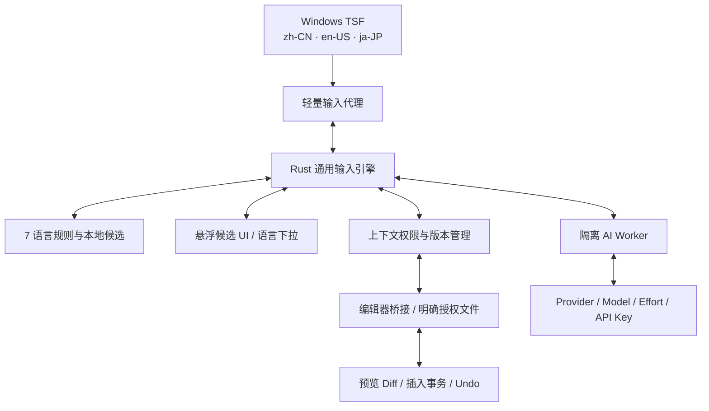
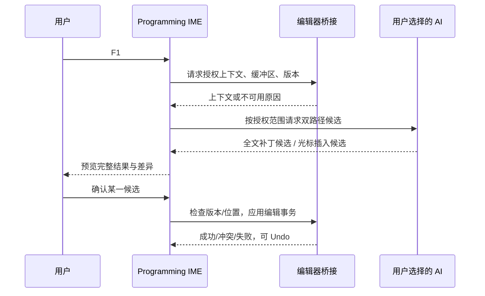

# Programming IME — 软件要件定义书（ソフトウェア要件定義書）

- **文档编号**：SRS-PIME-001
- **版本**：v1.2（统一修订版）
- **日期**：2026-10-29
- **状态**：Requirements Baseline / 技术原型验证前
- **规范参照**：IPA 共通フレーム2013、非機能要求グレード2018；Windows TSF 正式接口文档
- **交付范围**：Windows 11 x64；zh-CN / en-US / ja-JP；Rust、Python、TypeScript、PowerShell、C、Assembly、Machine Code；用户自选 AI Provider/API Key/模型/Effort；实时预测；F1 智能修改

> 本文采用日本 IPA 常见的要件定义章节和可追踪编号组织，并非声称存在单一强制性的 IPA 官方版式。所有性能指标是项目的暂定验收基线，而非 IPA 规定值。

## 0. 模块清单（機能一覧）

| ID | 模块 | 定义 | 优先级 |
|---|---|---|---|
| M01 | Windows 系统输入服务 | TSF 注册、zh-CN/en-US/ja-JP、输入生命周期 | P0 |
| M02 | 通用输入与候选引擎 | Direct、组合、候选排序、撤销与提交 | P0 |
| M03 | 编程语言智能适配 | 七语言 Profile、自动识别、悬浮切换 | P0 |
| M04 | 上下文获取与权限 | TSF 临近文本、编辑器桥接、授权边界 | P0 |
| M05 | AI 服务与模型管理 | BYOK、模型发现、Effort、成本与故障回退 | P0 |
| M06 | 实时预测与智能输入 | 键入预测、本地优先、异步 AI、低干扰 | P0 |
| M07 | F1 智能编辑工作流 | 整文件修改、当前位置插入、差异审阅和事务应用 | P0 |
| M08 | 悬浮交互与快捷键 | 候选层、下拉语言、F1 重绑定、键位冲突 | P0 |
| M09 | 规则与扩展管理 | 词典、模板、方言、插件、用户偏好 | P0 |
| M10 | 安装安全与运维 | 签名、密钥存储、隐私、回滚、诊断 | P0 |

## 1. 项目与业务要求（プロジェクト概要・業務要件）

### 1.1 目标（目的）

把编程语言本身作为操作系统级输入对象：用户无论处于 Windows 中文、英文还是日文输入环境，都能切换到同一款 Programming IME，在任意兼容文本输入场景快速直接输入代码；通过语法规则和用户自行配置的 AI，在光标附近实时给出符合当前语言和上下文的候选，并可按 F1 获得“当前文件完整修改”和“光标位置插入”的独立备选。

### 1.2 系统边界（システム境界）

- 本产品是 **系统输入法**，不是 IDE、编译器、Agent 自治程序或文本替换脚本。
- Windows TSF 负责系统输入法注册、组合、选择与提交；输入引擎用 Rust 编写；复杂 AI 推理与上下文桥接独立进程。
- **TSF 并不等于具备完整文件读取权限。** 临近文本可能由 TSF 提供，但整文件未保存内容、语言标识、文档版本及原子编辑需要受支持编辑器桥接或用户明确授权的文件输入。
- v1.0 允许 **仅修改当前文件**；不自动修改其他文件，不执行生成代码，不自动写盘/运行测试/提交 Git。
- 用户无 API Key 时仍有可用的 Direct、符号与确定性语法候选；AI 功能在配置和授权后启用。

### 1.3 优先级与原则

- **P0**：v1.0 必须满足，验收失败不得标记正式完成。
- **P1**：增强功能，允许在 v1.0 后逐步完善，但设计保留接口。
- **P2**：规划项，不构成本版验收条件。
- **无干扰输入优先**：常规键入不得被 AI 延迟、候选不得未经确认写入文本。
- **用户控制优先**：显式语言切换、手动候选与授予权限优先于自动推断。
- **可恢复性优先**：所有文件级改动先 Diff 预览、再确认应用，支持 Undo 和并发冲突检测。

## 2. 用户角色与典型流程（利用者・ユースケース）

| 用例 | 触发 | 输入上下文 | 用户获得的结果 |
|---|---|---|---|
| UC-01 跨语言启动 | Win+Space/系统语言栏 | zh-CN / en-US / ja-JP | 进入同一个 Programming IME |
| UC-02 实时预测 | 键入字母、符号、前缀 | 光标附近文本、编程语言 | 不阻断输入的候选代码 |
| UC-03 选择语言 | 悬浮框的语言下拉 | Rust/Python/TS/PS/C/ASM/MC | 即刻切换候选规则 |
| UC-04 自动识别 | 打开文件或切换编辑器 | languageId、扩展名、可信上下文 | 自动建议语言，低置信不强切 |
| UC-05 F1 整文件修改 | 默认 F1（可重绑定） | 当前文件完整缓冲区/授权文件 | 完整修改建议 + Diff 预览 |
| UC-06 F1 光标插入 | 默认 F1 | 光标及相邻代码 | 在当前位置插入或替换的候选 |
| UC-07 模型配置 | 设置面板 | Provider/API Key/Model/Effort | 选定自有 AI 能力与用量限制 |
| UC-08 离线降级 | 网络失败/未配 Key | 本地规则与词典 | 继续正常输入 |

### 2.1 核心交互约束

1. 用户每输入一个字母或相关符号，**立即刷新本地候选**；启用 AI 后，在可配置防抖窗口内异步请求更适合上下文的预测。AI 结果必须绑定输入快照、文档版本和光标位置，过期即丢弃。
2. 悬浮框常驻显示当前编程语言标识，点击下拉可选择七种 Profile；可手动锁定，避免自动识别反复跳变。
3. 按 F1 后，面板并列提供 **A. 修改当前整个文件** 与 **B. 插入当前光标处** 两条独立路径。**“给出完整修改内容”不等于自动覆盖文件**：必须先预览、审阅差异和确认，才产生编辑事务。
4. 编辑器不提供全文时，A 不可用或须通过用户指定文件获得授权；B 仍可在受支持文本上下文中工作。不得虚构已读取全文。

## 3. 产品结构（システム構成）

### 3.1 三层语言模型

- `WindowsInputLanguage`：`zh-CN`、`en-US`、`ja-JP`，决定从哪个系统语言环境选择输入法。
- `InterfaceLocale`：`zh-CN`、`en-US`、`ja-JP`，决定悬浮窗和设置显示语言。
- `ProgrammingProfile`：Rust、Python、TypeScript、PowerShell、C、Assembly、Machine Code，决定生成内容及语法规则。

三者独立，例如在 `ja-JP` Windows 输入环境中用中文 UI 编写 Rust。

### 3.2 上下文等级（ContextLevel）

| 等级 | 获取途径 | 允许操作 |
|---|---|---|
| L0 none | 无有效上下文 | Direct/本地固定规则 |
| L1 nearby | TSF 授权临近范围 | 附近代码预测/插入候选 |
| L2 selection | 编辑器当前选区/片段 | 对选区进行补全、替换候选 |
| L3 full-buffer | 可信编辑器桥接、当前未保存缓冲区 | F1 整文件修改与 Diff |
| L4 explicit-file | 用户主动选择文件、明确授权读取 | 当前文件完整变更；必须处理与编辑器 buffer 冲突 |

**读取权限不是系统输入法默认特权。** 优先支持 VS Code 扩展桥接（文件 URI、版本、languageId、selection、dirty buffer、WorkspaceEdit）；其他 IDE 使用独立适配器。普通应用只保证其实际暴露的输入范围，无法承诺跨所有软件读取全文。

## 4. 功能要求（機能要件）

下表是全量功能基线；ID 永久稳定，可直接进入基本设计、详细设计和 UT/IT/ST 追踪。

| ID | 模块 | 功能 | 详细要求 | 优先级 | 验收标准 |
|---|---|---|---|---|---|
| FR-001 | M01 | 三系统语言注册 | 通过同一 TSF CLSID 注册 zh-CN、en-US、ja-JP 三个独立 Profile GUID；允许按语言启用。 | P0 | 分别在三语言环境选择、激活并输入成功 |
| FR-002 | M01 | 非侵入系统切换 | 通过 Win+Space 或系统语言栏切换；不替换或破坏现有拼音、US、日文 IME。 | P0 | 重启后正常，原有输入法仍可用 |
| FR-003 | M01 | 文字提交与回退 | 支持 Composition、提交、Esc 取消以及 Direct 直通；不支持组合的应用自动降级。 | P0 | 候选失败时可正常继续键入 |
| FR-004 | M01 | 敏感输入降级 | 密码/安全输入上下文不进行上下文收集、预测或云端请求。 | P0 | 安全框无内容采集及 AI 请求 |
| FR-005 | M02 | 直接输入默认 | 初次安装默认 Direct，不改变英数字和符号含义；输入候选不强制转换。 | P0 | 关闭候选时行为与常规英文键盘一致 |
| FR-006 | M02 | 统一候选模型 | 对词法、语法、结构、AI、整文件补丁统一 Candidate 类型与来源标志。 | P0 | 七语言共享同一候选排序及 UI |
| FR-007 | M02 | 候选确认撤销 | 支持方向键导航、数字选择、Tab/Enter 可配置、Esc 取消和 Undo。 | P0 | 取消不污染缓冲区；提交可撤销 |
| FR-008 | M02 | 参数结构输入 | 结构模板支持占位符、可选参数、跳转；无法原子编辑时退化成文本。 | P0 | 可在支持的编辑器逐项填写占位符 |
| FR-009 | M03 | 七语言支持 | 支持 Rust、Python、TypeScript/TSX、PowerShell、C、Assembly、Machine Code，统一装载语言 Profile。 | P0 | 七语言完成语言基准用例 |
| FR-010 | M03 | 自动语言识别 | 优先采用编辑器 languageId/文件 URI；其次扩展名及可靠语法特征；低置信保持原模式。 | P0 | 已知文件类型正确识别，模糊不强切 |
| FR-011 | M03 | 用户优先锁定 | 悬浮窗下拉切换语言；手动选择优先于自动识别，允许按文件/应用记忆。 | P0 | 手动锁定后自动识别不得覆盖 |
| FR-012 | M03 | 方言与版本配置 | C 标准、TSX、PowerShell 版本、x86-64 ISA/Intel-AT&T/汇编器及机器码模式独立配置。 | P0 | 不同方言不混用不兼容语法 |
| FR-013 | M04 | 临近文本获取 | 优先读取所授权文本范围，提供光标前后文本、选区和位置；严格遵循 TSF 宿主范围限制。 | P0 | 没有权限时标记可用上下文等级 |
| FR-014 | M04 | 编辑器桥接 | 提供 VS Code 首批官方桥接，取得当前未保存 buffer、版本号、languageId、选区/光标及授权文件内容。 | P0 | 可读取未保存更改，版本号与定位一致 |
| FR-015 | M04 | 逐层上下文策略 | ContextLevel = none/nearby/selection/full-buffer；整文件操作仅在 full-buffer 或显式文件授权时开放。 | P0 | 无完整上下文时禁用整文件应用 |
| FR-016 | M04 | 按项目授权 | 全文发送前展示接收方、范围与风险；允许每次/当前工作区授权及随时撤销。 | P0 | 未授权不得上传文件正文 |
| FR-017 | M04 | 保护未保存工作 | 按编辑器 buffer 原文生成补丁，不以磁盘旧版本覆盖未保存更改。 | P0 | 磁盘与 buffer 不同时保留最新 buffer |
| FR-018 | M05 | 用户自带密钥 | 用户填写第三方 AI API Key；保存到 Windows Credential Manager；支持新增/修改/测试/删除。 | P0 | 密钥不落普通配置文件、不出日志 |
| FR-019 | M05 | 模型供应商配置 | 支持可扩展 Provider 配置、可选自定义兼容端点、模型列表刷新/手动 Model ID，测试连接。 | P0 | 可切换至少两类 Provider 适配器 |
| FR-020 | M05 | Effort 能力协商 | 提供 Auto/Low/Medium/High 等 UI 档位；按提供商映射有效值，不能用则禁用并解释，不静默忽略。 | P0 | 不支持 Effort 的模型不发送无效参数 |
| FR-021 | M05 | 按场景模型选择 | 分别设定实时补全模型和 F1 编辑模型、Effort、输出上限和并发限制。 | P0 | 两种场景可选不同模型且相互独立 |
| FR-022 | M05 | 调用边界 | API Key 配置完成且显式启用后才发 AI 请求；禁用或离线时确定性引擎正常使用。 | P0 | 关闭 AI 后网络请求数为零 |
| FR-023 | M05 | 成本与用量 | 显示估计 tokens/调用次数、模型单价可配置、费用预算、调用取消及速率限制。 | P0 | 超出限额后停止 AI 但不阻断输入 |
| FR-024 | M05 | 容错切换 | 鉴权失败、超时、限流、余额不足和网络错误时显示原因并降级本地候选。 | P0 | 断网键入不中断 |
| FR-025 | M06 | 任意字母预测 | 用户持续输入字母、符号时，以当前 Profile+光标附近文本生成最可能的代码候选，不要求完整固定缩写。 | P0 | Rust/Python/TS/PS/C 均有字母预测样例 |
| FR-026 | M06 | 确定性优先 | 本地词典、语法规则、符号、AST 约束等立即显示；AI 仅增强或重排，不覆盖锁定候选。 | P0 | 无网络仍能提供有效候选 |
| FR-027 | M06 | 防抖与取消 | 输入期间本地即时更新；AI 请求可配置 debounce（初始 350 ms）、取消过时请求、版本标记避免插错。 | P0 | 快速输入不堆积无效结果 |
| FR-028 | M06 | 低干扰 | 候选作为悬浮层显示，不自动修改已输入文本；支持隐藏、暂停、固定、仅显式触发。 | P0 | 正常连续输入无强制替换 |
| FR-029 | M06 | 候选解释 | 展示来源、本地/AI、语言、适用区域、简要解释；低置信结果不得冒充确定性输出。 | P0 | 用户可区分候选来源与效果 |
| FR-030 | M06 | 预测范围 | 缺少全文时只建议附近可证明的片段，不虚构跨文件符号、项目结构或未读上下文。 | P0 | 无桥接时不产生假定完整工程候选 |
| FR-031 | M07 | F1 快捷键 | 当前受支持编辑窗口按 F1 呼出 AI 编辑面板；提供可重绑定、应用例外及保留原 F1 选项。 | P0 | 冲突时不窃取 IDE 帮助键 |
| FR-032 | M07 | 双候选输出 | F1 同时提供 A 整文件修改建议 与 B 光标处插入建议；两条候选可单独生成与选择。 | P0 | 同一上下文可分别预览两类结果 |
| FR-033 | M07 | 整文件修改 | 基于最新 buffer 和编辑意图生成完整变更后的文件或等价补丁，显示完整修改效果及行级 Diff。 | P0 | 用户可查阅全部变更并选择性采纳 |
| FR-034 | M07 | 当前位置插入 | 在当前光标/选区产生上下文适用的插入/替换文本备选，显示将写入的准确位置。 | P0 | 插入目标与用户实际光标一致 |
| FR-035 | M07 | 显式确认应用 | 按候选确认后才修改；整文件必须预览 Diff；可接受全部或按 Hunk 选择。 | P0 | 未确认零写入，确认可撤销 |
| FR-036 | M07 | 版本冲突防护 | 生成时记录文档版本与内容哈希；应用前重新校验，改变则重新比对、重新生成或拒绝。 | P0 | 生成过程中用户修改文档不覆盖 |
| FR-037 | M07 | 安全回退 | 通过编辑器原子 Edit API/Undo 栈应用；失败保留原文，撤销后恢复原状态。 | P0 | 失败不产生半文件覆盖 |
| FR-038 | M07 | 代码检查 | 可用时进行语法解析/格式校验；检查失败突出显示，默认不自动执行、编译或提交。 | P0 | 非法语法不会静默应用 |
| FR-039 | M07 | 无桥接降级 | 仅 TSF 环境展示插入候选；整文件修改需用户主动选择文件并授权，否则明确不可用。 | P0 | 普通记事本中不假装有完整 buffer |
| FR-040 | M07 | 单文件边界 | v1.0 F1 仅对当前文件实施修改；跨文件引用可作只读上下文，不允许未授权写其他文件。 | P0 | 仅授权文件发生实际编辑 |
| FR-041 | M08 | 悬浮交互 | 非遮挡悬浮框显示候选、当前语言下拉、AI 状态、模型、Effort、用量入口。 | P0 | 三种系统语言下均可操作 |
| FR-042 | M08 | 即时语言切换 | 从悬浮下拉选择七语言，不关闭输入法；当前缓冲候选刷新并避免跨语言错误提交。 | P0 | 切换后候选符合新语言 |
| FR-043 | M08 | 可访问性 | 全键盘操作、DPI/多屏适配、屏幕阅读器必要语义、候选窗口位置回退。 | P0 | 常见缩放和多屏下候选可见 |
| FR-044 | M08 | 本地化 | UI 显示语言中文、英文、日文；独立于 Windows 语言与 Programming Profile。 | P0 | 日文系统显示中文 UI 仍能输出 Rust |
| FR-045 | M09 | 声明式语法规则 | 所有语言包共享统一接口，支持词典、标记、结构模板、权重与方言识别。 | P0 | 不改 TSF 核心可更新语言包 |
| FR-046 | M09 | 配置迁移 | 规则与 Profile 带 Schema 版本，提供备份、升级、降级及冲突报告。 | P0 | 旧配置升级不丢失用户偏好 |
| FR-047 | M09 | 第三方插件隔离 | 自定义扩展不能直接进入 TSF 敏感输入线程，访问上下文需权限声明。 | P1 | 异常插件不导致宿主崩溃 |
| FR-048 | M10 | 安装卸载 | 安装器提供 zh/en/ja Profile 勾选、签名验真、清理 GUID/组件、恢复原输入设置。 | P0 | 安装卸载及系统重启后状态正确 |
| FR-049 | M10 | 隐私过滤 | API 请求最小化；过滤疑似密钥/凭据/私密路径，提示用户对全文授权风险。 | P0 | 敏感样例未传输、调用审计可核对 |
| FR-050 | M10 | 操作日志 | 只记录性能、状态与错误元数据，默认不记录按键、源代码、密钥及全文。 | P0 | 日志扫描不含敏感内容 |
| FR-051 | M10 | 输入路径隔离 | TSF 线程只处理轻量状态和 UI，AI、解析、插件在隔离执行单元运行且超时有上限。 | P0 | AI 卡死不影响正常字符输入 |
| FR-052 | M10 | 模式安全 | PowerShell、Assembly、Machine Code 仅生成文本或字节，不主动执行、注入进程或运行生成程序。 | P0 | 无执行副作用且字节需验证 |

## 5. 七语言输入规格（言語別要件）

| 语言 | Profile | 版本/方言 | 首批候选范围 | 特别验证 | 优先级 |
|---|---|---|---|---|---|
| Rust | rust | stable；edition 可配置 | fn、impl、trait、match、Result/Option、async、宏、生命周期 | 语法感知; 避免错误分号 | P0 |
| Python | python | Python 3；项目版本可配置 | def/class、缩进、推导式、with、try、async、类型注释 | 遵循编辑器缩进策略 | P0 |
| TypeScript | typescript | TS/TSX；目标版本可配置 | interface/type、泛型、arrow、Promise、async、union、类型守卫 | 识别 JSX/TSX 语法冲突 | P0 |
| PowerShell | powershell | PowerShell 5.1/7 按 Profile 配置 | Cmdlet、参数、管道、变量、脚本块、函数、异常 | 命令仅作文本绝不执行 | P0 |
| C | c | C11/C17/C23 | 函数/指针/数组/struct/union/enum、预处理器 | 兼容所选 C 标准 | P0 |
| Assembly | assembly | x86-64；Intel/AT&T；汇编器配置 | 助记符/寄存器/寻址/标签/伪指令 | 地址与重定位不确定时提示 | P0 |
| Machine Code | machine-code | x86-64；mode/ISA/地址/字节格式 | hex 字节、ASM↔byte 候选、反汇编预览 | 未解析符号不得生成伪最终字节 | P0 |

### 5.1 规则引擎的抽象

每条规则使用 `LanguageProfile + Trigger + ContextConstraint + Candidate + Parameters + Validation + CommitPolicy`；同一触发串在不同语言中可返回不同结构。支持**非固定缩写**：输入法可根据已输入的字符前缀、正在编辑的 token、AST 可用信息和邻近语句给出候选，而不仅是 `fori → for` 这种模板替换。

- Rust：匹配表达式、`impl`/`trait`、生命周期和宏调用；不能在未知上下文随意添加分号。
- Python：精确跟随原编辑器的缩进和换行设置。
- TypeScript：区分 TS 与 TSX 中 `<...>` 的泛型/JSX 用法。
- PowerShell：Cmdlet 和管道作为**文本**候选，不允许预览时执行。
- C：保证目标 C 标准及其声明语法的兼容性。
- Assembly：必须知道 ISA、Intel/AT&T 语法、汇编器方言及必要的地址环境。
- Machine Code：仅在明确 x86-64 模式与已知编码上下文时输出可验证字节；绝不将未解析符号替换为伪确定的最终机器码。

## 6. AI 服务要求（AI連携要件）

### 6.1 用户设置

| 设置项 | 基线规则 |
|---|---|
| Provider | 可新增多个 Provider Profile；至少提供一个正式 API 适配器和一个可配置兼容端点 |
| API Key | 用户自己填写/测试/更换/删除；凭据保存在 Windows Credential Manager；UI 掩码显示 |
| Model | 可查询可用列表，也允许手动输入 Model ID；按每个场景分别选择 |
| Effort | `Auto / Low / Medium / High / Extended` 等用户级预设；实际参数依 Provider/模型能力映射 |
| 请求场景 | `RealtimeCompletion` 与 `F1Edit` 分开配置 Model、Effort、超时、token 上限、预算 |
| 发送范围 | 未授权不发送文件内容；局部输入采用最小上下文，全文操作需要单独授权 |
| 审计与费用 | 展示调用统计、估计 token/费用、取消、限流、费用上限；不保存原始代码 |

“Effort”是通用 UI **能力抽象**，不是假设所有供应商都支持同名参数。运行前查询或维护模型能力表：支持则正确映射；不支持则禁用该项、回退 Auto 或明确告知用户，不得暗中发送无效参数。Provider 服务端模型列表、价格和支持级别会变化，不将特定模型名称写成固定版本承诺。

### 6.2 实时 AI 的调度

- 本地候选优先，无需网络立即展示；云端 AI 默认仅在用户配置 Key、显式启用并完成传输范围授权后生效。
- 默认防抖 350ms，可选 150–1000ms；避免每次按键触发完整计费请求。
- 即时取消过时请求；绑定 `document_version + selection + cursor + composition_seq + language_profile` 防止旧结果错位。
- 采用多路排序：用户固定规则 > 语法/局部上下文 > 本地频次 > 可选 AI。AI 提供解释与合理上下文，但不得自动插入。
- 常见不联网的匹配可使用本地缓存；缓存仅存脱敏和授权允许的数据，不存代码正文作为全局共享缓存。
- API 故障时保留原始输入，不阻塞 TSF；关闭 AI 时网络请求为零。

### 6.3 AI 模型输入与输出契约

请求至少包含：`task_type`、`language_profile`、`dialect`、`context_level`、`cursor/selection`、`allowed_context`、`user_intent`、`privacy_policy`、`document_version`。输出候选必须是结构化对象，包含：`candidate_id`、`candidate_type`、`replacement_range`、`text_or_patch`、`reason`、`assumptions`、`validation`、`source=ai`，且先在本地检查其目标位置与语法合法性。

## 7. F1 全文编辑与局部插入（智能編集ワークフロー）

### 7.1 F1 双路径

**A — Full File Change**：基于当前完整文件缓冲区、光标上下文和用户输入意图提出修改。显示修改后的完整文件内容及可审阅的行级/分块 Diff；必要时生成 Patch 并在最终预览中呈现完整生效结果。用户可以接受全部或部分差异，确认后才提交给编辑器。

**B — Insert Here**：基于当前光标与周围代码生成一个或多个适用片段；在悬浮框中预览插入/替换位置和文本，用户选择后执行局部编辑。不能越过当前许可范围写入其他位置。

F1 是默认快捷键，但须允许自定义、按应用禁用、保留原 F1 帮助功能；焦点不在可编辑代码区域时不抢占 F1。

### 7.2 操作时序

### 7.3 不可妥协的安全约束

- 未授权读取全文、缺少未保存缓冲区或文档版本不可信：禁止直接应用 Full File Change。
- 编辑器文档在 AI 生成期间变化：必须重新基线比对、让用户重新确认或拒绝，不使用旧位置盲写。
- 所有编辑尽可能使用编辑器的 Undo 与原子编辑 API；不借助低层按键模拟整文件全选覆盖。
- 生成结果可能不正确：必须检查语法可用性、目标范围、换行编码和文件原格式；未通过则提供错误提示，不默默应用。
- F1 不执行 PowerShell 脚本、汇编指令或机器码，不能自动发起编译、终端指令、Git 操作。

## 8. UI 与快捷键（画面・操作要件）

- 主悬浮窗：一行状态 `编程语言 ▾ | Direct/Syntax/AI | 模型 | Effort | 设置`，下面显示可键盘选择的候选。
- 自动语言检测结果可用 `检测到 Rust` 小提示；用户手动选择后锁定模式，直到撤销锁定或切换文件策略。
- 候选内容可以显示代码片段摘要，展开后显示完整代码和假设；不得用长 AI 文本压住编辑区。
- F1 面板提供两个标签：`整文件修改` 与 `光标处插入`；每个标签独立展示版本/授权范围/差异/应用按钮。
- 键盘优先：Esc 取消，方向键选择，确认键可配置；候选不能强行劫持 IDE 已绑定的 Tab/F1/Ctrl+Space。
- 中、英、日 UI 国际化独立于操作系统输入语言和目标编程语言。

## 9. 数据需求（データ要件）

| 实体 | 核心字段 | 保密与存储 |
|---|---|---|
| SystemProfile | LangID、Profile GUID、enable_state | 本地注册配置 |
| ProgrammingProfile | language、dialect、version、locked | 普通用户配置 |
| ProviderProfile | provider_id、base_url、model_id、capabilities | 普通配置无密钥 |
| ProviderCredential | provider_ref、secret | Windows Credential Manager |
| AIActionSettings | realtime/f1、effort、timeout、budget | 用户设置 |
| ContextSnapshot | version、hash、selection、cursor、context_level | 内存短期、按请求丢弃 |
| Candidate | type、range、text/patch、source、validation | 会话临时数据 |
| EditTransaction | document_uri、before_hash、after_hash、hunks、status | 会话与编辑器 Undo 体系 |
| UserRule | trigger、language、constraint、replacement | 本地版本化规则库 |
| PermissionGrant | workspace、context_scope、provider、expiry | 本地最小授权 |

## 10. 外部接口（外部インターフェース）

| ID | 接口 | 合约 |
|---|---|---|
| IF-01 | Windows TSF / COM | 多语言 Profile、Composition、Candidate UI、文本提交 |
| IF-02 | Rust Core IPC | 轻量消息、超时、取消、不可泄露密钥 |
| IF-03 | IDE Context Bridge | 当前语言、文件 URI、未保存缓冲区、选区、文档版本、编辑事务 |
| IF-04 | Provider Adapter | 模型能力发现、凭据引用、补全/编辑请求与结构化结果 |
| IF-05 | Parser/Rules | 语言解析、规则更新、静态合法性验证、字节编码检查 |
| IF-06 | Local Vault | 凭据保存读取、加密与删除 |

## 11. 非功能要求（非機能要件）

参照 IPA《非機能要求グレード2018》的 **可用性／性能・拡張性／運用保守性／移行性／セキュリティ／システム環境・エコロジー** 六大类整理。以下阈值为项目暂定目标，应在标准基准机上实测修订。

| ID | IPA 分类 | 要件 | 优先级 | 验收指标 |
|---|---|---|---|---|
| NFR-101 | 可用性 | 无 AI 网络时完整 Direct/本地候选可用 | P0 | 断网运行 30 分钟无需重启 |
| NFR-102 | 可用性 | 服务崩溃或 IPC 断开 2 秒内恢复 Direct 可输入 | P0 | 辅助进程强杀后不丢已输入字符 |
| NFR-201 | 性能・拡張性 | 本地候选生成 P95 ≤ 20ms；候选显示 P95 ≤ 50ms（指定基准机、1000 次测量） | P0 | 基准测试两指标达标 |
| NFR-202 | 性能・拡張性 | AI 不阻塞按键；默认 350ms 防抖、单会话≤1在途补全请求，可配置 | P0 | 快速打字可取消过期请求 |
| NFR-203 | 性能・拡張性 | F1 先显示处理中状态；首个候选 P95 目标≤15s（依赖模型网络，超时可配置） | P1 | 记录受控网络下的 P95 和超时率 |
| NFR-301 | 運用保守性 | 可查看 Provider 连接状态、响应耗时、费用估计，取消请求，不曝光内容 | P0 | 异常可诊断且无敏感日志 |
| NFR-302 | 運用保守性 | Provider API/模型能力表可通过适配器升级，失效提示不静默替换 | P0 | 未支持 effort 明确呈现 |
| NFR-401 | 移行性 | 安装、升级、卸载可回滚，配置 Schema 版本化 | P0 | 升级/卸载用例通过 |
| NFR-501 | セキュリティ | API Key 存 Windows Credential Manager，不写配置、剪贴板、崩溃日志 | P0 | 安全检查无密钥泄露 |
| NFR-502 | セキュリティ | 任何文件级操作遵循授权、Diff 确认、文档版本校验和可撤销事务 | P0 | 并发修改失败后无数据丢失 |
| NFR-503 | セキュリティ | 第三方代码与 AI 回复视作不可信数据；插件无默认文件/执行权限 | P0 | 恶意指令不能触发自动执行 |
| NFR-601 | システム環境・エコロジー | 支持 Windows 11 x64，DPI 100%-250%，中英日 Profile；默认 CPU 空闲占用≤1%（基准机） | P0 | 系统兼容矩阵达标 |

## 12. 安全与隐私（セキュリティ・プライバシー）

- **BYOK**：用户密钥仅用于其指定 API Provider；不能上传至产品开发者服务器，不能出现在调试日志、明文配置和默认遥测中。
- **最小上下文**：实时预测默认只发送必要邻近片段；F1 全文请求独立授权，并在发送前显示文件范围、服务商、敏感数据风险。
- **危险内容过滤**：识别疑似 API Key、证书私钥、访问令牌、`.env`、密码框等；敏感场景默认阻断上传，用户对代码文件的风险接受必须显式操作。
- **提示注入隔离**：文件注释及 AI 输出均是低可信数据，不得更改工具权限、读取范围或触发命令执行。
- **文档安全**：文件差异用户确认、内容哈希/版本校验、编辑器原子事务和可撤销是 P0，不允许隐藏地进行整文件覆盖。
- **跨供应商**：每个 Provider 独立权限、密钥和使用范围；禁止未经用户选择将代码转发到其他供应商。

## 13. 验收方案（受入基準・試験設計の入口）

| 测试 ID | 测试组 | 场景 | 验收结果 |
|---|---|---|---|
| AT-001 | zh-CN | 安装 zh-CN Profile，切到 Programming IME 并输入 Rust | 显示并激活，候选及提交成功 |
| AT-002 | en-US | 安装 en-US Profile，切到 Programming IME 并输入 Rust | 显示并激活，候选及提交成功 |
| AT-003 | ja-JP | 安装 ja-JP Profile，切到 Programming IME 并输入 Rust | 显示并激活，候选及提交成功 |
| AT-010 | 语言识别 | 打开 .rs、.py、.tsx、.ps1、.c、.asm 和 .bin 关联缓冲区 | 按可信信号推荐；不确定不强制切换 |
| AT-011 | 人工优先 | 手动选 TypeScript 再输入 Python 语法片段 | 保持用户锁定 TypeScript |
| AT-018 | API Key 安全 | 填写、保存、检测、删除 Key；检查磁盘和日志 | Key 只在受保护凭据存储 |
| AT-021 | Effort 协商 | 选不支持 high 或 none 的模型 | 控制不可用或提示，不能默默忽略 |
| AT-023 | 离线/隐私 | 禁用 AI 后连续输入 100 字符 | 0 条 AI 网络请求，本地输入正常 |
| AT-026 | 任意字母预测 | 不同语言中输入非固定缩写的前缀 | 按语言和附近文本形成候选 |
| AT-028 | 快速打字 | 100 字符连续键入、反复退格 | 不会提交陈旧 AI 回复或排队爆发 |
| AT-032 | F1 冲突 | 在 IDE 中配置 F1/其他快捷键并切换应用 | 保留原帮助键或按配置处理 |
| AT-033 | F1 双候选 | 在有桥接编辑器按 F1 | 展示整文件修改和光标插入两个类别 |
| AT-034 | 整文件 Diff | 开启未保存修改并请求 F1 整文件建议 | Diff 基于编辑器未保存缓冲区且能查看全部变更 |
| AT-035 | 插入候选 | 不同光标/选区位置选择插入备选 | 只修改目标位置，结果精确 |
| AT-036 | 明确确认 | 只预览 F1 结果不点击应用 | 文件无任何变化 |
| AT-037 | 并发修改 | AI 生成期间用户编辑同一 buffer | 旧版补丁不直接覆盖新版 |
| AT-038 | 撤销事务 | 确认整文件变更再 Undo | 恢复原文件含未保存内容 |
| AT-040 | 无桥接降级 | 记事本/不支持的 IDE 按 F1 | 允许局部插入，不伪称已理解全文 |
| AT-042 | 悬浮 UI | 中文、英文、日语系统输入环境下呼出下拉 | 七语言可选，语言切换即时 |
| AT-050 | 敏感数据 | 文件包含 mock API Key/私人路径时尝试启用上下文 | 过滤或阻断并要求明确确认 |
| AT-052 | 服务容错 | 强杀 AI Worker 或断开 IPC | 直通输入持续可用 |
| AT-053 | 危险文本 | AI 推荐 PowerShell、字节/汇编文本 | 不自动执行、编译或注入 |
| AT-056 | 提示注入 | 代码注释中含要求上传文件或执行命令的恶意指示 | 当作不可信正文，不能变更应用权限 |

### 13.1 质量门禁

- **UT**：输入规则、语言推断、候选排序、Effort 映射、版本哈希、Patch 合并、字节验证和 Secret 过滤。
- **IT**：TSF↔核心 IPC、核心↔Provider、TSF↔候选窗、核心↔编辑器桥接、凭据保存/删除与错误回退。
- **ST/E2E**：Windows 三输入语言 × 七编程 Profile × 典型宿主应用；快速键入/离线/F1 双候选/未保存缓冲区/并发编辑/撤销/卸载。
- **受入**：P0 测试 100% 通过；涉及源代码覆盖、秘钥外泄、无同意的网络请求、原输入法损坏等阻断级缺陷为 0。

## 14. 分阶段实现（開発フェーズ）

| 阶段 | 工程目标 | 验收门槛 |
|---|---|---|
| Phase 0 | Windows TSF 三 Profile 原型；VS Code bridge；文档版本事务原型 | 三系统语言正常激活，F1 获得未保存 buffer |
| Phase 1 | Rust Core、Direct/规则候选、七语言 Profile、悬浮下拉 | 七语言本地候选可用且不打断输入 |
| Phase 2 | BYOK、Provider、Model、Effort、实时 AI、成本/权限控制 | 真实 API、断网及安全测试通过 |
| Phase 3 | F1 完整双路径、Diff、冲突/Undo、机器码严谨校验 | 完整 P0 验收，发布 v1.0 |
| Phase 4 | 更多 IDE Bridge、更多 ISA、插件、额外模型与本地 AI | P1/P2 扩展 |

## 15. 对抗式审查与待验证事项（設計レビュー）

| 风险 | 审核结论 / 改进措施 | 状态 |
|---|---|---|
| 仅靠 TSF 获取完整文件 | 不成立；必须编辑器桥接或显式授权文件；无全文时降级 | 架构已纠正、待原型 |
| F1 被 IDE 的帮助系统占用 | 默认 F1 但允许改键、上下文激活与保留 IDE F1 | 待宿主兼容测试 |
| 每键联网导致费用高且打字卡顿 | 本地同步候选 + AI 防抖/取消/预算/快照失效 | 设计已限定、待测 |
| 所有模型 Effort 参数不同 | 引入模型能力矩阵和 Provider Adapter，不支持要可见 | 设计已限定、待适配 |
| AI 错误覆盖用户未保存内容 | 以未保存 buffer 和版本哈希为准，Diff 审批与 Undo | 设计已限定、待事务原型 |
| 自动识别错误语言 | 优先 IDE languageId，低置信不强切，人工选择最高优先级 | 设计已限定 |
| AI 泄露代码/密钥 | 分级授权、Local Vault、敏感过滤、无默认原文日志 | 设计已限定、待安全测试 |
| 汇编与机器码无架构上下文 | x86-64 作为首批；限定 ISA/模式/方言，无法编码要报不确定 | 设计已限定、待编码校验 |

### 15.1 基本设计阶段必须回答的问题

1. TSF COM 组件在 Win11 三语言 Profile 下是否都能稳定激活，以及候选窗在多 DPI/应用中的定位。
2. VS Code 当前文档未保存缓冲区、版本戳、撤销栈与原子编辑如何桥接给 IME；F1 在不同应用如何避免冲突。
3. 实时 AI 在合理网络延迟和预算内的推荐质量，如何避免覆盖用户现有输入及误匹配。
4. 整文件编辑结果如何保持换行符、编码、光标、选区、用户未保存内容和补丁一致性。
5. 七种语言的语法/方言/机器码验证范围和可重复测试集。

## 16. 正式参考（参照資料）

- IPA 非機能要求グレード2018：https://www.ipa.go.jp/archive/digital/iot-en-ci/jyouryuu/hikinou/ent03-b.html
- Microsoft TSF Text Service Registration：https://learn.microsoft.com/en-us/windows/win32/tsf/text-service-registration
- Microsoft ITfContext：https://learn.microsoft.com/en-us/windows/win32/api/msctf/nn-msctf-itfcontext
- Microsoft VS Code API：https://code.visualstudio.com/api/references/vscode-api
- Microsoft Windows Credentials Management：https://learn.microsoft.com/en-us/windows/win32/secauthn/credentials-management
- OpenAI Reasoning Effort（用于说明供应商能力差异，并非锁定 OpenAI）：https://developers.openai.com/api/docs/guides/reasoning

**文档结束 / End of Requirements Definition**
