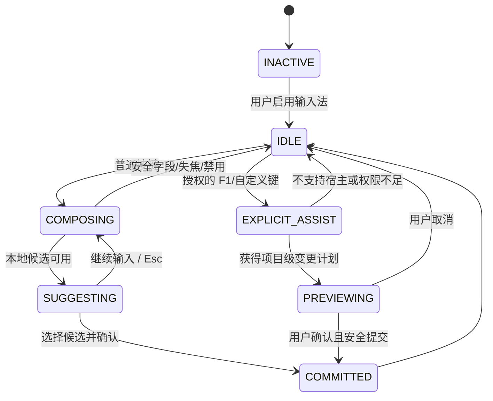

# IDE1.0 — TASE 模板感知语义执行系统：详细设计书

| 属性 | 内容 |
|---|---|
| 文档编号 | IDE-TASE-DD-001 |
| 版次 | 1.1 / 2026-11-05 |
| 状态 | 可实施的详细设计提案；代码和数据库迁移**尚未实施** |
| 关联 | `01_要件定义.md`、`02_基本设计.md`、`04_需求追踪矩阵.xlsx` |
| 设计原则 | 版本化命令、可验证副作用、符号级并发准备、文件级原子提交 |

## 1. 工程分包与依赖（DD-ARCH）

### 1.1 Rust Workspace 新增结构

```text
crates/
├── ide-kernel/                     # 既有，保留唯一文本修改内核
├── editcore/                       # 既有，保留字符位置和 undo
├── ide-shell-protocol/             # 既有，扩展 tase.* 方法
├── tase-contract/
│   ├── src/{lib,api,error,ids,version}.rs
│   └── schemas/{plan,template,job,preview}.schema.json
├── tase-registry/
│   └── src/{manifest,loader,policy,query,digest,validator}.rs
├── tase-semantic/
│   └── src/{lib,adapter,symbol,position,rust,typescript,impact}.rs
├── tase-planner/
│   └── src/{strategy,context,validator,plan_hash}.rs
├── tase-executor/
│   └── src/{preview,apply,rebase,conflict,workspace,git_tx,undo}.rs
├── tase-worker/
│   └── src/{main,consumer,lease,runner,verifier,recovery}.rs
└── tase-metrics/
    └── src/{meter,pricing,aci,telemetry}.rs
apps/web/
└── app/api/v1/tase/{templates,plans,previews,applications,jobs}/
templates/
└── rust/handler-create/1.0.0/...
infra/
├── migrations/0001_tase.sql
└── policies/tase-policy.yaml
```

依赖方向：`contract` 是最底层 DTO（不依赖 executor）；`registry`、`semantic`、`planner` 依赖 contract；`executor` 依赖它们并以适配接口调用 `ide-kernel`；`worker` 依赖 executor、仓储实现和指标；`ide-shell-protocol` 只引用 contract 与应用服务接口，避免将 HTTP server 反向引入核心。

### 1.2 模块核心接口（Rust 伪签名，待与现有 crate API 对接）

```rust
#[async_trait]
pub trait TemplateRegistry: Send + Sync {
    async fn search(&self, q: TemplateQuery) -> Result<Vec<TemplateSummary>, TaseError>;
    async fn resolve(&self, id: TemplateId, digest: Sha256) -> Result<TemplateArtifact, TaseError>;
}

#[async_trait]
pub trait SemanticAdapter: Send + Sync {
    async fn index(&self, snapshot: &RepoSnapshot, path: &RepoPath) -> Result<Vec<Symbol>, TaseError>;
    async fn edit(&self, snapshot: &RepoSnapshot, op: &Operation) -> Result<EditSet, TaseError>;
    async fn affected(&self, snapshot: &RepoSnapshot, edits: &EditSet) -> Result<ImpactSet, TaseError>;
}

#[async_trait]
pub trait CodeExecutor: Send + Sync {
    async fn preview(&self, request: PreviewRequest) -> Result<PreviewResult, TaseError>;
    async fn submit_apply(&self, request: ApplyRequest) -> Result<JobTicket, TaseError>;
}

pub trait DocumentEditAdapter {
    // 在仓库快照隔离会话内适配现有 ide_kernel::Document::apply 语义。
    fn apply_edit_batch(&mut self, patches: &[TextEdit]) -> Result<(), TaseError>;
    fn export_normalized_bytes(&self) -> Result<Vec<u8>, TaseError>;
}
```

**实现注意**：`DocumentEditAdapter` 是本设计新增的适配接口，并非宣称 `ide-kernel` 当前已有相同方法签名。正式编写前用现有 Document API 做 PoC，保持编辑和撤销的唯一事实源。

## 2. Contract 规范（DD-RPC）

### 2.1 通用请求封装

```json
{
  "contract_version": "1.0.0",
  "request_id": "req_01HXYZ",
  "tenant_id": "tn_demo",
  "workspace_id": "ws_demo",
  "repository_id": "repo_ide1",
  "agent_id": "agent_17",
  "trace_id": "trace_01HXYZ"
}
```

上述 `tenant_id/agent_id` 在提交体中仅作提示，**授权主体必须从认证上下文推导**；客户端不能自行声称另一个租户身份。所有时间用 UTC RFC3339，所有路径内部统一仓库根相对 `/` 分隔形式。`request_id` 仅用于追踪，不作为幂等判据。

### 2.2 Template 查询

`GET /api/v1/tase/templates?language=rust&tag=crud&limit=20` / RPC `tase.template.search`。

```json
{
  "templates": [
    {
      "id": "rust.handler.create",
      "version": "1.0.0",
      "digest": "sha256:012345...",
      "language": "rust",
      "tags": ["handler", "crud"],
      "params_schema_ref": "artifact://templates/rust.handler.create/1.0.0/params.schema.json",
      "approval_status": "ACTIVE",
      "license": "MIT"
    }
  ],
  "next_cursor": null
}
```

`digest` 示例做了截断展示；实际必须是 64 位 hex 的 SHA-256。搜索按授权范围过滤，不泄露其它租户私有模板名称。

### 2.3 Plan 创建（`tase.code.plan`）

```json
{
  "contract_version": "1.0.0",
  "repository_id": "repo_ide1",
  "target_ref": "refs/heads/agent-feature",
  "base_commit": "a1b2c3d4fullsha",
  "strategy": "template",
  "operations": [
    {
      "op_id": "op_001",
      "kind": "instantiate_template",
      "target": {
        "path": "src/api/user.rs",
        "symbol": "crate::api::user::create_user",
        "symbol_kind": "function"
      },
      "template": {
        "id": "rust.handler.create",
        "version": "1.0.0",
        "digest": "sha256:FULL64HEX"
      },
      "params": {
        "entity": "User",
        "database": "postgres",
        "authorization": true
      },
      "preconditions": {
        "file_blob_sha": "GIT_BLOB_SHA",
        "symbol_signature_hash": "sha256:FULL64HEX",
        "expected_symbol_exists": false
      }
    }
  ],
  "validation_profile": "rust-ci-default",
  "approval_policy": "project-default"
}
```

样例中的 `fullsha`、`FULL64HEX`、`GIT_BLOB_SHA` 是占位符，需在真实请求中替换为合法完整摘要。对于新文件 `file_blob_sha` 允许 null、`expected_symbol_exists=false`；对于已存在文件要给出真实 blob hash。`symbol` 对新增方法表示目标声明标识而非已存在定位锚点；插入点另由模板 manifest 或 `insert_sibling` 指定。

**Plan 服务执行**：身份鉴权→Schema 校验→仓库/分支权限→内容地址校验→模板锁定→静态检查→操作 DAG 排序→生成规范化 JSON→SHA-256 计划摘要→数据库保存 `plan_id`。Planner 不执行文件写入。

### 2.4 Preview 请求与返回

```json
{
  "contract_version": "1.0.0",
  "plan_id": "plan_001",
  "expected_plan_digest": "sha256:FULL64HEX",
  "snapshot_policy": "pinned_base",
  "include_diff": true
}
```

```json
{
  "preview_id": "prev_001",
  "plan_id": "plan_001",
  "base_commit": "a1b2c3d4fullsha",
  "new_tree_digest": "sha256:FULL64HEX",
  "changes": [
    {"path":"src/api/user.rs","symbols":["crate::api::user::create_user"],
     "added_lines":83,"deleted_lines":0,"diff_uri":"artifact://diff/prev_001/user"}
  ],
  "checks": [{"name":"format","status":"PASS"},{"name":"parse","status":"PASS"}],
  "requires_approval": false,
  "expires_at": "2026-11-05T12:10:00Z"
}
```

Preview 的 `new_tree_digest` 不是最终 Git commit SHA；仅指示候选树内容。过期/基线变化后不得直接复用 Preview。

### 2.5 Apply 请求与异步响应

`POST /api/v1/tase/applications`，HTTP 202，必带 `Idempotency-Key`。

```json
{
  "contract_version": "1.0.0",
  "plan_id": "plan_001",
  "preview_id": "prev_001",
  "expected_plan_digest": "sha256:FULL64HEX",
  "expected_base_commit": "a1b2c3d4fullsha",
  "approval_token": null,
  "commit_policy": "commit_on_green"
}
```

```json
{
  "job_id": "job_001",
  "state": "QUEUED",
  "deduplicated": false,
  "status_url": "/api/v1/tase/jobs/job_001"
}
```

若同一幂等键重复提交相同摘要，返回相同 `job_id` 与 `deduplicated=true`；若内容不同，返回 `IDEMPOTENCY_MISMATCH`。后台进行的失败验证不能直接在初始 202 中报为“已成功提交”。

### 2.6 作业查询

```json
{
  "job_id": "job_001",
  "state": "COMMITTED",
  "attempt": 1,
  "base_commit": "a1b2c3d4fullsha",
  "new_commit": "e5f6fullsha",
  "checks": [{"name":"cargo-check","status":"PASS"}],
  "metrics": {
    "input_tokens": 640,
    "output_tokens": 96,
    "cached_input_tokens": 400,
    "reasoning_tokens": null,
    "llm_cost_usd": null,
    "worker_cost_usd": null,
    "elapsed_ms": 2840
  }
}
```

费用或供应商未报告的 token 记 `null`，不得默认 0。总 Token 汇总需分别保留供应商的计费粒度，防止 reasoning 已包含于 output 时重复计数。

### 2.7 JSON-RPC 到 REST 映射

RPC request `{"jsonrpc":"2.0","id":101,"method":"tase.code.preview","params":{...}}`。服务端统一调用 `TaseApplicationService::preview`；REST 和 RPC 两套 transport 只做参数解码和错误映射。保留现有 `ide-shell-protocol` 的 `-32700/-32600/-32601/-32602/-32603`，新增业务码放在 `error.data.business_code`。

## 3. 模板格式与确定性渲染（DD-REGISTRY）

### 3.1 Manifest 样例

```yaml
schema_version: "1.0"
id: rust.handler.create
version: "1.0.0"
language: rust
engine: tase-safe-template
engine_version: "1.0.0"
license: MIT
provenance: internal-reviewed
status: ACTIVE
permissions:
  filesystem: [workspace_write_scoped]
  network: deny
  subprocess: deny
parameters_schema: params.schema.json
outputs:
  - path_pattern: "src/api/{entity_snake}.rs"
    content: "fragments/handler.rs.tmpl"
    update_mode: semantic_insert
validation:
  - rustfmt
  - cargo_check
fixtures:
  - input: fixtures/input
    expected: fixtures/expected
# digest 记录在注册表的不可变外部元数据，不自引用参与哈希
```

### 3.2 Schema 样例

```json
{
  "$schema": "https://json-schema.org/draft/2020-12/schema",
  "type": "object",
  "additionalProperties": false,
  "required": ["entity", "database", "authorization"],
  "properties": {
    "entity": {"type":"string","pattern":"^[A-Z][A-Za-z0-9]{0,63}$"},
    "database": {"type":"string","enum":["postgres","mysql"]},
    "authorization": {"type":"boolean"}
  }
}
```

`entity_snake` 由**可信 Rust 转换器**从 `entity` 推导，而不是接受一个可包含 `../` 的任意路径参数。模板渲染器禁止执行用户表达式、任意动态 include、shell 命令与外部网络请求。模板包 canonicalize 后计算 SHA-256（排序后的文件路径、权限、内容），对 manifest 自引用 digest 采用外部注册表 metadata 避免循环摘要。

### 3.3 注册/执行算法

```text
register(package):
  verify archive limits, normalized paths and no symlink traversal
  parse manifest + schema, reject unknown capabilities
  compile restricted template AST
  run all golden fixtures in isolated sandbox
  scan licenses and provenance; require approval according to policy
  compute canonical bundle digest; write immutable artifact
  persist metadata with UNIQUE(id,version); emit audit

instantiate(template_digest, params, context):
  fetch immutable artifact and check policy/revocation
  validate params against pinned JSON Schema
  derive identifiers and paths with trusted language adapter
  reject path traversal, collisions, secret path targets
  render restricted AST / syntax tokens
  verify byte-for-byte deterministic hash on same toolchain
  return staged files and affected semantic targets
```

### 3.4 模板失配规则

- 版本未命中、Schema 不合法、符号已存在而需新增、权限超出：拒绝并提供可操作错误。
- 模板匹配评分不足：`strategy = semantic/freeform` 可作为**重新提交的计划**，不得沿用已审批的模板操作默默降级。
- 模板被撤销：未执行作业必须停止并通知；已完成作业保留完整审计信息。

## 4. 语义索引与符号修改（DD-SEMANTIC）

### 4.1 语义键和范围

```rust
struct SymbolLocator {
    repo_path: RepoPath,           // canonical relative path
    language: Language,
    qualified_name: String,
    kind: SymbolKind,
    declaration_digest: Sha256,    // signature / declarations
    anchor_digest: Sha256,         // surrounding normalized node text
}

struct TextPosition {
    line: u32,                     // 0-based
    column_char: u32,              // Unicode scalar value index, not bytes
}

struct ParsedSpan {
    start_byte: usize,
    end_byte: usize,
    start_char: TextPosition,
    end_char: TextPosition,
}
```

正式 diff 的坐标为 UTF-8 byte offsets（便于补丁写入）；人机界面的 cursor 坐标为 `line + char`。LSP 提供的 UTF-16 offset 要专门转换。**永远不能直接用 `column_char` 切 Rust `&str`，否则含中文、日文、emoji 时会出错或 panic**。

### 4.2 定位与编辑算法

```text
resolve_symbol(snapshot, locator):
  read immutable Git blob; verify file blob digest
  parse by language-specific adapter
  filter kind + qualified_name
  check exact signature and contextual anchor
  if exactly one match => return NodeHandle(snapshot_digest, span, scope)
  if zero => SYMBOL_NOT_FOUND
  if >1 => AMBIGUOUS_SYMBOL (return redacted candidates)

build_edit_set(snapshot, operations):
  normalize operation DAG
  for op in deterministic order:
    resolve target in CURRENT staged snapshot
    construct AST edit or validate freeform patch anchors
    collect direct writes + implicit writes (imports, formatting, helpers)
    apply to temporary document through DocumentEditAdapter
    reparse and reject inconsistent/error node when operation requires valid AST
  calculate real final diff against base snapshot
  derive final write set + affected dependencies
  return EditSet / ImpactSet / new tree
```

### 4.3 自动导入/格式化处理

补入 import 必须把 import 组计为共享写集合，不允许两个 Agent 假定“只写自己的函数”。`rustfmt` 可能重排相邻行或文件，须基于 **格式化后的最终 diff** 重算冲突范围，避免计划时无交叠、落盘时覆盖。

### 4.4 增量索引

索引缓存键：`(repo_id, commit_sha, path, blob_sha, adapter_version)`；变动文件增量重建。缓存过期只影响性能，不可充当当前 HEAD 的真相来源。采用 Tree-sitter 时，在文本编辑后调用 tree edit + reparse，并重新映射旧节点句柄；不能持久化旧内存节点/byte span 当作跨 commit 标识。

## 5. 并发调度、冲突检测及 Git CAS（DD-EXEC）

### 5.1 只读 Preview

```text
preview(plan):
  assert permission(read + preview) and plan digest
  load pinned base snapshot and pinned template versions
  run deterministic operation DAG into staging worktree
  validate paths, AST, generated file size and policy
  calculate actual final diff and ImpactSet
  run preview-level checks within sandbox
  store PreviewArtifact(immutable digest, base, plan digest, validator versions)
  return preview_id + diff URI + checks + expiry + risk
```

Preview 仅可写隔离 worktree/工件库，不更改用户正式 ref。预览成功不代表 Apply 一定成功：可能因 HEAD 漂移、批准失效或校验策略变化而冲突。

### 5.2 Apply 核心伪代码

```text
submit_apply(request, auth, idempotency_key):
  authorize repo/branch/action; check approval and expiry
  digest = canonical_hash(auth.scope, request)
  BEGIN TX
    existing = SELECT jobs WHERE (tenant, idem_key) FOR UPDATE
    if existing:
      if existing.digest != digest: abort IDEMPOTENCY_MISMATCH
      return existing.job_id
    INSERT jobs(id, tenant, idem_key, digest, QUEUED, ...)
    INSERT outbox(job_id, action='READY')
  COMMIT
  return 202 Accepted job_id

worker_apply(job):
  acquire durable job lease with monotonic epoch
  validate current authorization and template pin
  load plan + preview; assert hashes and policy
  current_head = fetch_branch_head()
  if current_head != plan.base:
     result = try_rebase(plan, from=plan.base, to=current_head)
     if unsafe: finish(CONFLICT), do not mutate
  staged = compute_edit_set(current_head)
  assert file/symbol/impact preconditions + deterministic checks
  run format, compile and selected tests in sandbox
  if validation fails: finish(FAILED) with evidence
  create Git tree and commit with Trailer: TASE-Job-ID=job_id
  call CommitCoordinator.commit(job_id, lease_epoch, current_head, new_commit)
    coordinator locks branch row + job lease row in database
    coordinator verifies live lease epoch and approval while locks held
    coordinator runs Git ref CAS expected=current_head to=new_commit
    coordinator records commit intent/result and releases locks
  if CAS fails:
     retry bounded rebase or finish(CONFLICT)
  reconcile durable commit record + audit (idempotent upsert)
  finish(COMMITTED) only after confirming ref/commit fact
  ack queue message
```

### 5.3 自动重基的允许条件

1. 先验证 `base_commit` 是目标分支当前历史中的已知祖先（若非祖先，拒绝或人工审查）。
2. 对变动文件在**新 HEAD** 重新索引全部目标符号，确认唯一性及签名/锚点前置条件。
3. 计算 `changed_since_base` 的真实写集合与新计划所需写集合：若重叠到相同声明、import、公共类型依赖或其它受保护作用域，拒绝。
4. 在新 HEAD 重新执行**原始声明式计划**，而非把旧 byte-offset 补丁套到新文件。
5. 对新候选重新执行编译/测试/政策门禁及代码 diff；重新生成 Preview digest。高风险计划需再次审批。
6. CAS 更新 branch 时再次确认 HEAD 未变化；失败有上限重试（默认 2 次），超过返回 CONFLICT。

**不自动重基**：删除/重命名公共 API、改变 trait / 类型签名、跨文件引用未知、两个操作改相同 symbol、import 产生不确定冲突、自由补丁锚点不唯一、涉及安全敏感路径、模板版本不一致。

### 5.4 同一文件两 Agent 场景

```text
HEAD H0: fn alpha + fn beta
Agent A plan@H0: 修改 alpha
Agent B plan@H0: 修改 beta
A/B 并行 Preview
A 在文件锁/branch CAS 下提交 H0 -> H1
B 发现 HEAD=H1 != H0
B 在 H1 重新解析 beta、import 和影响集
  若独立 -> 重新实例化、验证、CAS H1 -> H2
  若 overlap -> SYMBOL_CONFLICT，不写正式分支
```

不能仅检查函数名不同就允许通过；如果 A 在共享 `use` 段添加引用而 B 删除该模块，两者必须视为冲突。

### 5.5 Git/DB 跨系统故障的恢复

Git ref CAS 与 Postgres 事务通常不构成单一 ACID 事务。新增单一 `CommitCoordinator` 作为分支引用的唯一写入口：通过数据库 `repo+branch` 提交行锁串行化，持锁时验证 `lease_epoch`/有效期/批准状态并执行 Git ref CAS，防止旧 Worker 在租约过期后提交。跨系统仍采用 **Outbox + Reconciler**：作业提交 Git 前写 `PREPARING_COMMIT` 证据；Git commit trailer/附加 metadata 含唯一 Job ID；发生进程崩溃时，恢复器检查当前 refs 与 Git 对象是否存在对应 commit，若已推进则幂等补录 `CommitRecord` 并标记成功，未推进则按幂等策略重试。禁止仅凭缓存状态宣布“未提交”。

### 5.6 取消与撤销

- `QUEUED`/`PREVIEW_READY` 可取消；`VERIFYING` 可请求停止并终止沙箱；`COMMITTED` 不可“取消”，只能发起新的反向计划。
- 撤销使用 `revert`/反向 AST patch，必须以当前 HEAD 为基础再检查冲突，避免撤销后覆盖其他 Agent 的后续修改。

## 6. 数据库详细设计（DD-DATA）

### 6.1 PostgreSQL 参考 DDL（最小核心）

```sql
CREATE TYPE tase_job_state AS ENUM (
  'RECEIVED','VALIDATED','QUEUED','LEASED','PREPARING',
  'PREVIEW_READY','AWAITING_APPROVAL','APPLYING','VERIFYING',
  'COMMITTED','CONFLICT','FAILED','CANCELLED','REJECTED'
);

CREATE TABLE tase_plans (
  plan_id UUID PRIMARY KEY,
  tenant_id UUID NOT NULL,
  repo_id UUID NOT NULL,
  target_ref TEXT NOT NULL,
  base_commit TEXT NOT NULL,
  plan_digest TEXT NOT NULL,
  contract_version TEXT NOT NULL,
  operations_json JSONB NOT NULL,
  created_at TIMESTAMPTZ NOT NULL DEFAULT NOW(),
  UNIQUE (tenant_id, plan_digest)
);

CREATE TABLE tase_jobs (
  job_id UUID PRIMARY KEY,
  tenant_id UUID NOT NULL,
  plan_id UUID NOT NULL REFERENCES tase_plans(plan_id),
  idempotency_key TEXT NOT NULL,
  request_digest TEXT NOT NULL,
  state tase_job_state NOT NULL DEFAULT 'RECEIVED',
  attempt INTEGER NOT NULL DEFAULT 0,
  lease_epoch BIGINT NOT NULL DEFAULT 0,
  lease_owner TEXT,
  lease_expires_at TIMESTAMPTZ,
  base_commit TEXT NOT NULL,
  new_commit TEXT,
  last_error_code TEXT,
  created_at TIMESTAMPTZ NOT NULL DEFAULT NOW(),
  updated_at TIMESTAMPTZ NOT NULL DEFAULT NOW(),
  UNIQUE (tenant_id, idempotency_key),
  CHECK (attempt >= 0),
  CHECK (lease_epoch >= 0)
);

CREATE TABLE tase_outbox (
  outbox_id BIGSERIAL PRIMARY KEY,
  job_id UUID NOT NULL REFERENCES tase_jobs(job_id),
  event_type TEXT NOT NULL,
  delivered_at TIMESTAMPTZ,
  created_at TIMESTAMPTZ NOT NULL DEFAULT NOW()
);

CREATE TABLE tase_branch_commits (
  repo_id UUID NOT NULL,
  target_ref TEXT NOT NULL,
  fencing_epoch BIGINT NOT NULL DEFAULT 0,
  PRIMARY KEY (repo_id, target_ref)
);

CREATE TABLE tase_commit_records (
  job_id UUID PRIMARY KEY REFERENCES tase_jobs(job_id),
  repo_id UUID NOT NULL,
  target_ref TEXT NOT NULL,
  old_commit TEXT NOT NULL,
  new_commit TEXT NOT NULL,
  committed_at TIMESTAMPTZ NOT NULL DEFAULT NOW(),
  UNIQUE (repo_id, target_ref, new_commit)
);

CREATE TABLE tase_audit_events (
  event_id BIGSERIAL PRIMARY KEY,
  tenant_id UUID NOT NULL,
  job_id UUID,
  actor_id TEXT NOT NULL,
  action TEXT NOT NULL,
  evidence_digest TEXT NOT NULL,
  created_at TIMESTAMPTZ NOT NULL DEFAULT NOW()
);

CREATE INDEX idx_tase_jobs_claim ON tase_jobs(state, lease_expires_at);
CREATE INDEX idx_tase_audit_job ON tase_audit_events(job_id, created_at);
```

追加表：`tase_template_versions(template_id,semver,digest,license,approval)`、`tase_preview_artifacts`、`tase_cost_records`、`tase_symbol_index`、`tase_approvals`、`tase_permissions`。这些表的详细字段可基于 DD-DATA 中的实体定义另行 migration；投产前必须补全外键、审计保留及权限策略。

### 6.2 原子领取租约

```sql
WITH picked AS (
  SELECT job_id
  FROM tase_jobs
  WHERE state = 'QUEUED'
     OR (state IN ('LEASED','PREPARING') AND lease_expires_at < NOW())
  ORDER BY created_at
  FOR UPDATE SKIP LOCKED
  LIMIT 1
)
UPDATE tase_jobs j
SET state='LEASED',
    lease_epoch=j.lease_epoch+1,
    lease_owner=$1,
    lease_expires_at=NOW() + INTERVAL '30 seconds',
    attempt=j.attempt+1,
    updated_at=NOW()
FROM picked WHERE j.job_id=picked.job_id
RETURNING j.job_id, j.lease_epoch;
```

需有心跳 `WHERE job_id = ? AND lease_epoch = ? AND lease_owner = ?` 更新，过期 epoch 不得推进状态。租约 30 秒只是初始建议，可配置且必须配合 heartbeat/recovery；实际生成/测试时长可以更久。

### 6.3 状态转移约束

所有状态转移通过 `UPDATE jobs SET state=:to WHERE id=:id AND state=:from AND lease_epoch=:epoch` 完成，并以影响行数验证。`COMMITTED`、`FAILED`、`CONFLICT`、`CANCELLED`、`REJECTED` 为终态；对终态相同重复通知可以幂等接受，但不能从终态“重新执行”，重试需要新 Job ID。

## 7. Worker 安全设计（DD-SECURITY）

### 7.1 权限请求模型

策略判定输入：`principal`, `tenant_id`, `repo_id`, `target_ref`, `paths`, `operation_kinds`, `template_digest`, `risk_level`, `approval_id`, `expires_at`。决策为 `ALLOW`/`DENY`/`REQUIRE_APPROVAL`；Router 只做前置鉴权，Worker 在应用前重新决策，阻断过期/撤销权限。

### 7.2 Sandbox 默认规则

- 文件系统：只允许容器中挂载的 repo snapshot 为只读，workspace staging 为受限可写；拒绝 `..`、绝对路径、symlink/hardlink 越界、大小写路径碰撞和 Windows 驱动器/UNC 注入。
- 命令：模板渲染器绝不调用 shell；rustfmt/cargo/check/test 由**固定 allowlist** 启动、指定 cwd 和 argv，不使用拼接的 shell 字符串。
- 网络：默认 deny，依赖下载需组织批准的代理/镜像，严格区分编译时与运行时外联。
- 资源：CPU、内存、文件数、单文件大小、输出量、时间、进程数和并发上限；超限明确返回 ERROR。
- 密钥：API Key 由凭证管理器短期注入最小 Scope，日志/trace 不记录明文；工件与缓存写入前进行泄露扫描。
- 模板包：限制解压大小与文件数量，拒绝归档路径穿越，所有文件重算 hash；发布/变更需审查。
- 外部 LLM：组织和用户明确授权后才发送最小必要代码上下文，默认不发送密钥和敏感文件。

### 7.3 防提示词注入

仓库代码、README、注释、模板说明均作为**不可信数据**，不得覆盖系统的安全策略、工具权限与任务约束。模型生成的 `Plan` 即使 JSON Schema 合法，也不代表有权执行，必须独立进行 Policy、Path、Version、Template 和 Sandbox 校验。

## 8. 事务适配和端侧同步（DD-ADAPTER）

### 8.1 本地 IDE 模式

`Tauri/CLI -> ide-shell-protocol application service -> tase-executor -> DocumentEditAdapter -> ide-kernel::Document`。一个 Plan 在本地编辑器显示为单一逻辑 undo 事务。若批量编辑过程中失败，利用内核暂存/快照回滚并恢复 buffer dirty/cursor 状态，保证半成品不呈现为成功。

### 8.2 云端仓库模式

`HTTP Router -> Queue -> Worker -> Staging Repository -> DocumentEditAdapter -> Git tree/commit -> CAS ref`。应用成功事件按 `commit_id` 发送给 Web 客户端；客户端发现当前 Buffer 有未保存本地修改时，不直接覆盖用户工作副本，应展示三方 diff 与选择项。

### 8.3 Unicode 与编码

对 CRLF、UTF-8 BOM、中文/日文字符、组合字符、emoji 及多字节字符建立 `PositionMapper`。`char` 对应 Unicode scalar 而不是 grapheme cluster；UI 光标可另以 grapheme 处理，但必须显式换算。保留原文件行尾风格、末尾换行与编码，除非任务要求转换。

## 9. 模型上下文、Token 与计费（DD-METRIC）

### 9.1 上下文生成

1. 检索目标 symbol、调用者/被调用者与必要 import，优先返回签名和摘要。
2. 模板匹配时传 `id/version/schema/supported_behaviors`，而非全部模板源码。
3. 模型只需输出经过 Schema 约束的操作参数；自由代码仅允许在 `freeform_patch` 的局部段。
4. 如果上下文不足，允许 agent 通过 `context.expand` 请求额外符号内容；请求需记录成本和敏感数据策略。
5. 任何模型输出都要经后置独立校验，不因“模型很自信”而直接应用。

### 9.2 统计结构

```json
{
  "job_id": "job_001",
  "provider": "provider-name",
  "model": "model-version",
  "usage": {
    "input_tokens": 5000,
    "output_tokens": 120,
    "cached_input_tokens": 3000,
    "reasoning_tokens": null
  },
  "pricing": {
    "version": "provider-pricing-2026-11",
    "input_usd_per_million": null,
    "output_usd_per_million": null,
    "cached_input_usd_per_million": null
  },
  "timing": {
    "llm_ms": 1510,
    "queue_ms": 84,
    "worker_ms": 1150,
    "validation_ms": 820,
    "e2e_ms": 2840
  },
  "outcome": "COMMITTED"
}
```

时间分项可能重叠（例如 worker_ms 包含 validation_ms），不简单相加为 e2e_ms。`input_tokens` 是否包含 `cached_input_tokens` 按提供者定义留元数据；不得重复计价。价格需按调用时实际版本、plan/区域/优惠归因，不是简单按总 Token × 单价。

### 9.3 基准设计

基准组 A：同一模型、同一任务、全代码生成；基准组 B：同一模型、模板/语义调用。任务至少包含：标准 CRUD、实体字段扩充、两个 Agent 修改同文件不同函数、带 import 冲突、复杂算法无模板、失败重试。记录 `success`、`cost/success`、`LLM output tokens`、`TTFT`（适用时）、`e2e latency`、`compile/test pass`、`human corrections`。每组重复 5 次以上并报告 P50/P95/置信区间或范围；模板不适用任务单列，禁止用模板最佳样本代替总体结论。

## 10. ACI、日志与验收测试（DD-ACCEPTANCE）

### 10.1 ACI 映射

沿用 IDE1.0 `.aci.json` 必填字段：`assertion_id`、`aci_version`、`layer`、`scope`、`expect`、`actual`、`status`、`severity`、`reasoning`、`captured_at`。测试层 `ut/it/st/e2e`；若要用 `uat` 作为 UI 术语，落入 ACI 时统一映射到 `e2e`，避免私自扩展 schema 枚举。

### 10.2 优先测试清单

| TC-ID | 层 | 对应 FR/NFR | 输入 | 预期 |
|---|---|---|---|---|
| TC-001 | UT | FR-001/003 | 相同 ID/version 不同内容 | 不可覆盖，返回不可变版本冲突 |
| TC-002 | UT | FR-004/021 | `entity="../../.env"` | 参数拒绝，无输出文件 |
| TC-003 | UT | FR-005/017 | 非法 Plan / 未知操作种类 | `INVALID_ARGUMENT` |
| TC-004 | IT | FR-008 | Preview CRUD | 返回 diff，正式 HEAD 不变 |
| TC-005 | IT | FR-009 | 过期 base commit | `STALE_BASE` 或安全重基，不覆盖 |
| TC-006 | ST | FR-010/011 | A/B 修改不同函数且不同 import | 可安全重基，输出包含两方代码 |
| TC-007 | ST | FR-011/012 | A/B 修改不同函数但共享 import 冲突 | `SYMBOL_CONFLICT` 或受检重新应用；无丢失 |
| TC-008 | IT | FR-013 / NFR-002 | 并发重复同 Key/同请求 100 次 | 单 Job、单 Git commit 效果 |
| TC-009 | IT | FR-013 | 同 Key 不同内容 | `IDEMPOTENCY_MISMATCH` |
| TC-010 | ST | FR-014 / NFR-014 | Worker CAS 之后 DB 之前崩溃 | 恢复器只补录一次，不重复提交 |
| TC-011 | ST | FR-019 | 日文、emoji、CRLF、多字节范围替换 | 坐标正确，文件可编译 |
| TC-012 | IT | FR-020 | 模板生成编译错误 | `VALIDATION_FAILED`，正式 ref 不变 |
| TC-013 | ST | FR-021/022 | 跨租户 repo/token/路径穿越 | 全拒绝、审计记录完整 |
| TC-014 | IT | FR-018 | 相同 Plan 从 TUI/HTTP/Tauri 调用 | 相同目标 tree digest |
| TC-015 | E2E | FR-029 | 修改保护分支/CI 配置 | 触发人工审批，不绕过 |
| TC-016 | Bench | FR-023/024, NFR-006/015 | 固定基准任务集 A/B | 报告完整成本、成功率及输出 Token 降幅 |
| TC-017 | ST | FR-016/030 | 提交后另一个 Agent 又修改同符号，再撤销早期提交 | 明确冲突，不覆盖最新修改 |
| TC-018 | IT | FR-027 | 已撤销模板继续引用 | `POLICY_REJECTED` |
| TC-019 | IT | FR-006/019 | 同名不同模块函数 | 精确定位或 `AMBIGUOUS_SYMBOL` |
| TC-020 | ST | NFR-008 | 1,000 Agent 身份排队、32 Worker 并发准备 | 不丢任务、资源配额受控、提交正确 |

各 FR 的完整一对一测试追踪在 xlsx 中扩展，实施时应在 `tests/ut/`、`tests/it/`、`tests/st/`、`tests/e2e/`、`tests/bench/` 存储真实可运行测试。

### 10.3 发布阻断门禁

- 代码质量：`cargo fmt --check`、`cargo clippy --workspace --all-targets -- -D warnings`、`cargo test --workspace` 必过。
- 安全：`cargo audit`（经版本验证采用）、secret scan、依赖许可/模板许可、沙箱逃逸回归通过。
- 协议：Contract 兼容性测试、schema snapshot、旧 `ide-shell-protocol` 端点回归通过。
- 事务：同文件冲突、Git ref CAS 失败、重复投递、租约过期、DB/Git 断点恢复不得发生静默丢失。
- 指标：每次发布保存固定基准样本与性能回归；指标不足则标明“不达目标”，不得无条件宣称节省成本。

## 11. 关键算法性能与边界

| 操作 | 预计成本类别 | 优化手段 | 失败边界 |
|---|---|---|---|
| Registry 查询 | 索引查询 | `language/tag/status` 索引及 Cache | ACL 过滤后返回 |
| 语义解析 | 与文件大小/语言复杂度相关 | 文件 blob hash cache / 增量解析 | 文件过大或语法无法稳定解析时拒绝 |
| Plan 校验 | 与操作数相关 | JSON Schema + DAG 拓扑排序 | 环拒绝，最大操作数受配额控制 |
| Preview | 解析 + 模板 + 校验 | 共享不可变 base 快照/工具链缓存 | 上限/超时后报告部分证据，不能伪报 PASS |
| Apply | 校验 + 受控串行提交 | 只锁必要文件，Git CAS 最终兜底 | CAS 重试有界，不无限循环 |
| 模型调用 | 依赖供应商和推理负载 | 限定输出 Schema、缓存固定前缀、最小上下文 | 遇到模型失败可转人工/重试，不绕过验证 |

## 12. 可配置参数（建议默认值；并非实测）

```yaml
tase:
  contract_version: "1.0.0"
  mode: hybrid
  planner:
    prefer_template: true
    allow_freeform: true
    max_operations: 128
    max_context_chars: 24000
  registry:
    require_approved: true
    require_digest_pin: true
    allow_remote_scripts: false
  executor:
    require_preview: true
    max_rebase_attempts: 2
    enforce_git_ref_cas: true
    validate_actual_write_set: true
    require_tests_on_protected_branch: true
  worker:
    max_preparing_concurrency: 32
    lease_seconds: 30
    heartbeat_seconds: 10
    sandbox_network: deny
    process_timeout_seconds: 900
  security:
    redact_secrets: true
    require_explicit_llm_context_consent: true
  metrics:
    emit_aci: true
    include_worker_cost: true
    pricing_policy: actual_or_unknown
```

设 `heartbeat_seconds < lease_seconds`，不同语言的编译器/依赖可在允许的沙箱策略下按项配置。`process_timeout_seconds` 是组织默认配额而不是 Vercel Function 时限。

## 13. 失败模式与恢复手顺

| 场景 | 检测 | 处理 | 正式仓库结果 |
|---|---|---|---|
| 模板哈希不符 | digest verify | 拒绝并报警，清理可疑缓存 | 不变 |
| 无权限/恶意路径 | policy / path canonicalization | 返回拒绝，保留脱敏审计 | 不变 |
| AST 锚点歧义 | >1 candidate | 返回候选位置，要求重计划 | 不变 |
| 编译测试失败 | exit code/nonzero | 保存验证工件、失败状态 | 不变 |
| 并发冲突 | CAS/ref mismatch | 可证明独立才有限重基，其他冲突 | 不覆盖他人 |
| 过期 Worker | lease_epoch mismatch | 中止提交，释放沙箱 | 不变 |
| Git 成功、DB 更新失败 | commit trailer + recovery | 补录事实并 ACK | 已提交一次 |
| DB 作业创建成功、队列投递失败 | outbox 未投递 | outbox relay 补发 | 尚未提交 |
| 客户端断线 | job_id 保存于数据库 | 客户端重连 `job.get` | 不受影响 |
| 成本供应商不返回 | usage unknown | null + 来源说明 | 不影响代码正确性 |

## 14. 详细设计开发次序 / 验收门槛

1. **S0 Contract 与验证**：Schema、OpenAPI、RPC method、错误码、表结构、先写 UT/IT。
2. **S1 Registry 与 Rust Semantic**：模板 fixture、Path/Unicode、单文档 Preview，不碰正式 Git ref。
3. **S2 Apply & Git CAS**：原子提交、事务适配、回滚与最小审计、幂等测试。
4. **S3 Worker & Queue**：租约、fencing、outbox、故障恢复与 32 并发模拟。
5. **S4 Vercel Router & UX**：外壳联动、diff/审批、权限与指标。
6. **S5 TS & Bench**：新增 TS 适配、扩大模板库、完成标准/模板 A/B 基准与 P0 签收。

**禁止条件**：不得为了满足性能目标跳过 `Document` 一致性、编译/测试验证、授权审批或 Git CAS；不得因为“模板生成成功”直接宣布“任务成功”。

## 15. 详细设计自审与设计决定

- [x] 功能范围与 FR、NFR 对齐，并有测试 ID 示例。
- [x] JSON-RPC 与 REST 明确只是一套 Contract 的不同 transport。
- [x] 识别 Git / Postgres 非同一事务，设计了 outbox 和提交对账。
- [x] 识别 Unicode char/byte/UTF-16 差异与 CRLF 兼容。
- [x] 区分真实最终 diff 和模型预测编辑范围，防止共享 import 漏检。
- [x] 审核模板、AST 和自由补丁三种路径均必须遵循安全策略。
- [x] 区分减少 Token、降低账单成本、缩短端到端时间三项不同指标。
- [x] 明确现有 IDE1.0 代码与新增 API 之间需要实现适配，未暗示已上线。

## 16. 参考资料

- IDE1.0 源代码：<https://github.com/UlyssesLeoLee/IDE1.0>
- Vercel Functions（运行模型）：<https://vercel.com/docs/functions>
- Vercel Queues（至少一次投递）：<https://vercel.com/docs/queues/concepts>
- Tree-sitter（增量解析）：<https://tree-sitter.github.io/tree-sitter/using-parsers/3-advanced-parsing.html>
- JSON-RPC 2.0：<https://www.jsonrpc.org/specification>
- JSON Schema 2020-12：<https://json-schema.org/draft/2020-12>

## 17. 本地多 Agent 服务：模块与 IPC（DD-LOCAL）

### 17.1 具体模块与目录（新增建议，均为设计；非既有实现）

```text
crates/
  tase-local-hub/                  # 唯一常驻 Local Agent Hub 二进制与运行时
    src/bin/tase-local-hub.rs
    src/{bootstrap,server,auth,session,workspace,telemetry}.rs
  tase-local-ipc/                  # Named Pipe/UDS、请求封装、异步帧、反压
    src/{transport,framing,connection,acl}.rs
  tase-agent-scheduler/           # 每 agent 公平队列、配额、租约、优先级
    src/{queues,quota,leases,budget,events}.rs
  tase-local-store/               # SQLite WAL、migration、outbox、恢复
    src/{sqlite,migrations,reconcile,snapshots}.rs
  tase-catalog/                   # 模式/算法知识库、别名、约束、版本
    src/{assets,index,recommend,governance,implementation}.rs
  tase-catalog-mcp/               # JSON-RPC 和 MCP 工具投影，共用 DTO
    src/{tools,schema,adapter}.rs
  tase-ime-core/                  # 跨平台候选排序与上下文隐私过滤（不依赖 COM）
    src/{candidate,context,rank,policy}.rs
  tase-ime-tsf/                   # Windows TSF 适配 DLL，编译/安装独立
    src/{com_adapter,composition,candidate_ui,ipc_client}.rs
```

保持原有 `ide-kernel` 的单一编辑事实源，`tase-executor` 承担文件/语义级 Apply；Hub 调用既有执行器，不直接实现第二套文本编辑缓冲。新 crates 必须检查循环依赖、Windows 非目标平台的条件编译以及既有 `rust-version` 与 CI 是否兼容；不强制将 COM DLL 编译加入现有全平台默认 workspace。

### 17.2 启动与单例模型

- Hub 入口调用 `start_or_connect()`：先以 Windows 登录 SID 作为 namespace 计算本用户管道名和单实例互斥体；若已存在已认证实例则连接，不再启动第二个写入协调进程。
- `Mutex` 只锁 Hub 生命周期；Git ref CAS、磁盘上的 per-file generation 和数据库 fencing 才构成持久安全边界。**不允许靠 mutex 推断 OS 崩溃前作业已经提交。**
- 本地数据默认落在用户专属受限目录（Windows 例如 `%LOCALAPPDATA%/IDE1.0/tase/`），目录 DACL 限当前用户，使用本地 SSD；SQLite WAL 数据不得直接放在共享/网络盘上。
- 每个 Workspace 可指向 `canonical_realpath` 验证后的根目录，拒绝任意符号链接、结点变更、路径穿越和未经允许的外接/网络目录写入。
- Hub 无外网监听。将本地 HTTP API 暴露到 `0.0.0.0` 不属于 v1.1 默认部署。需要跨用户/远程访问时，应另开具明确鉴权、证书及审计的服务型部署。

### 17.3 IPC 帧与协议协商

同机 Named Pipe 承载 JSON-RPC 2.0 消息；物理层采用 4 字节小端 `u32` 的长度前缀，再跟 UTF-8 JSON 字节，默认单帧上限 1 MiB，超过立即拒绝。消息体仍然有 `jsonrpc: "2.0"`、`method`、`params`、`id`；每个 request 独立 `trace_id`，并行响应按 `id` 关联而非依赖到达顺序。

```json
{
  "jsonrpc": "2.0",
  "id": "reg-01",
  "method": "tase.agent.register",
  "params": {
    "contract_version": "1.1",
    "client": "codex-cli",
    "workspace_id": "workspace-abc",
    "requested_scopes": ["catalog:read", "plan:write", "preview:read"],
    "client_nonce": "generated-client-nonce"
  }
}
```

成功返回 `agent_id`、`session_id`、`granted_scopes`、`protocol_capabilities`、`heartbeat_interval_ms`、`session_expires_at`。外部 `client` 名称不可作为可信身份。连接先验证 Windows pipe 对端进程 token 与 logon SID，并映射授权身份；grant 是 Hub 签发的受限能力，`requested_scopes` 不会自动批准。允许同一 Agent 重新连接，但必须证明会话恢复令牌/本地进程身份；默认重启分配新 session。

必备 RPC：

| RPC | 输入主要字段 | 输出 | 安全属性 |
|---|---|---|---|
| `tase.agent.register` | workspace、申请 scopes | agent/session/granted scopes | 本地身份校验 |
| `tase.agent.heartbeat` | session、last_seq | lease expiry | 只更新该会话 |
| `tase.agent.unregister` | session | accepted / active jobs | 不影响其他会话 |
| `tase.workspace.snapshot` | workspace、document/buffer preference | commit/buffer_generation/snapshot_digest | 只读授权 |
| `tase.local.status` | agent/session | own quotas, queue position | 最小信息返回 |
| `tase.local.events` | since_seq、workspace、filters | 有界事件流 | ACL + 订阅过滤 |
| `tase.catalog.search` | query/constraints | asset cards | 跨 Agent 不可变缓存 |
| `tase.catalog.instantiate` | asset pin、parameters、baseline | plan/preview | 无正式副作用 |
| `tase.code.apply` | plan、idempotency_key、approval | job | 需 `code:write` 与 CAS |

为满足跨进程编排，所有可能改变正式状态的方法必须存在独立 `plan_id`、`idempotency_key` 与 `base_snapshot_id`；禁止在搜索工具中隐藏文件写入。事件流不应将 Agent A 的私有 Prompt、别人的未保存 Buffer 或秘密泄露给 Agent B。

### 17.4 会话、工作区与锁模型

```rust
// 设计伪代码：类型将依赖现有 Document/Session 接口适配。
struct AgentSession {
    agent_id: AgentId,
    session_id: SessionId,
    workspace_id: WorkspaceId,
    scopes: Vec<Capability>,
    last_heartbeat_epoch_ms: u64,
    queue_weight: u16,
    max_inflight: u16,
}
struct WorkspaceSnapshot {
    repository_commit: Option<Oid>,
    document_generation: Option<u64>,
    dirty_buffer_digest: Option<Sha256>,
    normalized_workspace_root: PathBuf,
}
struct WriteFootprint {
    symbol_ids: Vec<SymbolId>,
    file_paths: Vec<NormalizedPath>,
    byte_spans: Vec<VerifiedSpan>,
    imports: Vec<QualifiedImport>,
    api_edges: Vec<DependencyEdge>,
}
```

- 所有 `snapshot` 由 Hub 签发不可篡改 ID，快照应指向可重建的 Git tree / Buffer 内容摘要。
- 符号级锁只用于协调准备，不保证强一致；任何提交都必须重新计算真实写集，并检查 `document_generation` 或 Git HEAD/ref。
- 人类 IDE 中的 dirty buffer 高优先级：如果 Agent 计划基于磁盘版本，UI 当前 buffer 已脏，则 `BUFFER_DIRTY_CONFLICT`，禁止直接改磁盘后通知 UI 覆盖。经用户授权可对 frozen dirty buffer preview，但只有编辑器内部 Document transaction 能完成提交。
- 多文件任务的依赖与写集合并要在整棵 Git tree 上预演；提交推进 ref 是唯一跨文件发布时刻，正式工作树同步失败必须报告 `COMMITTED_SYNC_PENDING`，不得撤回已推进的 Git ref 后假装没有提交。

### 17.5 公平调度与资源预算

使用单进程 Hub 的分层队列（同机）：`interactive_candidate`、`preview_read`、`prepare`、`verify`、`commit`。各队列分别有 CPU、内存和并发上限；全局对每 Agent 使用加权轮转/ deficit round robin，避免大量低成本读请求淹没验证工作。

```text
on_submit(job):
  verify session, scopes, workspace, request_digest, quota
  persist job + outbox in same SQLite transaction
  enqueue job (at-least-once dispatcher)

on_schedule():
  class = choose_eligible_class_with_aging()
  agent = deficit_round_robin(class, active_agent_queues)
  if quota_global AND quota_workspace AND quota_agent AND budget_available:
      lease(job, lease_epoch++, deadline)
      run_preparation_in_isolated_worker()
  else:
      keep_queued_and_report_retry_hint()
```

默认目标：64 活跃 IPC 连接、16 并行纯准备、2 并发编译/测试、1 同分支 CAS 提交窗口，均可配置。锁不得覆盖模型调用、阻塞网络、完整编译过程；对可重入的纯查询优先使用读缓存。高负载时可降级关停模型推荐，只保留本地资产检索/键盘响应。

### 17.6 断线、崩溃、重启恢复

1. 确认单例进程死亡/租约过期，读取持久 jobs、outbox、reconcile log。
2. 过期 session 标记 `DISCONNECTED`；未授权的遗留 grant 作废；同 Agent 不自动继承前一个 session 的秘密。
3. 对 `PREPARING` 作业重新排队，但验证临时 snapshot digest；不得复用其他 Agent 的临时目录。
4. 对 `APPLYING/VERIFYING` 作业读取 `commit_intent`，查询 Git ref、commit object 与 job digest。若 ref 已推进，则补完审计并返回 COMMITTED；否则可恢复/显式失败；**不得直接重跑提交步骤**。
5. 旧 Worker  lease epoch 比较失败必须终止，不允许过期执行者更新正式 ref。
6. 清理孤儿沙箱需先确认无在途 lease/引用；审计流包含 `RECOVERED`、`ORPHANED` 事件。

## 18. 本地存储与冲突事务（DD-LOCAL-DATA）

### 18.1 SQLite WAL 参考 DDL

```sql
PRAGMA journal_mode = WAL;
PRAGMA foreign_keys = ON;
CREATE TABLE IF NOT EXISTS local_agent_sessions (
  session_id TEXT PRIMARY KEY,
  agent_id TEXT NOT NULL,
  workspace_id TEXT NOT NULL,
  owner_logon_sid_hash TEXT NOT NULL,
  granted_scopes_json TEXT NOT NULL,
  state TEXT NOT NULL CHECK (state IN ('CONNECTED','DISCONNECTED','EXPIRED')),
  lease_epoch INTEGER NOT NULL DEFAULT 0,
  heartbeat_at_ms INTEGER NOT NULL,
  created_at_ms INTEGER NOT NULL
);
CREATE TABLE IF NOT EXISTS local_jobs (
  job_id TEXT PRIMARY KEY,
  workspace_id TEXT NOT NULL,
  agent_id TEXT NOT NULL,
  session_id TEXT NOT NULL,
  idempotency_key TEXT NOT NULL,
  request_digest TEXT NOT NULL,
  base_snapshot_digest TEXT NOT NULL,
  status TEXT NOT NULL,
  lease_epoch INTEGER NOT NULL DEFAULT 0,
  worker_id TEXT,
  commit_intent_digest TEXT,
  committed_ref TEXT,
  committed_oid TEXT,
  error_code TEXT,
  created_at_ms INTEGER NOT NULL,
  updated_at_ms INTEGER NOT NULL,
  UNIQUE (workspace_id, agent_id, idempotency_key),
  FOREIGN KEY (session_id) REFERENCES local_agent_sessions(session_id)
);
CREATE INDEX IF NOT EXISTS idx_local_jobs_state ON local_jobs(status, updated_at_ms);
CREATE TABLE IF NOT EXISTS local_outbox (
  event_id INTEGER PRIMARY KEY AUTOINCREMENT,
  job_id TEXT NOT NULL,
  payload_digest TEXT NOT NULL,
  published_at_ms INTEGER,
  FOREIGN KEY (job_id) REFERENCES local_jobs(job_id)
);
CREATE TABLE IF NOT EXISTS local_workspace_versions (
  workspace_id TEXT NOT NULL,
  normalized_path TEXT NOT NULL,
  buffer_generation INTEGER NOT NULL DEFAULT 0,
  file_content_digest TEXT NOT NULL,
  PRIMARY KEY(workspace_id, normalized_path)
);
CREATE TABLE IF NOT EXISTS local_audit_events (
  seq INTEGER PRIMARY KEY AUTOINCREMENT,
  job_id TEXT,
  agent_id TEXT NOT NULL,
  session_id TEXT NOT NULL,
  workspace_id TEXT NOT NULL,
  event_type TEXT NOT NULL,
  payload_digest TEXT NOT NULL,
  created_at_ms INTEGER NOT NULL
);
```

Agent 认证和授权关系仍需作为正式模型独立保存；`owner_logon_sid_hash` 仅作审计分组，不替代 OS token 验证。`local_outbox` 负责同 DB 写入任务与通知可恢复，所有处理须幂等。与远程 PostgreSQL `jobs/leases/commits` 是不同存储实现，保持 Contract DTO 和状态语义一致，不做双向同步时的双主库。

### 18.2 文件事务伪代码

```text
apply_local(job):
  assert_auth_scope(job.agent, 'code:write')
  assert_session_and_lease_current(job)
  assert_workspace_root_is_authorized_and_canonical()
  snapshot = load_exact_immutable_baseline(job)
  candidate = expand_or_transform(snapshot, approved_asset_digest)
  write_set = compute_actual_write_footprint(candidate, snapshot)
  run_syntax_and_security_gate(candidate)
  run_formatter_and_tests(candidate)
  acquire_commit_coordinator(repo, branch)  # 不在前述长任务期间持锁
  try:
      assert_fence_epoch_is_current()
      head = read_current_branch_and_dirty_buffer_generation()
      if head != job.base:
          candidate = rebase_only_after_reparse_and_disjoint_footprint(head, job)
          rerun_impacted_validation(candidate)
      assert_user_approval_if_required()
      record_commit_intent(job, candidate.digest)
      commit_oid = write_git_commit_object(candidate)
      git_ref_compare_and_swap(expected=head.oid, new=commit_oid)
      persist_audit_result(job, commit_oid)
  finally:
      release_commit_coordinator()
```

注意：本地 Git 的工作树磁盘文件同步不是同一 Git ref CAS 的一部分。应提供 `HEAD_COMMITTED_WORKTREE_PENDING` 恢复态（业务状态可映射为 `COMMITTED_SYNC_PENDING`），以免电源故障造成 Git commit 成功但工作区未写完；启动时从新 Git tree 或受限备份恢复。对非 Git 纯文件项目，一次多文件操作无法天然具有 Git 的跨文件原子性，必须采用 shadow directory + manifest + two-phase journal，或要求初始化 Git；第一版默认禁用无 Git 的跨文件原子 Apply。

## 19. 模式/算法目录：结构、注册与实现（DD-CATALOG）

### 19.1 Asset Manifest 参考（YAML 描述格式）

```yaml
schema_version: tase.asset.v1
asset_id: algorithm.graph.dijkstra
version: 1.0.0
kind: algorithm
name:
  zh-CN: Dijkstra 最短路径
  en-US: Dijkstra Shortest Path
aliases: [最短路径, shortest_path]
category: graph
status: APPROVED_CARD
intent: 单源最短路径，边权非负
applicability:
  constraints:
    directed_graph: optional
    weight_type: nonnegative
    negative_edges: forbidden
    output: distances_and_predecessors
  counterexamples:
    - 存在负权边时不应使用 Dijkstra
  alternatives:
    - algorithm.graph.bellman_ford
complexity:
  time: O((V + E) log V) # 二叉堆+邻接表版本，视具体实现证明
  extra_space: O(V + E)
implementations:
  - implementation_id: algorithm.graph.dijkstra.rust.binary_heap
    language: rust
    version: 1.0.0
    status: APPROVED
    engine: tase-template
    path: templates/rust/graph/dijkstra
    sha256: '<release-sha256-placeholder>'
    parameters_schema: schemas/dijkstra-params.json
    tests_manifest: tests/dijkstra.yaml
provenance:
  references: ["https://en.wikipedia.org/wiki/Dijkstra%27s_algorithm"]
  license: MIT # 仅为本模板作者授权示例；第三方来源许可独立核查
```

此 Manifest 是设计示例，不等于已经存在获批准的 Dijkstra Rust 实现。`status=APPROVED_CARD` 仅表示知识卡已审阅；`implementation.status=APPROVED` 的条件是具体语言实现测试/许可/签名证据存在。`sha256` 需由真实文件构建流程写入，严禁打包发布占位 hash。代码生成依赖、OS/CPU 架构条件须在 Implementation 级声明。

### 19.2 资产目录与推荐契约

```json
{
  "contract_version": "1.1",
  "query": "nonnegative shortest path in Rust",
  "language": "rust",
  "workspace_id": "workspace-abc",
  "constraints": {
    "negative_edges": false,
    "vertices_upper_bound": 100000,
    "memory_budget_mb": 128,
    "prefer_standard_library": true,
    "must_be_deterministic": true
  },
  "required_asset_status": "APPROVED"
}
```

候选排序和不可行原因均须结构化：`rejected=[{asset_id,reason:'NEGATIVE_EDGES_UNSUPPORTED'}]`、`recommended=[{asset_id,implementation_id,version,reason,complexity,requirements,proof_evidence}]`。当约束无法确定时返回 `INSUFFICIENT_CONSTRAINTS`（附建议澄清字段），不能默认使用某个算法后写入仓库。

### 19.3 选择与实例化算法

```text
search_and_recommend(request):
  candidates = index_lookup(query, language, category, aliases)
  for each candidate:
      reject_if_revoked_or_unreviewed()
      impl = find_approved_implementation(candidate, language, toolchain, target)
      reject_if_no_implementation_for_write_operations()
      validate_hard_constraints(memory, graph_weights, mutation, thread_safety, license, platform)
      evaluate_complexity_with_input_scale()
      prefer_verified_standard_library_or_stable_deps()
      rank_after_hard_filters()
  return explanations + viable_implementations + rejected_reasons

instantiate(implementation_id, pinned_digest, parameters, base_snapshot):
  assert_immutable_digest_approved()
  assert_schema_constraints_and_workspace_policy()
  render_to_readonly_preview_snapshot()   # 不是正式工作区
  ensure_expected_paths_and_symbols_only()
  run_implementation_approved_tests_and_project_checks()
  return TasePlan + Diff + VerificationEvidence
```

算法测试至少覆盖：普通/空输入、单元素、重复值、溢出边界、非 ASCII、坏参数、性能上界回归、标准库/黄金实现交叉比较、性质测试和必要时 fuzz。对 Dijkstra 检查负权拒绝、不可达节点、路径重建与非负边约束；对二分查找检查输入已排序或明确前置条件；对 `quick_sort` 检查最坏复杂度与栈深度。

### 19.4 全部 GoF 模式资产 ID（23）

| 类别 | IDs（均自动补 `pattern.gof.<category>.` 前缀） |
|---|---|
| creational | `abstract_factory`, `builder`, `factory_method`, `prototype`, `singleton` |
| structural | `adapter`, `bridge`, `composite`, `decorator`, `facade`, `flyweight`, `proxy` |
| behavioral | `chain_of_responsibility`, `command`, `interpreter`, `iterator`, `mediator`, `memento`, `observer`, `state`, `strategy`, `template_method`, `visitor` |

工程模式使用 `pattern.arch.*`、`pattern.integration.*`、`pattern.concurrent.*` 等 namespace；算法使用 `algorithm.<category>.<id>`。每条知识卡需给出典型源文件的模板形状、选择依据、过度设计风险、替代方案，以及测试说明。对于 GOF `singleton`，明确并发初始化与全局可变状态风险；对于 `observer`，明确订阅生命周期；对于 `visitor`，明确扩展维度的权衡。

### 19.5 算法/模式目录的数据表

```sql
CREATE TABLE catalog_assets (
  asset_id TEXT NOT NULL,
  asset_version TEXT NOT NULL,
  kind TEXT NOT NULL CHECK (kind IN ('algorithm','pattern','recipe')),
  category TEXT NOT NULL,
  card_json TEXT NOT NULL,
  card_digest TEXT NOT NULL,
  card_status TEXT NOT NULL,
  PRIMARY KEY(asset_id, asset_version)
);
CREATE TABLE catalog_implementations (
  implementation_id TEXT NOT NULL,
  implementation_version TEXT NOT NULL,
  asset_id TEXT NOT NULL,
  asset_version TEXT NOT NULL,
  language TEXT NOT NULL,
  toolchain_constraint TEXT NOT NULL,
  target_constraint TEXT NOT NULL,
  template_digest TEXT NOT NULL,
  schema_digest TEXT NOT NULL,
  test_evidence_digest TEXT,
  license_spdx TEXT NOT NULL,
  status TEXT NOT NULL,
  PRIMARY KEY(implementation_id, implementation_version),
  FOREIGN KEY(asset_id, asset_version) REFERENCES catalog_assets(asset_id, asset_version)
);
CREATE INDEX idx_catalog_lang ON catalog_implementations(language, status);
```

需要真实发布时还须落地供应链 `source_digest/signature/provenance`、安全公告映射、不可变约束，以及 `asset_dependency_edges` 表记录具体实现所依赖的包与版本；这些是实施阶段 schema 迁移要求，不可只依靠上述最小 DDL 推断安全完成。

### 19.6 MCP 接口声明片段（仅工具 schema 示例）

```json
{
  "name": "tase_catalog_search",
  "title": "Search code patterns and algorithms",
  "description": "Search reviewed pattern and algorithm cards without modifying source files.",
  "inputSchema": {
    "type": "object",
    "properties": {
      "query": { "type": "string", "maxLength": 300 },
      "language": { "type": "string", "enum": ["rust", "python", "typescript", "powershell", "c", "assembly", "machine"] },
      "category": { "type": "string" },
      "limit": { "type": "integer", "minimum": 1, "maximum": 50 }
    },
    "required": ["query", "language"],
    "additionalProperties": false
  },
  "annotations": { "readOnlyHint": true, "idempotentHint": true, "openWorldHint": false }
}
```

这是 MCP 工具元数据片段，不是可独立运行的完整 MCP 交互。实现时应遵循当期稳定版 MCP 的 `_meta`、tool listing、JSON Schema/structuredContent 规则和本地 API 权限校验，不应把 annotations 当成鉴权依据。参考：<https://github.com/modelcontextprotocol/modelcontextprotocol/blob/main/docs/specification/2026-07-28/server/tools.mdx>。

## 20. 程序员输入法：TSF 与候选执行（DD-IME）

### 20.1 状态机



### 20.2 线程/隐私边界

- TSF in-proc DLL 的 UI 线程只执行候选更新、Composition/commit 与轻量的异步 IPC 发起，不允许同步等待模型、编译、Git 提交或网络。
- IPC 超时/Hub 未启动时快速退回普通文字输入，绝不能丢键、卡住系统登录或者所有宿主应用；推荐 `p95 <= 50ms` 只针对本地缓存候选。
- 在密码控件、安全桌面、UAC 提权界面、受限 AppContainer、浏览器安全输入域等情形下依照 TSF/宿主可用能力决定禁用候选，不尝试模拟键盘、注入进程、读取剪贴板或屏幕来绕过限制。
- 监听到当前输入上下文变化即废弃旧候选，带 `focus_context_generation`；提交时再次核对 generation，防止 Agent 旧结果插入到另一个应用。
- 快捷键 F1 可全局/按应用禁用或改键。不可绕过宿主软件的保留快捷键及系统辅助功能。
- 原有多模型 AI API Key 保存在用户级安全凭据存储中；IME 不持有密钥，Hub 仅在授权调用时使用指定 provider，默认本地优先与无联网。

### 20.3 人类插入与 Agent 编排严格分离

| 调用方 | 搜索与推荐 | 应用方式 | 失败回退 |
|---|---|---|---|
| 人类 IME | `catalog.search`/`recommend` | 用户确认后由 TSF commit 文字；大型改动要求 IDE Preview | 继续普通输入 |
| IDE1.0 内部插件 | 同一 Catalog | `Document::apply` 事务 / Git CAS | 产生冲突并展示 diff |
| 外部 Agent | MCP/JSON-RPC/HTTP，同一 Contract | 先 `instantiate/plan/preview`，再授权 `code.apply` | 返回机器可读错误与修正建议 |

### 20.4 IME 候选示例（不自动执行）

```json
{
  "candidate_id": "cand-104",
  "asset_ref": "pattern.gof.behavioral.strategy@1.0.0",
  "implementation_ref": "pattern.gof.behavioral.strategy.rust@1.0.0",
  "language": "rust",
  "label": "Strategy: trait + implementations",
  "insert_preview": "trait SortStrategy { /* ... */ }",
  "selection_requires_confirmation": true,
  "complete_project_edit": false,
  "risk": "新 trait 带来抽象与维护成本",
  "status": "CANDIDATE_ONLY"
}
```

当 Agent 选择同一资产时获得的是 `TasePlan`/`plan_digest` 而不是候选框坐标或按键事件。输入法和 Agent 的共用要素只包含 Catalog、Schema、排序规则与认证实现，而不是编辑焦点、用户按键或凭证。

## 21. 扩展接口错误码与并发操作示例（DD-LOCAL-RPC）

| 业务错误码 | 状态 | 恢复方式 |
|---|---|---|
| `SESSION_EXPIRED` | 401 | 重新注册 Agent，不沿用旧 grant |
| `IPC_FRAME_TOO_LARGE` | 400 | 限制消息体或改引用工件 URI |
| `RESOURCE_EXHAUSTED` | 429 | 受控排队或按 `retry_after_ms` 重试 |
| `BUFFER_DIRTY_CONFLICT` | 409 | 读取新的用户确认 BufferSnapshot 再 Preview |
| `FOCUS_STALE` | 409 | 输入法放弃旧候选并重新检索 |
| `CATALOG_ASSET_REVOKED` | 422 | 重新选择安全版本 |
| `UNAPPROVED_IMPLEMENTATION` | 422 | 仅返回知识卡，不生成可应用代码 |
| `UNSUPPORTED_LANGUAGE_TARGET` | 422 | 查看语言能力矩阵并显式切换目标 |
| `INSUFFICIENT_CONSTRAINTS` | 422 | 提交必需算法约束后重新推荐 |
| `IPC_PEER_DENIED` | 403 | 检查 Windows 登录 SID/客户端授权 |

提交示例：Agent A 执行 `replace_symbol(alpha)` 与 Agent B 执行 `replace_symbol(beta)`，两者基线均为 `HEAD=X`。A 先通过 CAS 提交 `Y`；B 获得锁后必须以 `Y` 重新定位 `beta`、计算 `actual_write_footprint`、检查 `imports/trait` 等共享依赖并重跑受影响验证，才可提交 `Z`。若任一条件不满足，B 返回 `SYMBOL_CONFLICT`；不可直接套用在 X 上计算的 patch。

## 22. 并发、标准资产和 IME 的测试设计（DD-LOCAL-TEST）

新增用例将并入已有 UT/IT/ST/E2E 与 ACI 报告；所有如下都是**计划测试**，不是已通过的实测。

| 用例 | 层级 | 场景 | 期望 |
|---|---|---|---|
| TC-021 | IT | 同一 Windows 用户 64 个 Agent 进程连接 | 独立 session，权限隔离，无连接交叉 |
| TC-022 | IT | 同一工作区同时查询 Catalog 1,000 次 | 一致快照，正确返回，不修改代码 |
| TC-023 | ST | 16 个 Agent 并行准备单文件不相交函数 | 提交线性化，零静默覆盖 |
| TC-024 | ST | A/B 同时修改相同 symbol | 只允许一个新版本，其他显式冲突 |
| TC-025 | ST | 改不同函数但都改 import/公共 trait | 写集合冲突或受检重基，无静默覆盖 |
| TC-026 | ST | 人类未保存 dirty buffer 与 Agent 磁盘 Apply | 返回 BUFFER_DIRTY_CONFLICT，不覆盖用户输入 |
| TC-027 | ST | Agent 断连、Hub 崩溃、租约恢复 | 只产生一次正式提交，作业可恢复 |
| TC-028 | ST | 过期 Worker fencing 失效后仍尝试 CAS | 拒绝提交，保留审计 |
| TC-029 | UT | 同 Key 同请求并发 100 次 | 单一 job/result |
| TC-030 | IT | Named Pipe 非当前登录 SID/远程访问 | 拒绝/安全失败，无源码泄露 |
| TC-031 | Bench | 64 连接、16 prepare、2 compile + 负载公平性 | 目标指标报告且无永久饥饿 |
| TC-032 | UT | GoF 23 条目的目录注册 | 唯一 ID、版本/分类/完整知识卡 |
| TC-033 | IT | 20 工程模式注册、分类与别名搜索 | 推荐解释与不适用场景齐全 |
| TC-034 | IT | 50 经典算法知识卡/重复别名 | 类别覆盖、无重复不可区分 ID |
| TC-035 | UT | Dijkstra 非负权约束与负权拒绝 | 明确前置条件/错误，无错误 Apply |
| TC-036 | UT | 二分查找对未排序输入的策略 | 明确拒绝/校验策略，不虚构正确性 |
| TC-037 | IT | 未批准语言实现被请求实例化 | UNAPPROVED_IMPLEMENTATION，知识卡可读 |
| TC-038 | IT | 撤销算法实现但旧 Plan 仍在队列 | Apply 再验签/撤销策略并安全拒绝 |
| TC-039 | IT | Rust/Python/TS 同资产不同模板版本 | 输出独立，许可证/版本可追溯 |
| TC-040 | IT | MCP 工具 schema 与权限门禁 | readOnly 注解不产生授权能力，写权限必须单独授予 |
| TC-041 | E2E | 输入法普通字符与离线候选 | 缓存候选 p95 目标，Hub 断连不阻塞输入 |
| TC-042 | E2E | F1 应用级冲突与重映射 | 尊重宿主快捷键，用户可更换绑定 |
| TC-043 | E2E | 密码/受保护控件输入 | 不请求上下文，不生成外部模型调用 |
| TC-044 | E2E | 焦点切到另一个窗口后旧候选返回 | FOCUS_STALE，不将旧代码插入新窗口 |
| TC-045 | IT | 机器语言/汇编无 ISA 参数 | 拒绝字节写入，知识卡或只读解释正常 |
| TC-046 | ST | Hub 离线 + IDE/Agent 本地协作 | 除显式模型调用外本地功能正常 |
| TC-047 | ST | 多 Agent 跨多个 workspace | 权限与工件严格隔离、广播过滤 |
| TC-048 | Bench | 模式/算法模板 vs 自由生成 A/B | 输出 Token、输入缓存、总成本、端到端耗时可复核 |
| TC-049 | E2E | Agent 调 API + 人类 IME 选择同资产 | 返回相同资产版本/规则，不共享焦点/未授权写入 |

### 22.1 测试运行和报告

- Windows 集成测试应真实创建多个独立子进程，而不只在一个线程内模拟 Agent；同时覆盖不同登录 SID 的拒绝访问、CLI/Tauri/Web 共存、Windows 休眠恢复与断网。
- IME 系统测试由签名测试安装包在独立 Windows VM 执行，覆盖 TSF composition、候选选择、F1 重映射、应用失焦、输入场景与卸载回滚。不能用普通 DOM/Playwright 测试代替 TSF 系统测试。
- 算法性能实验输入规模、CPU、版本与实现必须记录；不以未测量的算法复杂度与 Token 节约宣称实际加速比。
- 对每一个 TC 生成 `ACI assertion`，把原有 ACI 断言字段中 `scope` 关联 `workspace/asset/agent/job`，但不得破坏 `.aci.json` 契约的既有必填字段。
- 发布阻断项：跨 Agent 越权、静默覆盖、密码域上下文获取、TSF DLL 卡死、无证据的算法模板执行、未审核模板被自动 Apply、崩溃恢复重复提交。

## 23. 发布与实现优先级（DD-ROADMAP）

| 阶段 | 必须完成 | 验收重点 |
|---|---|---|
| M0 | `Contract v1.1`、旧接口兼容层、知识卡 Schema、Local Hub 安全基线 | Schema/ACL/授权测试 |
| M1 | 常驻 Hub、多进程注册、Rust Catalog/Plan/Preview/Apply、最低限本地持久化 | 同机多个 Agent 读写隔离、离线工作 |
| M2 | 公平队列、锁与版本前置条件、恢复、GoF 23/工程模式/算法目录、MCP 工具 | 64 连接、16 并行准备、冲突与算法测试 |
| M3 | Windows TSF IME、IDE 统一候选、F1、Vercel Router、可视化与成本基准 | 输入隐私/原生安装/多客户端一致性 |
| M4 | 语言实现扩展、算法正式认证、组织策略、签名与运维 | 语言矩阵、发布签署与升级兼容 |

全部设计为目标架构；实际能否达到容量、Token 和响应阈值须以实现后的 Windows 环境测试为准。
