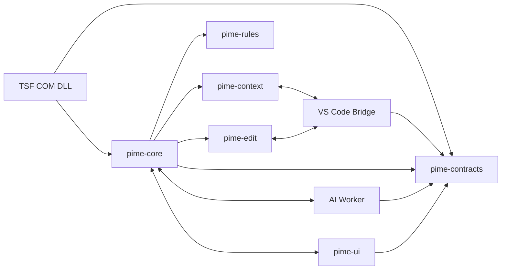
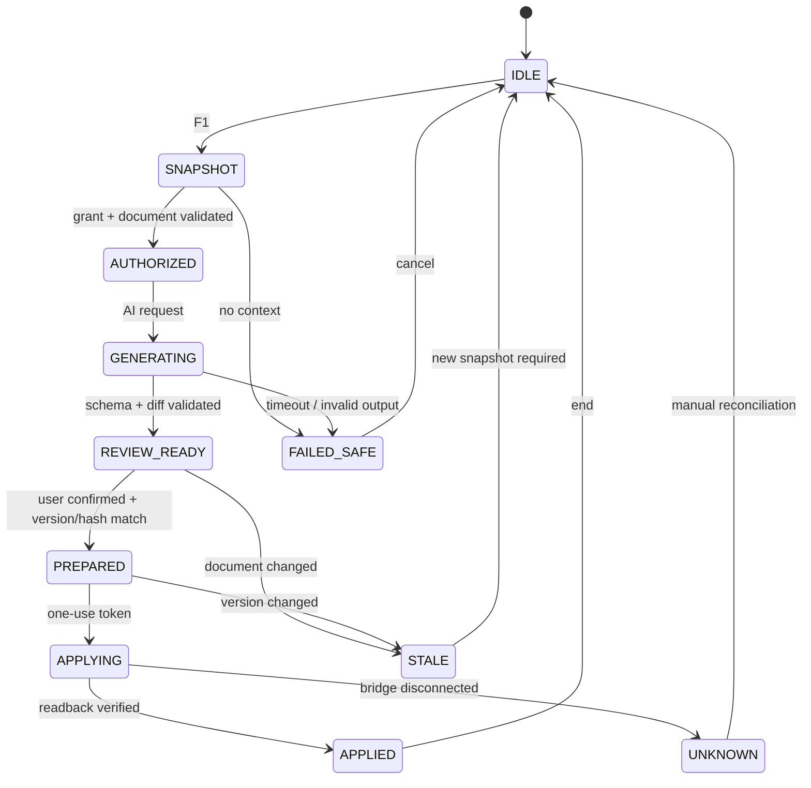
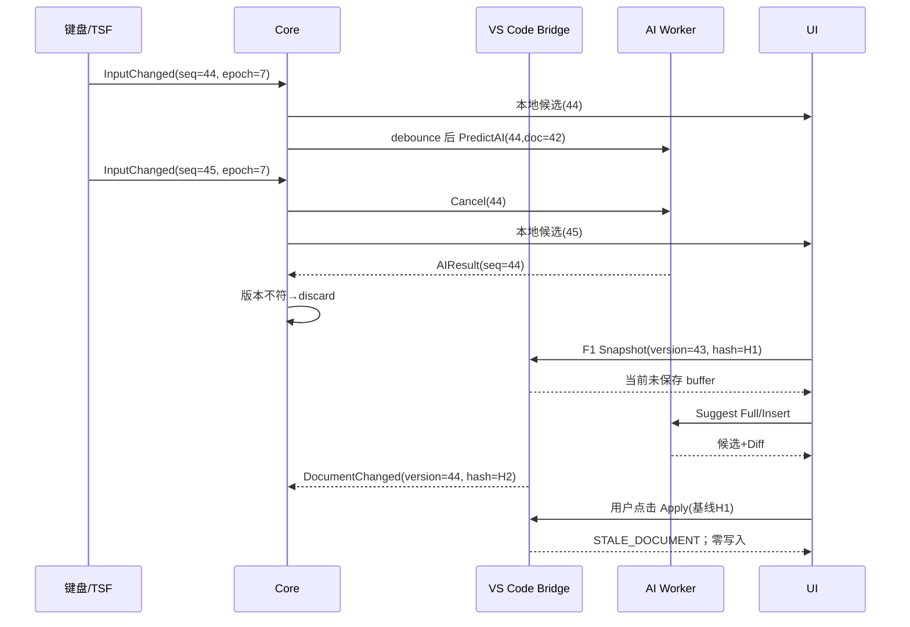

# Programming IME — 软件详细设计书（ソフトウェア詳細設計書／内部設計書）

| 管理项目 | 内容 |
|---|---|
| 文档编号 | `DD-PIME-001` |
| 版本 / 日期 | **v1.0 / 2026-10-29** |
| 状态 | **详细设计基线草案（PoC 未验证／未编码）** |
| 上游基线 | `SRS-PIME-001 v1.2`；`BD-PIME-001 v1.0` |
| 目标 | Windows 11 x64、zh-CN/en-US/ja-JP、7 种编程语言、BYOK AI、实时预测及 F1 双路径编辑 |
| 章节用途 | 本文对应详细设计；配套 UT/IT/ST 设计书与 Excel 需求追踪；任何变更先更新 FR/NFR→DD→TEST 链路 |

## 0. 组件一览（構成モジュール一覧）

| DD 编号 | 所属模块 | 组件／库 | 责任边界 |
|---|---|---|---|
| DD-01 | M01 | `pime-tsf.dll` / TSF Profile Installer | COM/TSF 注册、键事件与合规文本提交 |
| DD-02 | M02 | `pime-core::input` | 输入状态机、事件序列、提交规则 |
| DD-03 | M03 | `pime-core::language` | 七语言 Profile、探测、方言与验证器 |
| DD-04 | M04 | `pime-context` + `pime-vscode` | 授权快照、编辑器版本与文档位置 |
| DD-05 | M05 | `pime-ai-worker` | BYOK、模型能力映射、网络、预算与 Vault |
| DD-06 | M06 | `pime-core::prediction` | 本地预测、AI 异步调度、去重与淘汰 |
| DD-07 | M07 | `pime-edit` + `pime-vscode` | F1 双路径、Diff、Prepare/Apply、Undo |
| DD-08 | M08 | `pime-ui.exe` | 候选浮层、F1 面板、设置、权限确认 |
| DD-09 | M09 | `pime-rules` | 内置语言包、用户规则、Schema 迁移 |
| DD-10 | M10 | `pime-installer` + `pime-diagnostics` | 发布、签名、安装卸载、安全与诊断 |
| DD-11 | 横断 | `pime-contracts` | IPC Schema、错误码、版本与权限枚举 |
| DD-12 | 横断 | `pime-testkit` | Fake TSF/Bridge/Provider、金样本与故障注入 |

## 1. 软件内部结构（内部構成・依存方向）

### 1.1 仓库与构建单元

```text
programming-ime/
  crates/
    pime-contracts/          # 公共 ID、协议 Schema、枚举、序列化
    pime-core/               # 输入状态、语言判定、候选、任务调度
    pime-rules/              # 声明式语言包、前缀索引、验证器
    pime-context/            # Grant、Snapshot 生命周期与数据裁剪
    pime-edit/               # Patch、Hunk、EditPlan 与校验
    pime-ai-worker/          # Provider、Vault、成本、网络及取消
    pime-diagnostics/        # 指标与脱敏事件
    pime-testkit/            # Fixture、fake Provider/Bridge、Fault Injection
  windows/
    tsf/                     # 最小 COM in-proc；必要时 C++ shim + Rust FFI
    ui/                      # 原生候选窗口和非模态 Diff 面板
    installer/               # 受签名的安装及 Profile 登记/恢复
  editor-bridges/
    vscode/                  # TypeScript 扩展；唯一 P0 全文编辑 Bridge
  language-packs/
    rust/ python/ typescript/ powershell/ c/ assembly/ machine-code/
  schemas/                   # IPC / UserSettings / LanguagePack JSON Schema
  tests/fixtures/            # UTF-16、CRLF、危险文本、无效补丁、ISA 金样本
  docs/                      # SRS/BD/DD/UT/IT/ST
```

1. 所有 TSF COM 回调禁止网络请求、磁盘全文扫描、同步等待 AI；仅做轻量状态转换、受权限允许的 Text Range 操作，且任何异常保持 Direct。
2. `pime-core` 不直接持有密钥、不访问未授权文件；`pime-ai-worker` 仅通过 Vault 的 `credential_ref` 在自身边界获取密钥。
3. `pime-vscode` 是全文编辑唯一受信写入端；`pime-edit` 只能提出计划，不调用任意文件系统写入当前工作区。
4. 输入与 AI 结果都包含 `session_id`、`profile_epoch`、`document_epoch`、`input_seq`；版本冲突只能拒绝或重新预览，不能自动覆盖。
5. Windows TSF 的 SDK 接口、句柄、COM 线程模型须通过 G0 原型验证；设计不宣称未经验证的 SDK 调用顺序一定对所有宿主可用。

### 1.2 依赖图



> 上图为逻辑依赖，不代表全部组件位于同一进程。跨进程只能经受控本地 IPC 和 Schema 转换；不共享 Rust 内存指针给插件或 Bridge。

### 1.3 核心对象与不可变规则

| 类型 | 主字段 | 不变量 |
|---|---|---|
| `InputEvent` | `session, seq, kind, text?, editor_epoch?, timestamp` | `seq` 单调增加；敏感输入不保留原文本 |
| `InputContext` | `language, dialect, scope, prefix, cursor, document_ref?` | 请求范围不得大于有效 Grant |
| `LanguageSelection` | `profile_id, dialect, origin, locked, profile_epoch` | 锁定覆盖所有自动推断 |
| `Candidate` | `id, kind, source, text?, patch?, scope, anchor, validation` | `invalid` 候选不可应用；仅候选展示不写入 |
| `Snapshot` | `editor_instance, uri, version, sha256, selection, eol, dirty, level` | L3 内容必须来自可信 Bridge 当前 buffer |
| `PermissionGrant` | `grant_id, provider_id, scope, workspace, expiry, revoked` | 一旦撤销，所有后续请求拒绝 |
| `EditPlan` | `edit_id, baseline, hunks, target_uri, expected_hash, expiry` | 只能包含当前文件、非重叠范围 |
| `ApplyOutcome` | `state, new_version?, new_hash?, undo_hint?, reason?` | `unknown_result` 禁止自动再次 Apply |

## 2. 共通 IPC 详细契约（共通インターフェース定義）

### 2.1 传输与安全协议 `PIME-IPC/1`

- 传输：Windows Named Pipe，按当前用户 SID、登录 Session 建立 ACL；连接拒绝其他用户/会话。每类客户端须有独立能力范围，实际进程身份与 ACL/握手联合校验；**PID、窗口标题或 localhost 地址不是授权依据**。
- 序列化：长度前缀帧 + UTF-8 JSON（PoC 后允许固定 Schema 的二进制形式）；单帧上限：控制消息 64 KiB，含授权全文的快照消息最大 2 MiB（超限返回 `PAYLOAD_TOO_LARGE`、可降级分块传输，不能暗中截断）。
- 协议：`major=1`，不同主版本直接 `PROTOCOL_MISMATCH`；新增可选字段必须提供默认，不认识的操作码必须拒绝。
- 握手：以当前用户私有的安装/连接凭据和随机 challenge-response 建立 `capability_session`；在进程或扩展来源验证后发放短时范围令牌。一次性挑战并不单独证明身份，必须结合 Windows 用户 SID、受保护端点和受信扩展安装来源。
- 安全边界：**同一 Windows 用户下其他恶意进程仍属剩余风险**；不能因为 pipe ACL 就保证抵御被攻陷的本机账户。禁止把完整文件内容广播给 UI/非编辑模块。
- 超时：TSF 输入路径不等待 Core/AI；Bridge 请求与 Apply 有显式截止时间；超过期限返回 `IPC_TIMEOUT`/`EDIT_UNKNOWN`，禁止重复写入。
- 重放：修改消息包含 128-bit 随机 `edit_id`、单次 `edit_token`、有效期、绑定 `(editor_instance, uri, version, hash, grant)`；已使用 token 立即失效。

### 2.2 消息模型（Schema 草案）

```json
{
  "protocol_version": {"major":1,"minor":0},
  "message_id":"uuid-v4",
  "reply_to":null,
  "kind":"PredictLocal",
  "session_id":"opaque",
  "profile_epoch":7,
  "document_epoch":15,
  "input_seq":120,
  "grant_id":null,
  "ttl_ms":500,
  "payload":{"profile":"rust","prefix":"fnm","context_level":"L1"}
}
```

校验顺序：`length → schema version → message id → connection identity/capability → deadline → payload bounds → grant/scope → business operation`。跨进程不得直接拿不同单调时钟源比较绝对时间戳；`ttl_ms` 自接收时计算有效期。所有错误返回 `PimeError { code, severity, retryable, user_action, correlation_id }`，不包含原始源代码或 Key。

### 2.3 操作一览

| API | 方向 | 请求核心字段 | 成功结果 | 错误与处理 |
|---|---|---|---|---|
| `Hello/BindSession` | TSF/Bridge/UI→Core | `role, protocol, challenge, instance` | `session, capabilities` | 协议拒绝、身份拒绝 |
| `PredictLocal` | TSF→Core | `seq, profile, prefix, context_level` | `Candidate[]` | 断开即 Direct |
| `PredictAI` | Core→Worker | `snapshot_ref, grant, model_ref, effort, budget` | `Candidate[], usage` | 已禁用/无授权/预算/超时 |
| `EditorSnapshot` | Core→Bridge | `editor_instance, target, requested_level` | `L0..L3, uri, version, hash, selection, content?` | `CONTEXT_UNAVAILABLE` |
| `LanguageDetect` | Core 内部 | `locked, languageId, extension, lexical_features` | `LanguageDecision` | 歧义保持现状 |
| `PrepareEdit` | Core→Bridge | `edit_plan, baseline, hunks, grant` | `prepared_token, expiry` | `STALE_DOCUMENT` |
| `ApplyEdit` | Core→Bridge | `token, expected_uri, expected_version/hash` | `applied/new_version/hash` | `EDIT_UNKNOWN` 需人工核对 |
| `Cancel` | UI/Core→Worker | `request_id` | `cancel_requested` | 已发上游内容不能撤回 |
| `VaultUpsert/Delete` | Worker→Windows API | `provider_ref, secret`（Worker 内部） | `credential_ref/status` | `VAULT_ERROR`，不导出 Key |

## 3. DD-01：TSF/COM 组件详细设计（入力サービス）

### 3.1 Windows Profile 注册

| 语言 | LANGID | `CLSID` | `guidProfile` | 启用策略 |
|---|---|---|---|---|
| zh-CN | `0x0804` | 全局唯一且稳定 `PIME_CLSID` | `PIME_PROFILE_ZH` | 安装时用户勾选 |
| en-US | `0x0409` | 同一个 `PIME_CLSID` | `PIME_PROFILE_EN` | 安装时用户勾选 |
| ja-JP | `0x0411` | 同一个 `PIME_CLSID` | `PIME_PROFILE_JA` | 安装时用户勾选 |

安装时在构建清单中分配真实稳定 GUID 并永久冻结；**本文标识符不是已经生成或注册的实际 GUID**。登记使用 `ITfInputProcessorProfileMgr::RegisterProfile`，完成组件和类别注册、正确的图标/显示名设置。卸载只移除本产品注册的 profile/CLSID；不改变其他 IME 的默认设置。`bEnabledByDefault` 不等于强行设置系统默认 IME。

### 3.2 COM 生命周期与键盘事件

| 方法/回调 | 前置条件 | 处理 | 错误返回 |
|---|---|---|---|
| `Activate/ActivateEx` | 宿主允许 TSF | 注册 Sink、读取激活 Profile、初始化线程态轻量缓存 | 不崩溃宿主；必要时仅 Direct |
| `OnTestKeyDown` | TSF 正确通知 | 判断当前状态是否接管按键；Direct 返回不消费 | 默认不抢键 |
| `OnKeyDown` | 已决定合法消费 | COMPOSING 内更新组合／选择；其余观察使用受许可事件 | 禁止重放或吞掉字符 |
| `RequestEditSession` | 具有合法 `ITfContext` | 仅在权限支持范围下提交替换、结束组合 | 失败回退，不用 SendInput/盲退格 |
| `Deactivate` | 服务停止 | 移除 Sink、释放 COM 引用、废弃 epoch、清除浮层 | 不删除已经提交的原文 |

> **输入事件语义**：Direct 默认由宿主输入，不能一边“按键已处理”一边再让宿主重复写入。监视文字变化必须通过合法文本服务事件或可信 Bridge，不能依靠系统级低层键盘钩子收集私密键入。TSF Text Range 能否读/写取决于宿主与 Edit Session；不得越过该约束。

### 3.3 输入安全与 Direct 故障策略

```text
on_input(event):
  if secure_context OR app_policy=DISABLED:
      clear_snapshot_and_candidates(); return PASS_THROUGH
  if core_unavailable OR bridge_not_authorized:
      if state=COMPOSING: safe_cancel_composition_if_owned()
      return PASS_THROUGH
  if state=COMPOSING AND event_in_reserved_keymap:
      handle_local_selection_under_edit_session(); return CONSUMED
  observe_legally(event); schedule_nonblocking_predict(); return PASS_THROUGH
```

安全框检测必须以宿主/Windows 可用的可信标志为基础；检测能力不足时禁用内容收集与 AI（而不是假定某类窗口标题表示安全）。不能保证每种安全输入组件都暴露同一种标识，需要使用阻断清单和实机验证补足。

## 4. DD-02：输入状态机与候选提交（入力状態機械）

### 4.1 状态及迁移

- `DIRECT` → `OBSERVING`：可合法读取局部范围，未开启强制组合。
- `OBSERVING` → `CANDIDATES`：本地/AI 非空候选；原文不修改。
- `CANDIDATES` → `COMPOSING`：用户进入显式 TSF 组合，宿主支持合法 Range。
- 任意可输入状态 → `SUSPENDED`：安全框或禁用策略；清除可能含上下文的内存，AI 新请求拒绝。
- 任意 → `FAULT_FALLBACK`：Core/IPC 异常，交还 Direct；恢复后 `profile_epoch` 增加并刷新候选。
- `F1_REVIEW` → `APPLYING`：受信 Bridge + 有效 Grant + 用户明示接受 + 版本一致；失败不会执行隐式第二次编辑。

### 4.2 本地候选数据及排序

```rust
// 接口草案；实际方法签名由实现版本审定
struct Candidate {
    id: CandidateId,
    kind: CandidateKind,
    source: CandidateSource,
    profile_id: ProfileId,
    profile_epoch: u64,
    score: i32,
    anchor: Option<TextRangeUtf16>,
    target_version: Option<u64>,
    document_epoch: u64,
    input_seq: u64,
    text: Option<String>,
    patch: Option<EditPlan>,
    validation: ValidationLevel,
    assumptions: Vec<String>,
}
```

候选排序键：`(explicit_user_pin, syntax_valid, deterministic_rule, prefix_match, local_frequency, ai_score, stable_id)`；所有外部模型的 `ai_score` 先按来源独立归一，不冒充可校准的合法性概率。相同编辑目标和规范化输出采用内容指纹去重，保留候选来源证据。

### 4.3 提交算法

```text
accept(candidate, current):
  if candidate.validation in {invalid, context_missing} => reject
  if candidate.profile_epoch != current.profile_epoch => reject STALE_RESULT
  if candidate.document_epoch != current.document_epoch => reject STALE_RESULT
  if candidate.target_version exists AND target_version != current.version => reject
  if trusted_bridge && anchor_is_verified => bridge.apply_targeted_edit(...)
  else if tsf_owned_composition && range_permitted => commit_in_edit_session(...)
  else => disable destructive accept; show copy-only/append-only option if safe
```

Undo 只在实际宿主允许的粒度上承诺；“已有字符替换”的提交不能通过发送 N 次 Backspace 模拟。参数占位在 VS Code Bridge 中可转换为宿主支持的 snippet placeholders；无 Bridge 时只能输出普通文本。

## 5. DD-03：七语言包与自动识别（言語別処理）

### 5.1 统一配置 Schema

```yaml
schema_version: 1
profile_id: rust
version: "1.0.0"
dialect: { edition: "2024" }
accepted_extensions: [".rs"]
triggers:
  - id: rust.main
    pattern: "fnm"
    kind: syntax
    requires: { location: statement_or_file, min_context: L0 }
    candidates:
      - text: "fn main() {\n    ${cursor}\n}"
        validator: rust_syntax
        source: rule
  - id: rust.fn_prefix
    pattern: "fn"
    kind: prefix
    candidates: [{text: "fn ${name}(${args}) {\n    ${cursor}\n}"}]
```

用户规则只允许 Schema 明确字段；${cursor} 是内部占位符而不是执行任意程序。限制单规则最大文本、嵌套深度和数量；不信任脚本模板/动态 shell 命令。加载步骤：`读取→Schema 检查→来源/版本检查→语义/方言检查→构建前缀索引→原子切换`，失败继续使用旧规则包。

### 5.2 七语言设计矩阵

| 语言 | 默认验证器及约束 | 语言特有候选 | 典型错误 |
|---|---|---|---|
| Rust | edition 2021/2024；语法校验与类型检查明确分层 | `fn`,`match`,`impl`,`Result`,`Option`,`async` | 未知表达式位置附加 `;` 不合法 |
| Python | Python 3 版本；缩进/EOL 从宿主策略得到 | `def`,`async def`,`with`,`try`,`comprehension` | 不要暗改 Tab/空格或缩进层级 |
| TypeScript | 目标 TS/TSX 模式；按 parser context 判定 | 泛型、interface、arrow、Promise | TSX 中 `<T>` 被当 JSX |
| PowerShell | 5.1/7 兼容配置；语法作为文本校验 | cmdlet、参数、管道、scriptblock | 绝不可运行解析得到的命令 |
| C | `-std=c11/c17/c23` 意图；语法/头文件环境分开 | 指针、struct、typedef、宏 | 非标准关键字或声明歧义 |
| Assembly | x86-64 ISA、mode、assembler、Intel/AT&T | 寄存器/助记符/寻址 | 未知地址导致重定位未定 |
| Machine Code | x86-64、明确 mode/address/ISA、Hex 编码校验 | 字节、机器码候选、反汇编 | 不应把不可解析符号判为确定字节 |

机器码在文本编辑器中提交的是规范化 Hex 字符串；**v1.0 不输出原始二进制文件写入**。机器码正确性由经过验证的测试向量独立对照；输入法不执行机器码。

### 5.3 自动语言判定算法

```text
resolve_language(ctx, current):
  if current.manual_locked && lock_scope_valid: return current.profile
  if ctx.bridge.language_id maps_exactly: return mapped_profile
  if ctx.ext in {rs,py,ts,tsx,ps1,c}: return mapped_profile
  if ctx.ext in {h,asm,bin} OR no_ext: keep current; show uncertain_hint
  if lexically_detected_with_high_confidence_and_no_conflict: suggest_only_or_select_per_policy
  if ai_detected: suggest_only
  return current.profile
```

`profile_epoch` 在切换时递增，废弃所有旧 profile 候选。自动判定**不得凭单个 `if`、`for`、`.bin` 强切**；在 `.h`、TSX 等高歧义环境优先 Bridge languageId。

## 6. DD-04：权限上下文、VS Code Bridge（エディタ連携）

### 6.1 Scope 与快照

| Scope | 取数方 | 输出 | 使用限制 |
|---|---|---|---|
| L0 | 本地状态 | 语言与当前显式触发串 | 不读取文本，离线候选 |
| L1 | TSF 合法范围或 Bridge | 光标邻近有限片段 | 可局部预测；绝不能宣称全文 |
| L2 | Bridge/可信选区 | 选区文本、range、version 可选 | 只能提交可验证选区 |
| L3 | VS Code Bridge | 当前完整 `TextDocument.getText()`、`version`、`uri`、`isDirty`、`eol`、`selections` | F1 全文唯一 P0 安全写入来源 |
| L4 | 用户显式选择文件 | 磁盘 bytes、hash、mtime | v1.0 只提供预览，无法保证等于当前未保存 buffer，禁止直接回写活动文档 |

Bridge 的 `DocumentSnapshot`：

```json
{
  "editor_instance_id":"opaque-editor-1",
  "document_uri":"opaque-canonical-uri",
  "document_version":42,
  "sha256":"lowercase-hex-sha256-of-current-buffer",
  "language_id":"rust",
  "eol":"LF",
  "dirty":true,
  "selection":{"start":{"line":12,"character":3},"end":{"line":12,"character":3}},
  "range_unit":"UTF16_CODE_UNITS",
  "content_scope":"L3",
  "content":"..."
}
```

Hash 对 `TextDocument.getText()` 的规范 Unicode 内容编码为 UTF-8 后计算 SHA-256；传输必须明确 `hash_algorithm`，避免“同文本不同序列化”的校验歧义。文件编码/BOM 在扩展无法可靠获取时标注 `encoding_unknown`，不能臆造物理文件字节保真承诺。EOL 用宿主保持，与文本内容中的实有换行一致。

### 6.2 Bridge 协议与事务

```text
bridge_snapshot(grant, requested_scope):
  require authenticated_extension && workspace_trust && active_editable_document
  require grant permits provider/scope/session
  read active_editor.document.getText(), version, uri, selections, isDirty, eol
  return exact snapshot + editor_instance_id + hash

bridge_prepare(plan):
  require plan.scope == CURRENT_FILE && explicit_user_confirmed
  require current_active_uri == plan.uri && current_version == baseline.version
  require sha256(current_getText()) == baseline.hash
  require no overlapping UTF16 ranges and no malformed new text
  return one_use_token(bound_to_snapshot_and_plan, expiry=short)

bridge_apply(token):
  require unused(token) && token.not_expired
  revalidate active uri/version/hash/grant/current selections if range-sensitive
  apply text-only edit using one editor operation
  read back version/hash and compare to proposed hash
  on mismatch: return EDIT_UNKNOWN; never retry automatically
```

**并发语义**：VS Code `WorkspaceEdit` 文本操作通常采用 all-or-nothing，但它不是跨“校验→调用”的通用 CAS。必须用扩展独占队列、同步窗口重校验、`onDidChangeTextDocument` 事件监听和应用后哈希校验；检测到竞态或无法证明时，禁用安全 Apply、保留预览，报告 `STALE_DOCUMENT`/`EDIT_UNKNOWN`。不能凭队列阻止其他扩展或用户编辑。

### 6.3 统一位置与 Unicode

- IPC range 一律为零基 `(line, character)`、`UTF-16 code units`、半开区间 `[start,end)`，和 VS Code API 位置一致。
- 对上下文文本用 Unicode code point/UTF-16 映射函数校验 range：不得切开代理项，不得把 CRLF 的 `\r` 当作额外可编辑字符；越界拒绝 `TARGET_RANGE_INVALID`。
- 同一 snapshot 必须绑定 `editor_instance_id + document_uri + version + hash + selection + epoch`；只比较文件名或光标行号不够。
- 候选在取消、失焦、关闭文件、切换语言、撤权时立刻逻辑失效（即使后台请求取消通知尚未送达）。

## 7. DD-05：BYOK / Provider 能力 / Effort（AIサービス）

### 7.1 数据与密钥生命周期

- 普通配置 `ProviderProfile { provider_id, api_family, base_url, model_id, credential_ref, capability_cache }` 不包含实际 Key；仅 `pime-ai-worker` 通过 Windows Credential Manager `CredWrite/CredRead/CredDelete` 接触密钥。
- 用户填入 Key 后由受保护的设置/Worker 通路完成一次性导入，禁止经通用 Core IPC 明文传输；删除 Key 时立即停止该 Provider 新请求、撤销 Grant、销毁进程内缓存。
- `AIActionSettings` 为 `realtime/f1_full/f1_insert` 各配置独立 `provider_ref, model_id, effort, token_limit, timeout_ms, budget`。
- 模型能力表记录 `model_ref, checked_at, supported_efforts, max_output, supports_structured_output`，未知模型不自动猜测 Effort 映射；以 Auto 或明确禁用处理。

### 7.2 Reasoning Effort 映射

```text
resolve_effort(user_level, capability):
  if user_level == Auto: omit_vendor_effort_or_use_verified_default()
  else if capability.explicitly_supports(user_level): map_to_vendor_parameter()
  else: return MODEL_UNSUPPORTED with supported_levels
```

UI 选项依 Provider 能力实时启禁，扩展档位不意味着所有提供商都支持。Provider timeout/429/401/网络失败各有专用错误，不应自动回退至未授权的其他 Provider；AI 已发送的请求即使取消，外送事实仍需在 UI/诊断中正确提示。

### 7.3 隐私、成本与输出验证

1. AI 开关初始 `false`；没有 Key/明确授权禁止向任何外部 endpoint 发请求。
2. 授权以 `(provider, workspace, scope, data_category, expiry)` 绑定；实时邻近发送和 F1 全文发送分别授权，撤销即时阻止新请求。
3. 敏感识别：密码字段、`.env`、典型 Secret 模式、私钥片段触发 `BLOCK` 或脱敏；不能宣称脱敏器能发现所有秘密。对高风险全文默认阻断外送，须经明确的额外风险操作方可允许符合策略的发送。
4. 预算在请求出站前保留估算额度，响应后按真实 token 调整；计费资料不可得时按保守估算并标记 `estimated`；达到上限立即不再发起新请求。
5. AI 输出只接受有限结构化候选：`Candidate[] | FullTextProposal | PatchProposal`，Schema 验证、长度限制、UTF-16 位置检查、语言/授权校验后才显示 Apply 按钮。
6. 源码注释是数据，不是指令；不提供模型可执行工具或自定义 shell 命令接口。

## 8. DD-06：实时预测与资源调度（予測スケジューラ）

### 8.1 调度及取消规则

```text
handle_input(seq, snapshot):
  local = language_pack.predict(prefix, permitted_nearby_context)
  publish_local_immediately(local)
  cancel_previous_ai_task_for_session()
  if not (ai_enabled && grant_valid && context_safe && budget_available): return
  schedule_after(debounce_ms=350, key=(session, seq, profile_epoch, document_epoch)):
      if key != current_state_key: return
      ai_request = build_minimized_request(snapshot_ref, model_for_realtime)
      send_async(ai_request)

on_ai_result(result):
  if result.key != current_state_key: discard
  if grant_revoked || result.target_outside_context || result.invalid_schema: discard
  merge_dedupe_keep_user_selection(result.candidates)
  publish_candidates_without_editing_buffer()
```

单用户会话同时在途实时补全任务上限 1（不意味着 F1 阻塞另一个独立队列）。防抖初值 350ms、可配置 150–1000ms。取消应在本地立即使旧任务逻辑失效，网络取消 best effort，不表示 Provider 未接收已发送内容。

### 8.2 排序与去重

- 按 `(profile, normalized_target_range, normalized_output)` 生成去重 fingerprint；同一候选保留本地/AI 来源记录而只显示一条。
- 绝对优先级：用户 pin、显式规则、语法验证、前缀匹配、适配器合法建议、AI 相关性。AI 内容无法凭模型自报 confidence 判定语法合法。
- 用户选中的 candidate ID 若仍然有效则保持选中；若变更影响范围或语言则清空选中并拒绝旧候选应用。
- 自动建议不会把已输入普通字母删除或替换；仅在候选被接受且可验证目标 Range 时才提交。

## 9. DD-07：F1 双路径与事务（編集トランザクション）

### 9.1 操作状态



### 9.2 `FullFileChange` 精确定义

- 只允许 `L3 current TextDocument` 修改当前打开的可编辑文件；L4 用户选择的磁盘文件在 v1.0 **只读预览**，不得绕开 Bridge 覆盖 dirty buffer。
- AI 可返回完整目标文本或对 snapshot 的非重叠文本 Patch。输入固定 `before_hash` 和选定语言，生成 `after_preview_text` 并计算 `after_hash`；所有修改通过分块 Diff 展示；用户可关闭某些 Hunk 后重新构造预览并重新验证。
- 同一文件的全量变更经 `workspace.applyEdit(WorkspaceEdit)` 或等效的受支持文本编辑 API 一次提交；编辑器 Undo 是否能按用户期望单步撤销须纳入 G1 PoC，不能在 PoC 之前保证所有宿主/扩展实现都天然单步撤销。
- 保留现有 EOL、尾随换行与未改变段落；若模型改变这些内容，则差异必须显式显示，不能默默规范化。

### 9.3 `InsertHere` 精确定义

- `InsertHere` 将位置固定在创建 snapshot 时的选区或光标；支持一个或多个候选，仅允许用户逐个选中应用。
- 若用户移动光标、改变选区、切换文件或语法上下文，旧候选立即失效并返回 `STALE_RESULT`；不能用旧坐标插入新位置。
- 仅 TSF 的 L1/L2 适配器在合法受控 Composition/Range 可以插入；无法确保 Range 时提供复制到剪贴板的显式按钮或禁用 Apply，不进行模拟 `Ctrl+A/Backspace`。

### 9.4 Prepare 与 Apply 内部算法

```text
prepare(plan, current):
  require user_explicit_confirmation && grant_still_valid
  require current.editor_instance == plan.editor_instance
  require current.uri == plan.uri && current.version == plan.version
  require current.hash == plan.hash && current.is_editable
  require all_ranges_valid_UTF16(plan) && ranges_nonoverlap(plan)
  require document_is_not_closed_or_focus_changed(plan)
  return one_use_token(plan_id, expiry, expected_hash)

apply(token, current):
  require token_valid_unused && same_document_and_version_and_hash
  mark token used before first write to prevent replay
  invoke_one_supported_editor_edit_operation(plan)
  read_back_document_state()
  if new_hash == proposed_hash: return APPLIED
  else: return EDIT_UNKNOWN  # don't retry blindly
```

**重要的实证边界**：扩展内的检查与 `applyEdit` 之间存在其他编辑器活动插入的机会；内部队列只能串行化自己发起的编辑，无法保证对外部编辑的硬 CAS。提交后出现内容不一致时必须停止，保留可见冲突，不能自动恢复旧文本覆盖用户的新改动；若 PoC 无法证明安全则禁止全文 Apply，仅允许预览和进一步人工操作。

## 10. DD-08：画面、事件与无障碍（画面・操作詳細）

| Screen | 用户事件 | 处理 | 状态/失败反馈 |
|---|---|---|---|
| SCR-01 候选浮层 | 字母输入、方向键、点击语言下拉 | 显示本地优先候选；改变语言时增加 epoch | AI 离线仍显示本地；无法定位则隐藏浮层 |
| SCR-02 F1 面板 | F1、编辑意图输入、两标签切换 | 触发快照/权限/AI，独立生成两个类别 | F1 冲突时遵守宿主快捷键策略 |
| SCR-03 Diff 预览 | 选择 Hunk、展开完整文本、点击审核 | 重新计算 after_hash，显示验证结果 | 过期时禁用 Apply 并要求重载 |
| SCR-04 局部插入 | 候选选择、定位预览 | 目标 Range 高亮与精确文本显示 | 无合法 Range 时不可应用 |
| SCR-05 AI 设置 | 添加/测试 Key、选择模型/Effort | Key 走 Vault，能力协商，分场景保存 | Effort 不支持显式禁用，不悄然回退 |
| SCR-06 语言设置 | 选择七语言、方言、锁定范围 | 更新 `profile_epoch`，清空旧候选 | 低置信只提示不强切 |
| SCR-07 权限 | 查看接收方、上下文范围、期限 | 明确批准/拒绝/撤销 | 拒绝立即中断新出站请求 |
| SCR-08 诊断 | 查看 Bridge/TSF/Core/Worker 状态 | 展示脱敏统计和错误码 | 不显示按键、Key、源代码 |

- 三种 Windows 输入语言均可选择 Programming IME；界面语言独立选择中文/英文/日文；代码文本绝不做语言翻译。
- UI 为非模态候选窗；DPI 100–250%及多屏时应在活动屏幕工作区域内调整位置。读屏需要候选序号、来源与操作提示的语义文本，不能只使用颜色区分 Diff。
- F1 默认**不是无条件全局劫持**：在 VS Code Bridge 环境需用户确认快捷键绑定；系统级 TSF 在不支持/高权限宿主不保证可拦截 F1，显示可改键提醒。
- 退出 F1 面板、Esc、失焦、关闭文档时，预览数据及 Grant 相关敏感快照应按 TTL 清理；必要的错误元数据可保留。

## 11. DD-09：规则库及本地物理数据（データ設計）

### 11.1 用户数据目录和持久化表

| 数据 | 建议位置 | 格式 | 管理 |
|---|---|---|---|
| `settings` | `%LOCALAPPDATA%\\ProgrammingIME\\settings.json` | 带 Schema version 的 JSON | 原子替换保存、备份上一版本 |
| `user_rules` | `%LOCALAPPDATA%\\ProgrammingIME\\rules/` | 已验证声明式 YAML | 加载前 Schema/资源限制 |
| `candidate_frequency` | 用户本地非机密 DB | SQLite（可选） | 仅候选 ID/计数，不存原代码 |
| `permission_grants` | 受限用户配置 | JSON/SQLite | 按 provider、范围、期限、撤销状态管理 |
| `provider_secret` | Windows Credential Manager | 系统 Vault | 仅 Worker 访问，不写文件 |
| `context_snapshots` | 内存 | 不落盘 | 取消/过期/失焦清理 |
| `edit_plans` | 内存 | 不落盘 | 成功/过期/撤销即删除源码片段 |
| `diagnostics` | `%LOCALAPPDATA%\\ProgrammingIME\\logs/` | 轮转结构化日志 | 保留天数可配，默认禁正文 |

持久化文件用单用户 ACL、写临时文件+原子替换及回滚备份；崩溃时读取最后一份校验有效的 Schema。不能凭 SQLite “已加密”假设数据默认安全，真正 Key 仅放 Credential Manager。

### 11.2 设置 Schema 示例

```json
{
  "schema_version":1,
  "ui_locale":"zh-CN",
  "windows_profiles":{"zh-CN":true,"en-US":true,"ja-JP":true},
  "profile":{"active":"rust","lock_scope":"file","dialect":{"rust":{"edition":"2024"}}},
  "prediction":{"local_enabled":true,"ai_enabled":false,"debounce_ms":350,"max_visible":6},
  "ai_actions":{"realtime":{"provider_ref":null,"model_id":null,"effort":"Auto"},"f1_full":{"provider_ref":null,"model_id":null,"effort":"Auto"},"f1_insert":{"provider_ref":null,"model_id":null,"effort":"Auto"}},
  "shortcuts":{"f1_edit":"F1","consume_tab":false},
  "privacy":{"realtime_context_scope":"L1","full_file_requires_consent":true},
  "diagnostics":{"log_content":false}
}
```

配置导出需要过滤所有 credential 引用背后的实际 Key；所有设置变化生成原子 Schema 版本，不能静默丢弃旧用户规则。

### 11.3 逻辑数据库 Schema（可选频次与授权索引）

```sql
CREATE TABLE candidate_usage (
  candidate_id TEXT NOT NULL,
  profile_id TEXT NOT NULL,
  count INTEGER NOT NULL DEFAULT 0 CHECK(count >= 0),
  last_used_utc TEXT NOT NULL,
  PRIMARY KEY(candidate_id, profile_id)
);
CREATE TABLE permission_grants (
  grant_id TEXT PRIMARY KEY,
  provider_id TEXT NOT NULL,
  workspace_token TEXT NOT NULL,
  context_scope TEXT NOT NULL CHECK(context_scope IN ('L1','L2','L3','L4')),
  expires_at_utc TEXT NOT NULL,
  revoked INTEGER NOT NULL DEFAULT 0 CHECK(revoked IN (0,1))
);
```

此 SQL 是非机密索引的**示意 DDL**。生产落地前必须决定是否保存工作区 token 的不可逆标识、加密策略、备份及删除行为；不得把文件正文、Key 或逐键记录追加进 DB。

## 12. DD-10：安装、迁移、诊断与安全（導入・保守）

### 12.1 安装升级步骤

```text
preflight(OS, x64, required_privilege, signed_package, langpacks)
backup(previous_own_profiles, own_settings_schema, own_component_state)
install_binaries_and_bridge_optional()
register_COM_and_TSF_profiles(selected_zh_en_ja)
verify_each_profile_enum_and_activation_where_possible()
commit_install_receipt()
# failure: undo only own new profiles and binaries, restore own setting backup
```

安装后用户可勾选中/英/日；未安装的 Windows 输入语言提示添加，不自动更改默认语言或删除原输入法。安装器需签名和卸载/Repair；签名证书获取方式另由发行阶段决定。卸载时清理由本产品创建的 CLSID、三个 GUID 与后台服务，用户选择是否保留普通设置；默认移除凭据/临时正文缓存，原 Windows 输入法仍保持原状。

### 12.2 故障、日志与安全规则

| Error Code | 触发 | 处置 | 用户可见说明 |
|---|---|---|---|
| `PROFILE_NOT_REGISTERED` | Profile 缺失 | 提示 Repair，不改别的 IME | 对应语言需修复 |
| `IPC_TIMEOUT` | Core 未响应 | Direct、取消旧候选 | 本地建议暂不可用 |
| `SECURE_INPUT` | 安全输入 | 不采集不联网、清内存 | 隐私保护已启用 |
| `CONSENT_REQUIRED` | 未授权 | 阻止出站，提示 Grant | 需要授权发送范围 |
| `MODEL_UNSUPPORTED` | Effort/Model 不支持 | 禁用不支持值 | 请更换型号或档位 |
| `AI_RATE_LIMIT` | 429/预算超限 | 不再发新请求，本地继续 | AI 暂停，本地可用 |
| `STALE_RESULT` | `seq/epoch/hash` 变动 | 丢弃旧候选 | 候选已过期 |
| `STALE_DOCUMENT` | 文档版本已变 | 禁用全文 Apply | 请重新审核 Diff |
| `PATCH_INVALID` | 范围重叠/UTF-16 错误 | 退回预览，零写入 | 建议无法安全应用 |
| `EDIT_UNKNOWN` | Apply 后无法核对 | 禁止自动重放、提示手动核对 | 编辑状态不确定 |
| `BYTE_ENCODING_UNRESOLVED` | ISA/重定位未满足 | 拒绝标记有效 bytes | 需要补充架构上下文 |
| `VAULT_ERROR` | 凭据存取失败 | 停止 AI，不写明文 | 凭据服务不可用 |

日志白名单：`timestamp, component, error_code, elapsed_ms, request_type, anonymized_session, counters`；默认禁 `input_text/source_code/api_key/document_uri(full)/prompt/response`。诊断包可通过自动安全扫描和人工审阅确认不含敏感信息。

### 12.3 可用性和性能守护

- Core 退出/Worker 崩溃，TSF 在 **2 秒以内**恢复/保持 Direct，不丢已经按出的字符（SRS NFR-102，需系统测量）。
- 本地计算目标 P95≤20ms、从输入事件接收到显示 P95≤50ms（1000 次，固定环境）。UI 错误不得影响输入。
- `debounce_ms` 初始 350；实时 AI 同会话并发≤1，队列只保留最新；F1 任务与实时预测独立资源预算。
- 启动时不因同步加载大型 Parser 或模型而卡住 TSF；规则预热可异步做，冷启动先保证 Direct。
- 发布需要回滚能力，或在无法安全回滚时清楚阻断安装；遥测默认不采代码。

## 13. 总体追踪与验证方针（トレーサビリティ）

- `DD-01～10` 与 `M01～10` 一一对应，每项 `FR-001～FR-052` 必须有详细设计映射，并至少一个 UT/IT/ST 案例。跨层需求（尤其 `FR-035～FR-037` 与 `NFR-502`）必须同时有接口级与系统级反例测试。
- `NFR-101～NFR-601` 以 IPA 六大项分类，但 **性能数值与安全门禁来自项目 SRS 而非 IPA 强制指标**。
- 试验层级：UT 验证内部函数、算法与数据边界；IT 验证跨组件 IPC、TSF/Bridge/Worker、安装器；ST 验证真实 Windows/编辑器/语言/网络与用户目标，不混淆“设计完成”和“测试已执行”。
- 外部依赖 SDK/Windows Update/VS Code 更新、AI Provider 模型能力变化，均需修订兼容清单和受影响用例。

## 14. 未决点与技术 Gate（課題・実証計画）

| Gate | 必须在真实环境证明 | 未达标策略 |
|---|---|---|
| G0 | 三输入语言 Profile 实际启用、原输入法不损坏、TSF 故障 Direct | 不推进正式版跨语言功能，保留内测 |
| G1 | VS Code dirty buffer、F1 快捷键冲突、全文 Edit 安全、版本冲突与 Undo | 禁用 FullFile Apply，仅允许只读预览及安全局部插入 |
| G2 | BYOK Vault、两个 Provider 契约、Effort 能力、真实 API 授权及过期取消 | 关闭 AI，仍保留本地候选 |
| G3 | 七语言金样本、x86-64 编码校验、签名安装与回滚、DPI/三语组合 | 阻止宣称 v1.0 全面兼容 |

### 14.1 前提假设

- 产品尚无实现，所有 API 原型、数据表和容器布局是**拟定设计**；各 SDK 的实际细节需以 G0/G1 原型确认。
- 预设目标宿主基线是 Windows 11 x64 最新受支持渠道与 VS Code 稳定版。其余宿主 Direct 可用性及候选显示分级验收；不假设 Terminal/高权限/沙盒应用对 TSF 一律开放。
- 努力值、模型列表及 Token 定价应由官方 Provider API 或用户配置更新，不对某一时期的产品模型固定承诺。

## 15. 内部接口签名（内部 API 仕様）

以下是**拟定的逻辑接口**，用于明确调用边界和 UT 替身，不代表已编译的 Rust 源码。

```rust
trait LanguageEngine {
    fn profile_id(&self) -> &str;
    fn predict_local(&self, ctx: &SafeInputContext) -> Result<Vec<Candidate>, PimeError>;
    fn validate(&self, candidate: &Candidate, ctx: &ValidationContext) -> ValidationReport;
}
trait PermissionBroker {
    fn authorize(&self, provider: ProviderRef, scope: ContextLevel,
                 workspace: WorkspaceRef) -> Result<GrantRef, PimeError>;
    fn revoke(&self, grant: GrantRef) -> Result<(), PimeError>;
    fn check(&self, grant: GrantRef, provider: ProviderRef,
             requested: ContextLevel) -> bool;
}
trait EditorBridge {
    async fn snapshot(&self, grant: GrantRef, scope: ContextLevel)
        -> Result<DocumentSnapshot, PimeError>;
    async fn prepare_edit(&self, edit: EditPlan)
        -> Result<PreparedEdit, PimeError>;
    async fn apply_edit(&self, token: OneUseToken)
        -> Result<ApplyOutcome, PimeError>;
}
trait ProviderAdapter {
    async fn capabilities(&self, model: &str) -> Result<ModelCapabilities, PimeError>;
    async fn infer(&self, req: AuthorizedAIRequest)
        -> Result<StructuredModelResult, PimeError>;
}
```

### 15.1 方法调用侧约束

| 接口 | 允许调用方 | 输入与线程约束 | 最大副作用 |
|---|---|---|---|
| `LanguageEngine.predict_local` | Core 调度 | 只读安全片段；同步、受计算预算限制 | 无文件/网络访问 |
| `PermissionBroker.authorize/check` | Core/UI | grant 存储可加锁，不能在 TSF 回调同步等待 | grant 状态变化 |
| `EditorBridge.snapshot` | Context Broker | 用户/工作区权限成立；仅当前活动编辑器 | 授权范围内的只读内容 |
| `EditorBridge.prepare_edit` | Edit Coordinator | 用户确认标记、单文件与完整哈希 | 生成短时编辑 token，不写文档 |
| `EditorBridge.apply_edit` | Edit Coordinator | 单次 token、重新核对版本 | 唯一受控文件编辑 |
| `ProviderAdapter.infer` | AI Worker | 有效 grant、vault reference、预算与 timeout | 只向选定服务商发出已授权片段 |

### 15.2 限额与校验规则

| 项目 | 初始建议值（非 IPA 强制） | 失败时措施 |
|---|---|---|
| `PredictLocal` 单次 CPU 预算 | 20ms P95 目标 | 超时跳过复杂 parser，Direct 不受影响 |
| 实时 debounce | 350ms，可配 150–1000ms | 无稳定输入则不发 AI |
| 实时 AI 在途请求 | 同一输入会话最大 1 | 取消旧 seq；响应陈旧则丢弃 |
| `Candidate` 首屏条数 | 6；可配置 | 仅显示前 N，仍可手动展开 |
| IPC 控制帧 | 64 KiB | `PAYLOAD_TOO_LARGE` |
| 全文快照单帧 | 2 MiB | 请求安全分块协议/缩小范围，**不可截断后声称全文** |
| 预览/Grant 缓存 | 会话短期内存，撤销、失焦、TTL 清理 | 自动清除所有相关 request_ref |
| API 超时 | 按场景配置，必须有限 | 标记 `AI_TIMEOUT`，不中断键入 |

## 16. 时序与失效条件（イベント・競合制御）



| 事件 | 必须失效的对象 | 不允许的行为 |
|---|---|---|
| 输入文字或退格 | 旧 `input_seq` 的 AI 与候选 | 在新光标上插入旧建议 |
| 切换编程 Profile/方言 | 旧 `profile_epoch` 的语法候选 | Rust 候选当 Python 应用 |
| 切文档/失焦/移动选区 | 相关 `document_epoch` 的局部候选 | 旧 Range 直接替换 |
| 删除 API Key/禁用 AI | 该 Provider 的所有后续网络任务 | 自动改用另一 Provider |
| 撤销 Grant | 所有绑定该 Grant 的待发任务及 EditPlan | 延迟发包绕过撤销 |
| 文档版本或哈希变化 | 所有待确认 FullFile/EditToken | 盲目再次 Apply |
| Bridge 返回未知结果 | 待重试 token | 重发同一补丁造成重复写入 |

## 17. 准入审查与变更管理（レビュー・変更管理）

### 17.1 禁止将未验证设计视为已实现

- G0：三 Windows 语言注册与输入安全；G1：F1 完整事务和 Undo；G2：BYOK/模型能力/权限；G3：七语言准确性/发行。每个 Gate 必须保存**实机日志、脚本版本、环境基线与结果证据**。
- 所有安全相关 API/错误路径需至少覆盖一条负向 UT、一条带真实边界的 IT、一条面向用户的 ST。技术原型失败时优先保留 Direct 与本地候选，并明确降低未经验证的功能承诺。
- 测试结果登记字段：`test_id, build_hash, os_build, host_version, fixture_version, operator, executed_at, result, evidence_uri, defect_id`。发布门禁严禁把“设计完成”自动置为“测试通过”。

### 17.2 需求到组件追踪索引

| 组件 | 关联 SRS 功能要件 | 关联基本设计 |
|---|---|---|
| DD-01 | FR-001～FR-004 | BD-01 |
| DD-02 | FR-005～FR-008 | BD-02 |
| DD-03 | FR-009～FR-012 | BD-03 |
| DD-04 | FR-013～FR-017 | BD-04 |
| DD-05 | FR-018～FR-024 | BD-05 |
| DD-06 | FR-025～FR-030 | BD-06 |
| DD-07 | FR-031～FR-040 | BD-07 |
| DD-08 | FR-041～FR-044 | BD-08 |
| DD-09 | FR-045～FR-047 | BD-09 |
| DD-10 | FR-048～FR-052 | BD-10 |

> 横断安全与非功能要求由多个 DD 组件协同负责；逐条责任与 UT/IT/ST 测试编号以配套追踪表为准。


## 参考与基线（参照資料）

1. `SRS-PIME-001` v1.2 — `Programming_IME_SRS_v1.2.md`（2026-10-29）。
2. `BD-PIME-001` v1.0 — `Programming_IME_Basic_Design_v1.0.md`（2026-10-29）。
3. IPA 共通フレーム2013：https://www.ipa.go.jp/publish/secbooks20130304.html
4. IPA 非機能要求グレード2018：https://www.ipa.go.jp/archive/digital/iot-en-ci/jyouryuu/hikinou/ent03-b.html
5. Microsoft TSF Profile Manager：https://learn.microsoft.com/en-us/windows/win32/api/msctf/nn-msctf-itfinputprocessorprofilemgr
6. Microsoft TSF RegisterProfile：https://learn.microsoft.com/en-us/windows/win32/api/msctf/nf-msctf-itfinputprocessorprofilemgr-registerprofile
7. VS Code Extension API（TextDocument / WorkspaceEdit）：https://code.visualstudio.com/api/references/vscode-api

> 以上采用 IPA 共通框架的文档阶段、追踪和试验分层习惯。IPA 不存在适用于所有系统的唯一、强制详细设计书/测试表格模板；本文属项目设计稿，并未完成实际开发和测试认证。

---
**End of Detailed Design / 详细设计结束**
