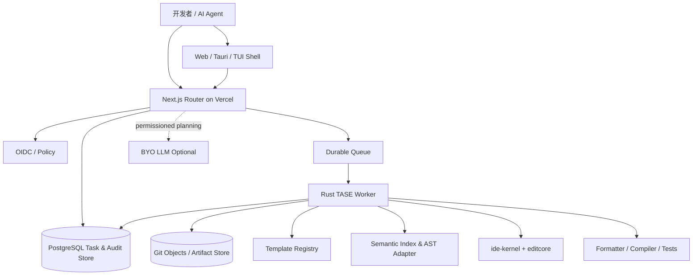
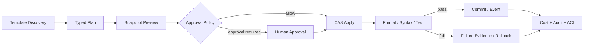
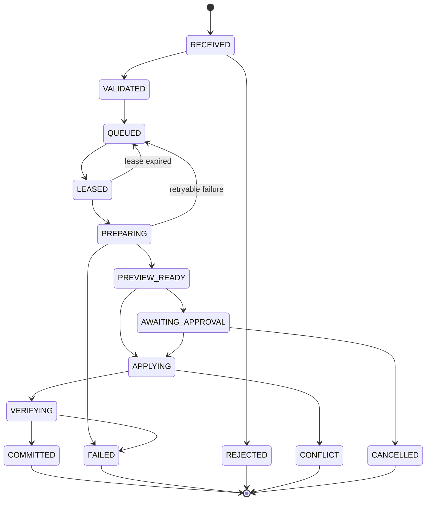
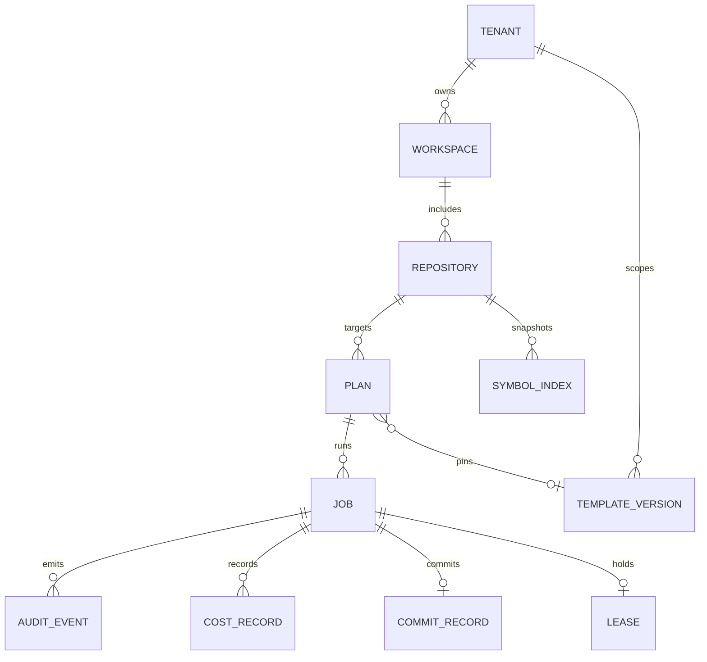
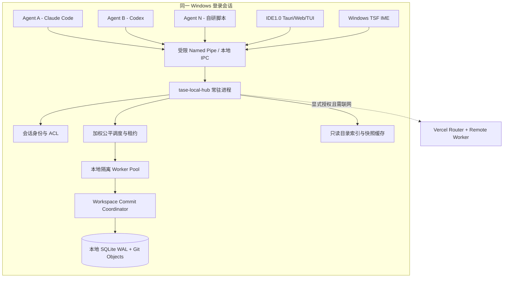
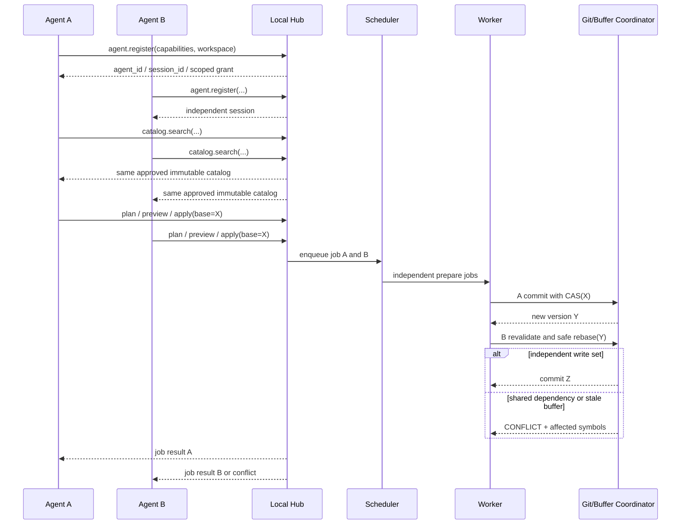
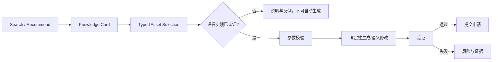
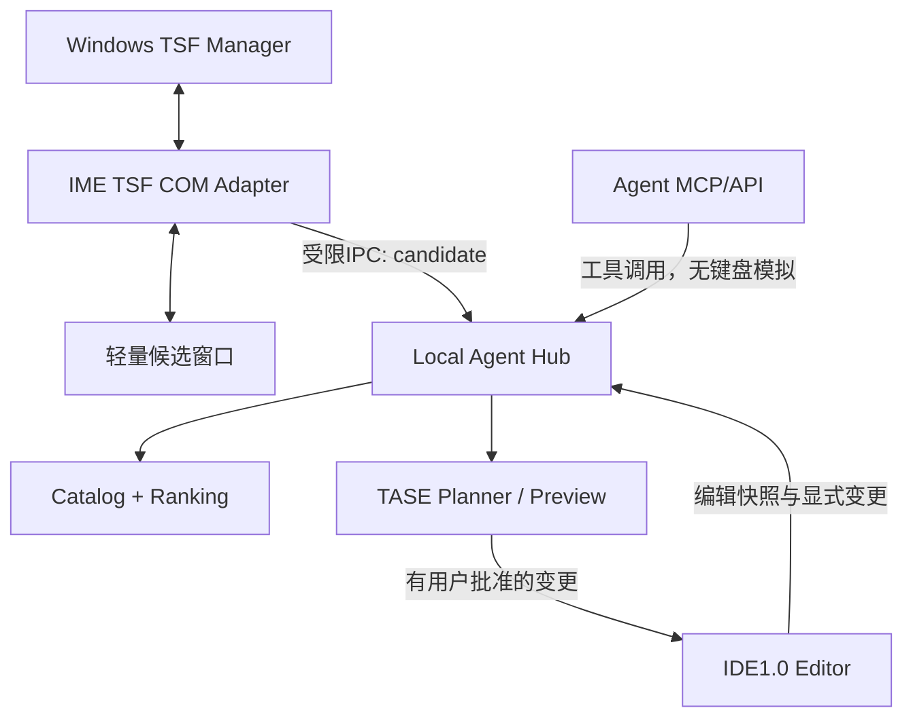
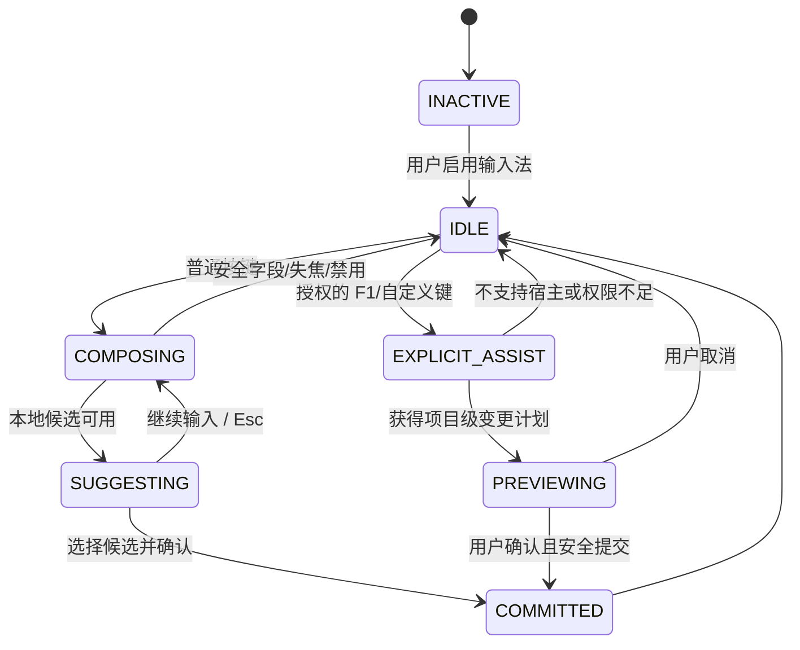

# IDE1.0 — TASE v1.1 全量设计（要件定义／基本设计／详细设计）

> 2026-11-05 · 单一完整设计输入 · 本文所述为拟实施设计，不代表实现已完成或通过测试。
>
> 需求共 64 FR / 28 NFR，测试计划共 49 TC；设计模式与算法目录 23 + 20 + 50 = 93 个知识资产。
>
> 设计参考日本 IPA 阶段式过程，不是 IPA 官方认证资料。

---

# IDE1.0 — TASE 模板感知语义执行系统：要件定义书

| 属性 | 内容 |
|---|---|
| 文档编号 | IDE-TASE-RD-001 |
| 版次 | 1.1 / 2026-11-05 |
| 状态 | 设计提案（非现有功能声明） |
| 产品 | IDE1.0（Rust 内核 + TUI / Web / Tauri） |
| 适用范围 | TASE + 同机 Local Agent Hub + 共享模式／算法资产目录 + Windows 程序员输入法桥接 |
| 工程参考 | 日本 IPA 的要件定义→基本设计→详细设计→测试/验收追踪方法；**并非 IPA 官方认证模板** |
| 相关文档 | `02_基本设计.md`、`03_详细设计.md`、`04_需求追踪矩阵.xlsx` |

## 1. 文档目的、背景与现状

### 1.1 业务问题

一般 AI IDE 的生成路径是“模型理解→模型连续输出源代码→编辑器写入”。固定样板代码不断由模型输出，带来不必要的输出 Token、等待时间，以及多 Agent 对同一文件重复生成/覆盖的风险。IDE1.0 要把模型的产物从“完整源代码”改为优先输出“受约束的操作计划”，随后由可审计的 Rust 引擎执行模板展开或结构化修改。

### 1.2 经仓库核对的既有能力（2026-11-05，默认分支内容快照）

- 工作区 `Cargo.toml` 的包版本是 **0.3.9**，已列出 `ide-kernel`、`ide-kernel-core`、`ide-cli`、`ide-shell`、`ide-shell-web`、`ide-shell-desktop`、`ide-shell-protocol`、`editcore` 与 `ide-fast`。
- `ide-kernel` 已以 `Document`/`Session` 聚合 `editcore`，声明编辑必须通过统一 `Document::apply` 记录撤销；位置语义采用字符计数。
- `ide-shell-protocol` 已有 JSON-RPC 2.0 风格的 HTTP/WS/stdio 接入、Buffer / Provider trait 等能力；新接口**添加命名空间而不是替换旧接口**。
- 项目声明 AGPL-3.0-only；需要做依赖与生成物许可审查，不能假设所有模板都自动可商用或免合规。
- README 的若干阶段统计与现有 workspace 文件不同步。因此本书以核对过的源文件作为**扩展切入点**，不将 TASE 描述为已经实现。

源：<https://github.com/UlyssesLeoLee/IDE1.0>；重点参照 `Cargo.toml`、`crates/ide-kernel/src/lib.rs`、`crates/ide-shell-protocol/src/lib.rs`、`crates/editcore/src/lib.rs`。

### 1.3 用语

| 术语 | 定义 |
|---|---|
| TASE | Template-Aware Semantic Execution，模板感知语义执行 |
| Template | 经过审核、版本锁定、含参数模式及测试夹具的可复用代码生成资产 |
| Semantic Unit | 具稳定符号标识与来源范围的语义工作单元，如函数、类型、方法、接口、测试用例 |
| Plan | 模型或客户端提交的声明式、无副作用操作意图 |
| Preview | 在不可变快照上生成的候选变更及验证报告，不写正式工作区 |
| Apply | 基于版本前置条件的原子修改/提交 |
| Worker | 隔离环境内执行模板、AST 编辑、格式化、测试的计算进程 |
| Router | 身份认证、租户/项目路由、调度、限流、作业查询的 API 层 |
| ACI | IDE1.0 已接入的结构化断言 / 测试报告约定 |
| CAS | Compare-And-Swap，比对并交换，用于防止过期写入 |

## 2. 目标与范围

### 2.1 目标

- G-01：对于适用预置模板的任务，减少模型重复输出固定源码，提高响应效率。
- G-02：实现可预测、可审计、可回放且可撤销的代码编辑操作。
- G-03：将 Agent 协作单位从“整文件写入”升级为“符号级规划 + 受控文件写入”。
- G-04：以既有 Rust 编辑内核为唯一的文档变更入口，复用 TUI/Web/Tauri。
- G-05：提供机器可发现、模型易调用的轻量 API，支持 Vercel Router 与可扩缩 Worker。
- G-06：对性能、价格、可靠性与冲突率进行实测，避免宣称固定的节省百分比。
- G-07：在同一台电脑上供多个相互独立的 Agent 进程并发使用，不共享可变编辑状态、不覆盖彼此修改。
- G-08：把主要设计模式与经典算法定义为统一可版本化的知识卡、代码模板、验证用例和可调用工具，并与程序员输入法共用。
- G-09：对人类输入法与 Agent API 统一标准资产、分离权限和交互；Agent 不依赖模拟键盘输入。

### 2.2 本期包括

模板注册、发现与锁版；计划校验；语义符号索引；模板参数验证；预览与差异；原子应用；并发冲突检测；重试/幂等；回滚；隔离执行；任务队列/租约；真实 Token 成本统计；安全与审计；Web/Tauri/TUI 调用桥接；Rust/TypeScript 第一批语法支持。

### 2.3 本期不包括

训练或微调基础模型、提供通用云端 IDE 容器租赁服务、承诺无限量实际并发、自动接受未经审核的互联网上传模板、未经批准自动合并受保护分支、将复杂业务算法强制模板化、替代 Git 本身或直接修改用户第三方仓库托管平台的安全策略。Python/Go/Java 等新增解析适配器列入后续阶段。Windows 程序员输入法的 TSF 集成纳入本设计，其最终系统级安装与跨应用兼容需要专项测试。

## 3. 参与者、环境与约束

| 参与者 | 责任 | 权限边界 |
|---|---|---|
| 人类开发者 | 选择模板、查看预览、审核高风险变更、恢复版本 | 项目角色授权 |
| AI Agent | 调用 `tase.*`，生成结构化计划，读取有限上下文 | 仅授予 scope 和能力令牌；不可直接绕过 Apply |
| 模板维护者 | 创建、测试、签名/批准模板版本 | 发布权限独立于使用权限 |
| Router | 认证、鉴权、路由、限流、作业建档 | 不执行任意未隔离命令 |
| Rust Worker | AST / 模板 / Git / 验证 / 结果归档 | 最小权限，仓库快照隔离 |
| 审计者 | 查阅日志、成本、失败、回滚证据 | 脱敏只读 |

平台约束：可部署在 Vercel 的 Web/Router；长任务由队列调度并在受控环境运行。Vercel Functions 是按请求调用且存在运行时限制，不能把无状态函数实例的本地文件系统视为共享、永久的工作区。可选 Vercel Queues/Workflow，但语义最终取决于系统自己的事务与作业库，须应对至少一次投递。官方参考：<https://vercel.com/docs/functions>、<https://vercel.com/docs/queues/concepts>。

## 4. 用例与业务流程

| 用例 | 发起方 | 触发 | 完成条件 |
|---|---|---|---|
| UC-01 | Agent | 需要实现 CRUD | 查找并锁定模板版本，拿到参数 Schema |
| UC-02 | Agent | 需要实施变更 | 获得结构化计划和预计影响范围 |
| UC-03 | 用户/Agent | 审核计划 | 看到差异、风险、成本估计和验证结果 |
| UC-04 | Agent | 提交申请 | 满足版本前置条件后一次性生效 |
| UC-05 | 多 Agent | 同时编辑单文件不同符号 | 可并发规划，依序安全提交，不丢失修改 |
| UC-06 | Agent | 修改冲突 | 收到明确冲突对象及重新计划建议，不静默覆盖 |
| UC-07 | 用户 | 想恢复 | 依据提交证据生成反向变更并再次校验 |
| UC-08 | 审计者 | 检查经济性 | 比对标准模式与 TASE 模式的成本、时间和失败率 |
| UC-09 | 用户 | 模板不匹配 | 进入 AST 编辑或自由生成模式，并留下原因 |

新增主流程：`Agent 注册 → 会话隔离 → 资产发现 → 参数/约束校验 → 计划 → Preview → 排队与仲裁 → Approval Gate（按需）→ Apply → Validation → Commit → Metrics`。人类 IME 交互走候选选择→确认插入路径；Agent 直接调用工具，无键盘焦点步骤。

主流程：`Discovery → Planning → Preview → Approval Gate（按需）→ Apply → Validation → Commit → Metrics`。失败需停在可恢复、可诊断状态，不能宣称成功。

## 5. 功能要件（FR）

**优先级**：P0 第一版必须；P1 第一版后优先；P2 扩展。**验收标识**：所有条目对应 Excel 追踪矩阵的 TC- 编号。

| ID | 优先级 | 要件 / 可验收行为 |
|---|---|---|
| FR-001 | P0 | 允许模板按 `namespace.name@semver` 注册，每版为不可变内容哈希。 |
| FR-002 | P0 | 按语言、用途、框架、license、能力标签和版本约束搜索模板。 |
| FR-003 | P0 | 每个模板具有机器可读参数 JSON Schema、默认值、必需项、输出路径策略与示例。 |
| FR-004 | P0 | 仅在参数 Schema 校验通过、许可策略允许时实例化；失败无任何工作区副作用。 |
| FR-005 | P0 | 计划必须通过统一 Schema 验证并声明目标仓库、基线版本、预计受影响符号与操作类型。 |
| FR-006 | P0 | 支持 `instantiate_template`、`replace_symbol`、`insert_sibling`、`delete_symbol`、`freeform_patch` 五类操作。 |
| FR-007 | P0 | 执行器根据任务特征推荐 Template → Semantic → Freeform 三档策略，允许客户端显式选择。 |
| FR-008 | P0 | Preview 在快照上执行，返回 diff、文件清单、潜在影响和验证摘要，不修改正式分支。 |
| FR-009 | P0 | Apply 必须验证 `base_commit` 及各文件/符号前置条件，禁止过期内容静默覆盖。 |
| FR-010 | P0 | 对同一物理文件实施互斥提交或等效线性化机制，允许不同符号并行准备。 |
| FR-011 | P0 | 不同符号编辑如触及共享导入、类型/接口或格式化范围，必须计算实际写入集合并检测重叠。 |
| FR-012 | P0 | 不能安全重基的并发修改返回 Conflict 及结构化原因；不得猜测合并。 |
| FR-013 | P0 | 根据 `Idempotency-Key` 和计划摘要去重；队列重复投递不重复写文件或提交。 |
| FR-014 | P0 | 对同一作业保留明确状态机、重试次数、租约、心跳与最终结果。 |
| FR-015 | P0 | 对每次 Apply 留存审计事件、变更哈希、版本、Agent 标识、执行工件与验证证据。 |
| FR-016 | P0 | 通过 `ide-kernel` 的统一编辑接口执行正式文档更改，保持 undo/redo 语义；Git 提交与内存会话同步。 |
| FR-017 | P0 | 通过名称空间化 JSON-RPC 暴露模板查询、计划、预览、应用和状态查询；维持现有协议兼容。 |
| FR-018 | P0 | Web、Tauri、TUI 对同一计划产生相同执行结果，禁止三套独立编辑引擎。 |
| FR-019 | P0 | 提供 Rust 的语义索引、符号定位和受控替换；语法不可靠时阻止语义 Apply。 |
| FR-020 | P0 | 提供格式化、语法/编译检查，并可配置测试门禁；未通过时禁止自动发布/提交。 |
| FR-021 | P0 | 路径规范化、工作区边界、模板注入防护、进程/网络/磁盘配额及密钥隔离。 |
| FR-022 | P0 | 租户、仓库、分支、Agent、操作权限必须在 Router 和 Worker 双重验证。 |
| FR-023 | P0 | 记录每次模型调用 input/output/cache/reasoning（若供应商提供）、工具调用、重试、价格快照与总耗时。 |
| FR-024 | P0 | 提供成本/性能基准测试模式，与传统全代码输出在同样任务集上比对。 |
| FR-025 | P0 | 输出可供现有 ACI emitter 消费的 UT/IT/ST/E2E 验证结论。 |
| FR-026 | P1 | 批量模板/语义操作形成 DAG，按依赖顺序调度并发现循环。 |
| FR-027 | P1 | 对 Template Registry 提供审核流、签名、撤销和锁版策略。 |
| FR-028 | P1 | 支持 TypeScript/TSX 的语义索引/修改；失败时安全降级。 |
| FR-029 | P1 | 提供敏感路径/受保护分支/跨模块 API 修改的人工批准门禁。 |
| FR-030 | P1 | 对撤销操作生成带版本前置条件的反向补丁，防止误回滚其他 Agent 修改。 |
| FR-031 | P1 | Agent 获取上下文时按语义单元裁剪，仅返回完成任务所必需的代码及摘要。 |
| FR-032 | P1 | 提供 Web 控制台展示计划、diff、并发冲突、作业队列、成本与模板来源。 |
| FR-033 | P1 | 提供公开 OpenAPI/JSON Schema 工件及 Rust/TypeScript 轻量客户端。 |
| FR-034 | P1 | 仓库内容和模型输入可按策略完全留在客户自托管 Worker；不得默认送至第三方模型。 |
| FR-035 | P2 | 可导入组织内部批准模板包，支持供应链签名及 SPDX/SBOM。 |
| FR-036 | P2 | 支持 Python/Go/Java 等语义适配器的插件接入。 |
| FR-037 | P0 | 同一 Windows 用户会话的 Agent 连接单一 Local Agent Hub；同时支持多个进程独立连接，不要求每 Agent 启动独立编辑器。 |
| FR-038 | P0 | Agent 注册返回唯一身份、会话标识、能力范围、最小权限与心跳租约；断线不自动继承其他 Agent 权限。 |
| FR-039 | P0 | 为每 Agent 隔离临时 Plan、Preview、上下文、执行工件及撤销历史；仅共享授权的不可变模板、索引与快照。 |
| FR-040 | P0 | 本地跨进程 IPC 支持多个连接、背压、异步任务、事件订阅与取消；Windows 默认使用受 ACL 保护的 Named Pipe。 |
| FR-041 | P0 | 按 Agent/项目/操作分类实施公平调度、限流、CPU/内存/编译并发配额，避免单个 Agent 饿死其他作业。 |
| FR-042 | P0 | 本地文件、未保存 Buffer、Git 分支采用统一版本向量/基线前置条件与提交协调器，避免跨进程丢失更新。 |
| FR-043 | P0 | Local Hub 崩溃重启应恢复持久作业、清理过期租约、隔离孤儿沙箱，避免重复提交。 |
| FR-044 | P0 | 支持同一项目多个独立 Agent 同时执行只读查询和模板/算法检索，写入操作必须经过能力鉴权与审计。 |
| FR-045 | P0 | 共享标准资产目录包含 GoF 23 种设计模式及定义范围内的主流工程模式，具唯一 ID、版本与适用性描述。 |
| FR-046 | P0 | 标准算法目录覆盖排序、查找、图、字符串、动态规划、数据结构、并发与数学等经典类别，并提供复杂度及前置条件。 |
| FR-047 | P0 | 模式/算法资产同时具有知识卡、参数模式、语言实现引用、复杂度、正确性用例、反例与来源许可。 |
| FR-048 | P0 | Agent 可用稳定 API/MCP 工具搜索、比较、解释、生成和验证模式或算法；无需模拟输入法按键。 |
| FR-049 | P0 | 所有模式/算法调用必须按语言、版本、平台、规模、排序稳定性、线程安全等约束选择资产，不符合要求时明确拒绝。 |
| FR-050 | P0 | 允许通过 IME / IDE 补全候选访问同一资产目录，候选插入需用户确认，不得在密码/安全输入区域收集上下文。 |
| FR-051 | P0 | 资产展开代码必须符合语言适配器和类型/编译检查，不应把知识说明误当作可运行代码模板。 |
| FR-052 | P0 | 模式/算法版本不可变；支持安全公告、弃用、回滚和语言实现的独立审核版本。 |
| FR-053 | P0 | 本地 Agent 对本地工程的默认执行完全离线可用，联网模型及云 Router 为显式可选项。 |
| FR-054 | P0 | 采用最小上下文捕获与本地 IPC 安全隔离，跨进程调用不得泄露其他 Agent prompt、API Key 或源码片段。 |
| FR-055 | P1 | 编程输入法提供 Rust/Python/TypeScript/PowerShell/C/汇编/机器语言类别，能力以适配器等级对外标识。 |
| FR-056 | P1 | Windows 输入法使用 TSF Text Input Processor 适配层，TSF DLL 不包含大模型/执行器；通过安全 IPC 访问 Local Hub。 |
| FR-057 | P1 | 提供可配置 F1 触发整体修改建议/插入候选、输入字符渐进候选、语言自动识别与手动选择；优先遵守宿主快捷键。 |
| FR-058 | P1 | 输入法与 IDE 统一候选排序、来源与风险提示；显示推荐理由、复杂度、适用场景和替代方案。 |
| FR-059 | P1 | 模式/算法可按项目策略固定推荐规范，例如优先标准库、禁用自实现加密或不允许递归深度超限方案。 |
| FR-060 | P1 | 多 Agent 支持协作任务 DAG、子 Agent 身份继承范围限制、资源预算和取消传播。 |
| FR-061 | P1 | 同机可同时服务多个 IDE / shell / IME 客户端，事件广播按项目/会话订阅过滤并有顺序标记。 |
| FR-062 | P1 | 提供资产版本选择与审批界面，并生成模板/算法的 UT/IT/ST/E2E 测试骨架，保持测试可追溯。 |
| FR-063 | P1 | 共享 Local Hub 提供只读运维指标：连接数、队列延迟、活跃 Agent、冲突、缓存命中、Token/CPU/内存。 |
| FR-064 | P2 | 未来支持局域网受控 Hub 集群，但默认无网络监听；跨 Windows 登录用户必须经独立身份与权限审核。 |

## 6. 非功能要件（NFR）与量化验收

| ID | 要件 | 验收定义 / 说明 |
|---|---|---|
| NFR-001 | 正确性 | 在固定 200 条回归样例中，**零静默数据覆盖、零越权提交**；冲突必须显式标记。 |
| NFR-002 | 幂等性 | 同 `Idempotency-Key` + 同请求摘要重发 100 次，最终只有一个成功提交；同 Key 不同摘要返回错误。 |
| NFR-003 | 原子性 | 每文件正式写入原子可见；多文件任务只有经 Git tree / 事务性提交成功才标记 COMMITTED。 |
| NFR-004 | 可用性 | Router 月可用性目标 ≥99.9%，Worker 失败可恢复；这是设计目标，不是已达成 SLA。 |
| NFR-005 | 审计 | 所有正式修改 100% 保留计划版本、请求标识、模型/模板版本、关联提交及校验结果。 |
| NFR-006 | 性能 | 在“有适用模板”的独立基准任务集上，相比全代码输出模式，输出 Token 中位数减少 ≥70% 为初期目标；**不是所有任务承诺**。 |
| NFR-007 | 响应 | `template.search`/`code.plan` 不含 LLM 耗时的服务端 p95 目标 ≤300ms / ≤1s，基于规定数据集验收。 |
| NFR-008 | 并发 | 支持 ≥1,000 个逻辑 Agent 身份与排队任务；实际并行 Worker 数由租户配额/资源决定，初期基准 32 个并发准备、对同文件线性化提交。 |
| NFR-009 | 跨平台 | Windows/Linux 的路径、Unicode、CRLF/LF 和结果 hash 验证一致（排除显式平台依赖模板）。 |
| NFR-010 | 安全 | 未审核模板禁止带副作用脚本；默认禁止未知出站网络、宿主目录访问和秘密回传。 |
| NFR-011 | 兼容 | 不破坏 `ide-shell-protocol` 现有方法及 `ide-kernel` 文档变更语义。 |
| NFR-012 | 追踪 | 每项 P0 需求至少映射 1 个自动化测试和 1 条设计定位；关键链路提供 E2E。 |
| NFR-013 | 可运营性 | 记录队列深度、租约超时率、冲突率、成功率、验证耗时、Token/任务、费用/成功任务。 |
| NFR-014 | 可恢复 | Worker 任意阶段中断后可判定 NOT_APPLIED/APPLIED/COMMITTED，不产生不明状态的成功响应。 |
| NFR-015 | 成本 | 比较总 Token、实际供应商账单、Worker CPU/内存与用户等待时间；只计算输出 Token 不算完成成本优化。 |
| NFR-016 | 同机连接并发 | 单 Windows 登录会话下维持 ≥64 个独立 Agent 客户端连接、16 个并行准备任务；与 1,000 逻辑身份/排队任务目标分开测量。 |
| NFR-017 | 并发一致性 | 在 500 个确定性同文件/跨文件并发场景中零静默覆盖；所有最终 Git/ref 或 Buffer 版本严格单调。 |
| NFR-018 | 公平性 | 持续高负载下配置为普通优先级的 95% 可执行作业不能因单 Agent 无限任务而永久饥饿；按容量基准评估。 |
| NFR-019 | 本地 IPC 安全 | 默认仅本登录 SID/受信进程可访问，拒绝远程客户；禁止跨 Windows 用户越权及意外提权。 |
| NFR-020 | 本地恢复 | 重启服务并重放 100 次注入故障，已提交作业零重复效果、未提交作业恢复/拒绝状态明确。 |
| NFR-021 | 资产覆盖 | 目录初始具有 23 个 GoF 模式条目、≥16 个工程模式及 ≥30 个经典算法知识卡；可执行模板逐条按语言认证，未认证仅展示知识。 |
| NFR-022 | 资产正确性 | 每个可执行算法有边界/随机/复杂度/属性测试证据；错误复杂度声明或测试不达标时拒绝发布。 |
| NFR-023 | IME 响应 | 本地已缓存候选 p95 ≤50ms，远程/模型候选不得阻塞键盘主线程；性能目标为基准而非当前成绩。 |
| NFR-024 | 输入隐私 | 密码域、保护输入、提权/安全桌面等不可访问上下文，默认不开启跨应用源码抓取；得到显式同意才发往模型。 |
| NFR-025 | 机器调用稳定性 | 模板与算法工具采用显式 JSON Schema 和版本标识，升级不静默破坏旧 Agent；旧协议回归 100% 通过。 |
| NFR-026 | 离线可用 | 本地 Hub 已安装目录和缓存命中条件下，断网可完成搜索、Preview 和获授权的本地编辑。 |
| NFR-027 | 并发可观测性 | 所有会话/作业带 agent_id、session_id、workspace_id、trace_id；脱敏后可定位锁等待与冲突原因。 |
| NFR-028 | 跨输入语言 | Rust/Python/TS 优先形成可执行模板；其他语言明确 capability matrix，汇编/机器语言默认禁止未经验证的字节级写入。 |

## 7. 安全、法规和许可

- **数据最小化**：仅传输与计划相关的符号和显式授权的上下文；密钥、`.env`、凭证目录默认拒绝采集。
- **受控执行**：模板本身视为不可信供应链资产。字符串替换不能防命令注入，需受限渲染器、路径白名单和隔离运行。
- **能力隔离**：Token 绑定租户/仓库/分支/动作/有效期；每次 Worker 侧重新验证。
- **审计与隐私**：默认不保留完整 prompt 或源码于公共日志，仅保留摘要、必要哈希与授权时可追溯引用；组织可设定保留期限。
- **许可**：本仓已声明 AGPL-3.0-only；服务器部署、再分发和模板输出的法律义务按实际依赖/模板许可独立评审，不提供“天然免费可商用”的保证。

## 8. 数据要件

- 必须保存 `Tenant`、`Workspace`、`Repository`、`TemplateVersion`、`SymbolIndex`、`Plan`、`Job`、`Lease`、`CommitRecord`、`AuditEvent`、`CostRecord`、`LocalAgentSession`、`AgentGrant`、`CatalogAsset`、`CatalogAssetVersion`、`CatalogImplementation`、`ImeProfile`。
- 仓库内容采用 Git 对象或不可变 snapshot URI；数据库中存对象摘要及访问控制，不保存重复大文本副本。
- 模板记录必须包含 `template_digest`、`version`、`engine_version`、`schema_digest`、`provenance`、`license`、`approval_status`。
- 作业表通过唯一索引锁定 `(tenant_id, idempotency_key)`，禁止跨租户误复用。

## 9. 验收流程及完成标准

1. 需求验收：P0 需求全部有实现引用、测试证据和签署结论。
2. 正确性验收：对中文/日文字符、并发同文件、共享 import 冲突、过期 base、恶意路径、重复投递、Worker 崩溃运行自动化回归。
3. 功能验收：分别在 CLI、Web、Tauri 和 Agent HTTP/stdio 客户端完成人类确认与纯 Agent 两种流程。
4. 基准验收：任务集至少 30 项、涉及模板适用和不适用两类；每任务至少 5 次，保留模型及价格版本，对比总成功成本、输出 Token、端到端耗时、编译/测试成功率。
5. 发布验收：完整 rollback runbook、告警路由、最小权限部署、安全扫描和版本兼容声明。

## 10. 需求风险与待决事项

| ID | 风险 / 待决 | 当前决定 |
|---|---|---|
| D-01 | Vercel 无法保证进程内共享文件系统 | Vercel 只承担 Router；正式修改在持久化 / 隔离 Worker 处理 |
| D-02 | 用户目标“无限 Agent” | 定义为无固定业务模型上限，但实施租户限流和可配置容量；不承诺无限资源 |
| D-03 | 同文件不同符号仍可能变更共享导入 | 提交时检测真实写入集合、重解析并检查类型依赖；必要时冲突 |
| D-04 | 模型是否必然节省成本 | 不保证；必须在真实模型、任务、缓存命中率和 Worker 价格下测量 |
| D-05 | 既有 `ide-kernel` 是否可直接支撑多文件 Git 事务 | 待开发适配层，禁止复制一个新的编辑缓冲作为真相来源 |
| D-06 | AST 引擎选型 | Rust 首选 `syn`/`quote` + 格式化，增量符号索引可用 Tree-sitter；TypeScript 后续适配 |

## 11. 版本范围与里程碑

| 里程碑 | 范围 | 出口标准 |
|---|---|---|
| M0 — 接口/门禁 | 规范、OpenAPI、Template Registry、策略与测试基座 | Schema 校验、鉴权、风险门禁通过 |
| M1 — 本地共享内核 MVP | Rust 模板、Local Hub、Agent 注册、多客户端只读查询、Plan/Preview/Apply | 16 个准备任务与基础冲突/身份隔离通过 |
| M2 — 同机并发与知识目录 | 公平调度、任务持久化、符号重基、GoF/工程模式/算法目录、MCP API | 64 连接、16 并发准备、无静默覆盖、目录完整性通过 |
| M3 — IME 与跨终端 | Windows TSF 输入法适配、F1 候选、Web/Tauri/TUI 联动、Vercel Router | 输入隐私、宿主兼容、跨终端 parity 及成本基准完成 |
| M4 — 多语言增强 | 其它语言模板认证、模式/算法补齐、审批/监控 | 语言能力矩阵与资产证据完成；稳定发行通过 |

## 12. 要件变更管理

新增/修改任何需求应同步更新 `(RD ID → BD 组件/接口 → DD 实现/算法 → TC 验收)`；破坏 API 须升级协议主版本。所有验收指标的阈值均为**设计目标**而不是当前性能声明。


## 13. 同一台电脑多个 Agent 并发使用：业务要件（RD-LOCAL）

### 13.1 部署与实例边界

系统应支持同一位开发者在一台 Windows PC 上，同时使用 Claude Code、Codex、Hermes、独立脚本、IDE1.0 Web/Tauri/TUI 等多个客户端。**默认采用每 Windows 登录用户一个常驻 Local Agent Hub**，由该 Hub 统一承载 Agent 注册、只读缓存、索引、租约、任务队列、提交协调，而不是一 Agent 一编辑器进程，也不是让多个 Agent 共用一个可写 Buffer。各进程仍拥有自己的 session / context / buffer view。

不同 Windows 登录用户不得默认共享进程权限或源码工作空间；确需跨用户或远程服务时使用明确的机器级服务部署并单独授权。允许多个 workspace 绑定到同一个 Hub，每个工作空间具有独立 policy、根目录与并发配额。

### 13.2 必须解决的冲突类型

| 类型 | 场景 | 验收行为 |
|---|---|---|
| Read/Read | 多个 Agent 查询模板和源码符号 | 完全并行，均获得指定快照的一致结果 |
| Read/Write | A 预览时 B 已提交 | A 的 Preview 保留快照来源；Apply 必须重新验证 |
| Write/Write — 同一符号 | A 与 B 同时替换一个函数 | 其中一个提交，其余返回冲突或形成新的受检计划 |
| Write/Write — 不同符号 | 同一文件改不同函数 | 可并行准备，提交串行化后重新解析、计算完整写集 |
| Shared Dependency | 不同函数引发公共导入、trait、类型变化 | 守住共享依赖边界；冲突时禁止静默合并 |
| Dirty Buffer | IDE 人类未保存内容，Agent 从磁盘计划 | 不得覆盖未保存修改；选择明确的基线或先进行双向协调 |
| Multi-file | Agent 同时更新 API+测试+配置 | 候选 Git tree 全量验证，通过一次 ref CAS 发布 |
| Offline vs Cloud | 本地 Hub 与云 Worker 同改仓库 | 采用 Git 对象、branch 版本和事务审计，失败后显式重基 |

### 13.3 角色与用例

- UC-10：用户在同一设备启动 20 个 Agent；所有 Agent 自动发现本地 Hub，分别注册 `agent_id` 与 `session_id`，获得独立请求额度。
- UC-11：一个 Agent 卡在长模型调用，其他 Agent 的模板搜索与已有任务查询仍可响应；不得持有工作区写锁等待模型输出。
- UC-12：Agent 被终止后，过期 lease 回收；其他 Agent 不承接其凭证；可恢复的任务重新排队。
- UC-13：机器离线时，模板搜索、知识卡、离线预览/编辑和本地审计正常运行；只有调用外部模型时按授权报错。
- UC-14：人类同时编辑同一文档时，Agent 只能对已确认的 Buffer snapshot 或 Git snapshot 申请修改；无法校验基线时要求重新预览。

## 14. 统一设计模式与经典算法目录：业务要件（RD-CATALOG）

### 14.1 GoF 模式全集（必须有知识卡，语言可执行模板按认证状态发布）

- 创建型（5）：Abstract Factory、Builder、Factory Method、Prototype、Singleton。
- 结构型（7）：Adapter、Bridge、Composite、Decorator、Facade、Flyweight、Proxy。
- 行为型（11）：Chain of Responsibility、Command、Interpreter、Iterator、Mediator、Memento、Observer、State、Strategy、Template Method、Visitor。

### 14.2 现代工程模式（首批不少于 16 项）

Dependency Injection、Repository、Unit of Work、CQRS、Event Sourcing、Saga、Transactional Outbox、Circuit Breaker、Bulkhead、Retry with Exponential Backoff and Jitter、Rate Limiter、Actor、Pipeline、Hexagonal Architecture、Clean Architecture、Publish–Subscribe、Idempotent Consumer、Cache-Aside、Object Pool、Read–Copy–Update。首批目录可收录 20 项，针对每项标明**适用条件、反例、并发风险、替代方案和系统边界**；现代模式并不全部属于 GoF 23 模式。

### 14.3 经典算法目录（首批 50 项）

| 分类 | 首批标识/算法 |
|---|---|
| 排序与选择 | merge_sort、heap_sort、quick_sort、quickselect、counting_sort、radix_sort、top_k_heap |
| 查找 | binary_search、lower_bound、upper_bound、two_pointers、sliding_window |
| 图 | bfs、dfs、topological_sort、dijkstra、bellman_ford、floyd_warshall、kruskal、prim、union_find |
| 字符串 | kmp、z_algorithm、trie、aho_corasick、rabin_karp、edit_distance |
| 动态规划 | knapsack_01、longest_increasing_subsequence、longest_common_subsequence、coin_change、interval_dp、bitmask_dp |
| 数据结构 | binary_heap、segment_tree、fenwick_tree、lru_cache、hash_table、monotonic_stack |
| 数学/数值 | euclidean_gcd、sieve_of_eratosthenes、fast_power、modular_exponentiation、extended_euclidean、reservoir_sampling |
| 并发/可靠性 | bounded_queue、producer_consumer、work_stealing、exponential_backoff_jitter、token_bucket |

同义算法名称统一为检索别名：`disjoint_set_union` 指向 `algorithm.graph.union_find`，`binary_exponentiation` 指向 `algorithm.math.fast_power`；不得通过别名虚增实际资产数量。绝不把教学算法实现等同于生产最优：**优先标准库/成熟库，密码学必须使用经过审查的密码库，不提供自写密码学实现**。算法知识卡应解释复杂度、稳定性、内存、溢出、极端输入、并发安全及限制。

### 14.4 资产状态与调用语义

知识卡有 `DOCUMENTED/REVIEWED`，语言实现额外有 `IMPLEMENTED/TESTED/APPROVED/DEPRECATED/REVOKED`；某算法在 Rust 已认证不代表 TypeScript 或 C 也已认证。Agent `catalog.search` 可发现知识卡，只有存在目标语言获批准实现且匹配约束，才能调用 `catalog.instantiate`。反例、许可和风险必须随机器结果返回，防止 Agent 为了减少 Token 无条件套用不适合的算法。

## 15. 程序员输入法与 Agent 调用的一体化边界（RD-IME）

- **单一知识库，两套适配**：Windows 程序员输入法（人类）和 `tase.catalog.*`/MCP（Agent）使用相同资产 ID、版本、语言矩阵、评分与测试证据；**Agent 不通过 TSF 注入键盘来调用模板**。
- 输入法在 Windows 切换列表中作为独立输入法；默认专注代码输入，不替代中文/日文一般文字输入法。
- 首批展示语言 Rust/Python/TypeScript/PowerShell/C/汇编/机器语言；其中 Rust/Python/TS 可优先做自动展开；PowerShell/C 逐步增加成熟模板；汇编需要指定 ISA/汇编器/ABI；机器语言仅以明确指令集和签名校验的低级片段进行高风险受控操作，默认提供知识/解释/只读候选，不直接写二进制。
- 手动选择语言、上下文自动识别、F1（可重映射）打开完整修改方案与当前位置插入候选；模糊候选输入时不阻塞键盘，也不抢占宿主软件的 F1。
- 默认不采集密码控件、安全桌面、其他程序的全文件内容或任意前台窗口文字；输入法只使用可获授权的编辑上下文，向外部 LLM 传输需要明确许可。
- TSF COM DLL 进程内部分保持极简，后台算法/模型、模板注册和调度在同一用户的 Hub 进程。Windows 安装/卸载、隐私和冲突处理需独立系统验收。

## 16. 正式版本验收边界

新增用例 TC-021～TC-049 与既有 TC-001～TC-020 构成完整计划测试。发布时要求每一项 P0/NFR 均能从 `.xlsx` 追踪到 BD、DD、TC，测试状态必须从“待实现”经真实运行与证据更新，不能将文档设计完成当作功能已经通过。更多验收设计见详细设计 `DD-LOCAL`、`DD-CATALOG` 和 `DD-IME`。


---

# IDE1.0 — TASE 模板感知语义执行系统：基本设计书

| 属性 | 内容 |
|---|---|
| 文档编号 | IDE-TASE-BD-001 |
| 版次 | 1.1 / 2026-11-05 |
| 状态 | 设计提案 |
| 上位输入 | `01_要件定义.md` |
| 下位输出 | `03_详细设计.md`、接口 Schema、测试设计 |
| 范围 | 云端与同机 Hub 双形态、统一知识资产、IME/Agent 接入、事务、资源与体验 |

## 1. 设计原则和约束（BD-ARCH）

1. **执行优于生成**：模型仅表达意图与最小必要自由代码；固定代码由模板实例化。
2. **计划与提交分离**：Plan 和 Preview 无正式副作用；Apply 通过 CAS 校验后提交。
3. **单一编辑内核**：所有正式文档变更经既有 `ide-kernel::Document::apply` 或其标准事务适配层，确保 undo/redo 与文档版本一致。
4. **保留现有协议**：增加 `tase.*` RPC 方法，适配 HTTP/WS/stdio；不破坏 `ide-shell-protocol` 的 Vim Buffer API。
5. **符号级准备，文件级线性化**：可同时计算多个符号变更；同一文件的落盘需要冲突检查及线性化序列。
6. **不可变工件**：版本化模板、Git 基线、预览差异、执行证据均按内容哈希引用。
7. **安全优先**：未经批准的源码不得传给 LLM；源代码生成与测试操作放入隔离 Worker。
8. **成本归因**：按每任务计算模型与 Worker 的完整费用，不把减少输出 Token 等同于总费用减少。

## 2. 系统边界

### 2.1 外部系统与交互对象

| 系统 | 输入 | 输出 | 信任边界 |
|---|---|---|---|
| 人类 / 多 Agent | 自然语言意图、模板条件、结构化 Plan | Diff、状态、成本、冲突证据 | API 身份认证 |
| IDE1.0 Web / Tauri / TUI | 用户事件、编辑会话 | 预览与最终代码 | 复用 Kernel 服务边界 |
| Vercel Router (Next.js) | REST / JSON-RPC、JWT / OIDC | 任务 ID、状态、事件流 | 公网入口；不直接改仓库 |
| Task Store / Queue | 不可变任务信息、幂等键、租约 | 状态转移与任务投递 | 持久化一致性边界 |
| Rust Worker | 模板工件、仓库快照、Plan | Patch、编译/测试证据、提交对象 | 沙箱与只读挂载边界 |
| Git Repository | Git refs / objects | 新树、提交 ID、审计版本 | CAS 更新 ref 的最终提交点 |
| LLM Provider（可选） | 最小必要上下文、可用模板清单 | 结构化计划 / 自由片段 | 外部网络/数据发送需授权 |

### 2.2 C4 容器关系



**部署决定**：Vercel 的无状态 Router 负责 REST 入口、鉴权、轻量 schema 校验与推送任务；长任务 Worker 运行于隔离的、可持久存取 Git 对象的环境。可选择 Vercel Queue 作为消息层，但由于其交付至少一次，应用自身必须以数据库作业状态和幂等键保证效果至多一次。Vercel 的函数最大执行时间等限制随计划和 runtime 更新，部署时以官方文档核对，不写死为产品逻辑。参考 <https://vercel.com/docs/queues/concepts>。

### 2.3 模块边界与新增 crate

| 组件 | 位置（建议） | 核心职责 | 复用/新增 |
|---|---|---|---|
| `ide-kernel` | 现有 crate | Document、Session、undo/redo、字符位置编辑 | 复用，增加事务适配 |
| `editcore` | 现有 crate | 文本、undo、range、encoding | 复用，不另建文本引擎 |
| `ide-shell-protocol` | 现有 crate | JSON-RPC / HTTP / WS / stdio | 扩展 `tase.*` dispatch |
| `tase-contract` | `crates/tase-contract` | API DTO、JSON Schema、版本、错误码 | 新增 |
| `tase-registry` | `crates/tase-registry` | 模板索引、内容哈希、许可/签名政策 | 新增 |
| `tase-planner` | `crates/tase-planner` | 意图策略、计划校验、上下文裁剪 | 新增 |
| `tase-semantic` | `crates/tase-semantic` | 语法树适配、符号索引、引用/影响面 | 新增 |
| `tase-executor` | `crates/tase-executor` | Preview / Apply / Rebase / Git CAS | 新增 |
| `tase-worker` | `crates/tase-worker` | 队列消费者、租约、沙箱、验证 | 新增 |
| `tase-metrics` | `crates/tase-metrics` | 成本、延迟、ACI、追踪和统计 | 新增 |
| `web-router` | Next.js App Router (部署包) | 身份鉴权、REST 映射、任务查询 | Web 侧新增 |

必须确保 CLI/Tauri 也可直接用本地 `tase-executor`，并不强制通过 Vercel；本机多 Agent 默认统一通过 `tase-local-hub` 仲裁，云部署采用相同核心 crate。

## 3. 业务功能结构



### 3.1 决策路由规则

| 特征 | 模式 | 适用任务 | 约束 |
|---|---|---|---|
| 模板完全匹配 + 参数充分 | Template | CRUD、DTO、Handler、固定测试脚手架 | 必须 pin digest；禁止任意命令插值 |
| 可确定符号定位 + 局部修改 | Semantic | 更新某函数/trait/import/属性 | 必须重新解析并验证作用范围 |
| 以上都不成立 | Freeform Patch | 复杂算法、新业务逻辑 | 只能输出受约束 diff，仍要版本校验与沙箱验证 |

**失败安全策略**：模板参数不合法不自动切换“自由生成”来绕过策略；仅明确有权限且重新形成计划时方可降级。语义锚点有多个同名候选时返回候选列表要求 disambiguate，不猜测第一个。

### 3.2 模板生命周期

`DRAFT → VALIDATED → APPROVED → ACTIVE → DEPRECATED → REVOKED`。模板发布之后内容 immutable；修复通过新版本。`REVOKED` 禁止新实例化，旧作业的恢复动作需按安全策略再次评估。审批后凭 `digest + template_version + engine_version` 重现结果。

### 3.3 作业状态机



作业中的 `PREVIEW_READY` 是提交之前的中间证据，不代表执行成功。已写入临时沙箱而未更新正式 Git ref 的任务，恢复时仍视为 NOT_COMMITTED。

## 4. 外部接口基本设计（BD-API）

### 4.1 协议总则

- 第一版 REST 基础路径：`/api/v1/tase`，所有写请求 `Content-Type: application/json`。
- JSON-RPC 2.0 方法名：`tase.template.search`、`tase.code.plan`、`tase.code.preview`、`tase.code.apply`、`tase.job.get`、`tase.job.cancel`、`tase.metrics.get`。
- Router 可将 REST 映射到同一 Contract DTO；CLI/stdio/WS 直接执行 JSON-RPC。方法体和错误语义一致。
- 请求头包含 `Authorization: Bearer <token>`、`Idempotency-Key`（有副作用的操作必填）、`X-Request-ID`（可选，不可信仅作追踪）。
- 所有对象有 `contract_version`；`v1` 不允许未知必需字段的静默解释，版本不兼容返回 `UNSUPPORTED_VERSION`。

### 4.2 API 一览

| REST | RPC | 副作用 | 响应 |
|---|---|---|---|
| `GET /templates` | `tase.template.search` | 无 | 模板摘要、参数模式 URI、digest |
| `POST /plans` | `tase.code.plan` | 仅计划记录 | `plan_id`、模式、目标与风险 |
| `POST /previews` | `tase.code.preview` | 仅快照/工件 | `preview_id`、diff、checks、影响集 |
| `POST /applications` | `tase.code.apply` | 修改/提交 | `job_id`，202 接受异步处理 |
| `GET /jobs/{id}` | `tase.job.get` | 无 | 状态、证据、commit、错误 |
| `POST /jobs/{id}/cancel` | `tase.job.cancel` | 更改作业状态 | 可取消/不可取消的明确状态 |
| `GET /metrics` | `tase.metrics.get` | 无 | 成本、时间、成功率分组 |

### 4.3 错误码约定

| 业务码 | HTTP | 场景 | 可重试 |
|---|---:|---|---|
| `INVALID_ARGUMENT` | 400 | schema / 参数无效 | 纠正后 |
| `UNAUTHENTICATED` | 401 | 无有效凭证 | 重新认证 |
| `PERMISSION_DENIED` | 403 | 租户/仓库/分支权限不足 | 否 |
| `NOT_FOUND` | 404 | 模板/符号/作业不存在 | 否 |
| `IDEMPOTENCY_MISMATCH` | 409 | 同 Key 请求摘要不同 | 否 |
| `STALE_BASE` | 409 | 基线 Git commit 不匹配 | 重新计划 |
| `SYMBOL_CONFLICT` | 409 | 符号/共享依赖变更冲突 | 重新计划 |
| `POLICY_REJECTED` | 422 | 模板/危险操作被策略拒绝 | 审批后 |
| `VALIDATION_FAILED` | 422 | 格式/编译/测试未通过 | 修复计划 |
| `RATE_LIMITED` | 429 | 配额/并发上限 | 根据 Retry-After |
| `WORKER_UNAVAILABLE` | 503 | 可恢复基础设施错误 | 可 |
| `INTERNAL_ERROR` | 500 | 未分类内部故障 | 视诊断 |

JSON-RPC error 使用标准外层 `code/message/data`，`data.business_code` 保存同名业务码；不能把 HTTP 409 直接当作 JSON-RPC 规范码。

## 5. 数据基本设计（BD-DATA）

### 5.1 关系图



### 5.2 关键实体和存储

| 表/存储 | 主键/唯一性 | 核心字段 | 保留策略 |
|---|---|---|---|
| `templates` + `template_versions` | `template_id`, `(template_id, semver)`, `digest UNIQUE` | schema、provenance、license、status、digest | 版本长期不可变 |
| `plans` | `plan_id` | repo、base_commit、operations_json、digest、risk | 可配置保留 |
| `jobs` | `job_id`, `(tenant_id, idempotency_key) UNIQUE` | state、request_digest、attempt、lease_epoch、result | 可配置保留 |
| `leases` | `job_id UNIQUE` | owner、epoch、expires_at | TTL + 历史事件 |
| `commits` | `job_id UNIQUE` | base_commit、new_commit、tree_digest、branch | 与代码版本关联 |
| `audit_events` | append-only event id | actor、time、action、hash、decision | 组织策略；不可由客户端删除 |
| `cost_records` | provider request id + job id | model、tokens、price_snapshot、elapsed_ms | 汇总 + 按需明细 |
| `symbol_index` | `(commit_id,file_path,adapter_version,symbol_id)` | span、signature hash、dependencies | cache，可重建 |
| Git / Artifact Store | content digest | snapshots、diff、logs、compiled artifacts | 对象生命周期/GC 管理 |

作业、幂等、租约及 branch CAS 是一致性所需的事实源。队列只承担传递，不承担“准确一次执行”承诺。

### 5.3 租户隔离

数据库每次查询均包含 `tenant_id`，可叠加 RLS；对象存储键按 tenant/repo 分区，签名 URL 最短有效期；worker 服务账号按 job 范围领取只读输入和受限写入凭证。

## 6. 事务和并发基本设计（BD-TX）

### 6.1 两个并发层次

- **并行计划层**：不同 Agent 可读取相同不可变快照，查询 Template Registry 和计算 AST 变更，无锁或只读。
- **受控提交层**：同文件按 `repo + branch + file` 取得可续租锁或通过数据库事务/有序队列线性化；最终以 Git ref compare-and-swap 防止跨文件、跨 Worker 的陈旧提交。

锁只是优化冲突；**最终版本 CAS 是防止丢失更新的必要保障**。此外引入受控 `CommitCoordinator`：它在数据库行锁保护下同时验证最新租约 epoch 与分支提交资格，然后才调用 Git ref CAS。租约失效的旧 Worker 即使未改动 HEAD，也不可再提交。Git 与数据库之间的崩溃窗口由 CommitRecord / Reconciler 对账。

### 6.2 冲突定义

触及同一 AST symbol、同一行内容范围、同一 import 组、同一公共签名、同一个跨文件声明/引用集，或自动格式化导致实际写集合重叠的操作均可能冲突。只有在当前 HEAD 重新解析、验证独立且测试通过时，才允许自动重基。

### 6.3 Git 事务边界

Worker 在临时快照生成候选 Git tree；多文件更新**不直接逐个写远端正式分支**。首先在隔离 worktree 验证全部文件，创建 commit object，再用受保护 ref 的 CAS 统一推进至新 commit。若 ref 在 CAS 时改变，作业进入重基或 `CONFLICT`，不可把部分文件宣称已提交。

本地未接 Git 的单文档编辑通过 `Document::apply` 批量事务及内核版本号实现一致性；不能误用 Git 的原子性来承诺未接 Git 的多文件保存。

## 7. 语义单元设计（BD-AST）

### 7.1 SymbolIdentity

`SymbolKey = repo + commit + normalized_path + language + qualified_name + kind + signature_fingerprint + anchor_context_hash`。其中 `commit` 是快照身份；重基时必须**重新解析映射**，不能假定旧 byte offset 永久有效。

### 7.2 字符位置与字节位置

`ide-kernel` 使用 char-based 行列；Tree-sitter 一类解析器偏向 UTF-8 byte offsets。需经唯一的 `PositionMapper` 做 char/UTF-8 byte/LSP UTF-16 三者转换，考虑 emoji、日文、CRLF、BOM，所有范围必须落在有效代码点边界。Tree-sitter 官方说明增量解析在 edit 后需要更新树及相应位置：<https://tree-sitter.github.io/tree-sitter/using-parsers/3-advanced-parsing.html>。

### 7.3 第一阶段解析器

Rust 优先：`syn` 负责合法 Rust 的结构化操作，`quote`（或等价生成器）处理语法 token，`rustfmt` 输出稳定格式；Tree-sitter 可承担增量导航/编辑过程中未闭合代码的符号探索。TypeScript/TSX 在 M3 提供独立解析适配器，不能用 Rust 文本规则误改 TS。

## 8. 模板基本设计（BD-TPL）

模板包建议结构：

```text
templates/rust/handler-create/1.0.0/
├── manifest.yaml            # id/version/license/engine/permissions/digest
├── params.schema.json       # 参数约束
├── fragments/handler.rs.tmpl
├── fixtures/input/          # 可选输入仓库片段
├── fixtures/expected/       # 输出快照
└── tests/template_tests.yaml
```

设计规则：输出目标路径必须来自模板白名单或经规范化的安全变量；支持禁用宏/表达式/任意脚本的受限模板语言；参数插入经过语言层转义/标识符合法性校验；相同模板哈希与参数在相同引擎版本应得到相同输出。复杂生成优先使用 AST 构造器而不是大规模字符串替换。

## 9. 用户界面基本设计（BD-UX）

- **编辑器侧边栏**：新增“TASE / Agent Execution”标签页，显示模板候选、模式（Template/Semantic/Freeform）、预览 diff、冲突提示和成本对比。
- **动作区**：搜索模板、规划、预览、申请执行、批准、查看状态、撤销。`Apply` 不能被仅预览的按钮间接触发。
- **版本显示**：显示 `base_commit`、目标分支、被锁定的模板版本与风险级别；没有参数时不能点击执行。
- **并发提示**：同一文件不同 Agent 的计划以符号定位列表展示；冲突给出“哪个符号、谁在何时修改、当前版本”的可信信息。
- **成本面板**：分别显示输入/输出/缓存 Token、LLM 请求费用、Worker 计算费用、验证耗时、总成功成本；未知费用明确标为未知，不推算为零。
- **无障碍**：键盘可用、长任务进度不依赖颜色、diff 清晰支持屏幕阅读器；移动 Web 仅浏览与审批作为 M3 目标。

## 10. 安全与运营基本设计（BD-OPS）

- 使用 OIDC/组织 SSO 或部署平台认证；策略按 `tenant/repo/ref/action/path/risk` 判断。
- 对模板发布、跨文件修改、修改 CI/安全文件和执行 shell 命令实施更高风险门禁。
- 每个 Worker 使用临时沙箱，默认只读基础镜像、非 root、限制 CPU/内存/进程数、输出大小、运行时间和网络；工具依赖按 digest pin。
- 日志不输出源码、Prompt、API Key；审计事件引用受控对象 URI。模型 Provider 连接仅通过显式启用的 outbound policy。
- 观测采用 trace_id、request_id、job_id、plan_id、commit_id；指标包括等待时间、执行时间、冲突率、重试率、验证通过率、Token 按供应商与任务分组。
- Queue 消费侧 at-least-once：Worker 领租约→CAS 标记为运行→计算→提交→记录结果→ACK。失败可以重试，但不可重复提交。
- 备份覆盖 Postgres/模板对象/Git 对象；恢复后先运行 pending job 对账，再恢复执行。

## 11. 容量与性能设计（BD-CAP）

| 容量项 | 初期设计目标 | 解释 |
|---|---|---|
| 逻辑 Agent 数 | ≥1,000 | 允许注册与排队，不等于 1,000 并发进程 |
| 同时准备的任务 | 32（基准） | Worker 水平扩展及配额决定上限 |
| 单个文件并发 Apply | 线性化为 1 次可见提交 | 同时独立准备可多个 |
| 高风险测试超时 | 按组织/项目限额配置 | 防止构建卡死 |
| 搜索与规划 | 索引、参数模式缓存 | 提供 p95 指标，独立剔除模型推理时间 |
| Token 优化 | 输出 Token/成功任务 | 含失败重试的总指标用于决策 |

## 12. 需求—设计—测试映射（BD-TRACE）

| 需求范围 | 基本设计定位 | 详细设计定位 | 验证入口 |
|---|---|---|---|
| FR-001~004, 027,035 | BD-TPL | DD-REGISTRY | UT/IT 模板工件 |
| FR-005~008,026,031 | BD-API, BD-AST | DD-RPC, DD-EXEC | UT/IT schema / preview |
| FR-009~016,030 | BD-TX | DD-EXEC | IT/ST 并发 / Git CAS |
| FR-017~018,032~033 | BD-API, BD-UX | DD-RPC, DD-ADAPTER | IT/E2E 客户端 parity |
| FR-019~020,028,036 | BD-AST | DD-SEMANTIC, DD-EXEC | UT/IT 解析与编译 |
| FR-021~025,029,034 | BD-OPS | DD-SECURITY, DD-METRIC | ST/E2E 安全与成本 |
| NFR-001~015 | BD-OPS, BD-TX, BD-CAP | DD-ACCEPTANCE | ST/E2E/Bench |

完整逐项追踪见 `04_需求追踪矩阵.xlsx`。

## 13. 与现有产品的集成计划

| 阶段 | 改动 | 防回归约束 |
|---|---|---|
| M0 | 新增 `tase-contract`、schema、只读索引和协议路由；不动既有编辑命令 | 既有 JSON-RPC 原始测试必须保持通过 |
| M1 | `tase-registry`、`tase-semantic`、`tase-executor`，以及适配 `Document::apply` | 单内核 undo/redo 不变 |
| M2 | worker、异步队列、基线 CAS、ACL、审计与 ACI | 单文件/跨文件无静默覆盖 |
| M3 | Next.js Router/UI、多租户、成本基准和 TS 适配 | Web/Tauri/TUI parity |

## 14. 前提与外部接口风险

- Vercel Queues、Workflow、Runtime 具体可用性与价格须以实施日和用户计划核实；系统不应依赖厂商特有投递恰好一次语义。
- `Document::apply` 和 `ide-shell-protocol` 当前版本必须通过 PoC 确认多文件事务适配点；不得私自在旁路新增第二份编辑事实源。
- Rust AST 格式化可能修改语义单元外围行，必须在 Preview 展示**真实最终 diff**，在 Apply 校验实际修改集合。
- 模板更新或失效必须强制重做计划/预览或保留明确安全快照；不得静默升级。
- Git 分支保护规则与 Agent 自主权限要在真实部署环境核对，不能由 Worker 绕开。

## 15. 基本设计自审清单

- [x] 与要件 ID 对应；明确不在范围内的能力。
- [x] 分清 Router、Worker、Git 与数据库最终事实源。
- [x] 分清只读规划、临时预览与正式提交。
- [x] 跨文件 Git ref CAS 与同文件符号重基均有明确责任模块。
- [x] 复用 IDE1.0 现有 `Document` 和 JSON-RPC，而不是另起编辑内核。
- [x] 容量与 Token 目标均为可测量指标，未误写为既有实测。


## 16. 双部署拓扑与本地多 Agent 架构（BD-LOCAL）

### 16.1 本机优先的共享代理服务



**实例粒度**：默认 `user_logon_sid` 一个 Hub 进程；Hub 可承载多个工作区，但所有状态通过 `tenant/user/workspace/agent/session` 显式分区。不同登录用户之间不共享权限；管理员权限启动的 IDE 不应让普通进程借 Hub 越权编辑受保护目录。允许以独立 Windows Service 的高级安装形态支持跨用户，但需另行授权与独立隔离策略，非 v1.1 默认。

### 16.2 IPC 与客户端协议

| 链路 | 传输 | 安全/语义 | 选用理由 |
|---|---|---|---|
| 同机 Agent / IDE / IME | Windows Named Pipe `\\.\pipe\ide1-tase-{logon-sid}`（示意，真实名由安装器生成） | DACL 绑定当前 logon SID；拒绝 remote clients；最大帧大小；每连接 session | 支持多个本机进程，不占用公网 TCP 端口 |
| Unix/Linux 后续 | Unix Domain Socket（权限 0600，所属用户） | SO_PEERCRED/UID 验证与能力 token | 跨平台同抽象 |
| 旧协议适配 | JSON-RPC over stdio / WebSocket / HTTP | 通过相同 Hub 逻辑转发；不在旧协议中引入共享可变 buffer | 向后兼容 |
| 远程 Router | HTTPS/OIDC，作业异步 API | 远程 Worker 双重鉴权与租约；Git snapshot 对齐 | 多机/云端协作 |

**安全注意**：不能依赖命名管道默认 DACL；Windows Named Pipe 存在多实例客户端与权限检查细节，必须显式设置 ACL 和 `PIPE_REJECT_REMOTE_CLIENTS`。参考：<https://learn.microsoft.com/en-us/windows/win32/ipc/named-pipes> 和 <https://learn.microsoft.com/en-us/windows/win32/ipc/named-pipe-security-and-access-rights>。

### 16.3 多 Agent 生命周期



### 16.4 并发级别与数据共享规则

- `AgentSession`：不可变 client identity + scoped grants；每个 Agent 独立持有 plan/history/preview/undo。这些内容不交叉广播。
- `WorkspaceView`：Agent 指向 Git commit 或已冻结编辑器快照；未保存内容须从 GUI 授权的 `BufferSnapshot` 获得，不允许默认使用磁盘过期副本写回覆盖。
- `CatalogCache`：按 `asset_digest` 全局只读缓存，支持并发读；版本变更采用 copy-on-write 和引用固定，不跨 Agent 改写已发布条目。
- `Scheduler`：基于 `workspace / agent` 队列与优先级；默认 Weighted Fair Queuing + 每 Agent in-flight 限额；交互输入候选优先于批量编译，但必须有 CPU 配额、防止输入流饿死提交任务。
- `CommitCoordinator`：本地工作区引入 per-file generation + in-process mutex（跨 Hub 实例由 singleton/文件锁保护）+ Git ref CAS；不在 LLM 等待期间占用提交锁。
- `EventBus`：有界队列、递增序号、`workspace_id` 与 `session_id` 过滤；消费者慢则断流并从 `last_seq` 恢复，避免内存无限增长。

### 16.5 容量与降级

建议容量目标：64 同时连接、16 并行准备、编译验证并发初始 2、1,000 逻辑身份/排队任务。实现值可按机器内存与用户配置调整；目标是可扩缩，不是单机真的同时运行无限模型进程。资源不足时只读 API 仍可服务，写请求返回 `RESOURCE_EXHAUSTED/RATE_LIMITED` 与建议重试时间；Hub 离线不应导致已经运行的 IDE 无法键盘输入。

## 17. 统一标准资产目录（BD-CATALOG）

### 17.1 逻辑分层



`catalog_asset` 保存跨语言知识；`catalog_implementation` 是语言/目标平台/框架特定的可执行实现。一个资产可以具多个实现，每个实现独立版本、许可证与测试工件。所有模板生成过程必须经原有 TASE `Plan → Preview → Apply`，不得因为来源是内置资产而绕开版本校验。

### 17.2 资产组成（适用于 GoF、工程模式、算法）

| 组成 | 内容 | 机器使用方式 |
|---|---|---|
| `asset_id`, `version` | 稳定 ID + semver + hash | pin 特定资产；防误用变更版本 |
| `card` | 意图、适用、不适用、优势/代价、反例、来源 | `catalog.inspect` 返回可读概要与风险 |
| `constraints` | 语言、数据规模、内存、稳定性、线程安全、复杂度 | `catalog.recommend` 先规则校验再排名 |
| `implements` | Rust/Python/TS 等语言模板与依赖 | 认证后用于生成；未认证只提供说明 |
| `tests` | 正确性/性质/极端输入/性能证据 | 发布门禁，编译/测试失败不得 APPROVED |
| `governance` | 作者、许可、来源、审查状态、安全公告 | 供应链与许可证策略 |

**选型原则**：标准库/成熟库满足功能时优先生成调用方式或最薄适配封装；只有使用者明确需要算法教学、低层控制或标准库不可满足时，才生成完整算法实现。不能为减少 Token 而给复杂业务强加模式，也不能以“设计模式”名义引入不必要抽象。

### 17.3 GoF 23、工程模式与算法覆盖

分类与名称的强制完整范围以 RD §14 为准。首版至少 GoF 23 + 工程模式 16 + 算法知识卡 30；推荐默认内置完整知识卡 23 + 20 + 50，代码实现认证按语言分批完成。所有资产通过层级 ID 搜索：`pattern.gof.behavioral.strategy`、`pattern.arch.hexagonal`、`algorithm.graph.dijkstra` 等，别名/翻译只做检索键，不改变 ID。

### 17.4 选择评分与安全优先级

1. 硬门禁：资产审核状态、语言适配、版本、许可证、权限、正确性与约束先决条件，未满足立即排除。
2. 技术评分：类型正确性/平台匹配优先，然后对数据规模、复杂度、内存、可读性和依赖情况评分。
3. 工程规范：组织可制定 `prefer_standard_library`、`no_custom_crypto`、`avoid_recursion_at_depth_gt`、`disallow_unapproved_network` 等政策。
4. 输出：候选附 `recommendation_reason`、`complexity`、`tradeoffs`、`required_tests`、`confidence_source=rule|verified_benchmark`；不能将模型自述的置信度当作验证结果。

### 17.5 Agent API / MCP 切面

| RPC | MCP Tool Name | 只读 | 用途 |
|---|---|---|---|
| `tase.catalog.search` | `tase_catalog_search` | 是 | 语义/约束/标签检索 |
| `tase.catalog.inspect` | `tase_catalog_inspect` | 是 | 资产知识卡、复杂度和实现状态 |
| `tase.catalog.recommend` | `tase_catalog_recommend` | 是 | 规则门禁 + 排名与替代方案 |
| `tase.catalog.instantiate` | `tase_catalog_instantiate` | 是（仅生成计划/预览） | 返回结构化 Plan 和 diff，不写正式仓库 |
| `tase.catalog.verify` | `tase_catalog_verify` | 可能产生隔离任务，不改正式仓库 | 运行受限验证并返回工件 ID |
| `tase.code.apply` | `tase_code_apply` | 否 | 单独的授权正式提交 |

MCP `inputSchema`/`outputSchema` 采用 JSON Schema；工具注解是提示信息，安全决策必须在 Hub/Worker 的权限层验证。参考 <https://modelcontextprotocol.io/specification/2025-11-25/server/tools>。

## 18. 程序员输入法与 IDE / Agent 统一接口（BD-IME）

### 18.1 架构边界



Windows 自定义 IME 必须使用 TSF（不使用旧 IMM32 方案）；TSF 由 OS 负责向应用提交用户选择后的文字。IME DLL 只做 COM 适配/快捷键/候选窗口，不能包含 Worker、LLM、网络凭证或持久仓库写入。参考 Microsoft 官方：<https://learn.microsoft.com/en-us/windows/apps/develop/input/input-method-editor-requirements>。

### 18.2 人机交互

- 默认输入字母提供本地匹配候选：`strategy` → Strategy 模式模板；`dijkstra` → Dijkstra 标准库推荐/受检模板。
- F1 默认“上下文修改方案与插入候选”，但可重映射并遵守宿主 App 的快捷键优先级；首次使用需要显式启用当前应用、工作区与权限。
- 文本候选有 `asset_id@version`、目标语言、复杂度、风险与来源。展示完全不等于写入；用户确认之后只通过 TSF 选择事件提交文本，完整项目级修改必须转交 IDE 服务进行 Preview/审批。
- 密码字段、受保护输入、远程桌面/提权窗口、沙箱拒绝输入上下文时静默回退普通输入；不做键盘记录、剪贴板旁路或跨进程代码扫描。
- 用户代码编写时，实时补全走本地缓存/索引，不把每次按键发送模型；只有用户显式触发 AI 并授权后才调用模型。

### 18.3 语言能力矩阵

| 语言 | 知识卡/候选 | 语法感知插入 | 已验证自动展开（计划目标） | 发布条件 |
|---|---|---|---|---|
| Rust | P0 | P0 | P0 | cargo fmt/check/test |
| Python | P0 | P1 | P1 | ruff/pytest 及解释器版本 |
| TypeScript | P0 | P1 | P1 | typecheck/eslint/test |
| PowerShell | P0 | P1 | P2 | PowerShell 解析与平台级集成测试 |
| C | P0 | P1 | P2 | 编译器/ABI/边界测试 |
| 汇编 | P1 | P2 | 受限 | 指定 ISA、汇编器、目标平台及审查 |
| 机器语言 | P1 | 受限 | 默认禁止写入二进制 | 指定 ISA、目标文件签名及人工确认 |

P0/P1/P2 表示设计阶段目标，而非当前已实现能力。无获批准的语言实现不得返回“可直接应用”的模板。

## 19. 新增可观测性、发布与追踪（BD-OPS-LOCAL）

审计增加 `device_id_hash`（匿名化）、`user_session_sid_hash`、`agent_id`、`session_id`、`workspace_id`、`catalog_asset_id`、`implementation_digest`、`request/trace_id`、`queue_wait_ms`、`lock_wait_ms`、`stale_base_count`、`ipc_connections`、`worker_memory_peak`。为成本优化同时记录模型 Token 与本地 CPU/编译时间。Agent 状态与源码/Prompt 不在全局仪表盘互相暴露。

新增的 FR-037～FR-064 / NFR-016～NFR-028 映射到详细设计 DD-LOCAL / DD-LOCAL-DATA / DD-CATALOG / DD-IME；测试 TC-021～TC-049。所有新增 P0 条目与原有 P0 使用同一个发布门禁，且须证明现有编辑内核、JSON-RPC 和 ACI 兼容不退化。


---

# IDE1.0 — TASE 模板感知语义执行系统：详细设计书

| 属性 | 内容 |
|---|---|
| 文档编号 | IDE-TASE-DD-001 |
| 版次 | 1.1 / 2026-11-05 |
| 状态 | 可实施的详细设计提案；代码和数据库迁移**尚未实施** |
| 关联 | `01_要件定义.md`、`02_基本设计.md`、`04_需求追踪矩阵.xlsx` |
| 设计原则 | 版本化命令、可验证副作用、符号级并发准备、文件级原子提交 |

## 1. 工程分包与依赖（DD-ARCH）

### 1.1 Rust Workspace 新增结构

```text
crates/
├── ide-kernel/                     # 既有，保留唯一文本修改内核
├── editcore/                       # 既有，保留字符位置和 undo
├── ide-shell-protocol/             # 既有，扩展 tase.* 方法
├── tase-contract/
│   ├── src/{lib,api,error,ids,version}.rs
│   └── schemas/{plan,template,job,preview}.schema.json
├── tase-registry/
│   └── src/{manifest,loader,policy,query,digest,validator}.rs
├── tase-semantic/
│   └── src/{lib,adapter,symbol,position,rust,typescript,impact}.rs
├── tase-planner/
│   └── src/{strategy,context,validator,plan_hash}.rs
├── tase-executor/
│   └── src/{preview,apply,rebase,conflict,workspace,git_tx,undo}.rs
├── tase-worker/
│   └── src/{main,consumer,lease,runner,verifier,recovery}.rs
└── tase-metrics/
    └── src/{meter,pricing,aci,telemetry}.rs
apps/web/
└── app/api/v1/tase/{templates,plans,previews,applications,jobs}/
templates/
└── rust/handler-create/1.0.0/...
infra/
├── migrations/0001_tase.sql
└── policies/tase-policy.yaml
```

依赖方向：`contract` 是最底层 DTO（不依赖 executor）；`registry`、`semantic`、`planner` 依赖 contract；`executor` 依赖它们并以适配接口调用 `ide-kernel`；`worker` 依赖 executor、仓储实现和指标；`ide-shell-protocol` 只引用 contract 与应用服务接口，避免将 HTTP server 反向引入核心。

### 1.2 模块核心接口（Rust 伪签名，待与现有 crate API 对接）

```rust
#[async_trait]
pub trait TemplateRegistry: Send + Sync {
    async fn search(&self, q: TemplateQuery) -> Result<Vec<TemplateSummary>, TaseError>;
    async fn resolve(&self, id: TemplateId, digest: Sha256) -> Result<TemplateArtifact, TaseError>;
}

#[async_trait]
pub trait SemanticAdapter: Send + Sync {
    async fn index(&self, snapshot: &RepoSnapshot, path: &RepoPath) -> Result<Vec<Symbol>, TaseError>;
    async fn edit(&self, snapshot: &RepoSnapshot, op: &Operation) -> Result<EditSet, TaseError>;
    async fn affected(&self, snapshot: &RepoSnapshot, edits: &EditSet) -> Result<ImpactSet, TaseError>;
}

#[async_trait]
pub trait CodeExecutor: Send + Sync {
    async fn preview(&self, request: PreviewRequest) -> Result<PreviewResult, TaseError>;
    async fn submit_apply(&self, request: ApplyRequest) -> Result<JobTicket, TaseError>;
}

pub trait DocumentEditAdapter {
    // 在仓库快照隔离会话内适配现有 ide_kernel::Document::apply 语义。
    fn apply_edit_batch(&mut self, patches: &[TextEdit]) -> Result<(), TaseError>;
    fn export_normalized_bytes(&self) -> Result<Vec<u8>, TaseError>;
}
```

**实现注意**：`DocumentEditAdapter` 是本设计新增的适配接口，并非宣称 `ide-kernel` 当前已有相同方法签名。正式编写前用现有 Document API 做 PoC，保持编辑和撤销的唯一事实源。

## 2. Contract 规范（DD-RPC）

### 2.1 通用请求封装

```json
{
  "contract_version": "1.0.0",
  "request_id": "req_01HXYZ",
  "tenant_id": "tn_demo",
  "workspace_id": "ws_demo",
  "repository_id": "repo_ide1",
  "agent_id": "agent_17",
  "trace_id": "trace_01HXYZ"
}
```

上述 `tenant_id/agent_id` 在提交体中仅作提示，**授权主体必须从认证上下文推导**；客户端不能自行声称另一个租户身份。所有时间用 UTC RFC3339，所有路径内部统一仓库根相对 `/` 分隔形式。`request_id` 仅用于追踪，不作为幂等判据。

### 2.2 Template 查询

`GET /api/v1/tase/templates?language=rust&tag=crud&limit=20` / RPC `tase.template.search`。

```json
{
  "templates": [
    {
      "id": "rust.handler.create",
      "version": "1.0.0",
      "digest": "sha256:012345...",
      "language": "rust",
      "tags": ["handler", "crud"],
      "params_schema_ref": "artifact://templates/rust.handler.create/1.0.0/params.schema.json",
      "approval_status": "ACTIVE",
      "license": "MIT"
    }
  ],
  "next_cursor": null
}
```

`digest` 示例做了截断展示；实际必须是 64 位 hex 的 SHA-256。搜索按授权范围过滤，不泄露其它租户私有模板名称。

### 2.3 Plan 创建（`tase.code.plan`）

```json
{
  "contract_version": "1.0.0",
  "repository_id": "repo_ide1",
  "target_ref": "refs/heads/agent-feature",
  "base_commit": "a1b2c3d4fullsha",
  "strategy": "template",
  "operations": [
    {
      "op_id": "op_001",
      "kind": "instantiate_template",
      "target": {
        "path": "src/api/user.rs",
        "symbol": "crate::api::user::create_user",
        "symbol_kind": "function"
      },
      "template": {
        "id": "rust.handler.create",
        "version": "1.0.0",
        "digest": "sha256:FULL64HEX"
      },
      "params": {
        "entity": "User",
        "database": "postgres",
        "authorization": true
      },
      "preconditions": {
        "file_blob_sha": "GIT_BLOB_SHA",
        "symbol_signature_hash": "sha256:FULL64HEX",
        "expected_symbol_exists": false
      }
    }
  ],
  "validation_profile": "rust-ci-default",
  "approval_policy": "project-default"
}
```

样例中的 `fullsha`、`FULL64HEX`、`GIT_BLOB_SHA` 是占位符，需在真实请求中替换为合法完整摘要。对于新文件 `file_blob_sha` 允许 null、`expected_symbol_exists=false`；对于已存在文件要给出真实 blob hash。`symbol` 对新增方法表示目标声明标识而非已存在定位锚点；插入点另由模板 manifest 或 `insert_sibling` 指定。

**Plan 服务执行**：身份鉴权→Schema 校验→仓库/分支权限→内容地址校验→模板锁定→静态检查→操作 DAG 排序→生成规范化 JSON→SHA-256 计划摘要→数据库保存 `plan_id`。Planner 不执行文件写入。

### 2.4 Preview 请求与返回

```json
{
  "contract_version": "1.0.0",
  "plan_id": "plan_001",
  "expected_plan_digest": "sha256:FULL64HEX",
  "snapshot_policy": "pinned_base",
  "include_diff": true
}
```

```json
{
  "preview_id": "prev_001",
  "plan_id": "plan_001",
  "base_commit": "a1b2c3d4fullsha",
  "new_tree_digest": "sha256:FULL64HEX",
  "changes": [
    {"path":"src/api/user.rs","symbols":["crate::api::user::create_user"],
     "added_lines":83,"deleted_lines":0,"diff_uri":"artifact://diff/prev_001/user"}
  ],
  "checks": [{"name":"format","status":"PASS"},{"name":"parse","status":"PASS"}],
  "requires_approval": false,
  "expires_at": "2026-11-05T12:10:00Z"
}
```

Preview 的 `new_tree_digest` 不是最终 Git commit SHA；仅指示候选树内容。过期/基线变化后不得直接复用 Preview。

### 2.5 Apply 请求与异步响应

`POST /api/v1/tase/applications`，HTTP 202，必带 `Idempotency-Key`。

```json
{
  "contract_version": "1.0.0",
  "plan_id": "plan_001",
  "preview_id": "prev_001",
  "expected_plan_digest": "sha256:FULL64HEX",
  "expected_base_commit": "a1b2c3d4fullsha",
  "approval_token": null,
  "commit_policy": "commit_on_green"
}
```

```json
{
  "job_id": "job_001",
  "state": "QUEUED",
  "deduplicated": false,
  "status_url": "/api/v1/tase/jobs/job_001"
}
```

若同一幂等键重复提交相同摘要，返回相同 `job_id` 与 `deduplicated=true`；若内容不同，返回 `IDEMPOTENCY_MISMATCH`。后台进行的失败验证不能直接在初始 202 中报为“已成功提交”。

### 2.6 作业查询

```json
{
  "job_id": "job_001",
  "state": "COMMITTED",
  "attempt": 1,
  "base_commit": "a1b2c3d4fullsha",
  "new_commit": "e5f6fullsha",
  "checks": [{"name":"cargo-check","status":"PASS"}],
  "metrics": {
    "input_tokens": 640,
    "output_tokens": 96,
    "cached_input_tokens": 400,
    "reasoning_tokens": null,
    "llm_cost_usd": null,
    "worker_cost_usd": null,
    "elapsed_ms": 2840
  }
}
```

费用或供应商未报告的 token 记 `null`，不得默认 0。总 Token 汇总需分别保留供应商的计费粒度，防止 reasoning 已包含于 output 时重复计数。

### 2.7 JSON-RPC 到 REST 映射

RPC request `{"jsonrpc":"2.0","id":101,"method":"tase.code.preview","params":{...}}`。服务端统一调用 `TaseApplicationService::preview`；REST 和 RPC 两套 transport 只做参数解码和错误映射。保留现有 `ide-shell-protocol` 的 `-32700/-32600/-32601/-32602/-32603`，新增业务码放在 `error.data.business_code`。

## 3. 模板格式与确定性渲染（DD-REGISTRY）

### 3.1 Manifest 样例

```yaml
schema_version: "1.0"
id: rust.handler.create
version: "1.0.0"
language: rust
engine: tase-safe-template
engine_version: "1.0.0"
license: MIT
provenance: internal-reviewed
status: ACTIVE
permissions:
  filesystem: [workspace_write_scoped]
  network: deny
  subprocess: deny
parameters_schema: params.schema.json
outputs:
  - path_pattern: "src/api/{entity_snake}.rs"
    content: "fragments/handler.rs.tmpl"
    update_mode: semantic_insert
validation:
  - rustfmt
  - cargo_check
fixtures:
  - input: fixtures/input
    expected: fixtures/expected
# digest 记录在注册表的不可变外部元数据，不自引用参与哈希
```

### 3.2 Schema 样例

```json
{
  "$schema": "https://json-schema.org/draft/2020-12/schema",
  "type": "object",
  "additionalProperties": false,
  "required": ["entity", "database", "authorization"],
  "properties": {
    "entity": {"type":"string","pattern":"^[A-Z][A-Za-z0-9]{0,63}$"},
    "database": {"type":"string","enum":["postgres","mysql"]},
    "authorization": {"type":"boolean"}
  }
}
```

`entity_snake` 由**可信 Rust 转换器**从 `entity` 推导，而不是接受一个可包含 `../` 的任意路径参数。模板渲染器禁止执行用户表达式、任意动态 include、shell 命令与外部网络请求。模板包 canonicalize 后计算 SHA-256（排序后的文件路径、权限、内容），对 manifest 自引用 digest 采用外部注册表 metadata 避免循环摘要。

### 3.3 注册/执行算法

```text
register(package):
  verify archive limits, normalized paths and no symlink traversal
  parse manifest + schema, reject unknown capabilities
  compile restricted template AST
  run all golden fixtures in isolated sandbox
  scan licenses and provenance; require approval according to policy
  compute canonical bundle digest; write immutable artifact
  persist metadata with UNIQUE(id,version); emit audit

instantiate(template_digest, params, context):
  fetch immutable artifact and check policy/revocation
  validate params against pinned JSON Schema
  derive identifiers and paths with trusted language adapter
  reject path traversal, collisions, secret path targets
  render restricted AST / syntax tokens
  verify byte-for-byte deterministic hash on same toolchain
  return staged files and affected semantic targets
```

### 3.4 模板失配规则

- 版本未命中、Schema 不合法、符号已存在而需新增、权限超出：拒绝并提供可操作错误。
- 模板匹配评分不足：`strategy = semantic/freeform` 可作为**重新提交的计划**，不得沿用已审批的模板操作默默降级。
- 模板被撤销：未执行作业必须停止并通知；已完成作业保留完整审计信息。

## 4. 语义索引与符号修改（DD-SEMANTIC）

### 4.1 语义键和范围

```rust
struct SymbolLocator {
    repo_path: RepoPath,           // canonical relative path
    language: Language,
    qualified_name: String,
    kind: SymbolKind,
    declaration_digest: Sha256,    // signature / declarations
    anchor_digest: Sha256,         // surrounding normalized node text
}

struct TextPosition {
    line: u32,                     // 0-based
    column_char: u32,              // Unicode scalar value index, not bytes
}

struct ParsedSpan {
    start_byte: usize,
    end_byte: usize,
    start_char: TextPosition,
    end_char: TextPosition,
}
```

正式 diff 的坐标为 UTF-8 byte offsets（便于补丁写入）；人机界面的 cursor 坐标为 `line + char`。LSP 提供的 UTF-16 offset 要专门转换。**永远不能直接用 `column_char` 切 Rust `&str`，否则含中文、日文、emoji 时会出错或 panic**。

### 4.2 定位与编辑算法

```text
resolve_symbol(snapshot, locator):
  read immutable Git blob; verify file blob digest
  parse by language-specific adapter
  filter kind + qualified_name
  check exact signature and contextual anchor
  if exactly one match => return NodeHandle(snapshot_digest, span, scope)
  if zero => SYMBOL_NOT_FOUND
  if >1 => AMBIGUOUS_SYMBOL (return redacted candidates)

build_edit_set(snapshot, operations):
  normalize operation DAG
  for op in deterministic order:
    resolve target in CURRENT staged snapshot
    construct AST edit or validate freeform patch anchors
    collect direct writes + implicit writes (imports, formatting, helpers)
    apply to temporary document through DocumentEditAdapter
    reparse and reject inconsistent/error node when operation requires valid AST
  calculate real final diff against base snapshot
  derive final write set + affected dependencies
  return EditSet / ImpactSet / new tree
```

### 4.3 自动导入/格式化处理

补入 import 必须把 import 组计为共享写集合，不允许两个 Agent 假定“只写自己的函数”。`rustfmt` 可能重排相邻行或文件，须基于 **格式化后的最终 diff** 重算冲突范围，避免计划时无交叠、落盘时覆盖。

### 4.4 增量索引

索引缓存键：`(repo_id, commit_sha, path, blob_sha, adapter_version)`；变动文件增量重建。缓存过期只影响性能，不可充当当前 HEAD 的真相来源。采用 Tree-sitter 时，在文本编辑后调用 tree edit + reparse，并重新映射旧节点句柄；不能持久化旧内存节点/byte span 当作跨 commit 标识。

## 5. 并发调度、冲突检测及 Git CAS（DD-EXEC）

### 5.1 只读 Preview

```text
preview(plan):
  assert permission(read + preview) and plan digest
  load pinned base snapshot and pinned template versions
  run deterministic operation DAG into staging worktree
  validate paths, AST, generated file size and policy
  calculate actual final diff and ImpactSet
  run preview-level checks within sandbox
  store PreviewArtifact(immutable digest, base, plan digest, validator versions)
  return preview_id + diff URI + checks + expiry + risk
```

Preview 仅可写隔离 worktree/工件库，不更改用户正式 ref。预览成功不代表 Apply 一定成功：可能因 HEAD 漂移、批准失效或校验策略变化而冲突。

### 5.2 Apply 核心伪代码

```text
submit_apply(request, auth, idempotency_key):
  authorize repo/branch/action; check approval and expiry
  digest = canonical_hash(auth.scope, request)
  BEGIN TX
    existing = SELECT jobs WHERE (tenant, idem_key) FOR UPDATE
    if existing:
      if existing.digest != digest: abort IDEMPOTENCY_MISMATCH
      return existing.job_id
    INSERT jobs(id, tenant, idem_key, digest, QUEUED, ...)
    INSERT outbox(job_id, action='READY')
  COMMIT
  return 202 Accepted job_id

worker_apply(job):
  acquire durable job lease with monotonic epoch
  validate current authorization and template pin
  load plan + preview; assert hashes and policy
  current_head = fetch_branch_head()
  if current_head != plan.base:
     result = try_rebase(plan, from=plan.base, to=current_head)
     if unsafe: finish(CONFLICT), do not mutate
  staged = compute_edit_set(current_head)
  assert file/symbol/impact preconditions + deterministic checks
  run format, compile and selected tests in sandbox
  if validation fails: finish(FAILED) with evidence
  create Git tree and commit with Trailer: TASE-Job-ID=job_id
  call CommitCoordinator.commit(job_id, lease_epoch, current_head, new_commit)
    coordinator locks branch row + job lease row in database
    coordinator verifies live lease epoch and approval while locks held
    coordinator runs Git ref CAS expected=current_head to=new_commit
    coordinator records commit intent/result and releases locks
  if CAS fails:
     retry bounded rebase or finish(CONFLICT)
  reconcile durable commit record + audit (idempotent upsert)
  finish(COMMITTED) only after confirming ref/commit fact
  ack queue message
```

### 5.3 自动重基的允许条件

1. 先验证 `base_commit` 是目标分支当前历史中的已知祖先（若非祖先，拒绝或人工审查）。
2. 对变动文件在**新 HEAD** 重新索引全部目标符号，确认唯一性及签名/锚点前置条件。
3. 计算 `changed_since_base` 的真实写集合与新计划所需写集合：若重叠到相同声明、import、公共类型依赖或其它受保护作用域，拒绝。
4. 在新 HEAD 重新执行**原始声明式计划**，而非把旧 byte-offset 补丁套到新文件。
5. 对新候选重新执行编译/测试/政策门禁及代码 diff；重新生成 Preview digest。高风险计划需再次审批。
6. CAS 更新 branch 时再次确认 HEAD 未变化；失败有上限重试（默认 2 次），超过返回 CONFLICT。

**不自动重基**：删除/重命名公共 API、改变 trait / 类型签名、跨文件引用未知、两个操作改相同 symbol、import 产生不确定冲突、自由补丁锚点不唯一、涉及安全敏感路径、模板版本不一致。

### 5.4 同一文件两 Agent 场景

```text
HEAD H0: fn alpha + fn beta
Agent A plan@H0: 修改 alpha
Agent B plan@H0: 修改 beta
A/B 并行 Preview
A 在文件锁/branch CAS 下提交 H0 -> H1
B 发现 HEAD=H1 != H0
B 在 H1 重新解析 beta、import 和影响集
  若独立 -> 重新实例化、验证、CAS H1 -> H2
  若 overlap -> SYMBOL_CONFLICT，不写正式分支
```

不能仅检查函数名不同就允许通过；如果 A 在共享 `use` 段添加引用而 B 删除该模块，两者必须视为冲突。

### 5.5 Git/DB 跨系统故障的恢复

Git ref CAS 与 Postgres 事务通常不构成单一 ACID 事务。新增单一 `CommitCoordinator` 作为分支引用的唯一写入口：通过数据库 `repo+branch` 提交行锁串行化，持锁时验证 `lease_epoch`/有效期/批准状态并执行 Git ref CAS，防止旧 Worker 在租约过期后提交。跨系统仍采用 **Outbox + Reconciler**：作业提交 Git 前写 `PREPARING_COMMIT` 证据；Git commit trailer/附加 metadata 含唯一 Job ID；发生进程崩溃时，恢复器检查当前 refs 与 Git 对象是否存在对应 commit，若已推进则幂等补录 `CommitRecord` 并标记成功，未推进则按幂等策略重试。禁止仅凭缓存状态宣布“未提交”。

### 5.6 取消与撤销

- `QUEUED`/`PREVIEW_READY` 可取消；`VERIFYING` 可请求停止并终止沙箱；`COMMITTED` 不可“取消”，只能发起新的反向计划。
- 撤销使用 `revert`/反向 AST patch，必须以当前 HEAD 为基础再检查冲突，避免撤销后覆盖其他 Agent 的后续修改。

## 6. 数据库详细设计（DD-DATA）

### 6.1 PostgreSQL 参考 DDL（最小核心）

```sql
CREATE TYPE tase_job_state AS ENUM (
  'RECEIVED','VALIDATED','QUEUED','LEASED','PREPARING',
  'PREVIEW_READY','AWAITING_APPROVAL','APPLYING','VERIFYING',
  'COMMITTED','CONFLICT','FAILED','CANCELLED','REJECTED'
);

CREATE TABLE tase_plans (
  plan_id UUID PRIMARY KEY,
  tenant_id UUID NOT NULL,
  repo_id UUID NOT NULL,
  target_ref TEXT NOT NULL,
  base_commit TEXT NOT NULL,
  plan_digest TEXT NOT NULL,
  contract_version TEXT NOT NULL,
  operations_json JSONB NOT NULL,
  created_at TIMESTAMPTZ NOT NULL DEFAULT NOW(),
  UNIQUE (tenant_id, plan_digest)
);

CREATE TABLE tase_jobs (
  job_id UUID PRIMARY KEY,
  tenant_id UUID NOT NULL,
  plan_id UUID NOT NULL REFERENCES tase_plans(plan_id),
  idempotency_key TEXT NOT NULL,
  request_digest TEXT NOT NULL,
  state tase_job_state NOT NULL DEFAULT 'RECEIVED',
  attempt INTEGER NOT NULL DEFAULT 0,
  lease_epoch BIGINT NOT NULL DEFAULT 0,
  lease_owner TEXT,
  lease_expires_at TIMESTAMPTZ,
  base_commit TEXT NOT NULL,
  new_commit TEXT,
  last_error_code TEXT,
  created_at TIMESTAMPTZ NOT NULL DEFAULT NOW(),
  updated_at TIMESTAMPTZ NOT NULL DEFAULT NOW(),
  UNIQUE (tenant_id, idempotency_key),
  CHECK (attempt >= 0),
  CHECK (lease_epoch >= 0)
);

CREATE TABLE tase_outbox (
  outbox_id BIGSERIAL PRIMARY KEY,
  job_id UUID NOT NULL REFERENCES tase_jobs(job_id),
  event_type TEXT NOT NULL,
  delivered_at TIMESTAMPTZ,
  created_at TIMESTAMPTZ NOT NULL DEFAULT NOW()
);

CREATE TABLE tase_branch_commits (
  repo_id UUID NOT NULL,
  target_ref TEXT NOT NULL,
  fencing_epoch BIGINT NOT NULL DEFAULT 0,
  PRIMARY KEY (repo_id, target_ref)
);

CREATE TABLE tase_commit_records (
  job_id UUID PRIMARY KEY REFERENCES tase_jobs(job_id),
  repo_id UUID NOT NULL,
  target_ref TEXT NOT NULL,
  old_commit TEXT NOT NULL,
  new_commit TEXT NOT NULL,
  committed_at TIMESTAMPTZ NOT NULL DEFAULT NOW(),
  UNIQUE (repo_id, target_ref, new_commit)
);

CREATE TABLE tase_audit_events (
  event_id BIGSERIAL PRIMARY KEY,
  tenant_id UUID NOT NULL,
  job_id UUID,
  actor_id TEXT NOT NULL,
  action TEXT NOT NULL,
  evidence_digest TEXT NOT NULL,
  created_at TIMESTAMPTZ NOT NULL DEFAULT NOW()
);

CREATE INDEX idx_tase_jobs_claim ON tase_jobs(state, lease_expires_at);
CREATE INDEX idx_tase_audit_job ON tase_audit_events(job_id, created_at);
```

追加表：`tase_template_versions(template_id,semver,digest,license,approval)`、`tase_preview_artifacts`、`tase_cost_records`、`tase_symbol_index`、`tase_approvals`、`tase_permissions`。这些表的详细字段可基于 DD-DATA 中的实体定义另行 migration；投产前必须补全外键、审计保留及权限策略。

### 6.2 原子领取租约

```sql
WITH picked AS (
  SELECT job_id
  FROM tase_jobs
  WHERE state = 'QUEUED'
     OR (state IN ('LEASED','PREPARING') AND lease_expires_at < NOW())
  ORDER BY created_at
  FOR UPDATE SKIP LOCKED
  LIMIT 1
)
UPDATE tase_jobs j
SET state='LEASED',
    lease_epoch=j.lease_epoch+1,
    lease_owner=$1,
    lease_expires_at=NOW() + INTERVAL '30 seconds',
    attempt=j.attempt+1,
    updated_at=NOW()
FROM picked WHERE j.job_id=picked.job_id
RETURNING j.job_id, j.lease_epoch;
```

需有心跳 `WHERE job_id = ? AND lease_epoch = ? AND lease_owner = ?` 更新，过期 epoch 不得推进状态。租约 30 秒只是初始建议，可配置且必须配合 heartbeat/recovery；实际生成/测试时长可以更久。

### 6.3 状态转移约束

所有状态转移通过 `UPDATE jobs SET state=:to WHERE id=:id AND state=:from AND lease_epoch=:epoch` 完成，并以影响行数验证。`COMMITTED`、`FAILED`、`CONFLICT`、`CANCELLED`、`REJECTED` 为终态；对终态相同重复通知可以幂等接受，但不能从终态“重新执行”，重试需要新 Job ID。

## 7. Worker 安全设计（DD-SECURITY）

### 7.1 权限请求模型

策略判定输入：`principal`, `tenant_id`, `repo_id`, `target_ref`, `paths`, `operation_kinds`, `template_digest`, `risk_level`, `approval_id`, `expires_at`。决策为 `ALLOW`/`DENY`/`REQUIRE_APPROVAL`；Router 只做前置鉴权，Worker 在应用前重新决策，阻断过期/撤销权限。

### 7.2 Sandbox 默认规则

- 文件系统：只允许容器中挂载的 repo snapshot 为只读，workspace staging 为受限可写；拒绝 `..`、绝对路径、symlink/hardlink 越界、大小写路径碰撞和 Windows 驱动器/UNC 注入。
- 命令：模板渲染器绝不调用 shell；rustfmt/cargo/check/test 由**固定 allowlist** 启动、指定 cwd 和 argv，不使用拼接的 shell 字符串。
- 网络：默认 deny，依赖下载需组织批准的代理/镜像，严格区分编译时与运行时外联。
- 资源：CPU、内存、文件数、单文件大小、输出量、时间、进程数和并发上限；超限明确返回 ERROR。
- 密钥：API Key 由凭证管理器短期注入最小 Scope，日志/trace 不记录明文；工件与缓存写入前进行泄露扫描。
- 模板包：限制解压大小与文件数量，拒绝归档路径穿越，所有文件重算 hash；发布/变更需审查。
- 外部 LLM：组织和用户明确授权后才发送最小必要代码上下文，默认不发送密钥和敏感文件。

### 7.3 防提示词注入

仓库代码、README、注释、模板说明均作为**不可信数据**，不得覆盖系统的安全策略、工具权限与任务约束。模型生成的 `Plan` 即使 JSON Schema 合法，也不代表有权执行，必须独立进行 Policy、Path、Version、Template 和 Sandbox 校验。

## 8. 事务适配和端侧同步（DD-ADAPTER）

### 8.1 本地 IDE 模式

`Tauri/CLI -> ide-shell-protocol application service -> tase-executor -> DocumentEditAdapter -> ide-kernel::Document`。一个 Plan 在本地编辑器显示为单一逻辑 undo 事务。若批量编辑过程中失败，利用内核暂存/快照回滚并恢复 buffer dirty/cursor 状态，保证半成品不呈现为成功。

### 8.2 云端仓库模式

`HTTP Router -> Queue -> Worker -> Staging Repository -> DocumentEditAdapter -> Git tree/commit -> CAS ref`。应用成功事件按 `commit_id` 发送给 Web 客户端；客户端发现当前 Buffer 有未保存本地修改时，不直接覆盖用户工作副本，应展示三方 diff 与选择项。

### 8.3 Unicode 与编码

对 CRLF、UTF-8 BOM、中文/日文字符、组合字符、emoji 及多字节字符建立 `PositionMapper`。`char` 对应 Unicode scalar 而不是 grapheme cluster；UI 光标可另以 grapheme 处理，但必须显式换算。保留原文件行尾风格、末尾换行与编码，除非任务要求转换。

## 9. 模型上下文、Token 与计费（DD-METRIC）

### 9.1 上下文生成

1. 检索目标 symbol、调用者/被调用者与必要 import，优先返回签名和摘要。
2. 模板匹配时传 `id/version/schema/supported_behaviors`，而非全部模板源码。
3. 模型只需输出经过 Schema 约束的操作参数；自由代码仅允许在 `freeform_patch` 的局部段。
4. 如果上下文不足，允许 agent 通过 `context.expand` 请求额外符号内容；请求需记录成本和敏感数据策略。
5. 任何模型输出都要经后置独立校验，不因“模型很自信”而直接应用。

### 9.2 统计结构

```json
{
  "job_id": "job_001",
  "provider": "provider-name",
  "model": "model-version",
  "usage": {
    "input_tokens": 5000,
    "output_tokens": 120,
    "cached_input_tokens": 3000,
    "reasoning_tokens": null
  },
  "pricing": {
    "version": "provider-pricing-2026-11",
    "input_usd_per_million": null,
    "output_usd_per_million": null,
    "cached_input_usd_per_million": null
  },
  "timing": {
    "llm_ms": 1510,
    "queue_ms": 84,
    "worker_ms": 1150,
    "validation_ms": 820,
    "e2e_ms": 2840
  },
  "outcome": "COMMITTED"
}
```

时间分项可能重叠（例如 worker_ms 包含 validation_ms），不简单相加为 e2e_ms。`input_tokens` 是否包含 `cached_input_tokens` 按提供者定义留元数据；不得重复计价。价格需按调用时实际版本、plan/区域/优惠归因，不是简单按总 Token × 单价。

### 9.3 基准设计

基准组 A：同一模型、同一任务、全代码生成；基准组 B：同一模型、模板/语义调用。任务至少包含：标准 CRUD、实体字段扩充、两个 Agent 修改同文件不同函数、带 import 冲突、复杂算法无模板、失败重试。记录 `success`、`cost/success`、`LLM output tokens`、`TTFT`（适用时）、`e2e latency`、`compile/test pass`、`human corrections`。每组重复 5 次以上并报告 P50/P95/置信区间或范围；模板不适用任务单列，禁止用模板最佳样本代替总体结论。

## 10. ACI、日志与验收测试（DD-ACCEPTANCE）

### 10.1 ACI 映射

沿用 IDE1.0 `.aci.json` 必填字段：`assertion_id`、`aci_version`、`layer`、`scope`、`expect`、`actual`、`status`、`severity`、`reasoning`、`captured_at`。测试层 `ut/it/st/e2e`；若要用 `uat` 作为 UI 术语，落入 ACI 时统一映射到 `e2e`，避免私自扩展 schema 枚举。

### 10.2 优先测试清单

| TC-ID | 层 | 对应 FR/NFR | 输入 | 预期 |
|---|---|---|---|---|
| TC-001 | UT | FR-001/003 | 相同 ID/version 不同内容 | 不可覆盖，返回不可变版本冲突 |
| TC-002 | UT | FR-004/021 | `entity="../../.env"` | 参数拒绝，无输出文件 |
| TC-003 | UT | FR-005/017 | 非法 Plan / 未知操作种类 | `INVALID_ARGUMENT` |
| TC-004 | IT | FR-008 | Preview CRUD | 返回 diff，正式 HEAD 不变 |
| TC-005 | IT | FR-009 | 过期 base commit | `STALE_BASE` 或安全重基，不覆盖 |
| TC-006 | ST | FR-010/011 | A/B 修改不同函数且不同 import | 可安全重基，输出包含两方代码 |
| TC-007 | ST | FR-011/012 | A/B 修改不同函数但共享 import 冲突 | `SYMBOL_CONFLICT` 或受检重新应用；无丢失 |
| TC-008 | IT | FR-013 / NFR-002 | 并发重复同 Key/同请求 100 次 | 单 Job、单 Git commit 效果 |
| TC-009 | IT | FR-013 | 同 Key 不同内容 | `IDEMPOTENCY_MISMATCH` |
| TC-010 | ST | FR-014 / NFR-014 | Worker CAS 之后 DB 之前崩溃 | 恢复器只补录一次，不重复提交 |
| TC-011 | ST | FR-019 | 日文、emoji、CRLF、多字节范围替换 | 坐标正确，文件可编译 |
| TC-012 | IT | FR-020 | 模板生成编译错误 | `VALIDATION_FAILED`，正式 ref 不变 |
| TC-013 | ST | FR-021/022 | 跨租户 repo/token/路径穿越 | 全拒绝、审计记录完整 |
| TC-014 | IT | FR-018 | 相同 Plan 从 TUI/HTTP/Tauri 调用 | 相同目标 tree digest |
| TC-015 | E2E | FR-029 | 修改保护分支/CI 配置 | 触发人工审批，不绕过 |
| TC-016 | Bench | FR-023/024, NFR-006/015 | 固定基准任务集 A/B | 报告完整成本、成功率及输出 Token 降幅 |
| TC-017 | ST | FR-016/030 | 提交后另一个 Agent 又修改同符号，再撤销早期提交 | 明确冲突，不覆盖最新修改 |
| TC-018 | IT | FR-027 | 已撤销模板继续引用 | `POLICY_REJECTED` |
| TC-019 | IT | FR-006/019 | 同名不同模块函数 | 精确定位或 `AMBIGUOUS_SYMBOL` |
| TC-020 | ST | NFR-008 | 1,000 Agent 身份排队、32 Worker 并发准备 | 不丢任务、资源配额受控、提交正确 |

各 FR 的完整一对一测试追踪在 xlsx 中扩展，实施时应在 `tests/ut/`、`tests/it/`、`tests/st/`、`tests/e2e/`、`tests/bench/` 存储真实可运行测试。

### 10.3 发布阻断门禁

- 代码质量：`cargo fmt --check`、`cargo clippy --workspace --all-targets -- -D warnings`、`cargo test --workspace` 必过。
- 安全：`cargo audit`（经版本验证采用）、secret scan、依赖许可/模板许可、沙箱逃逸回归通过。
- 协议：Contract 兼容性测试、schema snapshot、旧 `ide-shell-protocol` 端点回归通过。
- 事务：同文件冲突、Git ref CAS 失败、重复投递、租约过期、DB/Git 断点恢复不得发生静默丢失。
- 指标：每次发布保存固定基准样本与性能回归；指标不足则标明“不达目标”，不得无条件宣称节省成本。

## 11. 关键算法性能与边界

| 操作 | 预计成本类别 | 优化手段 | 失败边界 |
|---|---|---|---|
| Registry 查询 | 索引查询 | `language/tag/status` 索引及 Cache | ACL 过滤后返回 |
| 语义解析 | 与文件大小/语言复杂度相关 | 文件 blob hash cache / 增量解析 | 文件过大或语法无法稳定解析时拒绝 |
| Plan 校验 | 与操作数相关 | JSON Schema + DAG 拓扑排序 | 环拒绝，最大操作数受配额控制 |
| Preview | 解析 + 模板 + 校验 | 共享不可变 base 快照/工具链缓存 | 上限/超时后报告部分证据，不能伪报 PASS |
| Apply | 校验 + 受控串行提交 | 只锁必要文件，Git CAS 最终兜底 | CAS 重试有界，不无限循环 |
| 模型调用 | 依赖供应商和推理负载 | 限定输出 Schema、缓存固定前缀、最小上下文 | 遇到模型失败可转人工/重试，不绕过验证 |

## 12. 可配置参数（建议默认值；并非实测）

```yaml
tase:
  contract_version: "1.0.0"
  mode: hybrid
  planner:
    prefer_template: true
    allow_freeform: true
    max_operations: 128
    max_context_chars: 24000
  registry:
    require_approved: true
    require_digest_pin: true
    allow_remote_scripts: false
  executor:
    require_preview: true
    max_rebase_attempts: 2
    enforce_git_ref_cas: true
    validate_actual_write_set: true
    require_tests_on_protected_branch: true
  worker:
    max_preparing_concurrency: 32
    lease_seconds: 30
    heartbeat_seconds: 10
    sandbox_network: deny
    process_timeout_seconds: 900
  security:
    redact_secrets: true
    require_explicit_llm_context_consent: true
  metrics:
    emit_aci: true
    include_worker_cost: true
    pricing_policy: actual_or_unknown
```

设 `heartbeat_seconds < lease_seconds`，不同语言的编译器/依赖可在允许的沙箱策略下按项配置。`process_timeout_seconds` 是组织默认配额而不是 Vercel Function 时限。

## 13. 失败模式与恢复手顺

| 场景 | 检测 | 处理 | 正式仓库结果 |
|---|---|---|---|
| 模板哈希不符 | digest verify | 拒绝并报警，清理可疑缓存 | 不变 |
| 无权限/恶意路径 | policy / path canonicalization | 返回拒绝，保留脱敏审计 | 不变 |
| AST 锚点歧义 | >1 candidate | 返回候选位置，要求重计划 | 不变 |
| 编译测试失败 | exit code/nonzero | 保存验证工件、失败状态 | 不变 |
| 并发冲突 | CAS/ref mismatch | 可证明独立才有限重基，其他冲突 | 不覆盖他人 |
| 过期 Worker | lease_epoch mismatch | 中止提交，释放沙箱 | 不变 |
| Git 成功、DB 更新失败 | commit trailer + recovery | 补录事实并 ACK | 已提交一次 |
| DB 作业创建成功、队列投递失败 | outbox 未投递 | outbox relay 补发 | 尚未提交 |
| 客户端断线 | job_id 保存于数据库 | 客户端重连 `job.get` | 不受影响 |
| 成本供应商不返回 | usage unknown | null + 来源说明 | 不影响代码正确性 |

## 14. 详细设计开发次序 / 验收门槛

1. **S0 Contract 与验证**：Schema、OpenAPI、RPC method、错误码、表结构、先写 UT/IT。
2. **S1 Registry 与 Rust Semantic**：模板 fixture、Path/Unicode、单文档 Preview，不碰正式 Git ref。
3. **S2 Apply & Git CAS**：原子提交、事务适配、回滚与最小审计、幂等测试。
4. **S3 Worker & Queue**：租约、fencing、outbox、故障恢复与 32 并发模拟。
5. **S4 Vercel Router & UX**：外壳联动、diff/审批、权限与指标。
6. **S5 TS & Bench**：新增 TS 适配、扩大模板库、完成标准/模板 A/B 基准与 P0 签收。

**禁止条件**：不得为了满足性能目标跳过 `Document` 一致性、编译/测试验证、授权审批或 Git CAS；不得因为“模板生成成功”直接宣布“任务成功”。

## 15. 详细设计自审与设计决定

- [x] 功能范围与 FR、NFR 对齐，并有测试 ID 示例。
- [x] JSON-RPC 与 REST 明确只是一套 Contract 的不同 transport。
- [x] 识别 Git / Postgres 非同一事务，设计了 outbox 和提交对账。
- [x] 识别 Unicode char/byte/UTF-16 差异与 CRLF 兼容。
- [x] 区分真实最终 diff 和模型预测编辑范围，防止共享 import 漏检。
- [x] 审核模板、AST 和自由补丁三种路径均必须遵循安全策略。
- [x] 区分减少 Token、降低账单成本、缩短端到端时间三项不同指标。
- [x] 明确现有 IDE1.0 代码与新增 API 之间需要实现适配，未暗示已上线。

## 16. 参考资料

- IDE1.0 源代码：<https://github.com/UlyssesLeoLee/IDE1.0>
- Vercel Functions（运行模型）：<https://vercel.com/docs/functions>
- Vercel Queues（至少一次投递）：<https://vercel.com/docs/queues/concepts>
- Tree-sitter（增量解析）：<https://tree-sitter.github.io/tree-sitter/using-parsers/3-advanced-parsing.html>
- JSON-RPC 2.0：<https://www.jsonrpc.org/specification>
- JSON Schema 2020-12：<https://json-schema.org/draft/2020-12>

## 17. 本地多 Agent 服务：模块与 IPC（DD-LOCAL）

### 17.1 具体模块与目录（新增建议，均为设计；非既有实现）

```text
crates/
  tase-local-hub/                  # 唯一常驻 Local Agent Hub 二进制与运行时
    src/bin/tase-local-hub.rs
    src/{bootstrap,server,auth,session,workspace,telemetry}.rs
  tase-local-ipc/                  # Named Pipe/UDS、请求封装、异步帧、反压
    src/{transport,framing,connection,acl}.rs
  tase-agent-scheduler/           # 每 agent 公平队列、配额、租约、优先级
    src/{queues,quota,leases,budget,events}.rs
  tase-local-store/               # SQLite WAL、migration、outbox、恢复
    src/{sqlite,migrations,reconcile,snapshots}.rs
  tase-catalog/                   # 模式/算法知识库、别名、约束、版本
    src/{assets,index,recommend,governance,implementation}.rs
  tase-catalog-mcp/               # JSON-RPC 和 MCP 工具投影，共用 DTO
    src/{tools,schema,adapter}.rs
  tase-ime-core/                  # 跨平台候选排序与上下文隐私过滤（不依赖 COM）
    src/{candidate,context,rank,policy}.rs
  tase-ime-tsf/                   # Windows TSF 适配 DLL，编译/安装独立
    src/{com_adapter,composition,candidate_ui,ipc_client}.rs
```

保持原有 `ide-kernel` 的单一编辑事实源，`tase-executor` 承担文件/语义级 Apply；Hub 调用既有执行器，不直接实现第二套文本编辑缓冲。新 crates 必须检查循环依赖、Windows 非目标平台的条件编译以及既有 `rust-version` 与 CI 是否兼容；不强制将 COM DLL 编译加入现有全平台默认 workspace。

### 17.2 启动与单例模型

- Hub 入口调用 `start_or_connect()`：先以 Windows 登录 SID 作为 namespace 计算本用户管道名和单实例互斥体；若已存在已认证实例则连接，不再启动第二个写入协调进程。
- `Mutex` 只锁 Hub 生命周期；Git ref CAS、磁盘上的 per-file generation 和数据库 fencing 才构成持久安全边界。**不允许靠 mutex 推断 OS 崩溃前作业已经提交。**
- 本地数据默认落在用户专属受限目录（Windows 例如 `%LOCALAPPDATA%/IDE1.0/tase/`），目录 DACL 限当前用户，使用本地 SSD；SQLite WAL 数据不得直接放在共享/网络盘上。
- 每个 Workspace 可指向 `canonical_realpath` 验证后的根目录，拒绝任意符号链接、结点变更、路径穿越和未经允许的外接/网络目录写入。
- Hub 无外网监听。将本地 HTTP API 暴露到 `0.0.0.0` 不属于 v1.1 默认部署。需要跨用户/远程访问时，应另开具明确鉴权、证书及审计的服务型部署。

### 17.3 IPC 帧与协议协商

同机 Named Pipe 承载 JSON-RPC 2.0 消息；物理层采用 4 字节小端 `u32` 的长度前缀，再跟 UTF-8 JSON 字节，默认单帧上限 1 MiB，超过立即拒绝。消息体仍然有 `jsonrpc: "2.0"`、`method`、`params`、`id`；每个 request 独立 `trace_id`，并行响应按 `id` 关联而非依赖到达顺序。

```json
{
  "jsonrpc": "2.0",
  "id": "reg-01",
  "method": "tase.agent.register",
  "params": {
    "contract_version": "1.1",
    "client": "codex-cli",
    "workspace_id": "workspace-abc",
    "requested_scopes": ["catalog:read", "plan:write", "preview:read"],
    "client_nonce": "generated-client-nonce"
  }
}
```

成功返回 `agent_id`、`session_id`、`granted_scopes`、`protocol_capabilities`、`heartbeat_interval_ms`、`session_expires_at`。外部 `client` 名称不可作为可信身份。连接先验证 Windows pipe 对端进程 token 与 logon SID，并映射授权身份；grant 是 Hub 签发的受限能力，`requested_scopes` 不会自动批准。允许同一 Agent 重新连接，但必须证明会话恢复令牌/本地进程身份；默认重启分配新 session。

必备 RPC：

| RPC | 输入主要字段 | 输出 | 安全属性 |
|---|---|---|---|
| `tase.agent.register` | workspace、申请 scopes | agent/session/granted scopes | 本地身份校验 |
| `tase.agent.heartbeat` | session、last_seq | lease expiry | 只更新该会话 |
| `tase.agent.unregister` | session | accepted / active jobs | 不影响其他会话 |
| `tase.workspace.snapshot` | workspace、document/buffer preference | commit/buffer_generation/snapshot_digest | 只读授权 |
| `tase.local.status` | agent/session | own quotas, queue position | 最小信息返回 |
| `tase.local.events` | since_seq、workspace、filters | 有界事件流 | ACL + 订阅过滤 |
| `tase.catalog.search` | query/constraints | asset cards | 跨 Agent 不可变缓存 |
| `tase.catalog.instantiate` | asset pin、parameters、baseline | plan/preview | 无正式副作用 |
| `tase.code.apply` | plan、idempotency_key、approval | job | 需 `code:write` 与 CAS |

为满足跨进程编排，所有可能改变正式状态的方法必须存在独立 `plan_id`、`idempotency_key` 与 `base_snapshot_id`；禁止在搜索工具中隐藏文件写入。事件流不应将 Agent A 的私有 Prompt、别人的未保存 Buffer 或秘密泄露给 Agent B。

### 17.4 会话、工作区与锁模型

```rust
// 设计伪代码：类型将依赖现有 Document/Session 接口适配。
struct AgentSession {
    agent_id: AgentId,
    session_id: SessionId,
    workspace_id: WorkspaceId,
    scopes: Vec<Capability>,
    last_heartbeat_epoch_ms: u64,
    queue_weight: u16,
    max_inflight: u16,
}
struct WorkspaceSnapshot {
    repository_commit: Option<Oid>,
    document_generation: Option<u64>,
    dirty_buffer_digest: Option<Sha256>,
    normalized_workspace_root: PathBuf,
}
struct WriteFootprint {
    symbol_ids: Vec<SymbolId>,
    file_paths: Vec<NormalizedPath>,
    byte_spans: Vec<VerifiedSpan>,
    imports: Vec<QualifiedImport>,
    api_edges: Vec<DependencyEdge>,
}
```

- 所有 `snapshot` 由 Hub 签发不可篡改 ID，快照应指向可重建的 Git tree / Buffer 内容摘要。
- 符号级锁只用于协调准备，不保证强一致；任何提交都必须重新计算真实写集，并检查 `document_generation` 或 Git HEAD/ref。
- 人类 IDE 中的 dirty buffer 高优先级：如果 Agent 计划基于磁盘版本，UI 当前 buffer 已脏，则 `BUFFER_DIRTY_CONFLICT`，禁止直接改磁盘后通知 UI 覆盖。经用户授权可对 frozen dirty buffer preview，但只有编辑器内部 Document transaction 能完成提交。
- 多文件任务的依赖与写集合并要在整棵 Git tree 上预演；提交推进 ref 是唯一跨文件发布时刻，正式工作树同步失败必须报告 `COMMITTED_SYNC_PENDING`，不得撤回已推进的 Git ref 后假装没有提交。

### 17.5 公平调度与资源预算

使用单进程 Hub 的分层队列（同机）：`interactive_candidate`、`preview_read`、`prepare`、`verify`、`commit`。各队列分别有 CPU、内存和并发上限；全局对每 Agent 使用加权轮转/ deficit round robin，避免大量低成本读请求淹没验证工作。

```text
on_submit(job):
  verify session, scopes, workspace, request_digest, quota
  persist job + outbox in same SQLite transaction
  enqueue job (at-least-once dispatcher)

on_schedule():
  class = choose_eligible_class_with_aging()
  agent = deficit_round_robin(class, active_agent_queues)
  if quota_global AND quota_workspace AND quota_agent AND budget_available:
      lease(job, lease_epoch++, deadline)
      run_preparation_in_isolated_worker()
  else:
      keep_queued_and_report_retry_hint()
```

默认目标：64 活跃 IPC 连接、16 并行纯准备、2 并发编译/测试、1 同分支 CAS 提交窗口，均可配置。锁不得覆盖模型调用、阻塞网络、完整编译过程；对可重入的纯查询优先使用读缓存。高负载时可降级关停模型推荐，只保留本地资产检索/键盘响应。

### 17.6 断线、崩溃、重启恢复

1. 确认单例进程死亡/租约过期，读取持久 jobs、outbox、reconcile log。
2. 过期 session 标记 `DISCONNECTED`；未授权的遗留 grant 作废；同 Agent 不自动继承前一个 session 的秘密。
3. 对 `PREPARING` 作业重新排队，但验证临时 snapshot digest；不得复用其他 Agent 的临时目录。
4. 对 `APPLYING/VERIFYING` 作业读取 `commit_intent`，查询 Git ref、commit object 与 job digest。若 ref 已推进，则补完审计并返回 COMMITTED；否则可恢复/显式失败；**不得直接重跑提交步骤**。
5. 旧 Worker  lease epoch 比较失败必须终止，不允许过期执行者更新正式 ref。
6. 清理孤儿沙箱需先确认无在途 lease/引用；审计流包含 `RECOVERED`、`ORPHANED` 事件。

## 18. 本地存储与冲突事务（DD-LOCAL-DATA）

### 18.1 SQLite WAL 参考 DDL

```sql
PRAGMA journal_mode = WAL;
PRAGMA foreign_keys = ON;
CREATE TABLE IF NOT EXISTS local_agent_sessions (
  session_id TEXT PRIMARY KEY,
  agent_id TEXT NOT NULL,
  workspace_id TEXT NOT NULL,
  owner_logon_sid_hash TEXT NOT NULL,
  granted_scopes_json TEXT NOT NULL,
  state TEXT NOT NULL CHECK (state IN ('CONNECTED','DISCONNECTED','EXPIRED')),
  lease_epoch INTEGER NOT NULL DEFAULT 0,
  heartbeat_at_ms INTEGER NOT NULL,
  created_at_ms INTEGER NOT NULL
);
CREATE TABLE IF NOT EXISTS local_jobs (
  job_id TEXT PRIMARY KEY,
  workspace_id TEXT NOT NULL,
  agent_id TEXT NOT NULL,
  session_id TEXT NOT NULL,
  idempotency_key TEXT NOT NULL,
  request_digest TEXT NOT NULL,
  base_snapshot_digest TEXT NOT NULL,
  status TEXT NOT NULL,
  lease_epoch INTEGER NOT NULL DEFAULT 0,
  worker_id TEXT,
  commit_intent_digest TEXT,
  committed_ref TEXT,
  committed_oid TEXT,
  error_code TEXT,
  created_at_ms INTEGER NOT NULL,
  updated_at_ms INTEGER NOT NULL,
  UNIQUE (workspace_id, agent_id, idempotency_key),
  FOREIGN KEY (session_id) REFERENCES local_agent_sessions(session_id)
);
CREATE INDEX IF NOT EXISTS idx_local_jobs_state ON local_jobs(status, updated_at_ms);
CREATE TABLE IF NOT EXISTS local_outbox (
  event_id INTEGER PRIMARY KEY AUTOINCREMENT,
  job_id TEXT NOT NULL,
  payload_digest TEXT NOT NULL,
  published_at_ms INTEGER,
  FOREIGN KEY (job_id) REFERENCES local_jobs(job_id)
);
CREATE TABLE IF NOT EXISTS local_workspace_versions (
  workspace_id TEXT NOT NULL,
  normalized_path TEXT NOT NULL,
  buffer_generation INTEGER NOT NULL DEFAULT 0,
  file_content_digest TEXT NOT NULL,
  PRIMARY KEY(workspace_id, normalized_path)
);
CREATE TABLE IF NOT EXISTS local_audit_events (
  seq INTEGER PRIMARY KEY AUTOINCREMENT,
  job_id TEXT,
  agent_id TEXT NOT NULL,
  session_id TEXT NOT NULL,
  workspace_id TEXT NOT NULL,
  event_type TEXT NOT NULL,
  payload_digest TEXT NOT NULL,
  created_at_ms INTEGER NOT NULL
);
```

Agent 认证和授权关系仍需作为正式模型独立保存；`owner_logon_sid_hash` 仅作审计分组，不替代 OS token 验证。`local_outbox` 负责同 DB 写入任务与通知可恢复，所有处理须幂等。与远程 PostgreSQL `jobs/leases/commits` 是不同存储实现，保持 Contract DTO 和状态语义一致，不做双向同步时的双主库。

### 18.2 文件事务伪代码

```text
apply_local(job):
  assert_auth_scope(job.agent, 'code:write')
  assert_session_and_lease_current(job)
  assert_workspace_root_is_authorized_and_canonical()
  snapshot = load_exact_immutable_baseline(job)
  candidate = expand_or_transform(snapshot, approved_asset_digest)
  write_set = compute_actual_write_footprint(candidate, snapshot)
  run_syntax_and_security_gate(candidate)
  run_formatter_and_tests(candidate)
  acquire_commit_coordinator(repo, branch)  # 不在前述长任务期间持锁
  try:
      assert_fence_epoch_is_current()
      head = read_current_branch_and_dirty_buffer_generation()
      if head != job.base:
          candidate = rebase_only_after_reparse_and_disjoint_footprint(head, job)
          rerun_impacted_validation(candidate)
      assert_user_approval_if_required()
      record_commit_intent(job, candidate.digest)
      commit_oid = write_git_commit_object(candidate)
      git_ref_compare_and_swap(expected=head.oid, new=commit_oid)
      persist_audit_result(job, commit_oid)
  finally:
      release_commit_coordinator()
```

注意：本地 Git 的工作树磁盘文件同步不是同一 Git ref CAS 的一部分。应提供 `HEAD_COMMITTED_WORKTREE_PENDING` 恢复态（业务状态可映射为 `COMMITTED_SYNC_PENDING`），以免电源故障造成 Git commit 成功但工作区未写完；启动时从新 Git tree 或受限备份恢复。对非 Git 纯文件项目，一次多文件操作无法天然具有 Git 的跨文件原子性，必须采用 shadow directory + manifest + two-phase journal，或要求初始化 Git；第一版默认禁用无 Git 的跨文件原子 Apply。

## 19. 模式/算法目录：结构、注册与实现（DD-CATALOG）

### 19.1 Asset Manifest 参考（YAML 描述格式）

```yaml
schema_version: tase.asset.v1
asset_id: algorithm.graph.dijkstra
version: 1.0.0
kind: algorithm
name:
  zh-CN: Dijkstra 最短路径
  en-US: Dijkstra Shortest Path
aliases: [最短路径, shortest_path]
category: graph
status: APPROVED_CARD
intent: 单源最短路径，边权非负
applicability:
  constraints:
    directed_graph: optional
    weight_type: nonnegative
    negative_edges: forbidden
    output: distances_and_predecessors
  counterexamples:
    - 存在负权边时不应使用 Dijkstra
  alternatives:
    - algorithm.graph.bellman_ford
complexity:
  time: O((V + E) log V) # 二叉堆+邻接表版本，视具体实现证明
  extra_space: O(V + E)
implementations:
  - implementation_id: algorithm.graph.dijkstra.rust.binary_heap
    language: rust
    version: 1.0.0
    status: APPROVED
    engine: tase-template
    path: templates/rust/graph/dijkstra
    sha256: '<release-sha256-placeholder>'
    parameters_schema: schemas/dijkstra-params.json
    tests_manifest: tests/dijkstra.yaml
provenance:
  references: ["https://en.wikipedia.org/wiki/Dijkstra%27s_algorithm"]
  license: MIT # 仅为本模板作者授权示例；第三方来源许可独立核查
```

此 Manifest 是设计示例，不等于已经存在获批准的 Dijkstra Rust 实现。`status=APPROVED_CARD` 仅表示知识卡已审阅；`implementation.status=APPROVED` 的条件是具体语言实现测试/许可/签名证据存在。`sha256` 需由真实文件构建流程写入，严禁打包发布占位 hash。代码生成依赖、OS/CPU 架构条件须在 Implementation 级声明。

### 19.2 资产目录与推荐契约

```json
{
  "contract_version": "1.1",
  "query": "nonnegative shortest path in Rust",
  "language": "rust",
  "workspace_id": "workspace-abc",
  "constraints": {
    "negative_edges": false,
    "vertices_upper_bound": 100000,
    "memory_budget_mb": 128,
    "prefer_standard_library": true,
    "must_be_deterministic": true
  },
  "required_asset_status": "APPROVED"
}
```

候选排序和不可行原因均须结构化：`rejected=[{asset_id,reason:'NEGATIVE_EDGES_UNSUPPORTED'}]`、`recommended=[{asset_id,implementation_id,version,reason,complexity,requirements,proof_evidence}]`。当约束无法确定时返回 `INSUFFICIENT_CONSTRAINTS`（附建议澄清字段），不能默认使用某个算法后写入仓库。

### 19.3 选择与实例化算法

```text
search_and_recommend(request):
  candidates = index_lookup(query, language, category, aliases)
  for each candidate:
      reject_if_revoked_or_unreviewed()
      impl = find_approved_implementation(candidate, language, toolchain, target)
      reject_if_no_implementation_for_write_operations()
      validate_hard_constraints(memory, graph_weights, mutation, thread_safety, license, platform)
      evaluate_complexity_with_input_scale()
      prefer_verified_standard_library_or_stable_deps()
      rank_after_hard_filters()
  return explanations + viable_implementations + rejected_reasons

instantiate(implementation_id, pinned_digest, parameters, base_snapshot):
  assert_immutable_digest_approved()
  assert_schema_constraints_and_workspace_policy()
  render_to_readonly_preview_snapshot()   # 不是正式工作区
  ensure_expected_paths_and_symbols_only()
  run_implementation_approved_tests_and_project_checks()
  return TasePlan + Diff + VerificationEvidence
```

算法测试至少覆盖：普通/空输入、单元素、重复值、溢出边界、非 ASCII、坏参数、性能上界回归、标准库/黄金实现交叉比较、性质测试和必要时 fuzz。对 Dijkstra 检查负权拒绝、不可达节点、路径重建与非负边约束；对二分查找检查输入已排序或明确前置条件；对 `quick_sort` 检查最坏复杂度与栈深度。

### 19.4 全部 GoF 模式资产 ID（23）

| 类别 | IDs（均自动补 `pattern.gof.<category>.` 前缀） |
|---|---|
| creational | `abstract_factory`, `builder`, `factory_method`, `prototype`, `singleton` |
| structural | `adapter`, `bridge`, `composite`, `decorator`, `facade`, `flyweight`, `proxy` |
| behavioral | `chain_of_responsibility`, `command`, `interpreter`, `iterator`, `mediator`, `memento`, `observer`, `state`, `strategy`, `template_method`, `visitor` |

工程模式使用 `pattern.arch.*`、`pattern.integration.*`、`pattern.concurrent.*` 等 namespace；算法使用 `algorithm.<category>.<id>`。每条知识卡需给出典型源文件的模板形状、选择依据、过度设计风险、替代方案，以及测试说明。对于 GOF `singleton`，明确并发初始化与全局可变状态风险；对于 `observer`，明确订阅生命周期；对于 `visitor`，明确扩展维度的权衡。

### 19.5 算法/模式目录的数据表

```sql
CREATE TABLE catalog_assets (
  asset_id TEXT NOT NULL,
  asset_version TEXT NOT NULL,
  kind TEXT NOT NULL CHECK (kind IN ('algorithm','pattern','recipe')),
  category TEXT NOT NULL,
  card_json TEXT NOT NULL,
  card_digest TEXT NOT NULL,
  card_status TEXT NOT NULL,
  PRIMARY KEY(asset_id, asset_version)
);
CREATE TABLE catalog_implementations (
  implementation_id TEXT NOT NULL,
  implementation_version TEXT NOT NULL,
  asset_id TEXT NOT NULL,
  asset_version TEXT NOT NULL,
  language TEXT NOT NULL,
  toolchain_constraint TEXT NOT NULL,
  target_constraint TEXT NOT NULL,
  template_digest TEXT NOT NULL,
  schema_digest TEXT NOT NULL,
  test_evidence_digest TEXT,
  license_spdx TEXT NOT NULL,
  status TEXT NOT NULL,
  PRIMARY KEY(implementation_id, implementation_version),
  FOREIGN KEY(asset_id, asset_version) REFERENCES catalog_assets(asset_id, asset_version)
);
CREATE INDEX idx_catalog_lang ON catalog_implementations(language, status);
```

需要真实发布时还须落地供应链 `source_digest/signature/provenance`、安全公告映射、不可变约束，以及 `asset_dependency_edges` 表记录具体实现所依赖的包与版本；这些是实施阶段 schema 迁移要求，不可只依靠上述最小 DDL 推断安全完成。

### 19.6 MCP 接口声明片段（仅工具 schema 示例）

```json
{
  "name": "tase_catalog_search",
  "title": "Search code patterns and algorithms",
  "description": "Search reviewed pattern and algorithm cards without modifying source files.",
  "inputSchema": {
    "type": "object",
    "properties": {
      "query": { "type": "string", "maxLength": 300 },
      "language": { "type": "string", "enum": ["rust", "python", "typescript", "powershell", "c", "assembly", "machine"] },
      "category": { "type": "string" },
      "limit": { "type": "integer", "minimum": 1, "maximum": 50 }
    },
    "required": ["query", "language"],
    "additionalProperties": false
  },
  "annotations": { "readOnlyHint": true, "idempotentHint": true, "openWorldHint": false }
}
```

这是 MCP 工具元数据片段，不是可独立运行的完整 MCP 交互。实现时应遵循当期稳定版 MCP 的 `_meta`、tool listing、JSON Schema/structuredContent 规则和本地 API 权限校验，不应把 annotations 当成鉴权依据。参考：<https://github.com/modelcontextprotocol/modelcontextprotocol/blob/main/docs/specification/2026-07-28/server/tools.mdx>。

## 20. 程序员输入法：TSF 与候选执行（DD-IME）

### 20.1 状态机



### 20.2 线程/隐私边界

- TSF in-proc DLL 的 UI 线程只执行候选更新、Composition/commit 与轻量的异步 IPC 发起，不允许同步等待模型、编译、Git 提交或网络。
- IPC 超时/Hub 未启动时快速退回普通文字输入，绝不能丢键、卡住系统登录或者所有宿主应用；推荐 `p95 <= 50ms` 只针对本地缓存候选。
- 在密码控件、安全桌面、UAC 提权界面、受限 AppContainer、浏览器安全输入域等情形下依照 TSF/宿主可用能力决定禁用候选，不尝试模拟键盘、注入进程、读取剪贴板或屏幕来绕过限制。
- 监听到当前输入上下文变化即废弃旧候选，带 `focus_context_generation`；提交时再次核对 generation，防止 Agent 旧结果插入到另一个应用。
- 快捷键 F1 可全局/按应用禁用或改键。不可绕过宿主软件的保留快捷键及系统辅助功能。
- 原有多模型 AI API Key 保存在用户级安全凭据存储中；IME 不持有密钥，Hub 仅在授权调用时使用指定 provider，默认本地优先与无联网。

### 20.3 人类插入与 Agent 编排严格分离

| 调用方 | 搜索与推荐 | 应用方式 | 失败回退 |
|---|---|---|---|
| 人类 IME | `catalog.search`/`recommend` | 用户确认后由 TSF commit 文字；大型改动要求 IDE Preview | 继续普通输入 |
| IDE1.0 内部插件 | 同一 Catalog | `Document::apply` 事务 / Git CAS | 产生冲突并展示 diff |
| 外部 Agent | MCP/JSON-RPC/HTTP，同一 Contract | 先 `instantiate/plan/preview`，再授权 `code.apply` | 返回机器可读错误与修正建议 |

### 20.4 IME 候选示例（不自动执行）

```json
{
  "candidate_id": "cand-104",
  "asset_ref": "pattern.gof.behavioral.strategy@1.0.0",
  "implementation_ref": "pattern.gof.behavioral.strategy.rust@1.0.0",
  "language": "rust",
  "label": "Strategy: trait + implementations",
  "insert_preview": "trait SortStrategy { /* ... */ }",
  "selection_requires_confirmation": true,
  "complete_project_edit": false,
  "risk": "新 trait 带来抽象与维护成本",
  "status": "CANDIDATE_ONLY"
}
```

当 Agent 选择同一资产时获得的是 `TasePlan`/`plan_digest` 而不是候选框坐标或按键事件。输入法和 Agent 的共用要素只包含 Catalog、Schema、排序规则与认证实现，而不是编辑焦点、用户按键或凭证。

## 21. 扩展接口错误码与并发操作示例（DD-LOCAL-RPC）

| 业务错误码 | 状态 | 恢复方式 |
|---|---|---|
| `SESSION_EXPIRED` | 401 | 重新注册 Agent，不沿用旧 grant |
| `IPC_FRAME_TOO_LARGE` | 400 | 限制消息体或改引用工件 URI |
| `RESOURCE_EXHAUSTED` | 429 | 受控排队或按 `retry_after_ms` 重试 |
| `BUFFER_DIRTY_CONFLICT` | 409 | 读取新的用户确认 BufferSnapshot 再 Preview |
| `FOCUS_STALE` | 409 | 输入法放弃旧候选并重新检索 |
| `CATALOG_ASSET_REVOKED` | 422 | 重新选择安全版本 |
| `UNAPPROVED_IMPLEMENTATION` | 422 | 仅返回知识卡，不生成可应用代码 |
| `UNSUPPORTED_LANGUAGE_TARGET` | 422 | 查看语言能力矩阵并显式切换目标 |
| `INSUFFICIENT_CONSTRAINTS` | 422 | 提交必需算法约束后重新推荐 |
| `IPC_PEER_DENIED` | 403 | 检查 Windows 登录 SID/客户端授权 |

提交示例：Agent A 执行 `replace_symbol(alpha)` 与 Agent B 执行 `replace_symbol(beta)`，两者基线均为 `HEAD=X`。A 先通过 CAS 提交 `Y`；B 获得锁后必须以 `Y` 重新定位 `beta`、计算 `actual_write_footprint`、检查 `imports/trait` 等共享依赖并重跑受影响验证，才可提交 `Z`。若任一条件不满足，B 返回 `SYMBOL_CONFLICT`；不可直接套用在 X 上计算的 patch。

## 22. 并发、标准资产和 IME 的测试设计（DD-LOCAL-TEST）

新增用例将并入已有 UT/IT/ST/E2E 与 ACI 报告；所有如下都是**计划测试**，不是已通过的实测。

| 用例 | 层级 | 场景 | 期望 |
|---|---|---|---|
| TC-021 | IT | 同一 Windows 用户 64 个 Agent 进程连接 | 独立 session，权限隔离，无连接交叉 |
| TC-022 | IT | 同一工作区同时查询 Catalog 1,000 次 | 一致快照，正确返回，不修改代码 |
| TC-023 | ST | 16 个 Agent 并行准备单文件不相交函数 | 提交线性化，零静默覆盖 |
| TC-024 | ST | A/B 同时修改相同 symbol | 只允许一个新版本，其他显式冲突 |
| TC-025 | ST | 改不同函数但都改 import/公共 trait | 写集合冲突或受检重基，无静默覆盖 |
| TC-026 | ST | 人类未保存 dirty buffer 与 Agent 磁盘 Apply | 返回 BUFFER_DIRTY_CONFLICT，不覆盖用户输入 |
| TC-027 | ST | Agent 断连、Hub 崩溃、租约恢复 | 只产生一次正式提交，作业可恢复 |
| TC-028 | ST | 过期 Worker fencing 失效后仍尝试 CAS | 拒绝提交，保留审计 |
| TC-029 | UT | 同 Key 同请求并发 100 次 | 单一 job/result |
| TC-030 | IT | Named Pipe 非当前登录 SID/远程访问 | 拒绝/安全失败，无源码泄露 |
| TC-031 | Bench | 64 连接、16 prepare、2 compile + 负载公平性 | 目标指标报告且无永久饥饿 |
| TC-032 | UT | GoF 23 条目的目录注册 | 唯一 ID、版本/分类/完整知识卡 |
| TC-033 | IT | 20 工程模式注册、分类与别名搜索 | 推荐解释与不适用场景齐全 |
| TC-034 | IT | 50 经典算法知识卡/重复别名 | 类别覆盖、无重复不可区分 ID |
| TC-035 | UT | Dijkstra 非负权约束与负权拒绝 | 明确前置条件/错误，无错误 Apply |
| TC-036 | UT | 二分查找对未排序输入的策略 | 明确拒绝/校验策略，不虚构正确性 |
| TC-037 | IT | 未批准语言实现被请求实例化 | UNAPPROVED_IMPLEMENTATION，知识卡可读 |
| TC-038 | IT | 撤销算法实现但旧 Plan 仍在队列 | Apply 再验签/撤销策略并安全拒绝 |
| TC-039 | IT | Rust/Python/TS 同资产不同模板版本 | 输出独立，许可证/版本可追溯 |
| TC-040 | IT | MCP 工具 schema 与权限门禁 | readOnly 注解不产生授权能力，写权限必须单独授予 |
| TC-041 | E2E | 输入法普通字符与离线候选 | 缓存候选 p95 目标，Hub 断连不阻塞输入 |
| TC-042 | E2E | F1 应用级冲突与重映射 | 尊重宿主快捷键，用户可更换绑定 |
| TC-043 | E2E | 密码/受保护控件输入 | 不请求上下文，不生成外部模型调用 |
| TC-044 | E2E | 焦点切到另一个窗口后旧候选返回 | FOCUS_STALE，不将旧代码插入新窗口 |
| TC-045 | IT | 机器语言/汇编无 ISA 参数 | 拒绝字节写入，知识卡或只读解释正常 |
| TC-046 | ST | Hub 离线 + IDE/Agent 本地协作 | 除显式模型调用外本地功能正常 |
| TC-047 | ST | 多 Agent 跨多个 workspace | 权限与工件严格隔离、广播过滤 |
| TC-048 | Bench | 模式/算法模板 vs 自由生成 A/B | 输出 Token、输入缓存、总成本、端到端耗时可复核 |
| TC-049 | E2E | Agent 调 API + 人类 IME 选择同资产 | 返回相同资产版本/规则，不共享焦点/未授权写入 |

### 22.1 测试运行和报告

- Windows 集成测试应真实创建多个独立子进程，而不只在一个线程内模拟 Agent；同时覆盖不同登录 SID 的拒绝访问、CLI/Tauri/Web 共存、Windows 休眠恢复与断网。
- IME 系统测试由签名测试安装包在独立 Windows VM 执行，覆盖 TSF composition、候选选择、F1 重映射、应用失焦、输入场景与卸载回滚。不能用普通 DOM/Playwright 测试代替 TSF 系统测试。
- 算法性能实验输入规模、CPU、版本与实现必须记录；不以未测量的算法复杂度与 Token 节约宣称实际加速比。
- 对每一个 TC 生成 `ACI assertion`，把原有 ACI 断言字段中 `scope` 关联 `workspace/asset/agent/job`，但不得破坏 `.aci.json` 契约的既有必填字段。
- 发布阻断项：跨 Agent 越权、静默覆盖、密码域上下文获取、TSF DLL 卡死、无证据的算法模板执行、未审核模板被自动 Apply、崩溃恢复重复提交。

## 23. 发布与实现优先级（DD-ROADMAP）

| 阶段 | 必须完成 | 验收重点 |
|---|---|---|
| M0 | `Contract v1.1`、旧接口兼容层、知识卡 Schema、Local Hub 安全基线 | Schema/ACL/授权测试 |
| M1 | 常驻 Hub、多进程注册、Rust Catalog/Plan/Preview/Apply、最低限本地持久化 | 同机多个 Agent 读写隔离、离线工作 |
| M2 | 公平队列、锁与版本前置条件、恢复、GoF 23/工程模式/算法目录、MCP 工具 | 64 连接、16 并行准备、冲突与算法测试 |
| M3 | Windows TSF IME、IDE 统一候选、F1、Vercel Router、可视化与成本基准 | 输入隐私/原生安装/多客户端一致性 |
| M4 | 语言实现扩展、算法正式认证、组织策略、签名与运维 | 语言矩阵、发布签署与升级兼容 |

全部设计为目标架构；实际能否达到容量、Token 和响应阈值须以实现后的 Windows 环境测试为准。

