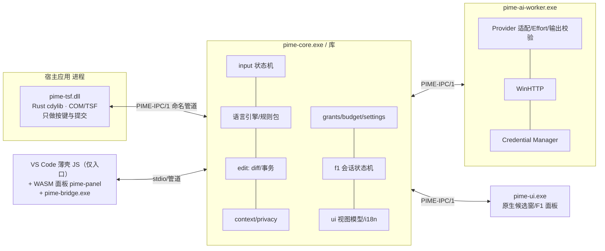
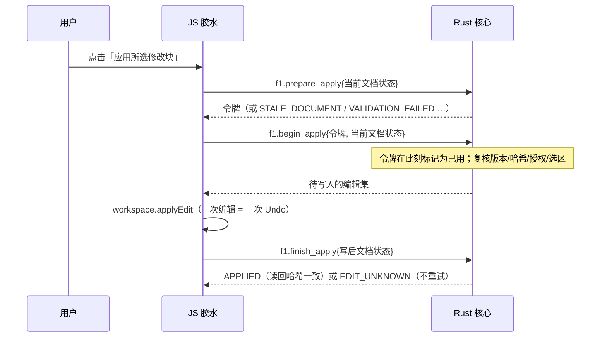

# 纯 Rust 化路线图（RUST-MIG-001，草案 v0.1，2026-10-30）

> 进度：**步骤 1.0/1.1 已实现，见第 13 节**。
>
> 状态：**设计草案**。第 1 阶段方案（逻辑迁入 Rust，JS 退化为胶水）已由项目负责人**暂定同意**；第 2 阶段起的方案是设计，尚未实现，
> 其中带「待决策」标记的事项需要确认后才能开工。本文不修改 `00_Documents/` 的原始设计文件；需要改动设计书的地方见第 11 节。
>
> **决策记录**：2026-10-30 项目负责人选定「纯 Rust」为 **B 档**（见 1.2）：webview 页面也由 Rust 编译成 WASM 生成；
> 扩展入口的 JS 薄壳因 VS Code 宿主限制仍然存在。由此新增的子决策见第 10 节第 8、9 项。
> 所有工作量只用相对规模（S/M/L/XL）表示，是估计而不是承诺。

## 0. 结论摘要

1. 最终目标是**产品代码纯 Rust**。VS Code 扩展宿主只能运行 JavaScript，所以「一行 JS 都没有」对 VS Code 桥接**不可能**；可行的最严格形式是
   「手写 JS 只剩扩展入口这一个不含任何业务逻辑的薄壳（有行数上限和 CI 检查），其余全部是 Rust」。已选定 **B 档**（见 1.2）：
   在此基础上，webview 页面也由 Rust 编译为 WASM，不再有手写的页面 JS/HTML（仅有 wasm-bindgen 生成的加载代码和一个极小的引导片段）。
2. 路线分七步：**P0 准备 → P1 纯逻辑迁入 Rust（已暂定）→ P2 Rust AI Worker（HTTPS + 凭据）→ P3 命名管道 IPC → P4 Rust 版 TSF 与原生候选窗 → P5 安装器 → P6 VS Code 壳最小化**。
3. P1 不引入任何第三方依赖，联网仍由 JS 发送（Rust 构造请求、校验响应）。P2 才需要放宽依赖策略（见 6）。
4. 每一步都必须让 **24 个 Playwright UAT 保持全绿**，作为迁移不改变用户可见行为的回归门槛。
5. TSF（P4）和安装器（P5）需要 Windows 11 虚拟机 + MSVC 才能验证，这台开发机不具备，是最大的外部前置条件。

## 1. 目标与定义

### 1.1 为什么

- 设计书（DD §0、SRS §3）本来就规定：输入引擎、状态机、IPC、AI Worker、TSF 适配都是 Rust 组件；v0.2 里 JS 与 Rust 两份实现靠夹具对齐，维护成本是 2 倍。
- TSF 在输入线程内运行：崩溃或内存安全问题会拖垮宿主应用，Rust（`#![forbid(unsafe_code)]` 的核心 + 极小的 FFI 面）是合适的语言。
- 密钥只应由 Worker 通过 Windows Credential Manager 接触（FR-018/NFR-501）；当前 JS 方案把密钥放在扩展宿主进程里，是过渡形态。

### 1.2 「纯 Rust」的三档定义（**已决策：B 档**）

| 档位 | 含义 | 可行性 | 评价 |
|---|---|---|---|
| A | 所有业务逻辑、协议、状态、安全决策都在 Rust；VS Code 里保留无逻辑的薄壳：`package.json` + 一个转发 VS Code API 的 JS 入口 + 一个只渲染 JSON 视图模型的**手写**静态 webview 页面 | 可行，P1 可达 | 之前的推荐方案 |
| **B（已选）** | 在 A 的基础上，webview 页面由 Rust 编译成 WASM（`wasm32-unknown-unknown` + wasm-bindgen）生成，仓库里没有手写的页面 JS/HTML；扩展入口 JS 仍必须存在 | 可行；需要 wasm 工具链和 webview 的 CSP 放行 WASM（见 4.P6） | 手写 JS 降到最低；代价是多一套 wasm 构建与依赖 |
| C | 完全没有 VS Code 扩展：只做原生 TSF + 原生候选窗；VS Code 作为普通宿主，只有 L1（附近文本）能力 | 技术上可行 | **失去**未保存缓冲区、版本哈希、WorkspaceEdit 事务和 Undo 单步撤销，即 F1 整文件路径（FR-014/033/036/037）不可用，与 SRS 冲突 |

**B 档的边界（如实说明）**：
1. **扩展入口的 JS 无法消除**：VS Code 通过加载 `main` 指向的 JavaScript 文件来激活扩展，`package.json` 清单也是 JSON。它们属于「VS Code 要求的宿主接口」，不算业务代码。
2. wasm-bindgen 会**生成**加载用的 JS 胶水；它是构建产物（不手写、不审阅逻辑、由构建脚本重新生成，可不入库），在统计时单独标注为「生成代码」。
3. 在 webview 里实例化 WASM 需要一小段引导脚本（≤ 15 行，只做 `import` 与 `init()`），并要求 CSP 的 `script-src` 增加 `'wasm-unsafe-eval'`；这是 B 档新增的安全面，需要在 P6 的安全审查中单独评估。

**硬规则**（P1 起生效，P6 收紧）：手写 JS 里**不得**出现语言/语法规则、校验、哈希、Diff、授权、预算、密钥扫描、Effort 协商、错误码映射、界面文案内容。
只允许：VS Code API 调用、定时器、HTTP 发送（P2 之前）、子进程与帧读写，以及（P1 期间）把 Rust 返回的视图模型渲染出来——P6 起渲染也由 WASM 完成。

### 1.3 非目标

不重写 VS Code；不在 Rust 里实现 TLS 协议栈（见 P2 的方案比较）；不改变 SRS 需求范围；不降低任何已通过的安全不变量（第 8 节）。

## 2. 现状盘点（2026-10-30）

| 区域 | 语言 | 规模 | 去向 |
|---|---|---|---|
| 语言包（数据） | JSON | 7 个文件 | 保留（数据，Rust 读取） |
| 语言引擎：规则/识别/预测/校验/x86/密钥扫描/UTF-16 范围 | JS + **Rust（已有，逐项一致）** | JS ~1,150 行 / Rust ~8,200 行（全 crate） | JS 版删除，以 Rust 为唯一实现 |
| 上下文快照/摘录、Diff 与 Hunk、事务（Prepare/Apply）、授权、预算、AI 请求构造与输出校验、设置与迁移、调度/历元、诊断、界面文案、UI 模型 | **仅 JS** | ~1,000 行 | **P1 迁入 Rust** |
| F1 流程（会话状态、视图模型、应用） | 仅 JS（`f1.js`、`ui/f1panel.js`） | ~520 行 | 状态机和视图模型迁入 Rust（P1），页面渲染保留（A 档） |
| VS Code 接线（状态栏、命令、内联补全、对话框） | 仅 JS（`extension.js`、`runtime.js`、`languageState.js`、`coreprocess.js`） | ~550 行 | 保留为胶水（P1），P6 压缩 |
| HTTP 发送（fetch）、SecretStorage | JS | 数十行 | P1 保留；P2 迁到 Rust Worker + Credential Manager |
| TSF COM DLL | C++ | 204 行，未编译 | P4 改写为 Rust |
| UAT | JS（Playwright） | 3 个 spec | 作为**外部测试工具**保留，或 P6 后评估换成 Rust CDP 客户端（待决策） |

## 3. 目标架构（最终态）

对应设计书 DD §1.1 的 crate 划分：`pime-contracts`、`pime-core`、`pime-rules`、`pime-context`、`pime-edit`、`pime-ai-worker`、`pime-diagnostics`、`pime-testkit`、
`windows/tsf`（Rust cdylib）、`windows/ui`、`windows/installer`、`editor-bridges/vscode`。当前 `pime-core` 是一个 crate，P1 内部按模块拆分，
P2 起按上述边界拆成 cargo workspace 的多个 crate（拆分不改变行为，由夹具回归保证）。

## 4. 分阶段路线

每个阶段列出：范围、退出条件（可验证）、主要风险、规模、前置环境。

### P0 准备（S）
- **WASM 可行性原型**（B 档）：一个最小 `pime-panel`（显示一个按钮和一段文字）在真实 VS Code webview 里通过 `wasm-unsafe-eval` CSP 加载、与扩展互发消息，并记录首次打开耗时和所需工具版本。失败则回到 A 档（手写页面），其余阶段不受影响。
- 冻结 v0.2 行为：把现有 JS 生成的夹具标记为 `golden-v0.2`（只读），另存一份 UAT 基线（`uat-results.json` + 截图）。
- 写 `cargo xtask`（Rust 脚本）或保持现有 `scripts/*`：一键 `test-all`（Rust 测试 + UAT + 追踪报告）、`glue-check`（5.5）。
- 决策：第 10 节的待决策事项。
- 退出条件：基线冻结并入库；决策记录完成。

### P1 纯逻辑迁入 Rust，JS 只做胶水（L，**已暂定**，详见第 5 节）
- 范围：除 HTTP 发送和 VS Code UI 外的全部逻辑迁入 `pime-core`；协议升到 0.3（有状态会话）。
- 退出条件：
  1. UAT 24/24 在「仅 Rust 引擎」下通过（`src/core` 下无 JS 文件）。
  2. `cargo test --workspace` 全绿，被迁走的 JS 单元测试以**同样的 UT/IT 编号**在 Rust 里重写并通过；`traceability-report` 的覆盖不下降。
  3. JS 行数不超过 5.5 的 P1 上限；`glue-check` 通过。
  4. 没有 JS 回退引擎：核心不可用时扩展显示明确状态并停用 IME 功能，**不影响 VS Code 自身输入**（Direct）。
- 主要风险：协议往返增加延迟（NFR-201：本地候选 P95 ≤ 20 ms、显示 P95 ≤ 50 ms）；密钥过渡暴露（5.7）；迁移期行为漂移。
- 前置：现有环境即可（零依赖）。

### P2 Rust AI Worker：HTTPS + Credential Manager（L）
- 范围：`pime-ai-worker`：Provider 适配、Effort、预算、取消、**HTTPS 发送**、Windows Credential Manager 保存/读取/删除密钥。密钥不再进入 JS 和 Core。
- TLS 方案比较（**待决策**）：

| 方案 | 做法 | 优点 | 缺点 |
|---|---|---|---|
| **A（推荐）WinHTTP/SChannel** | 通过 `windows` crate 调 WinHTTP；证书用系统信任库，代理设置随系统 | 不自己实现 TLS，不引入 ring/aws-lc 的构建脚本；与 Credential Manager 同一依赖；产品本就只面向 Windows | 仅 Windows；异步/取消要自己封装 |
| B rustls | `rustls` + 加密后端 | 跨平台、纯 Rust 生态 | 依赖多且带构建脚本（本机无法构建，需在 CI/虚拟机构建）；证书/代理要自己处理 |
| C 保留 JS fetch | 不迁移 | 零工作量 | 不满足「纯 Rust」，密钥继续留在 JS，不符合 FR-018 设计 |

- 退出条件：UAT 在 Worker 下通过（Mock 供应商，自签名证书需要为测试配置信任，不放宽产品默认）；扫描确认密钥不出现在扩展宿主进程内存之外的任何路径；强杀 Worker 后输入不受影响（IT-042/ST-037 的 Worker 部分）。
- 风险：依赖引入（供应链）；WinHTTP 的取消/超时语义；Anthropic/OpenAI 兼容端点的差异。
- 前置：能构建 `windows` crate 的机器（MSVC 或 gnu 工具链 + 无构建脚本限制）。**待验证**：`windows`/`windows-sys` 在本机是否能构建（本机无法执行依赖的构建脚本；这两个 crate 近年不依赖构建脚本，但未在本机验证）。

### P3 命名管道 IPC `PIME-IPC/1`（M）
- 范围：`pime-ipc`：长度前缀帧、协议版本、按用户 SID 的 ACL、握手（challenge-response）、能力令牌、超时（DD §2.1）。替换 stdio；Core↔Worker↔UI↔TSF↔VS Code 壳统一走它。
- 退出条件：IT-003（身份认证：同 SID 合法、异 SID/重放被拒）、IT-004/ST-037（Core 被挂起/强杀后 Direct ≤ 2 s）在 VM 上通过。
- 风险：Win32 命名管道与 ACL 需要少量 `unsafe` FFI（隔离在 `pime-ipc`/`windows` crate 内，核心 crate 仍 `forbid(unsafe_code)`）。
- 前置：Windows 11 VM。

### P4 Rust 版 TSF 与原生候选窗（XL）
- 范围：`windows/tsf` 用 Rust 重写：`ITfTextInputProcessorEx`、`ITfKeyEventSink`、组合与提交（编辑会话）、三语言 Profile 注册；TSF 回调内**不做**网络/磁盘/等待 AI（DD §1.1 规则 1）；原生候选浮层/语言下拉（`pime-ui.exe`，Win32 + Direct2D，DPI 感知，多屏回退）。
- 退出条件：**G0**：三种系统语言下选择、激活、输入成功（ST-001..005），原输入法与默认设置不受影响；安全输入框零采集（IT-005）；TSF 故障保持 Direct。
- 风险：宿主兼容性（不同应用对 TSF 范围的暴露不同）；候选窗定位；这是整个项目**不确定性最大**的一步，也是 v0.1 以来一直未验证的缺口。
- 前置：Windows 11 VM（Sandbox / Hyper-V，可丢弃、有管理员权限）、测试签名证书。MSVC 与 Windows SDK 对**构建**已不是必需（见 §6，`windows` 钉 0.58 的 GNU 路径已验证），但仍可用于对照构建和签名工具。

### P5 安装器与签名（L）
- 范围：`windows/installer`：注册/卸载 COM 与三个 Profile（只动本产品 GUID，UT-002/061 已有 Rust 计划生成器）、文件部署、回滚、升级迁移；签名流程。
- 形态（**待决策**）：Rust 自包含安装器（推荐，保持纯 Rust）/ MSI（需要 WiX，打包层非 Rust）。签名用 `signtool`（外部工具，不是产品代码）。
- 退出条件：ST-035（新装/修复/升级/卸载/重启，失败可回滚）；FR-048。

### P6 VS Code 壳最小化 + WASM 页面（L，B 档）
- 范围：
  1. 新 crate `pime-panel`（`cdylib`，目标 `wasm32-unknown-unknown`）：消费 P1 定义的**视图模型 JSON**（5.8），用 `web-sys` 直接操作 DOM（面板很小，**不引入** Yew/Leptos 等框架，减少依赖；框架选择见第 10 节第 8 项），把用户操作转成消息发回扩展。页面保持 textContent 渲染、无远程资源。
  2. 构建：`wasm-bindgen` 生成 `pime_panel.js` + `pime_panel_bg.wasm`；构建脚本负责生成并放进 VSIX 的 `media/`，webview 通过 `webview.asWebviewUri` 加载，`localResourceRoots` 只开放该目录。
  3. CSP：`default-src 'none'; script-src 'nonce-…' 'wasm-unsafe-eval'; style-src 'nonce-…'`；引导脚本 ≤ 15 行（`import init from …; init();`），不含逻辑。
  4. 手写 JS 压缩到 5.5 的最终上限（只剩扩展入口）；打包 `pime-bridge.exe`（或直接 `pime-core.exe`）随 VSIX 分发（按平台）。
  5. 可选（**待决策**，第 10 节第 9 项）：把整个桥接逻辑也编译成 WASM 在扩展宿主内运行，从而不再需要子进程；VS Code API 仍须由 JS 导入提供，增加的只是一层绑定，是否值得取决于性能和调试体验。
- 退出条件：`glue-check` 通过最终上限（手写 JS 仅扩展入口；页面无手写 JS/HTML）；UAT 24/24（其中 F1 面板场景覆盖 WASM 页面）；VSIX 在干净环境可安装运行；webview 的 CSP 放行范围只增加 `'wasm-unsafe-eval'` 且有安全评审记录。
- 主要风险：webview 内 WASM 的加载路径与 CSP 细节；wasm 体积与启动延迟（F1 面板首次打开）；`wasm-bindgen` CLI 与 `wasm32` 目标需要额外工具链。

## 5. 第 1 阶段详细设计（已暂定）

### 5.1 模块映射（JS → Rust）

| JS 模块（`editor-bridges/vscode/src/…`） | Rust 去向 | 说明 |
|---|---|---|
| `core/errors.js` | `error.rs`（已有）| 错误码全集与 `PimeError` 元数据对齐 |
| `core/textrange.js`、`x86.js`、`validators.js`、`secrets.js`、`languages.js` | **已迁入**（`textrange.rs`、`x86.rs`、`validators.rs`、`secrets.rs`、`pack/predict/resolve.rs`）| 删除 JS 版 |
| `core/context.js` | `context.rs`（新）| 快照、L0–L4 能力表、摘录；需要 **SHA-256**（零依赖自实现，≈100 行，用标准测试向量验证）|
| `core/diff.js` | `edit/diff.rs`（新）| 行级 LCS Hunk、重放、渲染模型 |
| `core/transaction.js` | `edit/transaction.rs`（新）| Prepare/Apply、一次性令牌、读回校验、EDIT_UNKNOWN 终态 |
| `core/grants.js` | `grants.rs`（新）| 授权代理；工作区令牌哈希 |
| `core/ai.js` | `ai/*.rs`（新）| Provider 适配（构造请求/解析响应）、Effort 协商、预算、错误映射、输出校验、提示构造；**不含 HTTP 发送** |
| `core/scheduler.js` | `session.rs` + `sched.rs`（新）| 历元与锁、去抖判定（注入时钟）、Direct 监督；**定时器本身留在 JS** |
| `core/settings.js` | `settings.rs`（新）| 有效设置、校验、迁移、原子写入、用户规则加载 |
| `core/i18n.js` | `i18n.rs`（新）| 文案表；JS 一次性获取 `ui.bundle(locale)` 缓存（数据，不是逻辑）|
| `core/diagnostics.js` | `diag.rs`（新）| 白名单脱敏 |
| `core/uimodel.js` | `uimodel.rs`（新）| 候选行语义、浮层定位、环境检查 |
| `f1.js`（流程/状态/视图模型）| `f1.rs`（新）| DD §9.1 状态机；输出面板视图模型 JSON；JS 只负责弹窗、转发点击、执行写入 |
| `extension.js`、`runtime.js`、`languageState.js`、`coreprocess.js`、`ui/f1panel.js` | **保留为胶水** | 见 5.5 |

### 5.2 状态归属

Rust 核心进程持有全部会话状态：历元、锁、快照（文本只在核心内存里，JS 不重复传输）、F1 会话、计划与令牌、授权、预算、冷却、诊断。
JS 不保存任何需要判断的状态；它只持有 VS Code 对象（编辑器、面板、状态栏项）。

### 5.3 协议 0.3（在 0.2 的帧和 `id` 基础上扩展；新增操作）

| 操作 | 请求要点 | 响应要点 |
|---|---|---|
| `session.open` | `locale`、`entropy`（32 字节，JS 的 `crypto.randomBytes`；P2 起改用系统随机数）、初始设置 | `session`、`protocol:"0.3"` |
| `settings.apply` | VS Code 配置值（providers/scenarios/budget/dialects…）| 有效设置、问题列表 |
| `lang.state` / `lang.lock` / `lang.unlock` | 文档标识（uri 的哈希）、languageId、文件名、头部文本 | 解析结果、方言、历元 |
| `lang.predict`（已有，扩展）| 增加 `session` | 候选（已有字段）|
| `ctx.snapshot` | uri、version、text、selection、languageId、dirty、fileName | `snapshot_id`、sha256、eol、level |
| `privacy.assess` / `privacy.redact` / `privacy.restore` | `snapshot_id` 或文本、范围 | 动作、发现项（不含值）、占位符映射留在核心 |
| `grant.authorize` / `grant.check` / `grant.revoke` / `grant.list` | 提供方+主机、工作区令牌、范围、期限 | 授权 id / 结果 / 列表 |
| `ai.prepare` | 场景、`snapshot_id`、意图、授权 id、（P1 过渡）密钥 | `request_id`、`http{url,headers,body}`、超时 |
| `ai.complete` / `ai.abort` | `request_id`、HTTP 状态/响应头/正文 或 传输错误码 | 解析后的结果或错误码、Effort 说明、用量 |
| `f1.begin` / `f1.generate` / `f1.result` / `f1.toggle_hunk` / `f1.view` | 标签、勾选、意图 | 面板视图模型 JSON |
| `f1.prepare_apply` / `f1.begin_apply` / `f1.finish_apply` / `f1.invalidate` | 当前文档状态（uri、version、text、selection）、写后状态 | 令牌、待写入的编辑集、APPLIED/EDIT_UNKNOWN/STALE_* |
| `sched.touch` / `sched.is_current` | 输入键（seq、历元）| 是否应发送、是否过期 |
| `diag.record` / `diag.summary` / `ui.bundle` / `ui.text` | — | — |

### 5.4 关键流程：整文件应用（把「令牌先标记已用再写入」保留在 Rust）

AI 请求同理：`ai.prepare` → JS 执行 `fetch`（超时/取消由 JS 的 `AbortController` 驱动并回报）→ `ai.complete`。

### 5.5 JS 胶水白名单与上限

允许：VS Code API 调用；定时器；HTTP 发送；子进程与 JSONL 帧；把视图模型渲染成 DOM；把用户点击转发给核心。
禁止：第 1.2 节列出的所有判断类逻辑。

| 指标 | 现在 | P1 上限 | P6 最终上限（B 档）|
|---|---|---|---|
| 手写 JS 总行数（不含测试）| ~2,750 | **≤ 700**（含手写 webview 页面）| **≤ 150**（只有扩展入口）|
| 手写 webview 页面 JS/HTML | ~170 行 | 保留（≤ 170 行，只渲染视图模型）| **0**（WASM 页面 + ≤ 15 行引导）|
| 生成的 JS（wasm-bindgen 产物）| 无 | 无 | 单独统计，不入库或标注 `generated`，不计入手写上限 |
| `src/core/` 下 JS 文件 | 15 | **0** | 0 |
| 业务逻辑检测（`glue-check` 禁用标识：`createHash`、`RegExp` 用于语言规则、`sha256`、`JSON.parse` 用于模型输出…）| 不适用 | 0 处 | 0 处 |

`glue-check` 是一个检查脚本（P0 编写，最终用 Rust `xtask` 实现），在测试流水线里强制执行；B 档下它还要校验「手写 JS 文件清单」只含白名单文件。

### 5.6 步骤切分（每一步结束时整个系统都是绿的，可在任意步骤停下）

| 步骤 | 内容 | 本步验收 |
|---|---|---|
| 1.0 | 协议 0.3 骨架：`session.open`、`settings.apply`；扩展增加 `programmingIme.engine`（`js`｜`rust`，默认仍 `js`）；UAT 支持用 Rust 二进制运行 | 两种模式下 UAT 24/24 |
| 1.1 | SHA-256、`context`、`diff`、`transaction`、`grants`、预算计账 入 Rust；F1 的写入路径走 Rust | Rust 同编号单测 + UAT（Rust 模式）|
| 1.2 | `ai` 请求构造/解析/Effort/错误映射/输出校验/脱敏还原 入 Rust；JS 仍发送 HTTP | 同上 + UAT-20/21/26..31 |
| 1.3 | 会话历元/锁/去抖判定、设置迁移与原子写入、诊断、i18n、uimodel 入 Rust | 同上 + UAT-01..08/33..35 |
| 1.4 | F1 会话状态机与视图模型入 Rust；面板只渲染 | 同上 + UAT-22..25 |
| 1.5 | 差分验证（同一输入在 JS 与 Rust 上逐项比对，覆盖 1.1–1.4 的全部操作）后，**删除 JS 核心模块与其单测**；默认引擎切为 Rust；去掉 JS 回退 | UAT 24/24（仅 Rust）|
| 1.6 | `glue-check`、文档、面板视图模型契约 `schemas/f1-view-v1.json`（5.8）、二进制随扩展分发的方式（5.9）| 退出条件 1–4 |

### 5.7 过渡期密钥处理（必须如实记录）

P1 期间 JS 仍从 SecretStorage 读取密钥并交给 Rust 的 `ai.prepare`，Rust 把它放进返回的 `http.headers`，再由 JS 发送。这意味着密钥短暂经过 JS 与管道。
缓解：不落盘、不进日志（诊断白名单）、请求结束即丢弃；UAT-20 的磁盘扫描继续有效。该暴露在 P2（Worker + Credential Manager）结束。

### 5.8 面板视图模型契约（P1 定义，P6 的 WASM 页面消费同一份）

为了让 B 档的页面能在 P6 直接替换，P1 就把面板的数据契约固定下来，而不是让手写页面和核心之间靠隐含约定：

- 契约 = `schemas/f1-view-v1.json`（JSON Schema）+ Rust 侧的 `ViewModel` 类型（`serde` 不可用，仍用自带 `json` 模块序列化）。
- 内容：当前标签、各标签状态（idle/loading/ready/error/unavailable）、消息与注记、Hunk 列表（id、标题、带 `+`/`-` 文本标记的行、是否选中）、结果预览与哈希、校验结论、可否应用、目标位置文本、候选列表、用量文本、横幅、i18n 文案包。
- 上行消息契约：`generate`、`regenerate`、`toggleHunk`、`openDiff`、`applyFull`、`applyInsert`、`cancel`、`tab`。
- P1 的手写页面和 P6 的 WASM 页面都只依赖这份契约；UAT 里已有的选择器（`#generate`、`#panel-full .status`、`fieldset.hunk`、`#apply-full` 等）作为 DOM 契约保留，保证替换页面后 UAT 不改。

### 5.9 二进制分发与降级

扩展随包携带 `pime-core.exe`（P1 先要求用户在 `programmingIme.coreExecutable` 指定或从构建目录加载；P6 随 VSIX 打包并校验哈希）。
核心不可用时：状态栏显示不可用原因，IME 功能停用，VS Code 的普通输入不受影响（不再有 JS 回退引擎）。这改变了 v0.2 的“JS 兜底”行为，需要在升级说明里写明。

## 6. 依赖与工具链策略

- **P1**：零第三方依赖不变（核心可审计，且本机无法运行依赖的构建脚本）。
- **P6（B 档新增）**：需要 `wasm32-unknown-unknown` 目标、`wasm-bindgen`（库与 CLI，版本必须一致）、`web-sys`/`js-sys`。这些是浏览器侧的最小集合，只用于 `pime-panel`，**不进入**核心、Worker、TSF 的依赖图（用 cargo workspace 的独立成员隔离，并由 `cargo tree` 检查）。`wasm-bindgen` 本身及其依赖是否带构建脚本、能否在本机构建**未验证**，需要在 P0 做一次可行性验证。
- **P2 起**：仅允许 Microsoft 官方的 `windows` / `windows-sys`（用于 WinHTTP、Credential Manager、命名管道、TSF/COM）；每个新增依赖要有决策记录（用途、替代方案、体积、是否有构建脚本、许可证）。接受 `cargo deny`/`cargo vet` 之类的供应链检查（**待决策**具体工具）。
- 构建环境：P2–P5 需要能构建 `windows` crate 的机器（MSVC 或可用链接器）。本开发机的限制（带构建脚本的依赖无法执行）只影响本机，不应成为设计约束；建议在 Windows 11 VM/CI 上构建这些阶段。
- 核心 crate 保持 `#![forbid(unsafe_code)]`；所有 `unsafe` 隔离在 `pime-ipc`、`windows/tsf`、`windows/ui`、`pime-ai-worker` 的 FFI 边界，并逐处注释安全前提。
- **P4 的构建路径（2026-10-30 实测，M2）**：`crates/pime-tsf`（TSF 文本服务 DLL，纯 Rust）可以在本机 `x86_64-pc-windows-gnu` 工具链上构建，**不需要 MSVC、Windows SDK 或 binutils**，前提是把 `windows` / `windows-core` 钉在 **0.58.0**（它依赖 `windows-targets 0.52` 自带的预编译导入库）。`windows` 0.60 / 0.61 / 0.62 改用 raw-dylib，要求 PATH 上有可用的 `dlltool`（连同 `as`）；本机 Rust 自带的 `dlltool.exe` 缺少汇编器，构建失败（已逐版本验证）。这是**有意的版本钉**，不是疏忽：当机器装有 MSVC 或 MinGW-w64 binutils 时再升级。`pime-tsf` 不是主工作区成员（需要 `unsafe`，有独立的 `Cargo.lock`），由 `tests/smoke/tsf-dll-check.js` 检查产物（x64、四个 COM 导出、只导入系统 DLL）。**构建成功不等于输入法可用**：注册、激活、按键、候选窗都尚未验证（见 13.7）。

## 7. 测试与证据延续

1. **UAT 是迁移的回归门槛**：每个步骤结束都跑 24 个场景；P1 末以后只在 Rust 引擎下跑。
2. **夹具**：`tests/fixtures/*.json` 是 JS 引擎生成的 `golden-v0.2`。JS 删除后它们转为只读黄金文件，由 Rust 的 `tests/parity.rs` 继续校验；今后的行为变更必须显式更新夹具并说明原因。
3. **单测迁移**：JS 单测按同样的 UT/IT 编号在 Rust 里重写；`scripts/traceability-report.js`（P6 前可保留，之后改为 Rust xtask）继续出报告，**覆盖编号数不得下降**。
4. **差分验证**：1.5 步用同一批输入（夹具 + 随机输入）同时跑 JS 与 Rust，零差异后才删除 JS。
5. 性能：`UT-068` 基准在迁移后重测，协议往返计入；NFR-201 的口径不变。
6. P3–P5 增加 VM 上的系统测试（G0、ST-001..005/035/037），用例编号沿用设计书。

## 8. 迁移期间不得退化的不变量

- 未授权不发送；AI 关闭时请求数为 0；高风险敏感内容未经显式确认不出站（最后一道闸）。
- 写入只经 Prepare/Apply：确认、版本+哈希复核、令牌先标记已用、读回校验、`EDIT_UNKNOWN` 不重试、一次编辑一次 Undo。
- 模型输出是数据：未知字段被忽略，跨文件修改被拒绝，不执行任何命令。
- 诊断只含白名单元数据；密钥不进设置、日志、诊断、崩溃输出。
- 核心/Worker 故障时输入保持可用（Direct）。

## 9. 风险登记

| 风险 | 影响 | 缓解 |
|---|---|---|
| 协议往返拉高候选延迟 | NFR-201 不达标 | 候选路径保持同步单次往返；批量/缓存；基准在每步重测；必要时核心内联为库 |
| 迁移期行为漂移 | 回归 | UAT 门槛 + 夹具 + 差分验证；步骤可在任意处停下 |
| TSF/Windows 环境不可得 | P4/P5 无法验证 | 在 P0 就确定 VM/CI；P1–P3 不依赖 |
| 依赖引入（P2）带来的供应链与构建问题 | 安全/可构建性 | 依赖策略 6；优先 WinHTTP；构建在 CI |
| JS 回退被删除后核心不可用 | 用户失去候选 | 清晰降级提示；VSIX 内置二进制并校验；输入不受影响 |
| 过渡期密钥经过 JS | 暴露面 | 5.7；P2 结束 |
| 「纯 Rust」被理解为零 JS | 目标无法达成 | 1.2 的明确定义（B 档，扩展入口 JS 不可消除）与 CI 强制 |
| webview 内 WASM：CSP 需放行 `'wasm-unsafe-eval'`，加载路径与首次启动延迟 | 增加页面攻击面、F1 面板首开变慢 | 只放行该指令并做安全评审；`localResourceRoots` 仅开放 `media/`；P0 做可行性原型并测首开耗时 |
| wasm 工具链（`wasm-bindgen` CLI 与库版本必须一致、构建脚本） | 构建不稳定、本机可能无法构建 | 工具版本钉死；在 CI/VM 构建；产物校验哈希 |

## 10. 待你决定的事项

1. ~~「纯 Rust」选哪一档~~ → **已决策：B 档**（2026-10-30）。
2. **P2 的 TLS 方案**：WinHTTP（推荐）/ rustls / 暂留 JS。
3. 是否同意 **P2 起引入 `windows`/`windows-sys` 依赖**，以及用什么做供应链检查。
4. **安装器形态**（P5）：Rust 自包含安装器 / MSI(WiX)。
5. **UAT 工具**：Playwright 作为外部测试工具长期保留，还是 P6 后换 Rust CDP 客户端。
6. **VS Code 桥接的长期地位**：与原生 TSF 并重，还是 TSF 稳定后降为可选适配器。
7. **Windows 11 VM + MSVC + 测试证书**何时能提供（决定 P3–P5 的开工时间）。
8. **WASM 页面的实现方式**（B 档引出）：`web-sys` 直接操作 DOM、零框架（推荐：面板很小，依赖最少）/ Yew / Leptos。
9. **是否把整个桥接逻辑也编译成 WASM 在扩展宿主内运行**（省掉子进程，但调试体验、性能和 VS Code API 绑定层要评估；默认不做，保留 `pime-bridge.exe`/`pime-core.exe` 子进程）。
10. **P0 的可行性验证何时做**：wasm 工具链能否在本机/CI 构建、WASM 页面在 webview 里加载并通过 CSP、首次打开耗时。

## 11. 对设计书的变更建议（不在本次修改 `00_Documents/`）

- DD §1.1：增加 `pime-bridge`/`pime-ipc`/`pime-ui` 的 crate 说明；明确 VS Code 桥接在 A 档下的 JS 壳边界。
- DD §2：保留 `PIME-IPC/1` 命名管道设计；在 P3 之前，v0.2/P1 使用 stdio JSON Lines 协议 0.2/0.3（仅限同机受信子进程）。
- DD-05：记录 P1 的密钥过渡路径与 P2 的目标路径。
- DD-12：测试夹具与 UAT 作为迁移回归门槛。
- DD §5.3（按键规则）与 UT-009：用户要求系统输入法的操作方式与搜狗等主流输入法一致（含候选前后翻页）。实现为**候选捕获/组合状态下的扩展键位**：数字键在**当前页**内选词（每页 1–9 个，默认 5）、PageUp/PageDown 翻页（仅在多于一页时消费，否则交还宿主滚动编辑器）、Up/Down 与 Shift+Tab 移动高亮、Tab/Enter 确认、Esc 取消、空格仅在组合状态确认（候选捕获状态下需显式开启 `space_confirms`）、`= . ]` / `- , [` 标点翻页默认**关闭**（它们是代码字符：`a.b`、`x - 1`）、单击 Shift 切换暂停/恢复（Shift 本身不被吞）。**直通（Direct）与观察（Observing）状态仍然不吞任何键**，UT-009 的原约束不变；只有显式启用候选捕获才消费。输入法之间的切换（Win+Space、Ctrl+Shift）由 Windows 负责，不由本输入法实现。
- 若批准，再统一出 DD v1.1 与追踪表更新，并保持 FR/NFR → DD → 测试 的追踪链。

## 12. 相对规模一览

| 阶段 | 规模 | 外部前置 |
|---|---|---|
| P0 准备 | S | 决策 |
| **P1 逻辑迁入（已暂定）** | L | 无 |
| P2 AI Worker | L | 能构建 `windows` crate 的环境 |
| P3 命名管道 IPC | M | Windows 11 VM |
| P4 TSF + 原生 UI | XL | VM + MSVC + SDK + 测试证书 |
| P5 安装器与签名 | L | 同上 + 签名证书 |
| P6 VS Code 壳最小化 + WASM 页面（B 档）| L | wasm 工具链（P0 验证）|

执行顺序：P0 → P1 → （P2 可与 P3 并行）→ P4 → P5 → P6。P1 完成后即可发布「JS 仅胶水」的版本，P4/P5 完成才是真正的系统输入法。

## 13. 进度记录（Progress）

> 最近更新：2026-10-30。**步骤 1.0 与 1.1 已实现**（工作区未提交）；1.2 及以后**未开始**。本节只记录事实；设计正文（第 5 节）未改。

### 13.1 1.0 交付：协议 0.3 骨架与引擎开关

- `pime-core` 协议升为 **0.3（0.2 的超集）**：7 个 0.2 操作行为不变（仍受 64 KiB 行限制）；`health` 现报告 `"protocol":"0.3"`（`version` 仍是 `0.2.0`）。
  唯一的 0.2 操作变化是 `predict` 新增**可选**字段 `pins`、`usage`（JS 桥此前没有把它们传给核心，Rust 引擎下排序会丢失置顶/使用频率）。
- 新增有状态会话：`session.open {locale, entropy, settings}`、`settings.apply {values, locale?}`、`settings.resolve {scenario}`、`session.close`；
  除 `health` 与 `session.open` 外，所有 0.3 操作都必须带 `session`，缺失/未知/淘汰/过期（空闲 24 h；最多 16 个会话，LRU 淘汰）→ `{"ok":false,"error":"NO_SESSION"}`。
- `settings.rs`：`effective`/`validate`/`resolveScenario` 的移植（JSON 形状与键顺序与 JS 一致，包含 `apiVersion`、`maxTokensParam` 与 `none/minimal/xhigh` 努力等级；
  端点校验是 WHATWG `new URL` 的子集，对 37 个边界样例（含 `https:host`、大写 scheme、`user@`、反斜杠、百分号编码主机、端口越界）与 JS 一致）。
- 扩展：新设置 `programmingIme.engine`（`js`｜`rust`，默认 `js`）。`rust` 下**必须**有可用的 `coreExecutable`（健康检查要求协议 0.3；`js` 下可选加速器接受 0.2 或 0.3），
  核心缺失/中途死亡 → 状态栏显示 `core unavailable` + 一次性错误通知 + IME 功能停用（F1 键回到命令面板），**没有静默回退到 JS 引擎**，VS Code 自身输入不受影响。
- `src/engine.js`（新）是适配层：`engine.coordinator` / `engine.broker` 与 JS 的 `EditCoordinator` / `PermissionBroker` 方法同名，其余边路径调用（`snapshot/excerpt/validateSnapshot/propose/select/resultText/hunkEdits`）二选一实现；
  `f1.js` 不含 `if (rust)`。`coreprocess.js`：用 `StringDecoder` 修复了多字节字符跨块被截断的问题，可配置最大行、逐请求超时。
- UAT 工具：环境变量 `PIME_ENGINE=rust` + `PIME_CORE_EXE=<pime-core.exe>` 把 `programmingIme.engine`/`coreExecutable` 写入测试配置；不设置时与以前完全一致。

### 13.2 1.1 交付：编辑路径进入 Rust

新模块（零第三方依赖，`#![forbid(unsafe_code)]` 不变）：`sha256.rs`（手写 SHA-256 + HMAC；NIST 向量含空串、448/896 位消息、100 万个 `a`；RFC 4231 HMAC 向量）、`clock.rs`（可注入的墙钟）、`ids.rs`（见 13.5）、
`context.rs`（L0–L4、`makeSnapshot`、`assertFullFileWritable`、`excerpt`、`requireWithinPolicy`）、`edit/diff.rs`、`edit/transaction.rs`、`grants.rs`、`budget.rs`、`settings.rs`、`session.rs`、`ops.rs`。

协议 0.3 操作表（**按实现**；请求字段 snake_case，嵌套对象沿用 JS 形状；偏离建议名的见 13.4）：

| 操作 | 请求要点 | 响应要点 |
|---|---|---|
| `session.open` / `session.close` | `locale`、`entropy`（32–512 字节十六进制）、`settings` | `session`、`protocol:"0.3"`、`issues` |
| `settings.apply` / `settings.resolve` | `values`、`locale?` / `scenario` | `settings`（有效设置）、`issues` / `scenario`（JS 形状） |
| `ctx.snapshot` | `uri,version,text,languageId,selection,isDirty,fileName,level,editorInstanceId`（**大行**） | `snapshot{snapshot_id,sha256,eol,…,length}`（不含文本；文本留在核心） |
| `ctx.excerpt` | `snapshot_id,cursor,before,after,policy?` | `excerpt{text,start,end,cursorInExcerpt,truncated}` |
| `ctx.validate` | `snapshot_id,language,dialect,edits?`（**大行**） | `result{ok,level,issues}`（可预览插入后的结果，不创建任何东西） |
| `ctx.release` | `snapshot_id` | `released`（同时丢弃该快照的全部 proposal） |
| `edit.propose` | `snapshot_id,proposed_text,language?,dialect?`（**大行**） | `proposal`、`hunks[]`（几何+显示行）、`stats`、`after_hash`、`result{length,hash,preview,truncated,validation}` |
| `edit.select` / `edit.result` | `proposal,hunk_ids[]` | `result{…}` / `text`（整段结果，用于只读 Diff） |
| `edit.plan` | `kind` + (`proposal`+`hunk_ids` 或 `snapshot_id`+`edits[]`)、`targets`、`selection` | `plan{id,status,proposedHash,expiresAt,…}`（EditCoordinator.createPlan） |
| `edit.prepare` | `plan,state{uri,version,text,isClosed?,editable?,selection?},confirmed,grant_id\|grant_ok,validation_ok`（**大行**） | `token` |
| `edit.begin_apply` / `edit.finish_apply` | `token,state` / `token,outcome:accepted\|rejected\|error,state?`（**大行**） | `edits[]`,`apply_timeout_ms` / `state:"APPLIED"`,`newVersion`,`newHash` |
| `edit.invalidate/discard/purge/status` | `uri` / `plan` / – / `plan` | `invalidated` / – / – / `status` |
| `grant.authorize/check/find/require/consume/revoke/revoke_provider/revoke_provider_prefix/revoke_all/still_valid/list/export/import/workspace_token` | `provider_id`、`workspace`\|`workspace_uris`、`scope`、`ttl_ms`、`once`、`grant_id` … | JS 形状的 grant 对象；修改类操作附带 `persist`（可持久化的可复用授权，供 JS 写入 `pime.grants.v1`） |
| `budget.configure/reserve/settle/release/snapshot/reset` | `max_requests,max_tokens,price_per_1k_tokens` / `estimate` / `ticket,usage?` … | `ticket` / `budget{requests,tokens,estimated,cost}` |

“大行”的操作可以使用最长 16 MiB 的请求行（2 MiB 文档在最坏转义下约 12 MiB）；其余操作仍是 64 KiB，超过则 `PAYLOAD_TOO_LARGE`（与 0.2 相同，含不带 `id` 的应答格式）。
机器可读契约：`schemas/core-protocol-v0.3.json`（0.2 的 schema 保留）；样例：`tests/fixtures/core-jsonl-v0.3.txt`（22 行，由 `handle_line` 与真实二进制各跑一遍）。

扩展接线（仅 `engine=rust`；`engine=js` 行为不变）：`f1.js` 的快照、摘录、Hunk 构建/选择/结果文本、语法校验、计划创建、Prepare/Apply/Finish、失效与清理、授权代理全部经核心；
`WorkspaceEdit`、对话框、面板仍在 JS。同一个授权代理服务**所有**调用方（F1、实时 AI、权限菜单、删除密钥、`annotate.js`、`authorizeRequest`），避免两个代理各持一半状态。
实时调度的 `isAllowed` 必须同步，Rust 引擎下用 `broker.findNow`：返回最近一次 `find` 的结论（授权成功时即预热、任何撤销即清空、5 s 过期后台刷新）；它只决定“是否尝试”，真正发送前 `authorizeRequest` 仍向核心 `require`。

### 13.3 验证（本机实测，见最终报告）

- `cargo test --workspace`：**209** 个测试（开始时 101）；`cargo clippy --workspace --all-targets -- -D warnings`、`cargo fmt --all -- --check` 干净。
- JS：`npm test` 90 项 + 10 项引擎差分测试（`tests/js/ut-engine.test.js`，需要 `PIME_CORE_EXE`，未设置时**跳过**而不是通过）；`npm run check` 通过；`node tests/gen-fixtures.js --check` 最新（新增 `edit-cases.json`：SHA-256、diff/hunk/render/选择、摘录、设置、端点、工作区令牌，全部由 JS 生成、Rust 逐项一致）。
- UAT（2026-10-30，真实 VS Code 1.137.0，每次一个实例）：**js 引擎 31 通过 + 1 跳过**（24 项原有 + 6 项注释 + ENG-01；ENG-02 需要核心，故跳过）；**rust 引擎 32/32 通过**（核心为 debug 构建的 `pime-core.exe`）。
  新增 `tests/uat/tests/05-engine.spec.js`：ENG-01（`engine=rust` 且核心不存在 → 状态栏 `core unavailable`、一次性通知、F1 仍打开命令面板、无 JS 回退、输入不受影响）、ENG-02（运行中强杀核心 → 同样降级）。
  复现：`cargo build` → `$env:PIME_ENGINE='rust'; $env:PIME_CORE_EXE='<pime-core.exe 路径>'; $env:UAT_EVIDENCE_DIR='<证据目录>'; cd tests/uat; npx playwright test`（默认引擎：不设这三个变量；约 4.3 分钟）。
- 移植到 Rust 的 UT/IT 编号（函数名带同样的编号，如 `ut_045_hunks_replay_to_the_exact_after_hash_with_crlf_and_a_changed_trailing_newline`）：UT-025/027/028/029/030、UT-035、UT-044/045/046/047/048/049/050/051/052/053/054、UT-075，IT-015/029/030/031/032/033/035/036，ST-027/030，NFR-502（UT-026 此前已在 `textrange.rs`）。

### 13.4 与计划/任务书的偏离及原因

1. **proposal 与 plan 分开**：`edit.propose` 返回 `proposal`（持有提案文本和 Hunk），`edit.select` 作用于 proposal；EditCoordinator 的 plan 在应用时由 `edit.plan` 创建（与 JS 一致：10 分钟计划寿命从点击“应用”算起，而不是从提案算起）。插入路径不经过 `propose`，直接 `edit.plan` + 显式 `edits`。
2. **新增操作**（计划表里没有）：`edit.plan`、`edit.result`、`edit.purge/discard/status`、`ctx.validate`（校验结果文本不必把大文本回传）、`ctx.release`（NFR-502：F1 会话关闭即丢弃文档副本）、`settings.resolve`、`session.close`、`grant.find`、`grant.workspace_token`、`grant.revoke_provider_prefix`（删除密钥须撤销该提供方所有主机的授权，含已用/过期的）。
3. `edit.prepare` 接受 `grant_id`（核心用自己的代理判断 `stillValid`）；只有没有 `grant_id` 时才接受字面量 `grant_ok:true`。`confirmed` 只认字面量 `true`。
4. **比 JS 更严格的地方**：同一计划的 EDIT_UNKNOWN 之后不能再 `prepare`（JS 允许对同一 plan 再签发令牌）；一个文档的写入在等待 `finish_apply` 时，第二个 `begin_apply` 返回 `EDIT_REJECTED` 且不消耗令牌（JS 靠队列串行）；
   `grant.import` 跳过字段不合法的条目（JS 全盘信任）；会话数/快照数/提案数/凭据数有上限。
5. **apply 拆分**的时间语义：`begin_apply` 启动 5 s 期限；超过期限的 `finish_apply` 一律 `EDIT_UNKNOWN`（绝不 `APPLIED`）；期限过后任何触及该 plan 的调用（`prepare`/`status`/`invalidate`…）都会把它置为 `UNKNOWN`；`purge` 保留未完成写入的记录 60 s，使迟到的 `finish_apply` 仍得到 `EDIT_UNKNOWN`。
6. **预算只做了核心模块与操作**（含 UT-035），**没有接入扩展**：`AiClient` 同步调用 `reserve`、`viewState`/状态栏同步读 `snapshot`，且任务书的 f1.js 接线清单不含预算；随 1.2（AI 客户端）一起接。
7. **设置**：核心持有有效设置并可 `resolve`，但扩展运行时仍用 JS 的 `effective()`（两者由夹具保证逐项一致）；把运行时切到核心属于 1.3。
8. JS 仍持有文档文本副本（AI 提示、秘密闸门、Diff 预览需要），只在打开 F1 时向核心发送一次；`prepare/begin_apply/finish_apply` 必须携带当前文本，因为 JS 不能算哈希。
9. 本机文件系统限制：首次运行刚链接的测试可执行文件偶发 `os error 5`（Windows Defender 扫描），重试即可；`scratchpad/ct.sh` 是重试封装（不在仓库中）。

### 13.5 随机数（必须如实记录的限制）

核心没有熵源（无依赖、`std` 无可移植 CSPRNG）。`session.open` 的 `entropy`（≥ 32 字节，由 JS 的 `crypto.randomBytes` 提供）经 `key = SHA-256("pime-id-v1" ‖ entropy)`、`id(n) = HMAC-SHA-256(key, domain ‖ 0x00 ‖ n)` 的计数器构造派生会话/快照/proposal/计划/令牌/授权/预算票据 id：
同一会话内唯一（计数器 + 域分隔），对其他进程不可预测（不知道 `entropy` 就算不出下一个 id）。强度**恰好等于**所给熵的强度；弱熵（少于 8 个不同字节值）与同一熵重复开会话会被拒绝。P2 起改用操作系统随机数。

### 13.6 未做 / 未验证

步骤 1.2–1.6 全部未做（AI 请求构造/解析、调度与历元、设置迁移、i18n、F1 状态机、删除 JS 核心、`glue-check` 上限）；JS 核心模块与 JS 单测仍在；默认引擎仍是 `js`。
Rust 引擎下性能（NFR-201）未重测；1 MiB 文档的端到端在 debug 构建下的耗时只作了功能验证。

### 13.7 P4 起步（2026-10-30）：按键映射与 DLL 构建路径（里程碑 M1、M2）

用户在发布前要求：安装后应像搜狗等输入法那样可以进入输入法，操作方式与主流一致（含前后切换）。因此 v1.0.0 安装包**暂停发布**，先做系统输入法。里程碑：

| 里程碑 | 内容 | 状态 |
|---|---|---|
| M1 | `pime-core` 输入状态机的主流键位：分页、页内数字选词、PageUp/PageDown、Shift+Tab、空格（组合态）、可选标点翻页、Shift 单击暂停/恢复（见 §11） | **完成并测试**：11 个新增测试 `key_01..key_11`，全部 Rust 测试 173 项（lib）通过，clippy/fmt 干净 |
| M2 | 纯 Rust 的 TSF DLL 能否在本机工具链构建 | **完成**：`crates/pime-tsf`（`windows` 钉 0.58.0），产物 x64、四个 COM 导出、只导入系统 DLL，已内联链接 `pime-core`；`DllRegisterServer` 仍返回 `E_NOTIMPL` |
| M3 | TIP：`ITfTextInputProcessorEx`、`ITfKeyEventSink`、保留键、编辑会话中的组合与提交、原生 Win32 候选窗（无需注册即可单独演示） | 未做 |
| M4 | 在 Windows Sandbox / Hyper-V 虚拟机里注册并在 zh-CN / en-US / ja-JP 下激活、输入（G0）；对照 SampleIME 检查注册的类别（含 Immersive 支持类别，否则 Store 应用和开始菜单搜索里不可用） | **未运行**：需要用户提供带管理员权限、可丢弃的测试环境；本机不注册 |
| M5 | 安装器（HKLM 注册需要管理员权限，故安装器要提权；先确认逐用户注册是否可行）、可干净卸载、不抢占默认输入法 | 未做 |

限制（必须如实记录）：构建只有 x64，32 位应用看不到该输入法（需另构建 i686 并同样注册）；M1 的键位在纯逻辑层经过完整测试，但 TSF 层尚未把键事件接入状态机，所以**今天的 DLL 不处理任何按键**。

### 13.8 1.2 与 1.3（调度部分）交付（P1A，2026-10-30）

范围：`ai.js`（请求构造/解析、Effort 协商、错误映射、输出校验、提示构造）、`secrets.js` 的脱敏/还原、`annotate.js`、`symbols.js`、`scheduler.js`（历元、去抖、过期规则）的**纯逻辑**迁入 `pime-core`，JS 仍负责 HTTP 发送、定时器与 `AbortController`。
新模块：`ai.rs`、`annotate.rs`、`symbols.rs`、`scheduler.rs`、`ops_ai.rs`（操作处理，使 `ops.rs` 只增加一行分派）、`regex.rs`（私有的小型回溯匹配器，直接运行 JS 的符号/Cypher 正则原文，保证匹配语义一致；有步数上限，恶意长行不会失控）；`secrets.rs` 增加 `assess_outbound/summarize/redact/restore`；`validators.rs` 增加带区间的遮蔽 `mask_chars_spans`（`maskSource` 的第三个参数）。协议 0.3 仍是 0.2 的超集，新增操作全部带 `session`，文档与 JSON Schema 在 `schemas/core-protocol-v0.3.json`（请求、应答、错误元数据）。
错误应答新增可选字段（只在 AI 失败时出现）：`retryable`、`user_action`、`retry_after_sec`、`detail`、`budget`（`OpError` 新增 `extra`）。

| 操作 | 作用（一行） |
|---|---|
| `ai.prompt` | `buildPrompt`：固定的无工具指令 + 数据通道（`JSON.stringify(payload)`），文件文本不进入指令 |
| `ai.prepare` | `AiClient.infer` 发送前的全部检查（同样的顺序）：关闭/冷却/家族/模型/HTTPS 端点/密钥/授权（核心自己的授权代理，授权令牌在此消费）/最后一道敏感闸/预算预留/Effort 协商，返回 `http{url,headers,body}`、超时、`max_response_units`、Effort 说明 |
| `ai.complete` | 报告结果（传输错误 \| HTTP 状态 + `Retry-After` 原值 + 正文）：错误映射、429 冷却、响应解析与用量、预算结算（未知/负数用量按估算）、返回文本/用量/`estimated`/Effort |
| `ai.parse` | `parseModelResult`：围栏容忍、未知键忽略（`ignoredKeys`）、边界、跨文件计划只留当前文件、补丁应用、CRLF 转换 |
| `privacy.assess` | `assessOutbound`：`allow/redact/block/confirm` + 发现项（只有类型/严重度/行号）+ 按类型汇总 |
| `privacy.redact` / `privacy.restore` / `privacy.release` | 脱敏（原值与占位符映射留在核心，`redaction` 集合最多 16 个/会话）、还原（未解析的占位符计数）、释放 |
| `annotate.supports` / `annotate.prompt` / `annotate.f1_addendum` / `annotate.apply` | 注释支持与前缀、提示构造、F1 附加指令、`applyAnnotateReply`（只允许加注释的验证、`${` 中和、Cypher 清洗与重渲染） |
| `symbols.extract` / `symbols.dir_candidates` | 符号索引；目录扫描的纯决策（普通文件、非当前、非凭据文件名、扩展名可识别） |
| `sched.configure` / `sched.schedule` / `sched.fire` / `sched.finish` / `sched.cancel` | 实时调度状态机：去抖窗口（150–1000，默认 350）、最新输入、是否启动、结果交付或以 `STALE_RESULT`/错误码丢弃、统计；返回 JS 需要执行的效果（清定时器/中止/`arm_ms`） |
| `sched.touch` / `sched.is_current` / `lang.state` / `lang.lock` / `lang.unlock` | `InputSession`：历元（seq/profile/document）、语言锁、`resolve`；Rust 侧已实现并有夹具，**扩展尚未接线**（`languageState.js` 是同步的，需要在 1.4/1.5 随胶水重排一起改成异步） |

扩展接线（仅 `engine=rust`，默认仍是 `js`，`src/core` 无一文件被删）：`engine.js` 增加 `createAi/budget/buildPrompt/parseModelResult/privacy/annotate/symbols/createScheduler`，JS 引擎委托给原模块、Rust 引擎走核心；`f1.js`、`extension.js`、`annotate.js`、`runtime.js` 只把原来直接调用核心 JS 模块的地方改成 `await rt.engine.…`（无 `if (rust)`）。`RustAiClient` 负责 `fetch`（超时、`redirect:'error'`、用户取消、响应大小）并把结果交给 `ai.complete`；预算由核心持有，状态栏通过最近一次应答的快照同步读取（`RustBudgetView`），限额在 `settings.apply` 之后用 `budget.configure` 下发。`RustScheduler` 自己保管定时器、中止信号和串行链，所有判断来自核心。
未接线（有意）：`configureAI`/`chooseModel` 用的 `FAMILIES`、`EFFORT_LEVELS`、`checkEndpoint`（同步输入校验，仍读 JS 模块，1.5 前改为启动时缓存的数据）；`rt.session`/`languageState.js` 的历元与语言锁（见上）；`diagnostics.record` 仍由 JS 客户端调用。

与 JS 的**有意差异**（均为提供商不会产生、且偏安全侧的输入；夹具回避，Rust 单测覆盖）：回复含重复键、嵌套超过 64 层或数字非有限 → `OUTPUT_INVALID`（JSON 解析器是严格的）；孤立代理项转义变 U+FFFD；用量不是非负整数（负数、小数、字符串、`null`/布尔）一律视为"无用量"（JS 会接受并可能让预算倒退）；`checkedAt` 只认 ISO 8601，无偏移的日期时间按 UTC；非字符串的回复文本（Chat 的 `content` 为数组）、会让 JS 解析器抛 `TypeError` 的回复（`null`、`output` 不是数组）按"无文本"处理（`OUTPUT_INVALID`，而不是未归类的异常）；端点 URL 只做常见规范化（小写主机、`//`、去默认端口、空路径为 `/`），转义/IDNA 由发送方的 URL 解析器完成；`ai.prepare` 的 `enabled`/`trusted` 必须显式给出（缺失 = `INVALID_REQUEST`，避免忘记传参而放行）。
**发现的 JS 缺陷（按原样移植并在夹具中固定，未静默修复）**：同一请求的多个片段分别脱敏时占位符都从 `PIME_REDACTED_1` 重新编号，`restore` 以后者覆盖前者（`runInsert` 的 before/after/selected、实时补全的 before/after 都会碰到），模型回复里的占位符可能还原成另一段的原值；修复只需让编号在同一集合内续号，需同时改 JS 与夹具。`Retry-After` 头缺失时 JS 得到 `retryAfterSec: 0`（`Number(null)`），而没有头部 API 时是 `undefined`，两者冷却都是 30 s，已原样保留。
**与设计书/计划的出入**：设计书 12.2 把"预算超限"归入 `AI_RATE_LIMIT`，JS 与本实现使用独立的 `AI_BUDGET_EXCEEDED`（设计书 12.2 的表里没有该码）；计划 5.3 的 `ai.abort` 不需要（取消与超时作为 `ai.complete` 的传输错误报告）；计划 5.3 的 `lang.state` 返回"解析结果、方言、历元"，实现返回决策与历元键，方言值仍由 `languages.resolveDialect` 在 JS 侧求值（核心尚无方言表接口）。顺带发现 `settings.rs` 的 `EFFORT_LEVELS` 少了 JS 的 `max`（`validate` 会把 `effort:"max"` 报为无效，`ai.rs` 的协商表是完整的 9 个），属于 1.3 设置迁移（P1B）的范围，本项未改。
验证（本机，2026-10-30）：`cargo test --workspace` 293 项（开始时 220，新增 73：模块内单测，以及 `parity_ai`、`parity_annotate`、`parity_sched`、`protocol_v03_ai` 四个集成测试文件，后者含真实二进制的往返）；新增夹具 `ai-cases.json`（效果协商 348、请求构造 22、响应解析 45、HTTP 状态 120、传输错误 204、提示 18、模型输出 232、完整 `prepare→提供商→complete` 44 个场景 343 步）、`privacy-cases.json`、`annotate-cases.json`（验证 1540、回复 1449、Cypher 77、提示 83、附加指令 288）、`symbols-cases.json`、`sched-cases.json`（71 个调度场景含 60 个固定种子的随机场景，共 2503 步；会话历元/锁 4 个场景），均由 JS 生成、Rust 逐项一致；JS 侧 `tests/js/ut-engine-ai.test.js` 10 项（需要 `PIME_CORE_EXE`）用同一个记录式假提供商比较两个引擎发出的字节与结果。**UAT 未运行**（本项不得启动 VS Code），Rust 引擎下的 UAT-20/21/26..31 与 UAT-01..08/33..35 由集成者运行。
