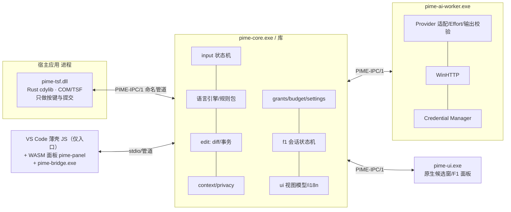
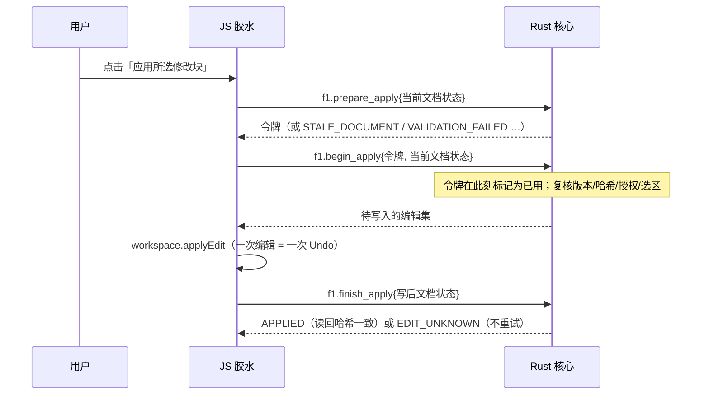

# 纯 Rust 化路线图（RUST-MIG-001，草案 v0.1，2026-10-30）

> 状态：**设计草案**。第 1 阶段方案（逻辑迁入 Rust，JS 退化为胶水）已由项目负责人**暂定同意**；第 2 阶段起的方案是设计，尚未实现，
> 其中带「待决策」标记的事项需要确认后才能开工。本文不修改 `00_Documents/` 的原始设计文件；需要改动设计书的地方见第 11 节。
>
> **决策记录**：2026-10-30 项目负责人选定「纯 Rust」为 **B 档**（见 1.2）：webview 页面也由 Rust 编译成 WASM 生成；
> 扩展入口的 JS 薄壳因 VS Code 宿主限制仍然存在。由此新增的子决策见第 10 节第 8、9 项。
> 所有工作量只用相对规模（S/M/L/XL）表示，是估计而不是承诺。

## 0. 结论摘要

1. 最终目标是**产品代码纯 Rust**。VS Code 扩展宿主只能运行 JavaScript，所以「一行 JS 都没有」对 VS Code 桥接**不可能**；可行的最严格形式是
   「手写 JS 只剩扩展入口这一个不含任何业务逻辑的薄壳（有行数上限和 CI 检查），其余全部是 Rust」。已选定 **B 档**（见 1.2）：
   在此基础上，webview 页面也由 Rust 编译为 WASM，不再有手写的页面 JS/HTML（仅有 wasm-bindgen 生成的加载代码和一个极小的引导片段）。
2. 路线分七步：**P0 准备 → P1 纯逻辑迁入 Rust（已暂定）→ P2 Rust AI Worker（HTTPS + 凭据）→ P3 命名管道 IPC → P4 Rust 版 TSF 与原生候选窗 → P5 安装器 → P6 VS Code 壳最小化**。
3. P1 不引入任何第三方依赖，联网仍由 JS 发送（Rust 构造请求、校验响应）。P2 才需要放宽依赖策略（见 6）。
4. 每一步都必须让 **24 个 Playwright UAT 保持全绿**，作为迁移不改变用户可见行为的回归门槛。
5. TSF（P4）和安装器（P5）需要 Windows 11 虚拟机 + MSVC 才能验证，这台开发机不具备，是最大的外部前置条件。

## 1. 目标与定义

### 1.1 为什么

- 设计书（DD §0、SRS §3）本来就规定：输入引擎、状态机、IPC、AI Worker、TSF 适配都是 Rust 组件；v0.2 里 JS 与 Rust 两份实现靠夹具对齐，维护成本是 2 倍。
- TSF 在输入线程内运行：崩溃或内存安全问题会拖垮宿主应用，Rust（`#![forbid(unsafe_code)]` 的核心 + 极小的 FFI 面）是合适的语言。
- 密钥只应由 Worker 通过 Windows Credential Manager 接触（FR-018/NFR-501）；当前 JS 方案把密钥放在扩展宿主进程里，是过渡形态。

### 1.2 「纯 Rust」的三档定义（**已决策：B 档**）

| 档位 | 含义 | 可行性 | 评价 |
|---|---|---|---|
| A | 所有业务逻辑、协议、状态、安全决策都在 Rust；VS Code 里保留无逻辑的薄壳：`package.json` + 一个转发 VS Code API 的 JS 入口 + 一个只渲染 JSON 视图模型的**手写**静态 webview 页面 | 可行，P1 可达 | 之前的推荐方案 |
| **B（已选）** | 在 A 的基础上，webview 页面由 Rust 编译成 WASM（`wasm32-unknown-unknown` + wasm-bindgen）生成，仓库里没有手写的页面 JS/HTML；扩展入口 JS 仍必须存在 | 可行；需要 wasm 工具链和 webview 的 CSP 放行 WASM（见 4.P6） | 手写 JS 降到最低；代价是多一套 wasm 构建与依赖 |
| C | 完全没有 VS Code 扩展：只做原生 TSF + 原生候选窗；VS Code 作为普通宿主，只有 L1（附近文本）能力 | 技术上可行 | **失去**未保存缓冲区、版本哈希、WorkspaceEdit 事务和 Undo 单步撤销，即 F1 整文件路径（FR-014/033/036/037）不可用，与 SRS 冲突 |

**B 档的边界（如实说明）**：
1. **扩展入口的 JS 无法消除**：VS Code 通过加载 `main` 指向的 JavaScript 文件来激活扩展，`package.json` 清单也是 JSON。它们属于「VS Code 要求的宿主接口」，不算业务代码。
2. wasm-bindgen 会**生成**加载用的 JS 胶水；它是构建产物（不手写、不审阅逻辑、由构建脚本重新生成，可不入库），在统计时单独标注为「生成代码」。
3. 在 webview 里实例化 WASM 需要一小段引导脚本（≤ 15 行，只做 `import` 与 `init()`），并要求 CSP 的 `script-src` 增加 `'wasm-unsafe-eval'`；这是 B 档新增的安全面，需要在 P6 的安全审查中单独评估。

**硬规则**（P1 起生效，P6 收紧）：手写 JS 里**不得**出现语言/语法规则、校验、哈希、Diff、授权、预算、密钥扫描、Effort 协商、错误码映射、界面文案内容。
只允许：VS Code API 调用、定时器、HTTP 发送（P2 之前）、子进程与帧读写，以及（P1 期间）把 Rust 返回的视图模型渲染出来——P6 起渲染也由 WASM 完成。

### 1.3 非目标

不重写 VS Code；不在 Rust 里实现 TLS 协议栈（见 P2 的方案比较）；不改变 SRS 需求范围；不降低任何已通过的安全不变量（第 8 节）。

## 2. 现状盘点（2026-10-30）

| 区域 | 语言 | 规模 | 去向 |
|---|---|---|---|
| 语言包（数据） | JSON | 7 个文件 | 保留（数据，Rust 读取） |
| 语言引擎：规则/识别/预测/校验/x86/密钥扫描/UTF-16 范围 | JS + **Rust（已有，逐项一致）** | JS ~1,150 行 / Rust ~8,200 行（全 crate） | JS 版删除，以 Rust 为唯一实现 |
| 上下文快照/摘录、Diff 与 Hunk、事务（Prepare/Apply）、授权、预算、AI 请求构造与输出校验、设置与迁移、调度/历元、诊断、界面文案、UI 模型 | **仅 JS** | ~1,000 行 | **P1 迁入 Rust** |
| F1 流程（会话状态、视图模型、应用） | 仅 JS（`f1.js`、`ui/f1panel.js`） | ~520 行 | 状态机和视图模型迁入 Rust（P1），页面渲染保留（A 档） |
| VS Code 接线（状态栏、命令、内联补全、对话框） | 仅 JS（`extension.js`、`runtime.js`、`languageState.js`、`coreprocess.js`） | ~550 行 | 保留为胶水（P1），P6 压缩 |
| HTTP 发送（fetch）、SecretStorage | JS | 数十行 | P1 保留；P2 迁到 Rust Worker + Credential Manager |
| TSF COM DLL | C++ | 204 行，未编译 | P4 改写为 Rust |
| UAT | JS（Playwright） | 3 个 spec | 作为**外部测试工具**保留，或 P6 后评估换成 Rust CDP 客户端（待决策） |

## 3. 目标架构（最终态）

对应设计书 DD §1.1 的 crate 划分：`pime-contracts`、`pime-core`、`pime-rules`、`pime-context`、`pime-edit`、`pime-ai-worker`、`pime-diagnostics`、`pime-testkit`、
`windows/tsf`（Rust cdylib）、`windows/ui`、`windows/installer`、`editor-bridges/vscode`。当前 `pime-core` 是一个 crate，P1 内部按模块拆分，
P2 起按上述边界拆成 cargo workspace 的多个 crate（拆分不改变行为，由夹具回归保证）。

## 4. 分阶段路线

每个阶段列出：范围、退出条件（可验证）、主要风险、规模、前置环境。

### P0 准备（S）
- **WASM 可行性原型**（B 档）：一个最小 `pime-panel`（显示一个按钮和一段文字）在真实 VS Code webview 里通过 `wasm-unsafe-eval` CSP 加载、与扩展互发消息，并记录首次打开耗时和所需工具版本。失败则回到 A 档（手写页面），其余阶段不受影响。
- 冻结 v0.2 行为：把现有 JS 生成的夹具标记为 `golden-v0.2`（只读），另存一份 UAT 基线（`uat-results.json` + 截图）。
- 写 `cargo xtask`（Rust 脚本）或保持现有 `scripts/*`：一键 `test-all`（Rust 测试 + UAT + 追踪报告）、`glue-check`（5.5）。
- 决策：第 10 节的待决策事项。
- 退出条件：基线冻结并入库；决策记录完成。

### P1 纯逻辑迁入 Rust，JS 只做胶水（L，**已暂定**，详见第 5 节）
- 范围：除 HTTP 发送和 VS Code UI 外的全部逻辑迁入 `pime-core`；协议升到 0.3（有状态会话）。
- 退出条件：
  1. UAT 24/24 在「仅 Rust 引擎」下通过（`src/core` 下无 JS 文件）。
  2. `cargo test --workspace` 全绿，被迁走的 JS 单元测试以**同样的 UT/IT 编号**在 Rust 里重写并通过；`traceability-report` 的覆盖不下降。
  3. JS 行数不超过 5.5 的 P1 上限；`glue-check` 通过。
  4. 没有 JS 回退引擎：核心不可用时扩展显示明确状态并停用 IME 功能，**不影响 VS Code 自身输入**（Direct）。
- 主要风险：协议往返增加延迟（NFR-201：本地候选 P95 ≤ 20 ms、显示 P95 ≤ 50 ms）；密钥过渡暴露（5.7）；迁移期行为漂移。
- 前置：现有环境即可（零依赖）。

### P2 Rust AI Worker：HTTPS + Credential Manager（L）
- 范围：`pime-ai-worker`：Provider 适配、Effort、预算、取消、**HTTPS 发送**、Windows Credential Manager 保存/读取/删除密钥。密钥不再进入 JS 和 Core。
- TLS 方案比较（**待决策**）：

| 方案 | 做法 | 优点 | 缺点 |
|---|---|---|---|
| **A（推荐）WinHTTP/SChannel** | 通过 `windows` crate 调 WinHTTP；证书用系统信任库，代理设置随系统 | 不自己实现 TLS，不引入 ring/aws-lc 的构建脚本；与 Credential Manager 同一依赖；产品本就只面向 Windows | 仅 Windows；异步/取消要自己封装 |
| B rustls | `rustls` + 加密后端 | 跨平台、纯 Rust 生态 | 依赖多且带构建脚本（本机无法构建，需在 CI/虚拟机构建）；证书/代理要自己处理 |
| C 保留 JS fetch | 不迁移 | 零工作量 | 不满足「纯 Rust」，密钥继续留在 JS，不符合 FR-018 设计 |

- 退出条件：UAT 在 Worker 下通过（Mock 供应商，自签名证书需要为测试配置信任，不放宽产品默认）；扫描确认密钥不出现在扩展宿主进程内存之外的任何路径；强杀 Worker 后输入不受影响（IT-042/ST-037 的 Worker 部分）。
- 风险：依赖引入（供应链）；WinHTTP 的取消/超时语义；Anthropic/OpenAI 兼容端点的差异。
- 前置：能构建 `windows` crate 的机器（MSVC 或 gnu 工具链 + 无构建脚本限制）。**待验证**：`windows`/`windows-sys` 在本机是否能构建（本机无法执行依赖的构建脚本；这两个 crate 近年不依赖构建脚本，但未在本机验证）。

### P3 命名管道 IPC `PIME-IPC/1`（M）
- 范围：`pime-ipc`：长度前缀帧、协议版本、按用户 SID 的 ACL、握手（challenge-response）、能力令牌、超时（DD §2.1）。替换 stdio；Core↔Worker↔UI↔TSF↔VS Code 壳统一走它。
- 退出条件：IT-003（身份认证：同 SID 合法、异 SID/重放被拒）、IT-004/ST-037（Core 被挂起/强杀后 Direct ≤ 2 s）在 VM 上通过。
- 风险：Win32 命名管道与 ACL 需要少量 `unsafe` FFI（隔离在 `pime-ipc`/`windows` crate 内，核心 crate 仍 `forbid(unsafe_code)`）。
- 前置：Windows 11 VM。

### P4 Rust 版 TSF 与原生候选窗（XL）
- 范围：`windows/tsf` 用 Rust 重写：`ITfTextInputProcessorEx`、`ITfKeyEventSink`、组合与提交（编辑会话）、三语言 Profile 注册；TSF 回调内**不做**网络/磁盘/等待 AI（DD §1.1 规则 1）；原生候选浮层/语言下拉（`pime-ui.exe`，Win32 + Direct2D，DPI 感知，多屏回退）。
- 退出条件：**G0**：三种系统语言下选择、激活、输入成功（ST-001..005），原输入法与默认设置不受影响；安全输入框零采集（IT-005）；TSF 故障保持 Direct。
- 风险：宿主兼容性（不同应用对 TSF 范围的暴露不同）；候选窗定位；这是整个项目**不确定性最大**的一步，也是 v0.1 以来一直未验证的缺口。
- 前置：Windows 11 VM、MSVC、Windows SDK、测试签名证书。

### P5 安装器与签名（L）
- 范围：`windows/installer`：注册/卸载 COM 与三个 Profile（只动本产品 GUID，UT-002/061 已有 Rust 计划生成器）、文件部署、回滚、升级迁移；签名流程。
- 形态（**待决策**）：Rust 自包含安装器（推荐，保持纯 Rust）/ MSI（需要 WiX，打包层非 Rust）。签名用 `signtool`（外部工具，不是产品代码）。
- 退出条件：ST-035（新装/修复/升级/卸载/重启，失败可回滚）；FR-048。

### P6 VS Code 壳最小化 + WASM 页面（L，B 档）
- 范围：
  1. 新 crate `pime-panel`（`cdylib`，目标 `wasm32-unknown-unknown`）：消费 P1 定义的**视图模型 JSON**（5.8），用 `web-sys` 直接操作 DOM（面板很小，**不引入** Yew/Leptos 等框架，减少依赖；框架选择见第 10 节第 8 项），把用户操作转成消息发回扩展。页面保持 textContent 渲染、无远程资源。
  2. 构建：`wasm-bindgen` 生成 `pime_panel.js` + `pime_panel_bg.wasm`；构建脚本负责生成并放进 VSIX 的 `media/`，webview 通过 `webview.asWebviewUri` 加载，`localResourceRoots` 只开放该目录。
  3. CSP：`default-src 'none'; script-src 'nonce-…' 'wasm-unsafe-eval'; style-src 'nonce-…'`；引导脚本 ≤ 15 行（`import init from …; init();`），不含逻辑。
  4. 手写 JS 压缩到 5.5 的最终上限（只剩扩展入口）；打包 `pime-bridge.exe`（或直接 `pime-core.exe`）随 VSIX 分发（按平台）。
  5. 可选（**待决策**，第 10 节第 9 项）：把整个桥接逻辑也编译成 WASM 在扩展宿主内运行，从而不再需要子进程；VS Code API 仍须由 JS 导入提供，增加的只是一层绑定，是否值得取决于性能和调试体验。
- 退出条件：`glue-check` 通过最终上限（手写 JS 仅扩展入口；页面无手写 JS/HTML）；UAT 24/24（其中 F1 面板场景覆盖 WASM 页面）；VSIX 在干净环境可安装运行；webview 的 CSP 放行范围只增加 `'wasm-unsafe-eval'` 且有安全评审记录。
- 主要风险：webview 内 WASM 的加载路径与 CSP 细节；wasm 体积与启动延迟（F1 面板首次打开）；`wasm-bindgen` CLI 与 `wasm32` 目标需要额外工具链。

## 5. 第 1 阶段详细设计（已暂定）

### 5.1 模块映射（JS → Rust）

| JS 模块（`editor-bridges/vscode/src/…`） | Rust 去向 | 说明 |
|---|---|---|
| `core/errors.js` | `error.rs`（已有）| 错误码全集与 `PimeError` 元数据对齐 |
| `core/textrange.js`、`x86.js`、`validators.js`、`secrets.js`、`languages.js` | **已迁入**（`textrange.rs`、`x86.rs`、`validators.rs`、`secrets.rs`、`pack/predict/resolve.rs`）| 删除 JS 版 |
| `core/context.js` | `context.rs`（新）| 快照、L0–L4 能力表、摘录；需要 **SHA-256**（零依赖自实现，≈100 行，用标准测试向量验证）|
| `core/diff.js` | `edit/diff.rs`（新）| 行级 LCS Hunk、重放、渲染模型 |
| `core/transaction.js` | `edit/transaction.rs`（新）| Prepare/Apply、一次性令牌、读回校验、EDIT_UNKNOWN 终态 |
| `core/grants.js` | `grants.rs`（新）| 授权代理；工作区令牌哈希 |
| `core/ai.js` | `ai/*.rs`（新）| Provider 适配（构造请求/解析响应）、Effort 协商、预算、错误映射、输出校验、提示构造；**不含 HTTP 发送** |
| `core/scheduler.js` | `session.rs` + `sched.rs`（新）| 历元与锁、去抖判定（注入时钟）、Direct 监督；**定时器本身留在 JS** |
| `core/settings.js` | `settings.rs`（新）| 有效设置、校验、迁移、原子写入、用户规则加载 |
| `core/i18n.js` | `i18n.rs`（新）| 文案表；JS 一次性获取 `ui.bundle(locale)` 缓存（数据，不是逻辑）|
| `core/diagnostics.js` | `diag.rs`（新）| 白名单脱敏 |
| `core/uimodel.js` | `uimodel.rs`（新）| 候选行语义、浮层定位、环境检查 |
| `f1.js`（流程/状态/视图模型）| `f1.rs`（新）| DD §9.1 状态机；输出面板视图模型 JSON；JS 只负责弹窗、转发点击、执行写入 |
| `extension.js`、`runtime.js`、`languageState.js`、`coreprocess.js`、`ui/f1panel.js` | **保留为胶水** | 见 5.5 |

### 5.2 状态归属

Rust 核心进程持有全部会话状态：历元、锁、快照（文本只在核心内存里，JS 不重复传输）、F1 会话、计划与令牌、授权、预算、冷却、诊断。
JS 不保存任何需要判断的状态；它只持有 VS Code 对象（编辑器、面板、状态栏项）。

### 5.3 协议 0.3（在 0.2 的帧和 `id` 基础上扩展；新增操作）

| 操作 | 请求要点 | 响应要点 |
|---|---|---|
| `session.open` | `locale`、`entropy`（32 字节，JS 的 `crypto.randomBytes`；P2 起改用系统随机数）、初始设置 | `session`、`protocol:"0.3"` |
| `settings.apply` | VS Code 配置值（providers/scenarios/budget/dialects…）| 有效设置、问题列表 |
| `lang.state` / `lang.lock` / `lang.unlock` | 文档标识（uri 的哈希）、languageId、文件名、头部文本 | 解析结果、方言、历元 |
| `lang.predict`（已有，扩展）| 增加 `session` | 候选（已有字段）|
| `ctx.snapshot` | uri、version、text、selection、languageId、dirty、fileName | `snapshot_id`、sha256、eol、level |
| `privacy.assess` / `privacy.redact` / `privacy.restore` | `snapshot_id` 或文本、范围 | 动作、发现项（不含值）、占位符映射留在核心 |
| `grant.authorize` / `grant.check` / `grant.revoke` / `grant.list` | 提供方+主机、工作区令牌、范围、期限 | 授权 id / 结果 / 列表 |
| `ai.prepare` | 场景、`snapshot_id`、意图、授权 id、（P1 过渡）密钥 | `request_id`、`http{url,headers,body}`、超时 |
| `ai.complete` / `ai.abort` | `request_id`、HTTP 状态/响应头/正文 或 传输错误码 | 解析后的结果或错误码、Effort 说明、用量 |
| `f1.begin` / `f1.generate` / `f1.result` / `f1.toggle_hunk` / `f1.view` | 标签、勾选、意图 | 面板视图模型 JSON |
| `f1.prepare_apply` / `f1.begin_apply` / `f1.finish_apply` / `f1.invalidate` | 当前文档状态（uri、version、text、selection）、写后状态 | 令牌、待写入的编辑集、APPLIED/EDIT_UNKNOWN/STALE_* |
| `sched.touch` / `sched.is_current` | 输入键（seq、历元）| 是否应发送、是否过期 |
| `diag.record` / `diag.summary` / `ui.bundle` / `ui.text` | — | — |

### 5.4 关键流程：整文件应用（把「令牌先标记已用再写入」保留在 Rust）

AI 请求同理：`ai.prepare` → JS 执行 `fetch`（超时/取消由 JS 的 `AbortController` 驱动并回报）→ `ai.complete`。

### 5.5 JS 胶水白名单与上限

允许：VS Code API 调用；定时器；HTTP 发送；子进程与 JSONL 帧；把视图模型渲染成 DOM；把用户点击转发给核心。
禁止：第 1.2 节列出的所有判断类逻辑。

| 指标 | 现在 | P1 上限 | P6 最终上限（B 档）|
|---|---|---|---|
| 手写 JS 总行数（不含测试）| ~2,750 | **≤ 700**（含手写 webview 页面）| **≤ 150**（只有扩展入口）|
| 手写 webview 页面 JS/HTML | ~170 行 | 保留（≤ 170 行，只渲染视图模型）| **0**（WASM 页面 + ≤ 15 行引导）|
| 生成的 JS（wasm-bindgen 产物）| 无 | 无 | 单独统计，不入库或标注 `generated`，不计入手写上限 |
| `src/core/` 下 JS 文件 | 15 | **0** | 0 |
| 业务逻辑检测（`glue-check` 禁用标识：`createHash`、`RegExp` 用于语言规则、`sha256`、`JSON.parse` 用于模型输出…）| 不适用 | 0 处 | 0 处 |

`glue-check` 是一个检查脚本（P0 编写，最终用 Rust `xtask` 实现），在测试流水线里强制执行；B 档下它还要校验「手写 JS 文件清单」只含白名单文件。

### 5.6 步骤切分（每一步结束时整个系统都是绿的，可在任意步骤停下）

| 步骤 | 内容 | 本步验收 |
|---|---|---|
| 1.0 | 协议 0.3 骨架：`session.open`、`settings.apply`；扩展增加 `programmingIme.engine`（`js`｜`rust`，默认仍 `js`）；UAT 支持用 Rust 二进制运行 | 两种模式下 UAT 24/24 |
| 1.1 | SHA-256、`context`、`diff`、`transaction`、`grants`、预算计账 入 Rust；F1 的写入路径走 Rust | Rust 同编号单测 + UAT（Rust 模式）|
| 1.2 | `ai` 请求构造/解析/Effort/错误映射/输出校验/脱敏还原 入 Rust；JS 仍发送 HTTP | 同上 + UAT-20/21/26..31 |
| 1.3 | 会话历元/锁/去抖判定、设置迁移与原子写入、诊断、i18n、uimodel 入 Rust | 同上 + UAT-01..08/33..35 |
| 1.4 | F1 会话状态机与视图模型入 Rust；面板只渲染 | 同上 + UAT-22..25 |
| 1.5 | 差分验证（同一输入在 JS 与 Rust 上逐项比对，覆盖 1.1–1.4 的全部操作）后，**删除 JS 核心模块与其单测**；默认引擎切为 Rust；去掉 JS 回退 | UAT 24/24（仅 Rust）|
| 1.6 | `glue-check`、文档、面板视图模型契约 `schemas/f1-view-v1.json`（5.8）、二进制随扩展分发的方式（5.9）| 退出条件 1–4 |

### 5.7 过渡期密钥处理（必须如实记录）

P1 期间 JS 仍从 SecretStorage 读取密钥并交给 Rust 的 `ai.prepare`，Rust 把它放进返回的 `http.headers`，再由 JS 发送。这意味着密钥短暂经过 JS 与管道。
缓解：不落盘、不进日志（诊断白名单）、请求结束即丢弃；UAT-20 的磁盘扫描继续有效。该暴露在 P2（Worker + Credential Manager）结束。

### 5.8 面板视图模型契约（P1 定义，P6 的 WASM 页面消费同一份）

为了让 B 档的页面能在 P6 直接替换，P1 就把面板的数据契约固定下来，而不是让手写页面和核心之间靠隐含约定：

- 契约 = `schemas/f1-view-v1.json`（JSON Schema）+ Rust 侧的 `ViewModel` 类型（`serde` 不可用，仍用自带 `json` 模块序列化）。
- 内容：当前标签、各标签状态（idle/loading/ready/error/unavailable）、消息与注记、Hunk 列表（id、标题、带 `+`/`-` 文本标记的行、是否选中）、结果预览与哈希、校验结论、可否应用、目标位置文本、候选列表、用量文本、横幅、i18n 文案包。
- 上行消息契约：`generate`、`regenerate`、`toggleHunk`、`openDiff`、`applyFull`、`applyInsert`、`cancel`、`tab`。
- P1 的手写页面和 P6 的 WASM 页面都只依赖这份契约；UAT 里已有的选择器（`#generate`、`#panel-full .status`、`fieldset.hunk`、`#apply-full` 等）作为 DOM 契约保留，保证替换页面后 UAT 不改。

### 5.9 二进制分发与降级

扩展随包携带 `pime-core.exe`（P1 先要求用户在 `programmingIme.coreExecutable` 指定或从构建目录加载；P6 随 VSIX 打包并校验哈希）。
核心不可用时：状态栏显示不可用原因，IME 功能停用，VS Code 的普通输入不受影响（不再有 JS 回退引擎）。这改变了 v0.2 的“JS 兜底”行为，需要在升级说明里写明。

## 6. 依赖与工具链策略

- **P1**：零第三方依赖不变（核心可审计，且本机无法运行依赖的构建脚本）。
- **P6（B 档新增）**：需要 `wasm32-unknown-unknown` 目标、`wasm-bindgen`（库与 CLI，版本必须一致）、`web-sys`/`js-sys`。这些是浏览器侧的最小集合，只用于 `pime-panel`，**不进入**核心、Worker、TSF 的依赖图（用 cargo workspace 的独立成员隔离，并由 `cargo tree` 检查）。`wasm-bindgen` 本身及其依赖是否带构建脚本、能否在本机构建**未验证**，需要在 P0 做一次可行性验证。
- **P2 起**：仅允许 Microsoft 官方的 `windows` / `windows-sys`（用于 WinHTTP、Credential Manager、命名管道、TSF/COM）；每个新增依赖要有决策记录（用途、替代方案、体积、是否有构建脚本、许可证）。接受 `cargo deny`/`cargo vet` 之类的供应链检查（**待决策**具体工具）。
- 构建环境：P2–P5 需要能构建 `windows` crate 的机器（MSVC 或可用链接器）。本开发机的限制（带构建脚本的依赖无法执行）只影响本机，不应成为设计约束；建议在 Windows 11 VM/CI 上构建这些阶段。
- 核心 crate 保持 `#![forbid(unsafe_code)]`；所有 `unsafe` 隔离在 `pime-ipc`、`windows/tsf`、`windows/ui`、`pime-ai-worker` 的 FFI 边界，并逐处注释安全前提。

## 7. 测试与证据延续

1. **UAT 是迁移的回归门槛**：每个步骤结束都跑 24 个场景；P1 末以后只在 Rust 引擎下跑。
2. **夹具**：`tests/fixtures/*.json` 是 JS 引擎生成的 `golden-v0.2`。JS 删除后它们转为只读黄金文件，由 Rust 的 `tests/parity.rs` 继续校验；今后的行为变更必须显式更新夹具并说明原因。
3. **单测迁移**：JS 单测按同样的 UT/IT 编号在 Rust 里重写；`scripts/traceability-report.js`（P6 前可保留，之后改为 Rust xtask）继续出报告，**覆盖编号数不得下降**。
4. **差分验证**：1.5 步用同一批输入（夹具 + 随机输入）同时跑 JS 与 Rust，零差异后才删除 JS。
5. 性能：`UT-068` 基准在迁移后重测，协议往返计入；NFR-201 的口径不变。
6. P3–P5 增加 VM 上的系统测试（G0、ST-001..005/035/037），用例编号沿用设计书。

## 8. 迁移期间不得退化的不变量

- 未授权不发送；AI 关闭时请求数为 0；高风险敏感内容未经显式确认不出站（最后一道闸）。
- 写入只经 Prepare/Apply：确认、版本+哈希复核、令牌先标记已用、读回校验、`EDIT_UNKNOWN` 不重试、一次编辑一次 Undo。
- 模型输出是数据：未知字段被忽略，跨文件修改被拒绝，不执行任何命令。
- 诊断只含白名单元数据；密钥不进设置、日志、诊断、崩溃输出。
- 核心/Worker 故障时输入保持可用（Direct）。

## 9. 风险登记

| 风险 | 影响 | 缓解 |
|---|---|---|
| 协议往返拉高候选延迟 | NFR-201 不达标 | 候选路径保持同步单次往返；批量/缓存；基准在每步重测；必要时核心内联为库 |
| 迁移期行为漂移 | 回归 | UAT 门槛 + 夹具 + 差分验证；步骤可在任意处停下 |
| TSF/Windows 环境不可得 | P4/P5 无法验证 | 在 P0 就确定 VM/CI；P1–P3 不依赖 |
| 依赖引入（P2）带来的供应链与构建问题 | 安全/可构建性 | 依赖策略 6；优先 WinHTTP；构建在 CI |
| JS 回退被删除后核心不可用 | 用户失去候选 | 清晰降级提示；VSIX 内置二进制并校验；输入不受影响 |
| 过渡期密钥经过 JS | 暴露面 | 5.7；P2 结束 |
| 「纯 Rust」被理解为零 JS | 目标无法达成 | 1.2 的明确定义（B 档，扩展入口 JS 不可消除）与 CI 强制 |
| webview 内 WASM：CSP 需放行 `'wasm-unsafe-eval'`，加载路径与首次启动延迟 | 增加页面攻击面、F1 面板首开变慢 | 只放行该指令并做安全评审；`localResourceRoots` 仅开放 `media/`；P0 做可行性原型并测首开耗时 |
| wasm 工具链（`wasm-bindgen` CLI 与库版本必须一致、构建脚本） | 构建不稳定、本机可能无法构建 | 工具版本钉死；在 CI/VM 构建；产物校验哈希 |

## 10. 待你决定的事项

1. ~~「纯 Rust」选哪一档~~ → **已决策：B 档**（2026-10-30）。
2. **P2 的 TLS 方案**：WinHTTP（推荐）/ rustls / 暂留 JS。
3. 是否同意 **P2 起引入 `windows`/`windows-sys` 依赖**，以及用什么做供应链检查。
4. **安装器形态**（P5）：Rust 自包含安装器 / MSI(WiX)。
5. **UAT 工具**：Playwright 作为外部测试工具长期保留，还是 P6 后换 Rust CDP 客户端。
6. **VS Code 桥接的长期地位**：与原生 TSF 并重，还是 TSF 稳定后降为可选适配器。
7. **Windows 11 VM + MSVC + 测试证书**何时能提供（决定 P3–P5 的开工时间）。
8. **WASM 页面的实现方式**（B 档引出）：`web-sys` 直接操作 DOM、零框架（推荐：面板很小，依赖最少）/ Yew / Leptos。
9. **是否把整个桥接逻辑也编译成 WASM 在扩展宿主内运行**（省掉子进程，但调试体验、性能和 VS Code API 绑定层要评估；默认不做，保留 `pime-bridge.exe`/`pime-core.exe` 子进程）。
10. **P0 的可行性验证何时做**：wasm 工具链能否在本机/CI 构建、WASM 页面在 webview 里加载并通过 CSP、首次打开耗时。

## 11. 对设计书的变更建议（不在本次修改 `00_Documents/`）

- DD §1.1：增加 `pime-bridge`/`pime-ipc`/`pime-ui` 的 crate 说明；明确 VS Code 桥接在 A 档下的 JS 壳边界。
- DD §2：保留 `PIME-IPC/1` 命名管道设计；在 P3 之前，v0.2/P1 使用 stdio JSON Lines 协议 0.2/0.3（仅限同机受信子进程）。
- DD-05：记录 P1 的密钥过渡路径与 P2 的目标路径。
- DD-12：测试夹具与 UAT 作为迁移回归门槛。
- 若批准，再统一出 DD v1.1 与追踪表更新，并保持 FR/NFR → DD → 测试 的追踪链。

## 12. 相对规模一览

| 阶段 | 规模 | 外部前置 |
|---|---|---|
| P0 准备 | S | 决策 |
| **P1 逻辑迁入（已暂定）** | L | 无 |
| P2 AI Worker | L | 能构建 `windows` crate 的环境 |
| P3 命名管道 IPC | M | Windows 11 VM |
| P4 TSF + 原生 UI | XL | VM + MSVC + SDK + 测试证书 |
| P5 安装器与签名 | L | 同上 + 签名证书 |
| P6 VS Code 壳最小化 + WASM 页面（B 档）| L | wasm 工具链（P0 验证）|

执行顺序：P0 → P1 → （P2 可与 P3 并行）→ P4 → P5 → P6。P1 完成后即可发布「JS 仅胶水」的版本，P4/P5 完成才是真正的系统输入法。
